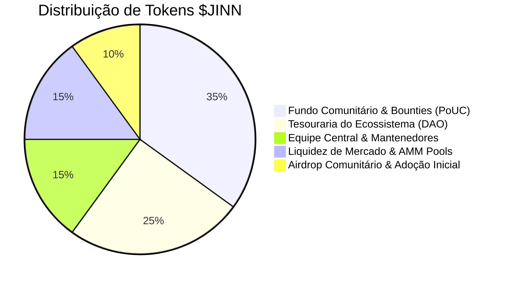
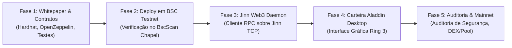

# JINN NETWORK TOKEN ($JINN) — PROPOSTA ARQUITETURAL E ECONÔMICA (WHITEPAPER V1.0)

**Documento:** Proposta Oficial de Engenharia Econômica, Governança e Integração Web3  
**Ativo:** $JINN (Jinn Token)  
**Padrão Técnico:** BEP-20 (BNB Smart Chain / EVM)  
**Versão:** 1.0.0 (Consolidada)  
**Data:** Novembro de 2026  
**Status:** Especificação Arquitetural e Proposta de Implementação Técnica

---

## 1. Visão Geral e Propósito

O **Jinn OS** é um microkernel x86_64 moderno, minimalista e preemptivo escrito em Rust do zero, projetado para sustentar uma família multissistema de computação (Aladdin Desktop, Simbad Server e Ifrit Industrial). 

Para consolidar um ecossistema autossustentável, descentralizado e de escala global, o projeto introduz o **$JINN**, o ativo cripto nativo da rede Jinn.

O $JINN é concebido como um **token de utilidade técnica (Utility Token), infraestrutura e governança de desenvolvimento**, desenhado especificamente para:
1. **Financiar a pesquisa contínua e o desenvolvimento soberano** do kernel e de suas manifestações (Aladdin Desktop, drivers de hardware, pilha de rede e sistemas de arquivos).
2. **Recompensar programadores e pesquisadores de sistemas** via *Proof of Useful Contribution* (PoUC) através de bounties automatizadas por código verificado e auditorias.
3. **Servir como meio transacional e de liquidação no ecossistema**: pagamentos no repositório de aplicativos do Aladdin Desktop, registro em repositórios descentralizados e taxas de microsserviços.
4. **Habilitar a camada DePIN (Decentralized Physical Infrastructure Networks)**: monetização e aluguel de processamento distribuído (JDA Engine) e armazenamento descentralizado nos nós Simbad e estações Aladdin.
5. **Governança Comunitária Técnica (KIP - Kernel Improvement Proposals)**: direcionamento das prioridades de roadmap, suporte a novas arquiteturas (ARM64, RISC-V) e liberação de subsídios da tesouraria.

---

## 2. Escolha da Rede: BNB Smart Chain (BSC)

O token $JINN adota o padrão **BEP-20 na BNB Smart Chain (BSC)** devido a vantagens estratégicas indispensáveis para um sistema operacional:

- **Ultra-baixas taxas de transação (< $0.03):** Viabiliza micro-recompensas para contribuidores e micropagamentos de serviços no desktop sem fricção de gás.
- **Alta vazão e finalização rápida (~3 segundos por bloco):** Essencial para interação ágil com aplicativos no Aladdin Desktop e validação de transações no userspace.
- **Compatibilidade total com o ecossistema EVM:** Facilita integração com bibliotecas de ponta em Rust (`ethers-rs`, `alloy`), wallets de mercado (MetaMask, Trust Wallet, Ledger) e infraestrutura de oráculos e DEXs (PancakeSwap).
- **Caminho nativo para Testnet (BSC Chapel Testnet):** Ambiente completo e gratuito para homologação de contratos, testes de estresse e prototipagem no desktop antes de qualquer lançamento em Mainnet.

---

## 3. Parâmetros e Tokenomics

### 3.1. Especificações Técnicas do Ativo

| Parâmetro | Valor |
|---|---|
| **Nome** | Jinn Network Token |
| **Símbolo / Ticker** | **$JINN** |
| **Padrão** | BEP-20 (compatível com ERC-20 / EVM) |
| **Decimais** | 18 |
| **Suprimento Total (Max Supply)** | **1.000.000.000 $JINN** (1 Bilhão fixo e imutável) |
| **Capacidade de Mint Arbitrário** | **Desativada** (Hard Capped no contrato de deploy) |
| **Mecanismo de Queima (Burn)** | Suportado (BEP-20 Burnable para taxas de serviços e deflação programada) |
| **Permit (EIP-2612)** | Habilitado (Aprovações sem gás com assinatura criptográfica) |
| **Pausa de Emergência** | Suportada via Governança Multi-Sig (Circuit Breaker temporário) |

---

### 3.2. Distribuição e Alocação do Suprimento

A distribuição do suprimento total de 1.000.000.000 $JINN foi desenhada para priorizar o desenvolvimento de longo prazo, a segurança da liquidez e o incentivo à comunidade:

```
┌────────────────────────────────────────────────────────────────────────┐
│                        ALOCAÇÃO TOTAL: 1 BILHÃO $JINN                   │
├────────────────────────────┬─────────────┬─────────────────────────────┤
│ Destinação                 │ Percentual  │ Quantidade                  │
├────────────────────────────┼─────────────┼─────────────────────────────┤
│ 1. Fundo Comunitário & PoUC │ 35%         │ 350.000.000 $JINN           │
│ 2. Tesouraria do Ecossistema│ 25%         │ 250.000.000 $JINN           │
│ 3. Mantenedores & Core Dev │ 15%         │ 150.000.000 $JINN           │
│ 4. Provisão de Liquidez DEX │ 15%         │ 150.000.000 $JINN           │
│ 5. Airdrop & Lançamento     │ 10%         │ 100.000.000 $JINN           │
└────────────────────────────┴─────────────┴─────────────────────────────┘
```



---

### 3.3. Cronograma de Liberação e Vesting (Proteção Antidump)

Nenhum token da equipe ou tesouraria é disponibilizado no primeiro dia. Todos os tokens institucionais e de desenvolvimento seguem contratos inteligentes de vesting lineares e transparentes:

| Categoria | TGE (Desbloqueio Inicial) | Carência (Cliff) | Período de Vesting Linear |
|---|---|---|---|
| **Comunidade & PoUC (35%)** | 5% no TGE (17.5M) | 0 meses | 48 meses de liberação proporcional a marcos de código e bounties |
| **Tesouraria DAO (25%)** | 0% no TGE | 12 meses | 36 meses de liberação linear contínua controlada por Multi-Sig |
| **Core Dev & Fundadores (15%)**| 0% no TGE | 12 meses | 36 meses de liberação linear mensal (bloqueio contratual em `JinnVesting.sol`) |
| **Liquidez & Market Making (15%)**| 100% no TGE | N/A | Bloqueio de liquidez (LP Tokens) em cofre verificado (PinkLock/Unicrypt) por 24 meses |
| **Airdrop & Adoção (10%)** | 20% no TGE | 1 mês | 6 meses para distribuidores de nós, primeiros testadores da ISO e assinantes do CLA |

---

## 4. Pilares de Utilidade no Ecossistema Jinn OS

O $JINN não é apenas um token especulativo; ele possui integração direta com o funcionamento técnico dos sistemas do ecossistema:

### 4.1. Proof of Useful Contribution (PoUC) & Bounties de Kernel
- Contribuidores que submetem drivers de dispositivos (NVMe, AHCI, Wi-Fi, Intel/Realtek NICs), aprimoramentos no escalonador preemptivo, módulos do Aladdin Desktop ou otimizações no Jinn Browser recebem recompensas automáticas em $JINN após aprovação do PR e assinatura do CLA.
- O contrato inteligente `JinnRewardDistributor.sol` permite o resgate descentralizado das recompensas mediante Merkle Proof ou assinatura criptográfica autorizada pelos revisores.

### 4.2. Aladdin App Store & Microtransações de Software
- Usuários do Aladdin Desktop podem comprar aplicativos proprietários, licenças de ferramentas comerciais, temas de interface e serviços integrados utilizando $JINN com taxa zero de intermediação.
- Desenvolvedores que publicam pacotes no ecossistema recebem pagamentos instantâneos direto em sua carteira no userspace.

### 4.3. Rede DePIN (Decentralized Physical Infrastructure) & JDA Compute
- Servidores rodando **Simbad OS** e nós ociosos de **Aladdin Desktop** podem disponibilizar CPU (via escalonador SMP) e armazenamento em bloco (VFS/NVMe) para computação distribuída através do protocolo JDA (Jinn Distributed Architecture).
- Provedores de recursos são remunerados continuamente em $JINN proporcionalmente à CPU e armazenamento comprovadamente fornecidos.

### 4.4. Staking e Nós de Serviço (RPC & Storage Gateways)
- Operadores de nós validadores e gateways de rede que servem conexões Web3 para as máquinas clientes fazem staking de $JINN para garantir confiabilidade de rede, recebendo recompensas de taxa de protocolo.

### 4.5. Governança e KIP (Kernel Improvement Proposals)
- Detentores de $JINN votam em propostas estratégicas de evolução tecnológica: priorização de porte para arquiteturas (x86_64 -> ARM64 Neoverse / Apple Silicon -> RISC-V), alocação de subsídios de pesquisa e parametrização de taxas do ecossistema.

---

## 5. Arquitetura de Integração Técnica e Fronteiras de Segurança

A integridade do sistema operacional e a proteção das chaves dos usuários são premissas fundamentais e inegociáveis.

```
┌────────────────────────────────────────────────────────────────────────┐
│                        ARQUITETURA DE CAMADAS WEB3                     │
├────────────────────────────────────────────────────────────────────────┤
│  CAMADA L3: ALADDIN DESKTOP (Userspace - Ring 3)                        │
│  ┌──────────────────────┐  ┌──────────────────────┐                    │
│  │ Aladdin Wallet (GUI) │  │ Jinn App Store       │                    │
│  │ Visualização de Saldo│  │ Micropagamentos      │                    │
│  │ Assinatura Local     │  │ Resgate de Bounties  │                    │
│  └──────────┬───────────┘  └──────────┬───────────┘                    │
│             │                         │                                │
├─────────────┼─────────────────────────┼────────────────────────────────┤
│  CAMADA L1/L2: SERVIÇO WEB3 USERSPACE (Daemon de Rede e RPC)           │
│  ┌────────────────────────────────────────────────┐                    │
│  │ jinn-web3d (Daemon em Userspace)               │                    │
│  │ - Cliente JSON-RPC EVM (eth_call, eth_sendRaw) │                    │
│  │ - Gerenciador de Keystore Encriptado (AES-GCM) │                    │
│  │ - Validação estrita de ChainID (BSC 56 / 97)   │                    │
│  └────────────────────────┬───────────────────────┘                    │
│                           │ Syscalls de Sockets /dev/net/              │
├───────────────────────────┼────────────────────────────────────────────┤
│  CAMADA L0: KERNEL JINN (Ring 0 - Privilegiado)                        │
│  ┌────────────────────────────────────────────────┐                    │
│  │ Microkernel Jinn                               │                    │
│  │ - Pilha TCP/IP (src/net/tcp.rs, socket.rs)     │                    │
│  │ - Firewall JinnWall (filtragem de portas)      │                    │
│  │ - Isolamento de Memória PML4 (Ring 0 / Ring 3) │                    │
│  │ [!] REGRA DE OURO: ZERO SEED PHRASES OU CHAVES  │                    │
│  │    PRIVADAS TOCAM O KERNEL RING 0!             │                    │
│  └────────────────────────────────────────────────┘                    │
└────────────────────────────────────────────────────────────────────────┘
                                   │ HTTPS / WSS
                                   ▼
          ┌──────────────────────────────────────────────────┐
          │      BNB Smart Chain (BSC Testnet / Mainnet)     │
          │   - JinnToken.sol (BEP-20 Standard)              │
          │   - JinnVesting.sol (Vesting de Tesouraria/Dev)  │
          │   - JinnRewardDistributor.sol (PoUC Bounties)    │
          └──────────────────────────────────────────────────┘
```

### Regras Estritas de Segurança de Sistema:
1. **Isolamento de Chaves Privadas:** Nenhuma semente mnemônica (*seed phrase*) ou chave privada jamais trafega em chamadas de sistema (syscalls) ou estruturas internas do kernel.
2. **Keystore Criptografado em Userspace:** As chaves de carteira são mantidas no disco de usuário (`/home/user/.jinn/keystore.json`), encriptadas com derivação Argon2id e cifra AES-256-GCM.
3. **Resiliência a Falhas de Conexão:** A indisponibilidade de internet ou do nó RPC jamais bloqueia a inicialização do kernel, o login do sistema ou a operação do Aladdin Desktop.
4. **Verificação de Confirmação:** O Aladdin Desktop sempre exibe para o usuário um modal de confirmação explícito com: Destinatário, Montante, Taxa de Gás Estimada e Chain ID antes de qualquer assinatura de transação.

---

## 6. Arquitetura dos Smart Contracts

O conjunto de contratos inteligentes é construído com base nos padrões industriais OpenZeppelin Contracts v5:

### 6.1. `JinnToken.sol`
- Padrão **BEP-20** integral com compatibilidade ERC-20.
- `ERC20Permit`: permite autorizações off-chain assinadas (EIP-2612) para que transações e pagamentos possam ser feitos sem aprovação prévia em transação separada.
- `ERC20Burnable`: permite a qualquer usuário queimar seus próprios tokens e viabiliza mecanismos de deflação para serviços do ecossistema.
- `Pausable`: circuito de emergência acionável exclusivamente pela governança multi-sig em caso de vulnerabilidades identificadas.
- `Ownable2Step`: transferência de posse da administração em duas etapas para prevenir transferências acidentais de administração para endereços inválidos.
- Suprimento fixo emitido na inicialização: 1.000.000.000 unidades (com 18 casas decimais).

### 6.2. `JinnVesting.sol`
- Sistema de vesting linear com carência (cliff) auditável e configurável para a equipe central, desenvolvedores e tesouraria.
- Permite múltiplos beneficiários com agendas independentes.
- Cálculo de liberação segundo a fórmula:
  $$\text{Tokens Liberados} = \begin{cases} 0, & \text{se } t < t_{\text{cliff}} \\ \text{Total} \times \frac{t - t_{\text{início}}}{\text{Duração Total}}, & \text{se } t_{\text{cliff}} \le t < t_{\text{fim}} \\ \text{Total}, & \text{se } t \ge t_{\text{fim}} \end{cases}$$

### 6.3. `JinnRewardDistributor.sol`
- Contrato dedicado à distribuição transparente de recompensas de contribuição (PoUC).
- Suporta verificação via **Merkle Root** (resgates descentralizados eficientes em gás) ou vouchers assinados via **EIP-712** pela comissão técnica de mantenedores do Jinn.

---

## 7. Governança e Custódia da Tesouraria

A governança do projeto adota uma transição estruturada de descentralização progressiva:

1. **Fase Inicial (Fundação e Multi-Sig):**
   - A custódia inicial da Tesouraria e dos contratos administrativos é gerenciada por uma carteira Multi-Sig Gnosis Safe (pelo menos 3 de 5 assinaturas necessárias para qualquer movimentação).
   - Signatários compostos pelos principais arquitetos do kernel e membros técnicos reconhecidos da comunidade open source.
   - Timelock obrigatório de 48 horas em todas as ações administrativas para transparência pública prévia.

2. **Fase Descentralizada (Jinn DAO):**
   - Adoção de votações no Snapshot baseadas em saldo de $JINN.
   - Propostas de Melhoria do Jinn (KIPs) exigem quórum mínimo e deliberação pública no fórum oficial antes de votação on-chain.

---

## 8. Diretrizes Legais, Tributárias e Regulatórias

1. **Classificação como Token de Utilidade (Utility Token):** O $JINN é projetado exclusivamente para utilização funcional dentro da arquitetura tecnológica do Jinn OS e ecossistemas afiliados.
2. **Ausência de Promessa de Rendimentos:** Não há garantia de valorização cambial, lucros passivos, recompra garantida ou divisão de lucros de qualquer natureza. O ativo não representa ação, participação societária ou título financeiro de dívida.
3. **Conformidade Regulatória:** As futuras fases de distribuição observarão rigorosamente o Marco Legal dos Criptoativos no Brasil (Lei nº 14.478/2022 e atos CVM/Bacen) e enquadramentos internacionais pertinentes (como MiCA na União Europeia).
4. **Independência do CLA:** A concessão de tokens por contribuições ao código não substitui o Acordo de Licença de Contribuidor (`CLA.md`) e não transfere direitos proprietários de patentes ou direitos autorais fora das licenças públicas do projeto.

---

## 9. Roadmap de Implementação Web3



1. **Etapa 1 — Especificação & Contratos Inteligentes (Concluída nesta fase):**
   - Publicação da proposta detalhada (`JINN_TOKEN_PROPOSAL.md`).
   - Implementação dos contratos `JinnToken.sol`, `JinnVesting.sol` e `JinnRewardDistributor.sol`.
   - Bateria completa de testes automatizados com Hardhat.
2. **Etapa 2 — Homologação em BSC Testnet (Chapel):**
   - Deploy dos contratos na testnet pública da Binance Smart Chain.
   - Verificação do código-fonte público no BSCScan Testnet.
   - Simulação de claims de recompensas e vesting.
3. **Etapa 3 — Daemon de Integração Userspace (`jinn-web3d`):**
   - Implementação de cliente JSON-RPC leve em Rust utilizando a pilha de sockets existente do Jinn OS (`src/net/socket.rs`).
   - Módulo de consulta de saldo e envio de transações via HTTP POST JSON-RPC.
4. **Etapa 4 — Carteira Gráfica no Aladdin Desktop:**
   - Criação da aplicação de carteira nativa para o desktop Aladdin com os Design Tokens do sistema (`COLOR_ACCENT_PRIMARY`, etc.).
   - Visualização de endereço, saldo em $JINN e histórico de recompensas.
5. **Etapa 5 — Auditoria Externa e Lançamento:**
   - Auditoria de segurança dos smart contracts por empresa especializada de segurança Web3.
   - Formação da liquidez oficial na PancakeSwap com bloqueio de LP.
   - Ativação das bounties automáticas para o repositório do kernel.

---

## 10. Conclusão

A transformação do projeto Jinn em um ecossistema com ativo cripto nativo une o rigor técnico da engenharia de sistemas operacionais em Rust com a transparência e incentivos econômicos da Web3. Com o **$JINN**, garantimos financiamento sustentável, meritocracia para contribuidores e uma infraestrutura moderna de computação descentralizada pronta para o futuro.
