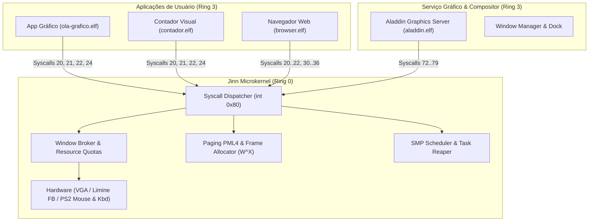

# Aladdin Application Runtime — Arquitetura e Especificação Técnica

> **Projeto Jinn OS & Aladdin Desktop**  
> **Status:** Homologado / Estável  
> **Classificação:** Arquitetura do Sistema e Runtime de Aplicações  
> **Data de Emissão:** 10 de Novembro de 2026  

---

## 1. Visão Geral Executiva

O **Aladdin Application Runtime** constitui a infraestrutura padronizada de execução de aplicações em espaço de usuário (**Ring 3**) sobre o microkernel **Jinn OS** e o ambiente gráfico **Aladdin Desktop**.

Projetado para eliminar dependências de código privilegiado e estruturas internas de kernel, o runtime estabelece uma fronteira de proteção rigorosa baseada em isolamento de memória via tabelas de páginas PML4 dedicadas, execução não-privilegiada (DPL=3) e mediação estrita de recursos através de chamadas de sistema (**Syscalls via `int 0x80`**).



---

## 2. Estratificação de Camadas

A arquitetura do sistema adota um modelo tripartite estrito:

| Camada | Nível de Privilégio | Componentes Principais | Responsabilidades |
| :--- | :--- | :--- | :--- |
| **Ring 0 — Microkernel** | Supervisor (DPL=0) | `src/syscall.rs`, `src/gui.rs`, `src/scheduler.rs`, `src/memory/` | Arbitragem de hardware, escalonamento SMP, isolamento PML4, validação de limites de memória, cotas de tarefas e broker de superfícies. |
| **Ring 3 — Graphics Service** | Usuário (DPL=3) | `apps/aladdin-server`, `AladdinSession`, Window Manager, Dock | Composição de tela, renderização de janelas clientes, detecção de oclusão de wallpapers, animações e despacho de eventos. |
| **Ring 3 — Client Applications** | Usuário (DPL=3) | `apps/ola-grafico`, `apps/contador`, `apps/browser`, `aladdin-sdk` | Lógica de negócio, interfaces interativas, processamento de formulários/renderização de canvas, sem privilégios de I/O de portas ou DMA direto. |

---

## 3. Modelo de Execução e Escalonamento

1. **Tarefas de Usuário Monothread / Multiprocesso:**  
   Cada aplicação executa em um processo isolado dotado de seu próprio PID, espaço de endereçamento virtual único e tabela de descritores de recursos.
2. **Preempção e Cooperação:**  
   As tarefas de usuário estão sujeitas ao escalonador preemptivo baseado no PIT/APIC Timer (100 Hz / quantum de 10 ms). Aplicações interativas podem voluntariamente ceder seu quantum através da chamada `sys_yield()` (`Syscall 3`) ou entrar em suspensão temporizada via `sys_sleep(ms)` (`Syscall 11`).
3. **Loop de Eventos Desacoplado:**  
   Aplicações não realizam *busy spinning* agressivo. O SDK oferece primitivas seguras de polling (`poll_event`) e espera cooperativa (`wait_event` e `wait_event_timeout`), garantindo consumo de CPU de ~0% quando ociosas.

---

## 4. Espaço de Endereçamento e Isolamento de Memória

Cada aplicação de usuário possui um diretório de tabelas de páginas PML4 independente alocado no kernel.

```
+------------------------------------------------------------------+ 0xFFFF_FFFF_FFFF_FFFF
|                                                                  |
|             Kernel Space (Ring 0 — Metade Superior)              |
|             Mapeamento HHDM, Heap de Kernel, MMIO, KDM           |
|                                                                  |
+------------------------------------------------------------------+ 0xFFFF_8000_0000_0000
|                 Buraco Não-Canônico (Gap x86-64)                 |
+------------------------------------------------------------------+ 0x0000_8000_0000_0000 (USER_SPACE_MAX - 128 TiB)
|                                                                  |
|   User Stack (Topo em 0x0000_7FFF_F000_0000, 512 KiB com Guarda)  |
|                                                                  |
|   User Heap Dinâmico (0x0000_2000_0000_0000 .. 0x0000_3000_0000) |
|                                                                  |
|   Segmentos de Dados (.data, .bss, .rodata)                      |
|                                                                  |
|   Segmentos de Código (.text) [USER | PRESENT | NX=0]            |
|                                                                  |
+------------------------------------------------------------------+ 0x0000_0000_0001_0000 (USER_SPACE_MIN - 64 KiB)
|                Página de Guarda Contra NULL Pointer              |
+------------------------------------------------------------------+ 0x0000_0000_0000_0000
```

### Invariantes de Segurança de Memória:
- **NULL Pointer Trap:** Os primeiros 64 KiB (`0x0000` até `0x10000`) permanecem intencionalmente não mapeados. Qualquer desreferenciamento de ponteiro nulo dispara um Page Fault imediato.
- **Política W^X (Write XOR Execute):** Segmentos de código executáveis possuem permissões estritas `USER | PRESENT` e bit `NX` limpo, mas jamais `WRITABLE`. Segmentos de dados e pilha possuem `USER | PRESENT | WRITABLE` e o bit `NX` (No-Execute) forçado a 1.
- **Isolamento de Metade Canônica:** Chamadas de sistema que recebem ponteiros inspecionam se o endereço inicial e o limite final recaem estritamente entre `USER_SPACE_MIN` (64 KiB) e `USER_SPACE_MAX` (128 TiB). Qualquer endereço apontando para a metade superior (espaço de kernel) resulta em rejeição imediata com `-EFAULT`.

---

## 5. Semântica de Buffer e Apresentação Gráfica

A integridade arquitetural exige total transparência sobre os mecanismos de transporte de dados visuais:

### A. Apresentação via Cópia Tamponada (`sys_window_blit` — Syscall 21)
- **Mecanismo:** Ao invocar `sys_window_update` / `sys_window_blit`, o processo de usuário transfere seu buffer linear de pixels para a superfície interna mantida pelo Window Broker no kernel.
- **Semântica:** **Cópia segura de memória** (`copy_from_user` / `slice::copy_from_slice`).
- **Propriedade:** O buffer de usuário permanece sob controle do processo chamador. O kernel valida que o ponteiro é canônico, pertence ao espaço de usuário e possui o tamanho exato de `width * height * 4` bytes.
- **Vantagem:** Isolamento total. O processo cliente pode reaproveitar ou modificar seu buffer local sem causar artefatos na tela antes do próximo ciclo de apresentação (*tear-free*).
- **Esclarecimento:** **Não é zero-copy.** O sistema não reivindica falsamente ausência de cópia onde ocorre transposição em memória física.

### B. Compartilhamento de Superfície Zero-Copy via JDA Shm (`sys_jda_shm_share` — Syscall 26)
- **Mecanismo:** Para buffers de altíssimo rendimento ou vídeo, o processo aloca um handle no pool de memória compartilhada do JDA (`sys_jda_shm_alloc`).
- **Semântica:** **Compartilhamento físico de frames (Zero-Copy)**.
- **Segurança:** O kernel mapeia as mesmas páginas físicas no PML4 do compositor e do cliente, rebaixando permissões para `USER_RO` no consumidor, prevenindo adulteração concorrente durante a renderização.

---

## 6. Governança e Limites de Recursos

Para assegurar estabilidade contra ataques de negação de serviço (DoS) e esgotamento involuntário de recursos por processos mal comportados:

1. **Cota de Janelas por Tarefa:** Cada tarefa possui um limite configurado (`task.limits.max_windows`, padrão de 4 a 8 janelas). A criação da janela falha com `-EDQUOT` caso o limite seja violado.
2. **Capacidade Global do Broker:** O Window Broker suporta até 32 superfícies simultâneas ativas no sistema (`CLIENT_WINDOWS`).
3. **Limites Dimensionais:** Larguras e alturas de janelas são estritamente delimitadas entre 1x1 e 1024x768 pixels. Tentativas de solicitar janelas maiores ou de dimensões nulas falham com `-EINVAL`.
4. **Títulos de Janelas:** Limitados a 48 bytes em UTF-8 válido.
5. **Reciclagem Automática:** Ao término ou aborto de qualquer processo (normal via `sys_exit` ou falha via exceção de CPU), a rotina `close_windows_for_pid(pid)` é disparada atomicamente pelo escalonador, desfazendo todas as alocações e restaurando as cotas.
