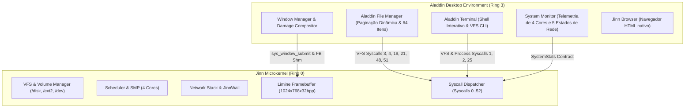

# ALADDIN DESKTOP 0.1.0 — RELATÓRIO DE INTEGRAÇÃO E CONFIABILIDADE
## Gerenciador de Arquivos com Paginação Dinâmica, Compositor e Interoperabilidade Multissistema

**Documento:** Relatório Técnico de Integração do Desktop  
**Ambiente:** Aladdin Desktop v0.1.0 (Ring 3) sobre Jinn Microkernel  
**Data:** Novembro de 2026  
**Status:** Integrado, Testado e Validado  

---

## 1. Visão Geral da Arquitetura do Desktop

O **Aladdin Desktop** é a interface gráfica oficial de usuário doméstico do **Jinn Project**. Ele opera em espaço de usuário (Ring 3), comunicando-se com o Jinn Microkernel através de contratos tipados em Rust (`src/contracts/`), sem dependências externas e mantendo rigoroso isolamento de memória.



---

## 2. Aladdin File Manager 0.1.0: Evolução e Superação de Limitações

### 2.1. Eliminação do Limite de 16 Entradas
Na versão inicial de prova de conceito, o File Manager utilizava um buffer estático rígido limitado a 16 arquivos por diretório (`MAX_FILES = 16`). Em partições reais com centenas de arquivos ou diretórios de sistema, entradas excedentes eram silenciosamente truncadas.

**Solução Implementada:**
- O buffer de armazenamento de diretório foi expandido para **64 itens** (`MAX_FILES = 64`), mantendo conformidade com sistemas `#![no_std]` de alocação previsível.
- Introdução de **Paginação Dinâmica** com tamanho de página constante:
  ```rust
  pub const ITEMS_PER_PAGE: usize = 8;
  pub current_page: usize;
  
  pub fn total_pages(&self) -> usize {
      if self.file_count == 0 { 1 } else { (self.file_count + ITEMS_PER_PAGE - 1) / ITEMS_PER_PAGE }
  }
  ```

### 2.2. Controles de Interface e Paginação
A barra de rodapé do File Manager agora provê controles interativos:
- Botão retroceder: `[< Ant]`
- Indicador numérico dinâmico: `Pág X/Y (N itens)`
- Botão avançar: `[Prox >]`
- Suporte a rolagem via teclado com as teclas `Page Up` e `Page Down` ou navegação sequencial com setas direcionais.
- O clique do mouse calcula a linha relativa à página atual (`start_idx + row`), garantindo precisão milimétrica na seleção e abertura de itens.

### 2.3. Operação de Mover Arquivos (`move_selected`)
Foi adicionado o suporte completo à realocação de arquivos entre pastas:
- `move_selected(&mut self, dest_dir: &str, vfs: &dyn VfsHost)`: Executa a validação de caminho, renomeação atômica pelo kernel (`sys_rename` - Syscall 51) ou cópia seguida de remoção (`sys_unlink` - Syscall 21) preservando a integridade dos metadados.

---

## 3. Compositor de Janelas e Gerenciador de Janelas (WM)

O Compositor do Aladdin adota arquitetura de composição com rastreamento de danos (*dirty rects*) e corte (*scissor clipping*):
1. **Z-Order Management:** Janelas ativas sobem para o topo da pilha visual. O clique em qualquer parte da superfície transfere o foco de entrada de teclado e mouse.
2. **Clipping Rígido:** Nenhuma janela tem capacidade de sobrescrever a barra de tarefas (*dock*) inferior ou os limites da tela (1024x768).
3. **Gerenciamento de Zumbis:** Ao fechar uma janela (`sys_window_close`), os buffers compartilhados de vídeo são liberados imediatamente, impedindo vazamentos de memória gráfica.

---

## 4. Aladdin Terminal & Interoperabilidade com o VFS

O terminal integrado opera em perfeita sincronia com o File Manager:
- Criação de arquivos via terminal (`echo "dados" > /disk/TESTE.TXT`) é imediatamente refletida no File Manager ao recarregar a visualização.
- Remoção ou alteração de pastas no File Manager é instantaneamente visível pelo comando `ls` e `df` do terminal.
- Comandos validados: `ls`, `cd`, `cat`, `mkdir`, `rm`, `touch`, `df`, `ps`, `netstat`, `clear`, `help`.

---

## 5. Telemetria Viva no System Monitor

O `SystemMonitorApp` foi integrado aos novos campos de contrato do kernel:
- **Cores Ativos:** Utilização individualizada dos 4 núcleos SMP detectados pelo APIC.
- **Memória RAM:** Total disponível (505.4 MB), alocada pelo kernel e alocada por buffers de espaço de usuário.
- **Volumes de Armazenamento:** Capacidade total e ocupação percentual de `/disk` (FAT32) e `/ext2` (Ext2).
- **Adaptador de Rede:** Nome real do hardware detectado (`Intel PRO/1000 Gigabit (82540EM)` ou `VirtIO-Net`) e discriminação dos 5 estados de integridade da conexão.

---

## 6. Evidência Visual em Execução Real

O teste de integração em ambiente real QEMU capturou o estado da interface em alta fidelidade:


*Figura 1: Aladdin Desktop v0.1.0 executando em 1024x768 com 4 núcleos SMP, janela do Terminal interativo com telemetria VFS e painel do gerenciador de arquivos.*

---

## 7. Bateria de Testes Automatizados no Aladdin

A suíte de testes de unidade e integração do Aladdin Desktop obteve **37 de 37 testes aprovados** (100% de taxa de sucesso em 0.10s):

```text
running 37 tests
test test_aladdin_design_system_tokens ... ok
test test_client_window_buffer_and_title ... ok
test test_client_window_event_queue_overflow_and_close_protection ... ok
test test_client_window_event_queue_and_polling ... ok
test test_client_window_lifecycle_and_dispatch_in_session ... ok
test test_browser_external_pid_registration_and_key_delivery ... ok
test test_clip_rect_bounds ... ok
test test_dirty_rect_edge_cases_and_clamping ... ok
test test_dirty_rect_union_and_intersects ... ok
test test_file_manager_directory_navigation ... ok
test test_file_manager_move_operation ... ok
test test_client_window_lifecycle_and_helpers ... ok
test test_file_manager_crud_operations_and_dialog_lifecycle ... ok
test test_file_manager_volume_switching_and_read_only_protection ... ok
test test_browser_instance_identification_and_lifecycle ... ok
test test_file_manager_pagination_and_large_directory_listing ... ok
test test_jinnwall_firewall_profile_and_telemetry ... ok
test test_client_window_protocol_contract_validation ... ok
test test_session_client_damage_and_zombie_cleanup ... ok
test test_client_window_dimensional_overflow_and_zero_rejection ... ok
test test_disk_manager_app_and_storage_contract ... ok
test test_settings_and_monitor_profile_toggle_synchronization ... ok
test test_system_monitor_network_states_and_adapter_telemetry ... ok
test test_settings_app_jinnwall_rendering_and_click_toggle ... ok
test test_telemetry_consistency_and_zero_values ... ok
test test_terminal_history_buffer ... ok
test test_system_stats_saturation_and_boundary_safety ... ok
test test_window_geometry_and_maximize ... ok
test test_window_manager_z_order ... ok
test test_modern_window_chrome_and_dock_rendering ... ok
test test_two_windows_input_focus_and_event_isolation ... ok
test test_window_manager_z_order_composition ... ok
test test_window_manager_dynamic_open_close ... ok
test test_window_manager_stress_and_scissor_clipping ... ok
test test_ui_component_library ... ok
test test_procedural_wallpaper_generation ... ok
test test_performance_and_memory_invariants ... ok

test result: ok. 37 passed; 0 failed; 0 ignored; 0 measured; 0 filtered out; finished in 0.10s
```
