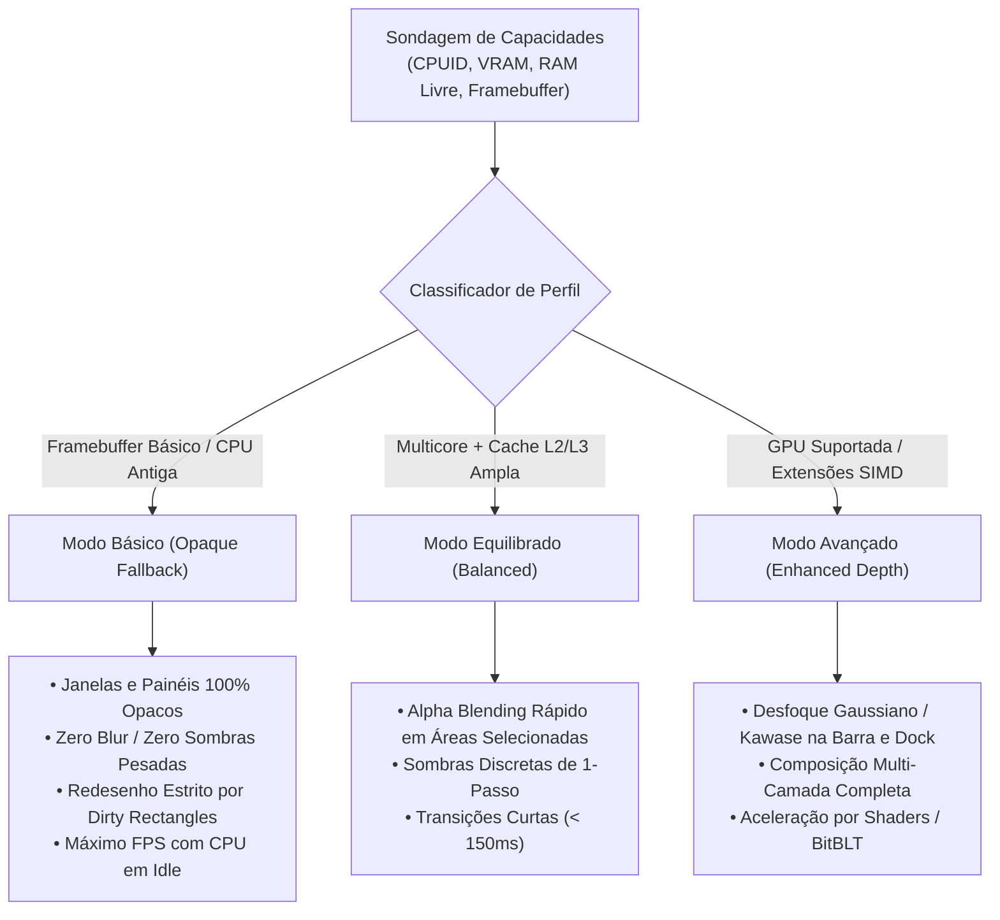

# Aladdin Desktop — Especificação Arquitetural e Sistema de Design v0.1

## 1. Visão de Produto e Filosofia

O **Aladdin Desktop** é o perfil de experiência gráfica doméstica do **Jinn OS**, projetado para aliar elegância visual marcante, previsibilidade de desempenho e eficiência computacional em sistemas microkernel.

### 1.1. Referências de Design e Princípios
O Aladdin sintetiza os pontos fortes de duas grandes filosofias de interface:
- **Garuda Linux (Dr460nized)**: Personalidade marcante, contraste escuro profundo, acentuações luminescentes vibrantes (ciano, néon, roxo profundo), profundidade visual refinada e suporte a efeitos modernos quando o hardware dispõe de folga térmica e de computação.
- **elementary OS 7 (HIG)**: Clareza hierárquica, intencionalidade de layout, espaçamentos consistentes, tipografia legível, ausência de poluição visual desnecessária e foco inegociável na facilidade de uso diário.

### 1.2. Princípios Norteadores
1. **Beleza não é refém da GPU**: A experiência visual deve ser atraente e coesa mesmo em renderização puramente por software (*Linear Framebuffer* sem acelerador 3D dedicado).
2. **Sem desperdício de ciclos**: Se a tela não foi alterada, a CPU deve repousar em `hlt` com consumo próximo a 0. Redesenhos de tela inteira (Full-Screen Blit de 3 MiB) são terminantemente proibidos quando apenas o cursor ou uma janela pequena se moveu.
3. **Identidade Própria**: Rejeição de cópias literais de Windows, macOS ou Aqua. O Aladdin constrói seu vocabulário próprio por meio de cartões flutuantes, paleta ardósia-nebulosa e tipografia geométrica.

---

## 2. Sistema de Design e Design Tokens

### 2.1. Paleta de Cores (ARGB 32-bit)

| Token | Valor Hex | Finalidade |
|:---|:---|:---|
| `COLOR_BG_DESKTOP` | `0xFF0D1117` | Fundo principal da área de trabalho (Abismo Ardósia) |
| `COLOR_SURFACE_CARD` | `0xFF161B22` | Fundo de janelas e cartões flutuantes |
| `COLOR_SURFACE_ALT` | `0xFF21262D` | Superfície secundária (campos de texto, listas, cabeçalhos) |
| `COLOR_PANEL_TOP` | `0xE60D1117` | Barra de status superior (com 90% de opacidade ou 100% no modo básico) |
| `COLOR_DOCK_BG` | `0xCC161B22` | Dock flutuante inferior |
| `COLOR_ACCENT_PRIMARY` | `0xFF38BDF8` | Ciano luminescente — Ações primárias, foco, indicador de atividade |
| `COLOR_ACCENT_PURPLE` | `0xFFA855F7` | Violeta vibrante — Destaque de estado, transições e marcas |
| `COLOR_ACCENT_GREEN` | `0xFF22C55E` | Esmeralda — Sucesso, montagem de discos, processos ativos |
| `COLOR_ACCENT_AMBER` | `0xFFF59E0B` | Âmbar — Avisos, pressão moderada de memória |
| `COLOR_ACCENT_RED` | `0xFFEF4444` | Rubi — Fechamento `[X]`, falhas e interrupções críticas |
| `COLOR_TEXT_PRIMARY` | `0xFFF8FAFC` | Texto de alto contraste (títulos, comandos) |
| `COLOR_TEXT_MUTED` | `0xFF94A3B8` | Metadados, descrições secundárias, atalhos |
| `COLOR_BORDER_DEFAULT`| `0xFF30363D` | Borda sutil de 1px entre superfícies |
| `COLOR_BORDER_FOCUS`  | `0xFF38BDF8` | Borda de janela ativa ou controle focado |

### 2.2. Tipografia e Escala de Dimensões
- **Fonte Padrão do Sistema**: Bitmap monocromático 8x8 (modo linear atual) com expansão para escala 8x16 nos títulos.
- **Espaçamentos Modulares (Grid de 4px / 8px)**:
  - `PAD_XS`: 4 px
  - `PAD_SM`: 8 px
  - `PAD_MD`: 16 px
  - `PAD_LG`: 24 px
- **Bordas e Cantos Arredondados**:
  - `RADIUS_WINDOW`: 6 px (modo equilibrado/avançado) ou 0 px (modo básico opaco).
  - `RADIUS_BUTTON`: 4 px.

---

## 3. Matriz de Capacidades Gráficas e Modos de Fallback

O Aladdin adapta dinamicamente os efeitos visuais com base nas capacidades medidas do hardware:



### Detalhamento dos Modos:
1. **Modo Básico (Prioridade Máxima de Eficiência)**:
   - Toda renderização é opaca.
   - O compositor opera em modo incremental: apenas retângulos alterados (*dirty rectangles*) são copiados do Backbuffer para a VRAM.
   - Consumo de memória: 1 Backbuffer (3 MiB a 1024x768x32).
2. **Modo Equilibrado**:
   - Alpha blending linear simples: $C_{\text{result}} = \alpha \cdot C_{\text{src}} + (1 - \alpha) \cdot C_{\text{dst}}$ otimizado por inteiros sem ponto flutuante.
   - Sombras leves pré-computadas nas bordas de janelas focadas.
3. **Modo Avançado**:
   - Aplicação de desfoque de fundo (*background blur*) sob a barra superior e o menu de aplicações.
   - Efeitos luminescentes inspirados no Dr460nized nas janelas ativas.

---

## 4. Arquitetura do Compositor e Damage Tracking (Dirty Rectangles)

O maior gargalo de um servidor gráfico sem aceleração por GPU é o custo de transferir 3.145.728 bytes (1024x768x4) pelo barramento a cada movimento de mouse ou pressionamento de tecla.

O Aladdin adota o modelo de **Damage Tracking**:
1. Quando uma janela é arrastada de $(x_1, y_1)$ para $(x_2, y_2)$, apenas as regiões da posição antiga e da nova posição são marcadas como *danificadas* (`DirtyRect`).
2. O compositor redesenha apenas o fundo e as janelas intersectadas por essas caixas delimitadoras.
3. Apenas as linhas alteradas são transferidas para a VRAM via `rep movsd` ou instruções de escrita não-temporal (`movntdq`).

```rust
pub struct DirtyRect {
    pub x: usize,
    pub y: usize,
    pub width: usize,
    pub height: usize,
}

impl DirtyRect {
    pub fn merge(&self, other: &DirtyRect) -> DirtyRect {
        let min_x = self.x.min(other.x);
        let min_y = self.y.min(other.y);
        let max_x = (self.x + self.width).max(other.x + other.width);
        let max_y = (self.y + self.height).max(other.y + other.height);
        DirtyRect {
            x: min_x,
            y: min_y,
            width: max_x - min_x,
            height: max_y - min_y,
        }
    }
}
```

---

## 5. Roteiro de Transição para Espaço de Usuário (Ring 3)

1. **Fase Atual (Kernel In-Place Engine)**:
   - O subsistema `gui.rs` fornece o framebuffer, primitivas e o event loop para desenvolvimento imediato.
2. **Fase Alvo (Aladdin Display Server em Ring 3)**:
   - O Kernel fornece apenas o descritor de framebuffer mapeado e eventos de entrada via `/dev/mouse` e `/dev/keyboard`.
   - O `aladdin-server` executa como um processo Ring 3 com privilégios restritos.
   - Aplicações clientes (como o terminal ou visualizador de imagens) criam superfícies em buffers de páginas físicas compartilhadas via IPC do JDA, evitando cópias de pixels durante a renderização.
