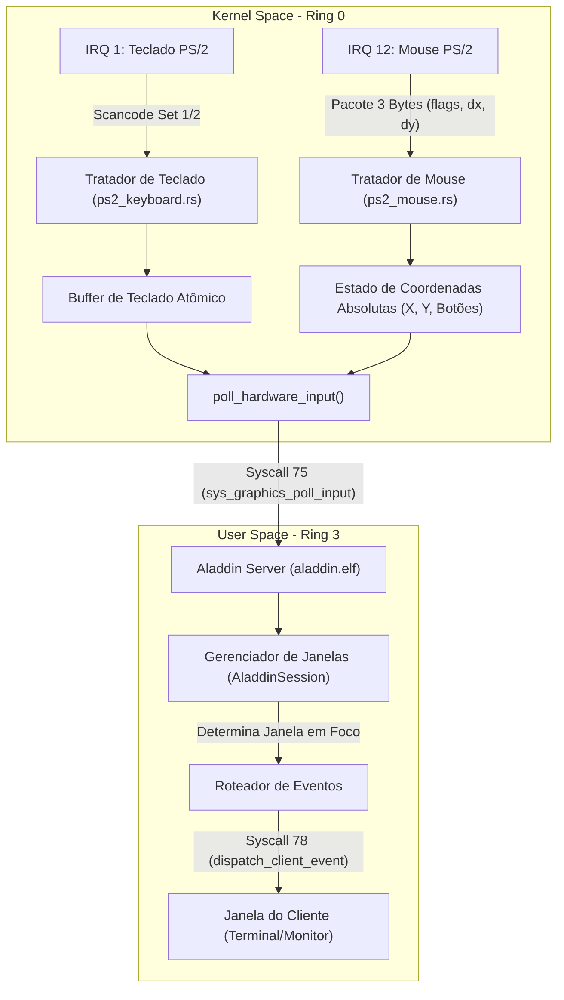

# ALADDIN INPUT INTERFACE SPECIFICATION
## Arquitetura de Entrada de Hardware, Roteamento e Mediação (Ring 0 -> Ring 3)

- **Versão:** 1.0.0
- **Mecanismo:** Mediação por Interrupção de Hardware em Ring 0 e Polling via Syscall 75 (`sys_graphics_poll_input`)
- **Controladores:** Teclado PS/2 (Porta 0x60/0x64, IRQ 1) e Mouse PS/2 (IRQ 12)
- **Serviço Gráfico:** Aladdin Desktop Server 0.1.0 (`aladdin.elf`)

---

## 1. Visão Geral e Princípio de Privilégio Mínimo

A arquitetura de entrada do Jinn OS elimina categoricamente o acesso direto a instruções de porta de I/O (`in al, dx`, `out dx, al`) por processos de espaço de usuário:

- **Ring 0 (Microkernel):** Os tratadores de interrupção (ISRs) e drivers do subsistema de dispositivos gerenciam os controladores 8042 PS/2, desserializam scancodes de teclado e decodificam os pacotes de 3 bytes do mouse PS/2. Os dados são convertidos em estruturas canônicas `InputHardwareEvent` e armazenados em buffers atômicos.
- **Ring 3 (Aladdin Server):** Executa com `IOPL = 0`. Para capturar a entrada do usuário, invoca a Syscall 75 (`sys_graphics_poll_input`). A chamada consome o próximo evento pendente ou retorna imediatamente `0` se a fila estiver vazia.
- **Gestão de Ociosidade:** Quando a fila de entrada está vazia e nenhuma animação está pendente, o Aladdin invoca `sys_yield()` ou `sys_sleep(ms)`, retornando fatias de tempo para o escalonador do microkernel e evitando queima de CPU (0% CPU quando ocioso).

---

## 2. Pipeline de Entrada de Teclado e Mouse



---

## 3. Estrutura e Semântica do Evento de Hardware

A estrutura `InputHardwareEvent` possui layout binário padronizado de 20 bytes:

```rust
#[repr(C)]
#[derive(Debug, Clone, Copy, PartialEq, Eq)]
pub struct InputHardwareEvent {
    pub kind:      u32, // Tipo de Evento
    pub code:      u32, // Código da Tecla (ASCII/Virtual) ou Máscara de Botões
    pub x:         i32, // Posição X absoluta do cursor (0..fb_width-1)
    pub y:         i32, // Posição Y absoluta do cursor (0..fb_height-1)
    pub modifiers: u32, // Teclas modificadoras ativas
}
```

### Tipos de Eventos (`kind`)
- **`0` (`None`):** Fila vazia ou nenhum evento pendente.
- **`1` (`KeyDown`):** Tecla pressionada. `code` contém o código ASCII ou chave virtual.
- **`2` (`KeyUp`):** Tecla liberada.
- **`3` (`MouseMove`):** O cursor do mouse foi movimentado. `x` e `y` contêm a nova posição absoluta já delimitada pelas bordas da tela.
- **`4` (`MouseDown`):** Botão do mouse pressionado. `code & 1 != 0` (Botão Esquerdo), `code & 2 != 0` (Botão Direito), `code & 4 != 0` (Botão Central).
- **`5` (`MouseUp`):** Botão do mouse liberado.
- **`6` (`Scroll`):** Roda de rolagem do mouse acionada (se suportado pelo controlador).

### Modificadores (`modifiers`)
- **Bit 0 (`0x01`):** Shift Esquerdo ou Direito ativo.
- **Bit 1 (`0x02`):** Control (Ctrl) ativo.
- **Bit 2 (`0x04`):** Alt ativo.
- **Bit 3 (`0x08`):** Super / Tecla Windows ativa.

---

## 4. Implementação do Polling no Microkernel (`src/gui.rs`)

O microkernel garante a entrega com priorização:
1. **Prioridade de Teclado:** Se houver caracteres ou scancodes no buffer de teclado, eles são emitidos com prioridade imediata para garantir responsividade máxima em comandos de teclado e atalhos de saída (ex: tecla ESC para desocupar o desktop).
2. **Prioridade de Mouse:** Se o estado do mouse diferir da última amostragem entregue ao servidor (`LAST_MOUSE_STATE`), um evento de `MouseDown`, `MouseUp` ou `MouseMove` é construído.
3. **Verificação de Autorização:** Apenas o processo com `caller_pid == GRAPHICS_SERVER_PID` é autorizado a extrair eventos de hardware. Chamadas de outros processos são rejeitadas com `-EPERM`.

```rust
pub fn poll_hardware_input(caller_pid: usize) -> Result<Option<InputHardwareEvent>, isize> {
    let s_pid = GRAPHICS_SERVER_PID.load(Ordering::SeqCst);
    if s_pid != 0 && caller_pid != s_pid {
        return Err(crate::syscall::EPERM);
    }

    // 1. Drena teclas pendentes no buffer canônico do teclado
    if let Some(ch) = crate::keyboard_buffer::pop() {
        return Ok(Some(InputHardwareEvent {
            kind: 1, // KeyDown
            code: ch as u32,
            x: 0,
            y: 0,
            modifiers: 0,
        }));
    }

    // 2. Compara estado atual do mouse com última posição informada
    crate::interrupts::ps2_mouse::poll();
    let (cur_x, cur_y, cur_btn) = crate::interrupts::ps2_mouse::get_state();
    let mut last = LAST_MOUSE_STATE.lock();
    if (cur_x, cur_y, cur_btn) != *last {
        let (_lx, _ly, lbtn) = *last;
        *last = (cur_x, cur_y, cur_btn);

        let kind = if (cur_btn & 1) != (lbtn & 1) {
            if (cur_btn & 1) != 0 { 4 } else { 5 } // MouseDown / MouseUp
        } else if (cur_btn & 2) != (lbtn & 2) {
            if (cur_btn & 2) != 0 { 4 } else { 5 }
        } else {
            3 // MouseMove
        };

        return Ok(Some(InputHardwareEvent {
            kind,
            code: cur_btn as u32,
            x: cur_x as i32,
            y: cur_y as i32,
            modifiers: 0,
        }));
    }

    Ok(None)
}
```

---

## 5. Garantias de Não-Bloqueio e Isolamento

- **Sem Espera Ocupada (Spinlock Gratuito):** Se nenhum evento estiver disponível, a chamada retorna `0` imediatamente, permitindo que o processo tome decisões de renderização ou entre em espera voluntária.
- **Isolamento de Entrada entre Aplicações:** Aplicações clientes em Ring 3 não têm acesso à Syscall 75 (recebem `-EPERM`). Toda entrada passa pelo compositor, que realiza *hit testing* e envia eventos apenas para a janela sob o foco do usuário via Syscall 78 (`sys_graphics_dispatch_client_event`), impossibilitando ataques de *keylogging* entre aplicações comuns.
