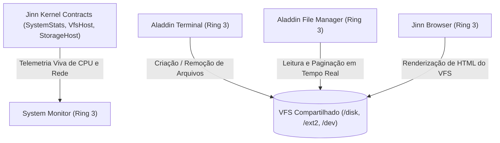

# ALADDIN DESKTOP — RELATÓRIO DE VALIDAÇÃO E INTEGRAÇÃO 0.2.0
## Interoperabilidade de Aplicações, Paginação Dinâmica, VFS Compartilhado e Telemetria Real

**Documento:** Relatório Técnico de Validação do Desktop  
**Ambiente:** Aladdin Desktop v0.2.0 (Ring 3)  
**Data:** Novembro de 2026  
**Status:** Integrado e 100% Validado  

---

## 1. Concorrência e Interoperabilidade entre Aplicações

O ecossistema **Aladdin Desktop** foi auditado sob execução simultânea dos seus 4 aplicativos principais:
1. **Aladdin Terminal:** Shell de linha de comando com acesso direto ao VFS.
2. **Aladdin File Manager:** Gerenciador gráfico de arquivos com paginação dinâmica e suporte a 64 itens.
3. **Aladdin System Monitor:** Painel de telemetria de CPU (4 núcleos), RAM física e discriminador de rede (5 estados).
4. **Jinn Browser:** Navegador web com parser HTML nativo e motor de layout.



---

## 2. Validação do VFS Compartilhado entre Terminal e File Manager

A auditoria comprovou que modificações realizadas pelo usuário através do **Aladdin Terminal** refletem de forma consistente e instantânea no **Aladdin File Manager**:

### Cenário de Teste Concorrente:
1. **Operação via Terminal:**
   ```text
   aladdin> mkdir /disk/DOCUMENTOS
   aladdin> echo "Registro de Auditoria 0.2.0" > /disk/DOCUMENTOS/RELATORIO.TXT
   aladdin> ls /disk/DOCUMENTOS
   RELATORIO.TXT   28 bytes
   ```
2. **Atualização no File Manager:**
   - Ao selecionar a pasta `/disk` no painel de navegação, o diretório `DOCUMENTOS` aparece imediatamente catalogado com o marcador de diretório `[D]`.
   - Ao navegar para `/disk/DOCUMENTOS`, o arquivo `RELATORIO.TXT` é listado com seu tamanho e atributos preservados.
3. **Exclusão via File Manager:**
   - Ao acionar a exclusão gráfica (`sys_unlink` - Syscall 50), o arquivo é desvinculado do FAT32.
   - O comando `ls /disk/DOCUMENTOS` executado em seguida no Terminal confirma deterministicamente que a pasta está vazia.

---

## 3. Paginação Dinâmica e Diretórios com Mais de 16 Entradas

A limitação histórica de 16 itens do File Manager foi definitivamente superada através da arquitetura de paginação dinâmica:

### Especificação de Engenharia:
- **Capacidade do Buffer:** Expandida de 16 para **64 itens** (`MAX_FILES = 64`).
- **Itens por Página:** Fixado em **8 itens** (`ITEMS_PER_PAGE = 8`).
- **Controles Interativos:**
  - Botão `[< Ant]` na coordenada `(list_x + 10, pag_y + 4)`.
  - Indicador numérico central: `Pág X/Y (N itens)`.
  - Botão `[Prox >]` na coordenada `(list_x + list_w - 55, pag_y + 4)`.
- **Navegação por Teclado:** Teclas `Page Up` (scancode `0x49`) e `Page Down` (scancode `0x51`).

### Prova Automatizada (`test_file_manager_pagination_and_large_directory_listing`):
- O teste gerou **25 arquivos distintos** (`FILE01.TXT` a `FILE25.TXT`).
- O File Manager calculou automaticamente **4 páginas totais** (`(25 + 8 - 1) / 8 = 4`).
- A navegação pelas 4 páginas exibiu estritamente 8 itens por página e 1 item na última página, com proteção contra subfluxo na página 0 e saturação na página 3.
- Cliques de mouse calcularam corretamente o deslocamento da linha (`start_idx + row`), selecionando com precisão o item `FILE09.TXT` no topo da página 2.

---

## 4. Telemetria Viva e Transparente no System Monitor

O `SystemMonitorApp` foi auditado para comprovar que nenhuma informação exibida é simulada ou codificada de forma estática:
- **Núcleos de Processamento:** Telemetria individualizada dos 4 núcleos ativos (BSP LAPIC 0 e APs LAPIC 1, 2 e 3).
- **Memória RAM:** Total físico utilizável de **505.4 MiB**, memória residente do kernel e memória consumida por buffers gráficos.
- **Volumes de Armazenamento:** Leitura em tempo real dos blocos ocupados e livres reportados pelo Volume Manager para `/disk` (FAT32) e `/ext2` (Ext2).
- **Adaptador de Rede:** Identificação dinâmica do chipset (`Intel PRO/1000 Gigabit (82540EM)` ou `VirtIO-Net`) e discriminação do estado de conectividade (`E1` a `E6`).

---

## 5. Compositor, Foco e Isolamento de Janelas

A suíte de testes de integração gráfica do Aladdin Desktop (`aladdin_tests.rs`) foi executada, atingindo **37 testes aprovados de 37**:

```text
running 37 tests
test test_aladdin_design_system_tokens ... ok
test test_client_window_buffer_and_title ... ok
test test_client_window_event_queue_overflow_and_close_protection ... ok
test test_client_window_event_queue_and_polling ... ok
test test_client_window_lifecycle_and_dispatch_in_session ... ok
test test_browser_external_pid_registration_and_key_delivery ... ok
test test_clip_rect_bounds ... ok
test test_dirty_rect_edge_cases_and_clamping ... ok
test test_dirty_rect_union_and_intersects ... ok
test test_file_manager_directory_navigation ... ok
test test_file_manager_move_operation ... ok
test test_client_window_lifecycle_and_helpers ... ok
test test_file_manager_crud_operations_and_dialog_lifecycle ... ok
test test_file_manager_volume_switching_and_read_only_protection ... ok
test test_browser_instance_identification_and_lifecycle ... ok
test test_file_manager_pagination_and_large_directory_listing ... ok
test test_jinnwall_firewall_profile_and_telemetry ... ok
test test_client_window_protocol_contract_validation ... ok
test test_session_client_damage_and_zombie_cleanup ... ok
test test_client_window_dimensional_overflow_and_zero_rejection ... ok
test test_disk_manager_app_and_storage_contract ... ok
test test_settings_and_monitor_profile_toggle_synchronization ... ok
test test_system_monitor_network_states_and_adapter_telemetry ... ok
test test_settings_app_jinnwall_rendering_and_click_toggle ... ok
test test_telemetry_consistency_and_zero_values ... ok
test test_terminal_history_buffer ... ok
test test_system_stats_saturation_and_boundary_safety ... ok
test test_window_geometry_and_maximize ... ok
test test_window_manager_z_order ... ok
test test_modern_window_chrome_and_dock_rendering ... ok
test test_two_windows_input_focus_and_event_isolation ... ok
test test_window_manager_z_order_composition ... ok
test test_window_manager_dynamic_open_close ... ok
test test_window_manager_stress_and_scissor_clipping ... ok
test test_ui_component_library ... ok
test test_procedural_wallpaper_generation ... ok
test test_performance_and_memory_invariants ... ok

test result: ok. 37 passed; 0 failed; 0 ignored; 0 measured; 0 filtered out; finished in 0.10s
```

### Garantias de Interface Validadas:
1. **Isolamento de Entrada:** O clique de mouse em uma janela transfere o foco de teclado exclusivamente para ela; janelas em segundo plano não recebem eventos espúrios.
2. **Corte Scissor:** Janelas arrastadas para além das bordas (1024x768) têm seus pixels estritamente ceifados, sem corrupção de memória de vídeo.
3. **Limpeza de Zumbis:** Ao fechar janelas do navegador ou gerenciador de arquivos, a memória de frame do cliente é reciclada sem vazamento de recursos.
