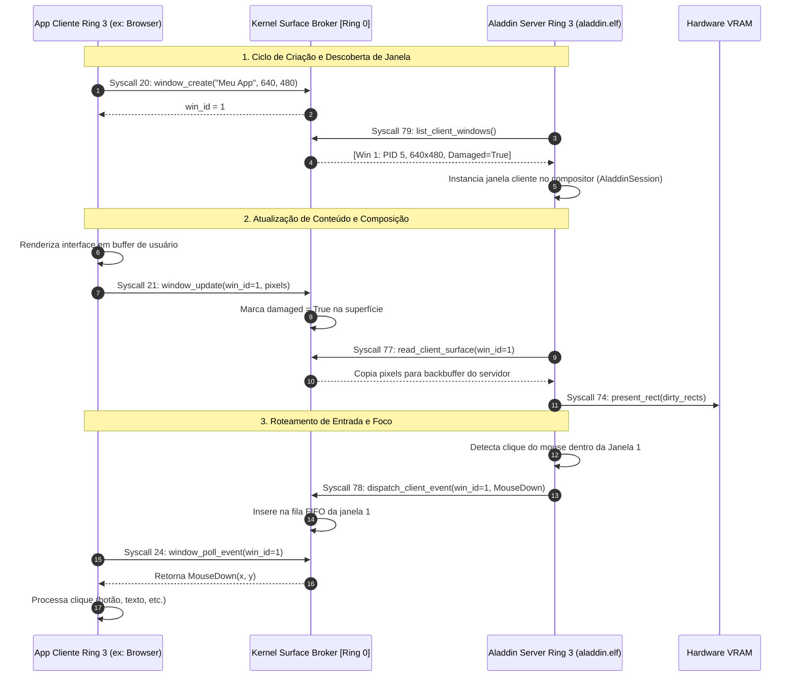

# ALADDIN IPC & CLIENT-SERVER PROTOCOL SPECIFICATION
## Protocolo de Comunicação e Transporte Gráfico entre Servidor e Clientes (Ring 3 <-> Ring 3)

- **Versão:** 1.0.0
- **Papéis:** Aladdin Graphics Service (Servidor/Compositor) e Aplicações Usuárias (Clientes)
- **Meio de Transporte:** Microkernel Jinn Surface Broker & Event Queue (Syscalls 20..24 e 77..79)
- **Garantia de Isolamento:** Processos clientes não acessam memória uns dos outros nem interferem no compositor

---

## 1. Visão Geral do Modelo Cliente-Servidor

O Aladdin Desktop opera sob um modelo gráfico desacoplado (análogo a Wayland e X11), no qual aplicações clientes desenham seus conteúdos em superfícies privadas de memória e o compositor do Aladdin as compõe sobre o papel de parede, aplicando decorações de janela, sombras e efeitos visuais.



---

## 2. Mensagens e Estruturas de Protocolo

### 2.1. Descoberta de Janelas (`ClientWindowInfoUser`)
A chamada de sistema 79 (`sys_graphics_list_client_windows`) popula arrays da seguinte estrutura:

```rust
#[repr(C)]
#[derive(Debug, Clone, Copy, PartialEq, Eq)]
pub struct ClientWindowInfoUser {
    pub win_id:    u32,      // Identificador único da janela (1..32)
    pub owner_pid: u32,      // PID do processo dono da janela
    pub width:     u32,      // Largura da superfície em pixels
    pub height:    u32,      // Altura da superfície em pixels
    pub is_open:   u32,      // 1 = Janela aberta, 0 = Fechada
    pub damaged:   u32,      // 1 = Pixels alterados requerem leitura
    pub title_len: u32,      // Tamanho do título (máx 48)
    pub title:     [u8; 48], // Título da janela em UTF-8
}
```

### 2.2. Eventos Despachados para Clientes (`ClientWindowEvent`)
A estrutura de 32 bytes transferida pela Syscall 78 e consumida pela Syscall 24:

```rust
#[repr(C)]
#[derive(Debug, Clone, Copy, PartialEq, Eq)]
pub struct ClientWindowEvent {
    pub event_type:   u32, // Identificador do tipo de evento
    pub param1:       u32, // Dados primários (ex: código de tecla, botão do mouse, nova largura)
    pub param2:       u32, // Dados secundários (ex: coordenada X relativa, nova altura)
    pub param3:       u32, // Dados terciários (ex: coordenada Y relativa)
    pub timestamp_ms: u64, // Marcação temporal monotônica (ms)
    pub reserved:     u64, // Reservado para alinhamento canônico
}
```

#### Tipos Canônicos de Evento
- **`1` (`EVENT_MOUSE_DOWN`):** `param1 = botão`, `param2 = x_relativo`, `param3 = y_relativo`.
- **`2` (`EVENT_MOUSE_UP`):** `param1 = botão`, `param2 = x_relativo`, `param3 = y_relativo`.
- **`3` (`EVENT_MOUSE_MOVE`):** `param2 = x_relativo`, `param3 = y_relativo`.
- **`4` (`EVENT_KEY_DOWN`):** `param1 = código_tecla`, `param2 = modificadores`.
- **`5` (`EVENT_KEY_UP`):** `param1 = código_tecla`, `param2 = modificadores`.
- **`6` (`EVENT_SCROLL`):** `param1 = delta_linhas`.
- **`7` (`EVENT_WINDOW_CLOSE`):** Solicitação de fechamento enviada pelo botão 'X' da janela.
- **`8` (`EVENT_WINDOW_RESIZE`):** Notificação de novo tamanho (`param1 = nova_largura`, `param2 = nova_altura`).
- **`9` (`EVENT_FOCUS_GAINED`):** A janela recebeu o foco de entrada ativo.
- **`10` (`EVENT_FOCUS_LOST`):** A janela perdeu o foco para outra aplicação.

---

## 3. Garantias de Isolamento e Segurança Operacional

1. **Anti-Interferência entre Processos (EPERM):**
   - Um processo cliente (ex: PID 7) só pode invocar `window_update`, `window_close` e `window_poll_event` para janelas cujo `owner_pid == 7`.
   - Tentativas de atualizar ou inspecionar janelas de outros PIDs resultam em rejeição imediata com `-EPERM`.
2. **Capacidade Delimitada da Fila de Eventos (FIFO 16 itens):**
   - Cada janela possui uma fila circular estática de 16 posições.
   - Se uma aplicação cliente parar de consumir eventos, a fila atinge capacidade máxima e o despacho rejeita novos eventos com `-EBUSY`, prevenindo vazamentos de memória ou estouros de pilha.
3. **Quotas por Processo (EDQUOT):**
   - Cada processo cliente possui uma cota máxima configurável de janelas (padrão: 8 janelas por processo).
   - Tentativas de exceder a quota resultam no erro `-EDQUOT`.
4. **Limpeza Automática em Crash do Cliente:**
   - Se uma aplicação cliente travar (Page Fault, General Protection Fault ou encerramento abrupto), o coletor do escalonador fecha automaticamente todas as superfícies abertas pelo respectivo PID e marca `damaged = 0`, liberando os descritores no broker.
5. **Recuperação em Crash do Servidor:**
   - Se o compositor Aladdin travar, as janelas dos clientes continuam preservadas na memória do broker. Ao ser reiniciado via `gui`, o novo servidor descobre as janelas existentes via Syscall 79 e reanexa a composição visual sem perda de estado para as aplicações em execução.
