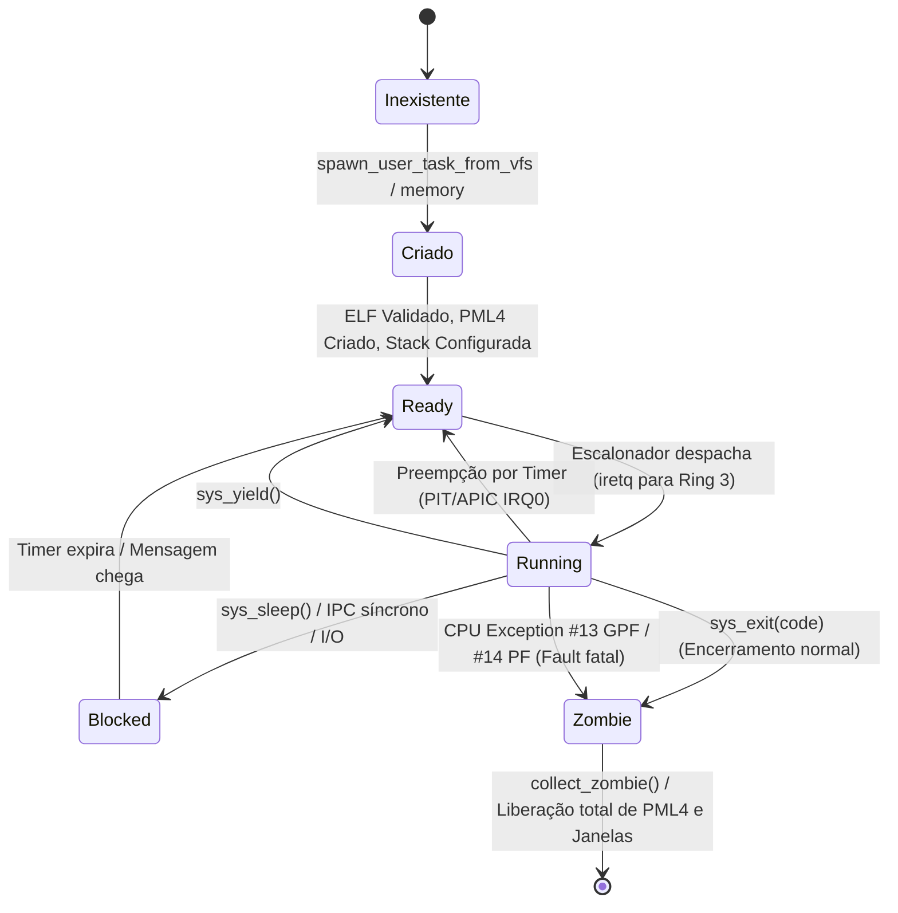

# Aladdin Process Lifecycle — Ciclo de Vida de Processos ELF64

> **Projeto Jinn OS & Aladdin Desktop**  
> **Status:** Homologado / Estável  
> **Classificação:** Gerenciamento de Processos e Escalonamento  
> **Data de Emissão:** 10 de Novembro de 2026  

---

## 1. Diagrama de Estados do Processo

Cada processo em Ring 3 percorre uma máquina de estados finita gerida pelo escalonador SMP do Jinn OS:



---

## 2. Carregamento e Validação ELF64

O carregador seguro do Jinn (`src/elf.rs`) processa executáveis estáticos de 64 bits (`ET_EXEC` / `EM_X86_64`) seguindo verificações determinísticas:

### Fases de Validação:
1. **Identificação e Cabeçalho:**
   - Magic bytes `\x7FELF`.
   - Classe `ELFCLASS64` (64-bit).
   - Endianness `ELFDATA2LSB` (Little Endian).
   - Tipo de máquina `EM_X86_64` (62).
2. **Espaço Canônico de Usuário:**
   - O ponto de entrada (`e_entry`) deve residir obrigatoriamente dentro de `[USER_SPACE_MIN, USER_SPACE_MAX)` (`0x10000` até `0x0000_8000_0000_0000`).
3. **Mapeamento de Segmentos `PT_LOAD`:**
   - Apenas segmentos do tipo `PT_LOAD` são processados.
   - Segmentos são mapeados em múltiplos de páginas de 4 KiB no PML4 ativo da tarefa.
4. **Política de Segurança W^X (Write XOR Execute):**
   - É terminantemente proibido qualquer segmento possuir flags `PF_W` (escrita) e `PF_X` (execução) simultaneamente.
   - Segmentos executáveis recebem páginas com `PRESENT | USER` e bit `NX` limpo.
   - Segmentos graváveis (.data/.bss) recebem páginas com `PRESENT | USER | WRITABLE` e bit `NX` ativado.
5. **Injeção de Armadilhas (INT3 Trap Fill):**
   - Áreas de padding de páginas executáveis não cobertas por código do arquivo são preenchidas com o byte `0xCC` (`INT 3`), prevenindo execução descontrolada em caso de desvios incorretos.
6. **Zeração de BSS:**
   - Áreas onde `p_memsz > p_filesz` são explicitamente preenchidas com zeros em memória física.

---

## 3. Configuração de Pilha com Página de Guarda

A pilha de usuário é alocada e inicializada pela rotina `setup_user_stack_with_args()` (`src/elf.rs`):

- **Tamanho Total:** 512 KiB (128 páginas de 4 KiB).
- **Base Virtual:** Alocada dinamicamente com base no `task_id` abaixo de `0x0000_7FFF_F000_0000`.
- **Página de Guarda (Guard Page):** A página virtual imediatamente inferior à base da pilha permanece **não mapeada**. Se a aplicação estourar a capacidade da pilha (*stack overflow*), a CPU dispara um Page Fault imediato, impedindo corrupção de outros segmentos.
- **System V ABI Compliant:**
  - Argumentos `argv` e variáveis `envp` copiados para o topo da pilha.
  - Tabela de ponteiros alinhada rigorosamente a **16 bytes**.
  - No ponto de entrada (`_start`), o registrador `RSP` aponta diretamente para `argc`.

---

## 4. Transição de Privilégios (Ring 0 $\to$ Ring 3)

A entrada em modo de usuário ocorre através da montagem de um quadro de interrupção na pilha do kernel e execução da instrução `iretq`:

```text
[Pilha do Kernel antes do iretq]
+-------------------------------+
| SS     = 0x33 (DPL=3)         | <- Seletor de segmento de dados de usuário
| RSP    = user_stack_top       | <- Topo da pilha de 512 KiB alinhada a 16 bytes
| RFLAGS = 0x202 (IF=1, IOPL=0) | <- Interrupções ativas, IOPL restrito
| CS     = 0x2B (DPL=3)         | <- Seletor de código de 64 bits de usuário
| RIP    = elf_entry_point      | <- Endereço do símbolo _start do ELF
+-------------------------------+
```

Ao executar `iretq`, a CPU muda o CPL (Current Privilege Level) para 3 e passa a executar o código da aplicação com privilégios reduzidos.

---

## 5. Encerramento Gracioso e Tratamento de Exceções

### 5.1. Encerramento Normal (`sys_exit`)
Quando a aplicação conclui seu trabalho ou o usuário fecha a janela:
1. A aplicação chama `sys_exit(code)` (`Syscall 0`).
2. O microkernel marca a tarefa como `TaskState::Zombie`.
3. Dispara a limpeza imediata de superfícies: `crate::gui::close_windows_for_pid(pid)`.
4. Fecha e remove descritores de arquivo, sockets de rede e pools de memória compartilhada JDA.
5. Emite sinal de término para o processo pai (caso haja `waitpid`).

### 5.2. Tratamento de Falhas Fatais (Page Fault, GPF, Divisão por Zero)
Se a aplicação violar permissões de memória (acesso nulo, escrita em segmento de código RX, execução de dados NX ou estouro de pilha):
1. A CPU captura a exceção de hardware (Vetor 14 para Page Fault, Vetor 13 para GPF).
2. O tratador de interrupções (`src/interrupts/mod.rs`) detecta que a falha originou-se com `CS=0x2B` (`is_user == true`).
3. O kernel **não entra em pânico** (*Kernel Panic é restrito a falhas do próprio Ring 0*).
4. O processo faltoso é finalizado imediatamente com código `128 + vector`.
5. O escalonador invoca `close_windows_for_pid(pid)` e preempciona para a próxima tarefa pronta.
6. A janela do processo é removida da tela pelo compositor sem travar o desktop e sem deixar vazamentos de frames físicos.
