# ALADDIN STRESS & INTEGRATION REPORT 0.3.0
## Avaliação de Estresse Concorrente, Paginação Dinâmica, Z-Order e Scissor Clipping

> **Projeto:** Aladdin Desktop System / Jinn Microkernel Ecosystem  
> **Versão:** 0.3.0 Hardening Milestone  
> **Classificação:** Relatório Técnico de Integração e Interface Gráfica  
> **Data:** Novembro de 2026  
> **Resolução de Tela:** 1024x768 @ 32 bpp Linear Framebuffer

---

## 1. Visão Geral da Sessão de Estresse

O **Aladdin Desktop** opera como a interface gráfica primária do ecossistema doméstico Jinn, alimentada por um compositor de janelas de alta performance baseado em regiões sujas (*dirty rects*) e corte geométrico restrito (*scissor clipping*).

Durante o marco **0.3.0 Hardening**, o desktop foi submetido a uma sessão de estresse concorrente envolvendo quatro aplicações nativas executando em paralelo sob resolução de 1024x768:

```mermaid
flowchart TD
    subgraph "Aladdin Desktop Compositor (1024x768)"
        A["Janela 1: Aladdin Browser\n(HTTP/1.1 Engine, DOM Render)"]
        B["Janela 2: Aladdin Terminal\n(Histórico de Comandos, VFS Shell)"]
        C["Janela 3: Aladdin File Manager\n(FAT32 CRUD, Paginação >32 Itens)"]
        D["Janela 4: Aladdin System Monitor\n(Telemetria E0..E4, JinnWall Toggle)"]
        E["Dock de Aplicações + Menu Iniciar"]
        F["Papel de Parede Procedural (Gradient Dark)"]
    end

    A --- E
    B --- E
    C --- E
    D --- E
    E --- F
```

---

## 2. Cenários de Estresse e Resultados Observados

### 2.1. Execução Simultânea das 4 Janelas Principais
- **Cenário:** Abertura concorrente do Browser, Terminal, File Manager e System Monitor.
- **Resultado:** O compositor manteve taxa de atualização estável sem corrupção visual. As 4 janelas preservaram seus respectivos backbuffers na memória compartilhada, e a composição através de *dirty rects* evitou redesenhos desnecessários do papel de parede.

### 2.2. Alteração Concorrente de Arquivos (Terminal vs. File Manager)
- **Cenário:** O usuário executa `mkdir /fat/projetos` e cria arquivos via Terminal enquanto o File Manager visualiza o diretório raiz do FAT32.
- **Resultado:** O File Manager atualizou sua listagem de diretório de forma atômica após cada operação VFS, sem apresentar inconsistências de cache de blocos ou condições de corrida nos metadados de cluster.

### 2.3. Estresse de Paginação Dinâmica (>32 Entradas)
- **Cenário:** Navegação em diretório contendo mais de 40 itens no volume FAT32.
- **Resultado:** O sistema de paginação implementado em `aladdin` segmentou perfeitamente os arquivos em páginas de 8 itens (botões "Anterior" e "Próximo"), exibindo a barra de paginação e contagem `Página X de Y` sem estouro de layout gráfico ou corte de texto.

### 2.4. Alternância de Foco e Z-Order Dinâmico
- **Cenário:** Cliques sucessivos de mouse alternando o foco entre o Browser e o Terminal em alta velocidade, acompanhados de entrada de teclado.
- **Resultado:** A janela clicada foi promovida imediatamente para o topo da pilha de Z-order. Apenas a janela em foco recebeu os eventos de teclado e roda do mouse; nenhuma janela em segundo plano processou cliques fantasmas (*ghost clicks*).

### 2.5. Corte Geométrico de Borda (Scissor Clipping)
- **Cenário:** Arrastamento de janela para além das fronteiras físicas do monitor (ex: coordenadas `x = -150`, `y = 700`).
- **Resultado:** O algoritmo de *scissor clipping* ceifou rigorosamente os pixels fora dos limites `[0..1023]` e `[0..767]`, impedindo violações de escrita na memória de vídeo.

### 2.6. Fechamento de Janela durante Operações de I/O
- **Cenário:** Fechamento forçado da janela do File Manager via botão "X" enquanto uma leitura de bloco FAT32 ocorria.
- **Resultado:** A janela foi destruída ordenadamente, seus recursos de tela foram reciclados pelo compositor e o descritor de arquivo associado foi liberado sem travamento da thread gráfica.

---

## 3. Matriz de Testes Automatizados (Aladdin Test Suite)

A suíte executada em `cargo test --manifest-path ../Aladdin/Cargo.toml` comprovou 100% de sucesso em seus 37 testes automatizados:

| Grupo de Testes | Quantidade | Cenários Cobertos | Status |
|---|---|---|---|
| **Janelas e Ciclo de Vida** | 8 testes | Criação, destruição, damage tracking, bounds, eventos | **Aprovado** |
| **Compositor e Scissor** | 7 testes | Dirty rects, union, clipping nas 4 bordas, z-order | **Aprovado** |
| **Aladdin File Manager** | 5 testes | CRUD, diálogos modais, navegação, paginação, readonly | **Aprovado** |
| **Aladdin Browser** | 2 testes | Lifecycle de instância, delivery de teclado | **Aprovado** |
| **Aladdin Terminal** | 2 testes | Histórico circular, processamento de linha | **Aprovado** |
| **System Monitor & Telemetria**| 5 testes | Estados E0..E4, JinnWall toggle, saturação CPU/RAM | **Aprovado** |
| **Design System & Chrome** | 8 testes | Tokens visuais, dock, botões modernos, renderização | **Aprovado** |
| **Total Consolidado** | **37 testes** | **100% de conformidade com os contratos gráficos** | **Aprovado** |

---

## 4. Conclusão

O Aladdin Desktop 0.1.0 demonstra maturidade técnica superior, comprovando robustez em multitarefa cooperativa e isolamento completo de eventos de entrada. O subsistema gráfico está plenamente qualificado para servir como a vitrine do ecossistema Jinn.
