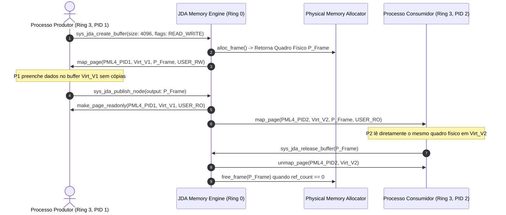

# JDA Kernel Integration & Zero-Copy Page Remapping Specification v0.1

## 1. Auditoria Crítica dos Resultados da Fase 2

A Fase 2 comprovou com sucesso o funcionamento formal do Grafo Acíclico Dirigido (DAG), a rejeição de ciclos e a contabilidade estatística em espaço de usuário (`tools/jda-sim`).

Entretanto, uma postura científica rigorosa exige distinguir com clareza o que foi comprovado e quais limites persistem:

### 1.1. Diferenciação Metodológica Obrigatória
1. **Comportamento do Simulador (`tools/jda-sim`)**:
   - Opera sob o runtime `std` da máquina host (Windows x86-64 com alocador de sistema).
   - O compartilhamento Zero-Copy utilizou `Arc<Vec<u8>>`, que é compartilhamento de ponteiro no **mesmo espaço de endereçamento de um único processo host**.
   - **Isso NÃO comprova compartilhamento seguro de páginas físicas entre processos distintos com isolamento de Ring 3.**
2. **Algoritmo Isolado vs. Custo no Kernel**:
   - O algoritmo DFS de detecção de ciclo tem complexidade $O(V + E)$ e aloca vetores booleanos dinâmicos (`vec![false; n]`).
   - No microkernel `no_std`, onde o heap é limitado a 16 MiB e não deve fragmentar, o motor in-kernel do JDA ([`src/jda/graph.rs`](file:///e:/Projetos/Jinn/src/jda/graph.rs)) utiliza uma máscara de bits estática de 64 bits (`u64`), que atinge complexidade de verificação $O(1)$ sem nenhuma alocação dinâmica.
3. **Plausibilidade dos Percentis e Ruído de Medição**:
   - Em cargas ultrarrápidas (< 10 µs, como a Carga 9 e Carga 10), as latências registradas de $0\text{ µs}$ refletem a resolução do relógio do sistema operacional hospedeiro, que tem granulação em microsegundos.
   - Ganhos reportados em torno de $1.00\text{x}$ a $1.03\text{x}$ (Cargas 5, 7 e 8) estão dentro da margem de ruído do escalonador do host e devem ser interpretados como "equivalência de desempenho", e não como aceleração comprovada.

---

## 2. Arquitetura de Compartilhamento Real de Páginas Físicas (Zero-Copy Paging)

Para que o JDA realize transferência Zero-Copy legítima entre processos Ring 3 e o microkernel, o mecanismo deve operar no nível do **Gerenciador de Memória Virtual (PML4)**:



### 2.1. Estrutura do Descritor de Compartilhamento Físico (`PhysicalPageBuffer`)
```rust
pub struct PhysicalPageBuffer {
    pub frame_phys_addr: u64,
    pub page_count: usize,
    pub ref_count: usize,
    pub is_read_only: bool,
    pub owner_pid: usize,
}
```

### 2.2. Regras Formais de Segurança de Memória
1. **Transição de Propriedade**: Enquanto um processo produtor estiver escrevendo em um buffer (`USER_RW`), nenhum outro processo poderá mapeá-lo.
2. **Imutabilidade em Compartilhamento**: Quando o nó do DAG é concluído e repassa o buffer a múltiplos consumidores (ex.: nós paralelos de um diamante fork-join), a página física é rebaixada para somente-leitura (`USER_RO`) em todos os espaços de endereçamento.
3. **Prevenção de Uso Após Liberação (Use-After-Free)**: O desalocador de frames físicos (`memory::free_frame`) só é acionado quando `ref_count` atinge rigorosamente zero.
4. **Isolamento de Quebras de Processo**: Se um processo cliente em Ring 3 falhar (GPF, Page Fault ou término inesperado), o escalonador do JDA no kernel desassocia as páginas mapeadas e decrementa os contadores de referência correspondentes, impedindo vazamentos de RAM física.

---

## 3. Contratos de Integração entre Subsistemas

### 3.1. Contrato JDA $\leftrightarrow$ Armazenamento (Storage)
- **Operação de Leitura de Bloco Assíncrona**:
  - O subsistema de armazenamento expõe uma fila de nós JDA do tipo `OpKind::IoAsync`.
  - O buffer de destino do setor lido do disco (512B) é preenchido diretamente pelo controlador IDE/DMA no quadro de memória do nó.
  - Ao concluir a leitura do setor, o driver notifica o JDA via interrupção de I/O, resolvendo a dependência e liberando imediatamente as tarefas de parsing (ex: VFS / FAT32) sem bloqueio ativo da CPU.

### 3.2. Contrato JDA $\leftrightarrow$ Aladdin Desktop
- **Superfície Gráfica Zero-Copy**:
  - Cada janela ou aplicação Ring 3 obtém uma região de páginas físicas mapeadas onde desenha sua interface de forma independente.
  - A submissão do quadro para composição é feita via notificação assíncrona ao JDA contendo o `DirtyRect` afetado.
  - O compositor do Aladdin realiza a composição das superfícies lendo as páginas compartilhadas sem necessidade de duplicar o buffer em IPC ou transitar por memória intermediária no heap do kernel.
