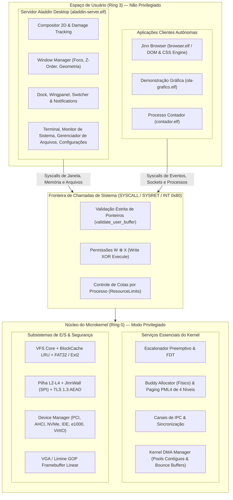
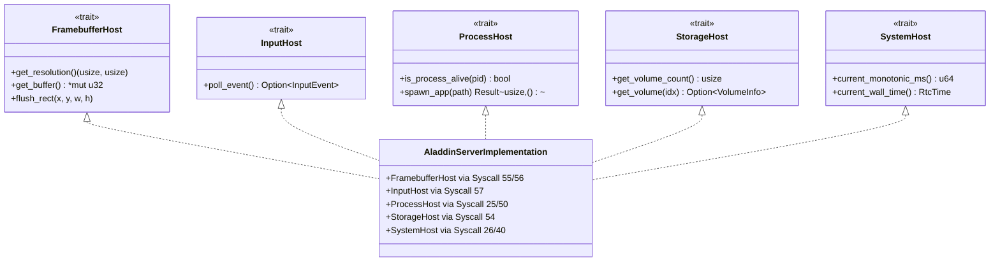
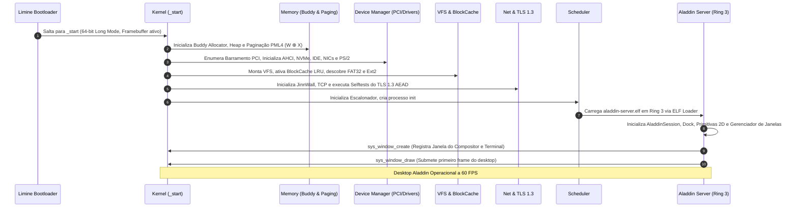

# 🏛️ Jinn OS — Estado Atual da Arquitetura de Sistemas

> **Documento Oficial de Engenharia — Etapa A (Consolidação Tecnológica)**  
> **Data de Auditoria:** 16 de Novembro de 2026 | **Branch:** `main` | **Commit Base:** `447780e`  

---

## 1. Visão Geral da Arquitetura e Fronteiras de Isolamento

O **Jinn OS** é estruturado como um **microkernel modular** em Rust `#![no_std]`, complementado pelo ambiente de espaço de usuário **Aladdin Desktop (Ring 3)**. A premissa central de sua arquitetura é a mínima intervenção em privilégio de núcleo (Ring 0) e a estrita separação entre mecanismos essenciais do sistema operacional e serviços gráficos.

---

## 2. Contratos de Isolamento entre Aladdin e o Microkernel

O ambiente Aladdin comunica-se com o microkernel através de contratos abstratos (*Traits* do Rust) definidos em `D:\Projetos\Aladdin\src\contracts\`, garantindo baixo acoplamento:

* **Independência de Compilação:** O Aladdin Desktop pode ser testado no host ou executado em Ring 3 no Jinn OS simplesmente substituindo as implementações de `Host`.
* **Zero Acesso Direto a Registradores de Hardware:** O servidor Aladdin nunca toca diretamente em portas I/O x86 (`0x3C0`, `0xCF8`, `0x60`) ou registradores MMIO; todas as operações fluem pelas chamadas de sistema intermediadas pelo kernel.

---

## 3. Fluxo de Inicialização: Do Bootloader ao Primeiro Frame Gráfico

O processo de bootstrap do sistema segue um pipeline linear determinístico:

---

## 4. Consumo de Memória e Perfis de Hardware em Runtime

O Jinn OS utiliza um sistema de perfis dinâmicos de hardware (`HardwareProfile`) para ajustar suas cotas em tempo de inicialização:

| Perfil | Faixa de RAM Física | Frames Máximos Ring 3 | Janelas Máximas | Buffers JDA | Buffers DMA Bounce |
|---|---|:---:|:---:|:---:|:---:|
| **Legacy** | $\le$ 64 MB | 3.584 (14 MiB) | 4 | 4 | 8 |
| **Compact** | 65 MB a 128 MB | 7.168 (28 MiB) | 6 | 8 | 16 |
| **Standard** | 129 MB a 256 MB | 14.336 (56 MiB) | 8 | 16 | 32 |
| **Performance** | 257 MB a 1 GB | 32.768 (128 MiB) | 12 | 32 | 64 |
| **HighEnd** | > 1 GB | 65.536 (256 MiB) | 16 | 64 | 128 |

### Orçamento de Memória Medido sob Perfil Legacy (64 MB Total):
* **Kernel BSS + Data + Code:** ~1,8 MB
* **Tabelas de Páginas de 4 Níveis (PML4):** ~512 KB
* **Heap Dinâmico do Kernel:** ~2,0 MB
* **BlockCache LRU (VFS):** ~1,0 MB
* **Buffer Linear de Vídeo GOP (1024x768x32):** ~3,0 MB
* **Heap `.bss` do Aladdin Server (Ring 3):** ~14,0 MB (alocação sob demanda)
* **Pilha e Dados do Jinn Browser:** ~3,5 MB
* **RAM FÍSICA OCUPADA REAL:** **~25,8 MB de 64 MB** (~38,2 MB de margem livre para cache e processos).

---

## 5. Auditoria da FPU e Estado Numérico

### 5.1. O que está implementado:
* **Detecção CPUID:** Módulo `src/cpu.rs` detecta e registra `has_fpu`, `has_sse`, `has_sse2`, `has_sse3`, `has_ssse3`, `has_sse4_1`, `has_sse4_2`, `has_avx`, `has_avx2`, `has_fma`.
* **Habilitação de Registradores de Controle:** Função `cpu::enable_sse()` ajusta:
  * `CR0.EM` (bit 2) $\to$ `0` (desativa emulação de coprocessador).
  * `CR0.MP` (bit 1) $\to$ `1` (ativa monitoramento de coprocessador).
  * `CR4.OSFXSR` (bit 9) $\to$ `1` (habilita suporte a instruções `FXSAVE`/`FXRSTOR` e instruções SSE/SSE2).
  * `CR4.OSXMMEXCPT` (bit 10) $\to$ `1` (habilita exceção `#XM` para erros SIMD).

### 5.2. O que NÃO está implementado (Gargalo Crítico):
* **Falta de Salvamento de Estado na Troca de Tarefas:**
  * O bloco `Task` em `src/scheduler.rs` e o stub de interrupção em `src/interrupts/stubs.s` salvam apenas os registradores gerais (GPRs: `RAX..R15`).
  * O bloco de 512 bytes exigido por `FXSAVE`/`FXRSTOR` (contendo `ST0..ST7`, `XMM0..XMM15` e `MXCSR`) **não existe** na estrutura `Task`.
  * **Consequência Técnica:** Se dois processos executarem operações de ponto flutuante ou cálculos numéricos simultâneos, os registradores `XMM` sofrerão corrupção cruzada durante a preempção temporal.

---

## 6. Auditoria de GPU e Aceleração Gráfica

### 6.1. O que está implementado:
* **Enumeração PCI:** O módulo `src/drivers/pci.rs` reconhece dispositivos com `Class Code 0x03` (`Display: VGA Compatible Controller` ou `Display: Other Display Controller`).
* **Renderização Linear:** O módulo `src/vga.rs` desenha diretamente no buffer de memória linear alocado pelo bootloader Limine (GOP).
* **Renderização de Software 2D:** O Aladdin Desktop possui primitivas 2D completas implementadas em software puro em `src/compositor/primitives.rs`.

### 6.2. O que NÃO está implementado:
* **Ausência de Abstração de Acelerador:** Não há interface unificada de comando de GPU (`GpuDevice`, `GpuBuffer`, `GpuCommandQueue`).
* **Ausência de Drivers Especializados:** Não há driver para VirtIO-GPU, Bochs BGA, VMware SVGA ou chipsets Intel/AMD.
* **Operação Totalmente por CPU:** Todas as operações gráficas (preenchimento, cópia de blocos, composição de janelas e texto) competem por ciclos da CPU principal.

---

## 7. Auditoria do Escalonador e Preempção

### 7.1. O que está implementado:
* Escalonamento Round-Robin de prioridades estáticas (`Realtime`, `High`, `Normal`, `Idle`) com fatias temporais (*quantums*) fornecidas pelo timer.
* Suporte a cooperação voluntária via `yield_now()` e pausas temporizadas via `sleep_ms()`.
* Múltiplos núcleos de processamento (SMP) descobertos e inicializados via INIT-SIPI.

### 7.2. O que NÃO está implementado:
* **Fila Compartilhada Única com Spinlock Global:** Todos os núcleos competem por um mesmo lock para selecionar a próxima tarefa, gerando contenção em SMP $\ge 4$.
* **Ausência de Preempção Adaptativa:** O escalonador não ajusta dinamicamente a prioridade de processos com base em interatividade (ex.: janelas ativas vs tarefas de fundo).
* **Ausência de Aquecimento de Recursos:** Recursos (páginas de código, arquivos e buffers) são carregados de forma puramente reativa, causando picos de latência na primeira execução.
