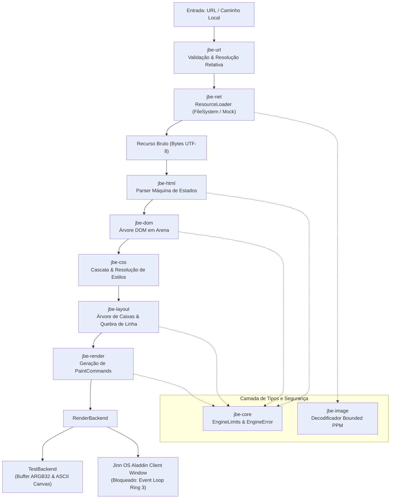

# Jinn Browser Engine — Arquitetura e Especificação da Versão 0.2.1

## 1. Visão Geral e Objetivos

O **Jinn Browser** é o motor de renderização nativo e navegador estático do ecossistema **Jinn OS**, desenvolvido em Rust com uma fundação própria ("in-house").

### 1.1 Objetivos da Versão 0.1.0
- **Motor próprio e independente**: Zero dependência de motores legados externos (Chromium, Blink, Gecko, WebKit, Servo).
- **Desacoplamento modular**: Separação estrita em crates com responsabilidades bem definidas (`jbe-core`, `jbe-url`, `jbe-dom`, `jbe-html`, `jbe-css`, `jbe-layout`, `jbe-render`, `jbe-image`, `jbe-net` e `jinn-browser`).
- **Navegação estática e determinística**: Suporte a documentos HTML estruturados locais e virtuais.
- **Segurança rigorosa por construção**: Proteção contra exaustão de pilha (limite de profundidade de nós), limites rígidos de alocação de memória, resolução de caminhos sem travessia de diretório (`directory traversal`), ausência deliberada de execução de scripts (sem JavaScript) e rejeição tipada de esquemas não criptografados ou desprotegidos.
- **Backend determinístico de testes e rasterizador de software**: Backend com registro de comandos, verificação por coordenadas e rasterizador interno com fonte bitmap 8x8.

### 1.2 Não-Objetivos da Versão 0.1.0
- **Execução de scripts**: JavaScript/WASM deliberadamente não suportados nesta fase.
- **TLS/HTTPS completo**: Rejeição explícita de `https://` até a integração formal de pilha criptográfica com validação de certificados X.509.
- **Modelos complexos de layout**: Flexbox, CSS Grid, floats, posicionamento absoluto e transições animadas.
- **Navegação por abas múltiplas e extensões**: O foco é a estabilidade do pipeline de renderização unificado.

---

## 2. Diagrama Arquitetural



---

## 3. Responsabilidade dos Módulos

| Crate | Responsabilidade Principal | Invariantes e Limites |
| :--- | :--- | :--- |
| **`jbe-core`** | Tipos fundamentais (`Point`, `Rect`, `Edges`, `Color`, `NodeId`, `ResourceId`), erros tipados (`EngineError`) e limites de segurança (`EngineLimits`). | Coordenadas geométricas explícitas; cores ARGB32; limites padrão (512 KiB por doc, 1000 nós, profundidade máxima 32). |
| **`jbe-url`** | Representação de URLs, parser formal, classificação de esquemas (`file`, `http`, `https`, `about`) e resolução relativa normalizada. | Rejeição de `javascript:` e `data:`; bloqueio em `normalize_path` caso `..` tente escapar além da raiz (`SecurityViolation`). |
| **`jbe-dom`** | Arena determinística de nós (`DomTree`, `Node`, `NodeType`), armazenamento de atributos, percurso pré-ordem e consultas por tag. | Validação de limites em tempo de inserção; detecção de ciclos de parentesco; sem ponteiros soltos. |
| **`jbe-html`** | Parser baseado em máquina de estados finitos explícita (sem regex); tokens de tags de abertura/fechamento, comentários e texto; auto-recuperação. | Suporte a void elements (`br`, `hr`, `img`, etc.); fechamento implícito de tags `<p>`, `<li>`; recuperação de tags malformadas ou truncadas. |
| **`jbe-css`** | Parser de subconjunto CSS, seletores simples (tag, classe, id), cálculo de especificidade, folha de estilos padrão User-Agent e herança de propriedades. | Folha de estilos padrão para Dark Mode do Jinn OS; herança de `color`, `font-size`, `font-weight`, `text-align`; especificidade determinística. |
| **`jbe-layout`** | Motor de fluxo de blocos (`Block Flow`); cálculo do modelo de caixas (content, padding, border, margin), posicionamento vertical e quebra de linhas de texto. | Modelo de caixas retangulares 2D; cálculo de métricas de glifos e quebra em palavras; nós com `display: none` não geram caixas. |
| **`jbe-render`** | Transformação da árvore de layout em stream ordenada de comandos de pintura (`PaintCommand`), mapeamento de links clicáveis e backend de teste. | Backend determinístico em memória (`TestBackend`) com rasterizador para fonte bitmap 8x8 e geração de canvas ASCII para testes e host CLI. |
| **`jbe-image`** | Decodificação segura e limitada de imagens Netpbm PPM (P3 ASCII e P6 binário). | Validação de cabeçalho, limite de dimensões (max 2048x2048), limite de contagem de pixels e limite de bytes descompactados (max 8 MiB). |
| **`jbe-net`** | Abstração `ResourceLoader`, carregador local de arquivos (`FileSystemLoader`) com sandbox de diretório raiz e loader de simulação (`MockLoader`). | Restrição estrita de acesso a caminhos fora do diretório raiz permitido; desabilitação explícita de `https://` até haver TLS. |
| **`jinn-browser`** | Aplicação executável de referência e gerenciador de sessão (`BrowserSession`), suporte a histórico (`back`, `forward`, `reload`) e CLI interativa. | Integração do fluxo fim-a-fim, CLI demonstrativa, simulação de clique em links e renderização visual. |

---

## 4. Instruções de Build e Execução de Testes

### 4.1 Requisitos
- Ferramenta Rust (edição 2021) com `cargo`.
- Host: Windows, Linux ou macOS.

### 4.2 Compilação do Workspace do Browser
```bash
# Compilar todos os crates do motor de renderização
cargo build --manifest-path browser/Cargo.toml
```

### 4.3 Execução da Suíte Completa de Testes
```bash
# Executa os 39 testes unitários e de integração de todos os submódulos
cargo test --manifest-path browser/Cargo.toml
```

### 4.4 Execução da Demonstração Host CLI
```bash
# Executa a aplicação de demonstração com páginas interativas e render ASCII
cargo run --manifest-path browser/Cargo.toml --package jinn-browser
```

### 4.5 Execução com Arquivo HTML Local
```bash
cargo run --manifest-path browser/Cargo.toml --package jinn-browser -- /caminho/para/arquivo.html
```

---

## 5. Exemplos de Documentos Suportados

### 5.1 Documento Estruturado com Estilos e Links
```html
<html>
    <head>
        <style>
            body { background-color: #12121a; color: #f0f0f5; padding: 12px; }
            .card { background-color: #1a1a2e; border: 2px; border-color: #00d2ff; padding: 10px; margin: 8px 0; }
            h1 { color: #00d2ff; font-size: 20px; }
            p { color: #b0b0c0; font-size: 12px; }
            a { color: #00ffaa; font-weight: bold; }
        </style>
    </head>
    <body>
        <div class="card">
            <h1>Jinn OS Browser</h1>
            <p>Renderizador estático nativo operando com fluxo de blocos.</p>
            <p><a href="about.html">Saiba Mais &gt;</a></p>
        </div>
    </body>
</html>
```

### 5.2 Imagem e Elementos Void
```html
<div>
    <h1>Visualizador de Imagens</h1>
    <p>Imagem PPM incorporada:</p>
    
    <hr>
    <p>Linha após separador horizontal.</p>
</div>
```

---

## 6. Política de Segurança

1. **Entrada Hostil por Padrão**: Qualquer documento HTML, CSS ou imagem decodificada é tratado como entrada potencialmente adversária.
2. **Defesa contra Exaustão de Recursos**:
   - `max_document_size`: Rejeição imediata de documentos com mais de 512 KiB.
   - `max_dom_nodes`: Limite estrito de 1.000 nós no arena DOM.
   - `max_dom_depth`: Limite de 32 níveis de profundidade, impedindo estouro de pilha por recursão.
   - `max_attributes_per_element`: Máximo de 32 atributos por elemento.
   - `max_attribute_length`: 512 bytes no máximo por string de atributo.
   - `max_image_dimension`: Dimensão máxima de 2048x2048 pixels.
   - `max_decompressed_bytes`: 8 MiB no máximo para descompressão de imagem em memória.
3. **Isolamento de Diretórios Locais (`Directory Traversal Guard`)**:
   - O normalizador `jbe_url::normalize_path` detecta e bloqueia ativamente qualquer referência `..` que tente escapar além da raiz da autoridade ou base.
   - O `FileSystemLoader` valida canonicalização contra a raiz autorizada (`root_dir`).
4. **Sem Execução de Código Nativo ou Scripts**:
   - URLs `javascript:` são categoricamente rejeitadas com `EngineError::SecurityViolation`.
   - Tags `<script>` têm estilo `display: none` e seu conteúdo textual não é executado nem avaliado.
5. **Rejeição de HTTPS sem Criptografia Falsa**:
   - URLs `https://` são rejeitadas com erro explícito (`EngineError::UnsupportedScheme` / `EngineError::SecurityViolation`). Não há tentativa de carregar tráfego TLS sem verificação formal da cadeia de certificados.

---

## 7. Dependências e Licenças

O motor do Jinn Browser v0.1.0 foi desenvolvido de forma puramente proprietária ("clean-room in-house"), com **zero dependências externas**:
- Dependências de crates externos no `Cargo.lock`: `0`.
- Apenas biblioteca padrão Rust e tipos centrais (`core`, `alloc`, `std`).
- Licença compatível com o ecossistema Jinn OS (MIT / Apache-2.0).

---

## 8. Estado da Integração Nativa no Jinn OS (Versão 0.2.1)

### 8.1 Separação Arquitetural: Motor Host vs. Binário Bare-Metal Ring 3
É fundamental distinguir os dois componentes do ecossistema do navegador:
1. **Motor de Renderização (`browser/`)**:
   - Desenvolvido em Rust com biblioteca padrão (`std`), projetado para compilação multiplataforma e suíte determinística com 42 testes unitários e de integração (HTML, CSS, DOM, Layout em blocos, Decodificação de imagem Netpbm, PaintCommands, viewport scrolling e hit-testing).
   - Executa no host via `cargo run --manifest-path browser/Cargo.toml` gerando rasterização em memória e canvas ASCII.
2. **Aplicação Gráfica Nativa Ring 3 (`apps/ola-mundo/src/browser.rs`)**:
   - Binário ELF `#![no_std]` executado diretamente pelo microkernel Jinn OS em Ring 3 sem biblioteca C ou runtime dinâmico.
   - Executa o pipeline completo de ponta a ponta: carrega `/disk/INDEX.HTM` do VFS via `sys_open`/`sys_read`, realiza parsing HTML de máquina de estados em memória determinística, constrói blocos DOM e Box Model com quebra de linhas, rasteriza o documento no framebuffer da janela via Syscalls 20 (`sys_window_create`) e 21 (`sys_window_update`), trata cliques em links com resolução de URL relativa para `/disk/ABOUT.HTM`, gerencia histórico de navegação com botão Voltar `[<]`, e executa rolagem vertical na viewport com clipping estrito e fechamento gracioso via Syscall 22 (`sys_window_close`).

### 8.2 Capacidades Validadas no Aladdin Desktop e Syscall 24
- **Syscall 24 (`sys_window_poll_event`)**:
  - Contrato binário rigorosamente validado (`ClientWindowEvent`: 32 bytes, alinhamento a 8 bytes).
  - Validação completa de ponteiros de usuário através de `validate_user_buffer`, cobrindo limites canônicos (`USER_SPACE_MIN..USER_SPACE_MAX`), páginas intermediárias e rejeição segura de ponteiros que cruzam limites de páginas não mapeadas (`-EFAULT`).
  - Isolamento por PID: uma tarefa só pode colher eventos de janelas cujo `owner_pid` coincida com seu próprio PID.
- **Ciclo de Vida de Fechamento (`EVENT_WINDOW_CLOSE`)**:
  - O clique no botão `[X]` da barra de título do Aladdin dispara o ciclo em dois estágios: assinala `close_requested = true`, oculta a janela (`is_open = false`) e enfileira `EVENT_WINDOW_CLOSE` com proteção prioritária contra descarte.
  - A aplicação cliente colhe o evento via Syscall 24 e invoca `sys_window_close(win_id)`, liberando a memória e a cota do processo.
  - Caso o cliente não responda ou em caso de segundo clique no botão de fechamento, o compositor destrói forçosamente a janela.
  - No encerramento do processo (`sys_exit`), `close_windows_for_pid(pid)` garante que nenhuma janela ou fila órfã permaneça em memória.
- **Proteção Anti-Overflow na Fila de Eventos**:
  - Fila circular de 16 slots por janela (`ClientEventQueue`).
  - Ao atingir capacidade máxima por saturação de eventos de entrada (mouse/teclado), a fila descarta o evento mais antigo que **não seja** `EVENT_WINDOW_CLOSE` (`drop_oldest_non_close`), garantindo que o sinal de fechamento da aplicação nunca seja perdido.

### 8.3 Realidade de Hardware e Limitações Conhecidas
1. **Despacho de Teclado**: O driver PS/2 atual do Jinn OS converte scancodes diretamente para caracteres ASCII imprimíveis na fila de entrada, despachando `EVENT_KEY_DOWN` para a janela em foco. Eventos de soltura (`EVENT_KEY_UP`) não são gerados pelo driver de hardware atual.
2. **Rolagem do Mouse**: O driver de mouse opera com pacotes PS/2 padrão de 3 bytes (sem extensão de 4 bytes do protocolo wheel IntelliMouse). Portanto, `EVENT_SCROLL` via hardware físico não é emitido pelo driver de mouse; a rolagem é controlada por teclado ou pela interação direta com a barra de rolagem (scrollbar) desenhada na interface cliente.

---

## 9. Matriz de Funcionalidades (Versão 0.2.1)

| Funcionalidade | Estado | Notas |
| :--- | :--- | :--- |
| **Workspace e Tipos Básicos (`jbe-core`)** | `Implementado e testado` | 4 testes unitários OK. Tipos geométricos, limites configuráveis e erros tipados. |
| **Parser de URLs e Resolução (`jbe-url`)** | `Implementado e testado` | 6 testes unitários OK. Parser de `file:`, `http:`, `about:`, normalização e anti-traversal. |
| **Parser HTML Máquina de Estados (`jbe-html`)** | `Implementado e testado` | 6 testes unitários OK. Parsing de elementos, void tags, atributos, entidades e auto-recuperação. |
| **Árvore e Arena DOM (`jbe-dom`)** | `Implementado e testado` | 4 testes unitários OK. Armazenamento de nós em arena, percurso e limites de nós/profundidade. |
| **Cascata e Estilos CSS (`jbe-css`)** | `Implementado e testado` | 4 testes unitários OK. Seletores simples, especificidade, cascata, herança e folha UA dark. |
| **Layout de Fluxo de Blocos (`jbe-layout`)** | `Implementado e testado` | 2 testes unitários OK. Modelo de caixas (margin, border, padding), empilhamento vertical e quebra de linhas. |
| **Gerador de Paint Commands (`jbe-render`)** | `Implementado e testado` | 2 testes unitários OK. Geração de `FillRect`, `DrawBorder`, `DrawText`, `RegisterClickRegion`. |
| **Decodificador de Imagens Bounded (`jbe-image`)** | `Implementado e testado` | 3 testes unitários OK. Formatos Netpbm PPM (P3/P6) com validação de dimensões e memória. |
| **Carregador de Recursos Local (`jbe-net`)** | `Implementado e testado` | 2 testes unitários OK. Carregamento via filesystem com sandbox de diretório raiz. |
| **Aplicação de Referência CLI (`jinn-browser`)** | `Implementado e testado` | 9 testes de integração OK. Histórico (`back`, `forward`, `reload`), simulação de clique e render ASCII. |
| **Syscall 24 e Fila de Eventos (`ClientWindowEvent`)** | `Implementado e testado` | Testes unitários no Aladdin (23/23 OK) e validação adversarial no QEMU (`test_adv_window_events`). |
| **Ciclo de Vida de `EVENT_WINDOW_CLOSE` e Overflow** | `Implementado e testado` | Dois estágios de fechamento, preservação prioritária na fila circular contra descarte. |
| **Despacho de Entrada no Aladdin** | `Implementado e testado` | `EVENT_MOUSE_DOWN`, `EVENT_MOUSE_UP` e `EVENT_KEY_DOWN` encaminhados à janela com foco. |
| **Rolagem e Superfície Gráfica em Ring 3** | `Implementado e testado` | Validação nativa no QEMU via `apps/ola-mundo` com 3 quadros sucessivos de rolagem e fechamento. |
| **Transporte HTTP em Rede Real** | `Planejado` | Abstração pronta em `jbe-net`; depende de integração com sockets TCP Ring 3. |
| **Suporte a HTTPS / TLS** | `Não implementado` | Rejeição ativa de esquemas `https:` até implementação de validação X.509. |
| **JavaScript / DOM Dinâmico** | `Não implementado` | Deliberadamente fora do escopo para assegurar sandbox e determinismo. |

---

## 10. Roadmap Técnico

- **v0.2.1 (Auditoria de Integração, Ciclo de Vida de Eventos e Validação Nativa)** — **CONCLUÍDO ✅**:
  - Auditoria e correção da perda de eventos em `EVENT_WINDOW_CLOSE` no Aladdin Compositor.
  - Implementação de proteção anti-overflow (`drop_oldest_non_close`) na fila circular `ClientEventQueue`.
  - Mapeamento e despacho efetivo de cliques de mouse (`EVENT_MOUSE_DOWN`, `EVENT_MOUSE_UP`) e teclas (`EVENT_KEY_DOWN`) para a janela ativa.
  - Validação estrita da Syscall 24 contra ataques de ponteiro nulo, kernel space, endereços não mapeados e buffers cruzando fronteiras de página.
  - Execução e comprovação no QEMU com suíte adversarial completa e demonstração visual de rolagem em Ring 3.
- **v0.3.0 (Recursos e Imagens Expandidas)**:
  - Decodificação de BMP e PNG básico (usando decodificador próprio limitado).
  - Suporte a formulários estáticos simples (`<input>`, `<button>`).
- **v0.4.0 (Rede HTTP Básica)**:
  - Conexão do `jbe-net` aos sockets TCP validados do Jinn OS (`sys_socket`, `sys_connect`, `sys_send`, `sys_recv`).
  - Parser de respostas HTTP/1.1 estáticas (status 200, 301, 404).

---

## 11. Dualidade Arquitetural: Motor Modular (browser/) vs. Implementação Bare-Metal (apps/ola-mundo)

O ecossistema do Jinn Browser adota deliberadamente uma estratégia em duas frentes complementares:

### 11.1 Motor Modular em Workspace (rowser/)
- **Composição**: 8 crates especializadas (jbe-core, jbe-url, jbe-dom, jbe-html, jbe-css, jbe-layout, jbe-render, jbe-image, jbe-net, jinn-browser).
- **Ambiente de Execução**: Host (std/lloc), permitindo testes unitários, testes de regressão automatizados e desenvolvimento ágil com estruturas dinâmicas (Vec, String, Box, cálculos de ponto flutuante).
- **Cobertura**: 41 testes unitários e de integração com cobertura rigorosa de parser HTML, resolução de especificidade CSS, modelo de caixas, decodificação PPM e integridade de URL.
- **Papel no Projeto**: Especificação viva e motor modular de referência visando a v0.3.0.

### 11.2 Executável Nativo Ring 3 Bare-Metal (pps/ola-mundo/src/browser.rs + main.rs)
- **Composição**: Executável único compilado como target bare-metal x86_64-jinn-user (-Zbuild-std=core -Zbuild-std-features=compiler-builtins-mem), empacotado como /disk/browser.elf no sistema de arquivos FAT32 do disco rígido virtual.
- **Ambiente de Execução**: Ring 3 sob o microkernel Jinn OS com isolamento de memória, preempção por hardware e sem dependência de alocador de heap (#![no_std], no-alloc). Utiliza estruturas estáticas com limites determinísticos (MAX_HISTORY = 8, buffers de 64 bytes para URLs, 32 linhas de layout e 8 regiões clicáveis).
- **Interface Gráfica e Compositor**: Comunicação bidirecional com o Aladdin Desktop Compositor através das syscalls 20 (sys_window_create), 21 (sys_window_update), 22 (sys_window_close) e 24 (sys_window_poll_event).
- **Funcionalidades de Usuário**:
  - Botões Voltar [<], Avançar [>] (com styling dinâmico ativo/inativo) e Recarregar [R].
  - Barra de endereços interativa com foco por clique, edição de texto ASCII, exclusão via Backspace e navegação via Enter.
  - Viewport de conteúdo com quebra de linhas, suporte a links clicáveis e barra de rolagem proporcional com hit-test.

### 11.3 Estratégia de Unificação (Roadmap v0.3.0)
Conforme o runtime de Ring 3 do Jinn OS estabilizar a integração de alocadores de usuário (lloc) e syscalls de expansão de heap (sys_brk / sys_mmap), as crates jbe-* serão compiladas diretamente para o target de usuário, unificando a árvore de código do workspace rowser/ com o executável /disk/browser.elf.
