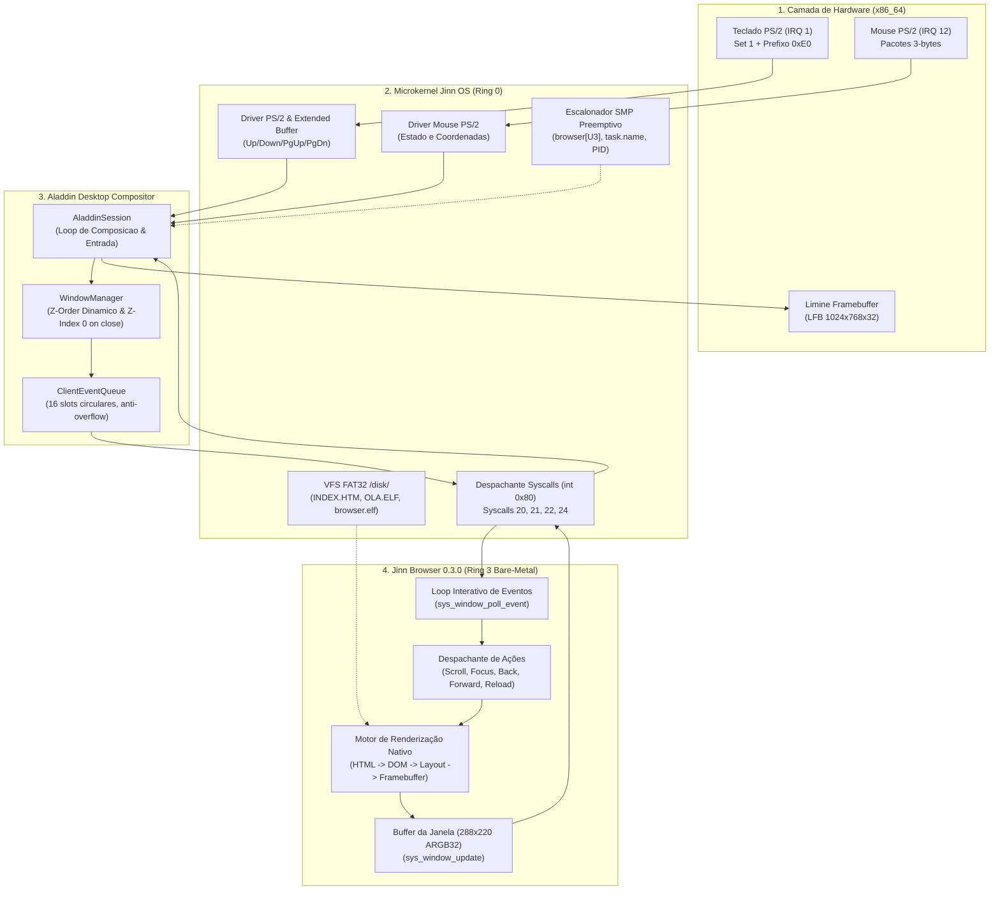

# Jinn Browser Engine — Arquitetura e Especificação da Versão 0.3.0

## 1. Resumo Executivo (Versão 0.3.0)

O **Jinn Browser 0.3.0** consolida o navegador nativo do microkernel **Jinn OS** e do ambiente gráfico **Aladdin Desktop Compositor** como um aplicativo estável, interativo e utilizável de primeira classe.

Diferente de versões conceituais ou autotestes sintéticos, a versão 0.3.0 entrega:
- **Lançamento de Primeira Classe**: Disparo pelo Menu Iniciar, Dock, atalho do Terminal e comandos de console, com identificação de propriedade do processo (`window.owner_pid` e `task.name`), prevenindo spoofing de janelas.
- **Pipeline de Interação Real Fim-a-Fim**: Recepção e tratamento direto de eventos de hardware (teclado PS/2 estendido com scancodes de setas e paginação, mouse com hit-testing determinístico), fluindo pelo driver, compositor Aladdin e syscalls de Ring 3.
- **Interface Gráfica e Navegação**: Histórico bidirecional (Voltar `[<]`, Avançar `[>]`, Recarregar `[R]`), barra de endereços com seleção completa e substituição automática na digitação, indicador visual de cursor, suporte a links locais e páginas de status embutidas (`about:version`, `about:blank`, `about:blocked`, `about:offline`, 404).
- **Segurança e Isolamento Bare-Metal**: Execução estrita em Ring 3 sem biblioteca padrão (`#![no_std]`, no-alloc), proteção ativa de fronteira contra escape de diretório (`..` e caminhos fora de `/disk/`), bloqueio de esquemas não suportados e contenção contra exaustão de pilha ou memória.
- **Validação de Hardware no QEMU**: Suíte de testes interativos automatizados via monitor TCP injetando teclado real externamente, sem mocks ou suposições de emulação do convidado.

---

## 2. Diagrama Arquitetural Fim-a-Fim



---

## 3. Contrato de Integração com o Aladdin Desktop

A comunicação entre o microkernel Jinn OS, o compositor Aladdin e a aplicação gráfica cliente em Ring 3 ocorre através de um protocolo binário formal baseado em chamadas de sistema:

### 3.1 Syscalls de Superfície e Janelamento

| Syscall | Número | Assinatura e Argumentos | Retorno | Descrição |
| :--- | :---: | :--- | :--- | :--- |
| `sys_window_create` | `20` | `rdi: *const u8` (título UTF-8), `rsi: usize` (largura), `rdx: usize` (altura) | `i64`: ID da janela (`0..7`) ou código de erro negativo (`-EMFILE`, `-EINVAL`, `-EFAULT`) | Cria uma janela cliente alocando buffer gerenciado e fila de eventos, associando `owner_pid` à tarefa chamadora. |
| `sys_window_update` | `21` | `rdi: usize` (ID da janela), `rsi: *const u32` (ponteiro do buffer), `rdx: usize` (tamanho em bytes) | `i64`: `0` em sucesso ou erro negativo | Copia os pixels da aplicação cliente para o backbuffer do compositor e marca o retângulo da janela como sujo (`dirty`). |
| `sys_window_close` | `22` | `rdi: usize` (ID da janela) | `i64`: `0` em sucesso ou erro negativo | Notifica o compositor do fechamento formal da janela, liberando os recursos associados e reorganizando a ordem Z. |
| `sys_window_poll_event` | `24` | `rdi: usize` (ID da janela), `rsi: *mut ClientWindowEvent` (ponteiro de destino) | `i64`: `1` se evento colhido, `0` se fila vazia, `-1` se janela inválida ou fechada, `-EFAULT` se ponteiro inválido | Consulta a fila circular da janela cliente sem bloquear a execução da tarefa. |

### 3.2 Estrutura Binária de Eventos (`ClientWindowEvent`)

A estrutura possui exatamente **32 bytes** de tamanho, com alinhamento a 8 bytes:

```rust
#[repr(C)]
pub struct ClientWindowEvent {
    pub event_type: u32,     // 0..3: Offset 0x00
    pub win_id: u32,         // 4..7: Offset 0x04
    pub x: i32,              // 8..11: Offset 0x08 (coordenada X local à área cliente)
    pub y: i32,              // 12..15: Offset 0x0C (coordenada Y local à área cliente)
    pub button_or_key: u32,  // 16..19: Offset 0x10 (código ASCII, scancode ou botão)
    pub _padding: u32,       // 20..23: Offset 0x14 (alinhamento a 64 bits)
    pub timestamp: u64,      // 24..31: Offset 0x18 (ticks do relógio do sistema)
}
```

#### Tipos de Eventos (`event_type`):
- `EVENT_WINDOW_CLOSE` (`1`): Solicitação de fechamento enviada pelo compositor (clique no botão `[X]` da barra de título).
- `EVENT_MOUSE_DOWN` (`2`): Pressionamento de botão do mouse com coordenadas relativas à área de conteúdo da janela.
- `EVENT_MOUSE_UP` (`3`): Soltura de botão do mouse.
- `EVENT_KEY_DOWN` (`4`): Tecla pressionada encaminhada à janela que detém o foco ativo.

### 3.3 Formato do Buffer Gráfico

- **Dimensões padrão da janela cliente**: 288 pixels de largura por 220 pixels de altura.
- **Formato de Pixel**: ARGB32 / BGRX (32 bits por pixel: `0x00RRGGBB`).
- **Stride**: Contíguo (288 `u32` words por scanline, sem padding extra).
- **Validação de Ponteiros de Usuário**: O kernel valida através de `validate_user_buffer` se o buffer do cliente reside integralmente no espaço de usuário (`0x0000_0000_0040_0000..0x0000_7FFF_FFFF_0000`), rejeitando qualquer tentativa de apontar para espaço de kernel (`-EFAULT`).

---

## 4. Mecanismo de Lançamento e Identificação de Propriedade

Para evitar vulnerabilidades de spoofing de janelas (onde um processo não autorizado cria uma janela fingindo ser o navegador), a identificação do navegador é estrita:

1. **Associação por PID e Nome de Tarefa**:
   - Ao carregar `/disk/browser.elf`, o escalonador atribui a tag `"browser[U3]"` à tarefa (`task.name`).
   - O compositor Aladdin mantém `browser_pid: Option<usize>` e `browser_win_id: Option<usize>`.
   - O registro do PID do navegador é feito em tempo de spawn (`register_browser_pid(pid)`), conferindo integridade independente de convenções de título de janela.
2. **Fluxos de Inicialização Homologados**:
   - **Start Menu**: O item "Navegador Web" dispara `proc_host.spawn_app("/disk/browser.elf")`.
   - **Dock**: O ícone Web chama `launch_or_focus_browser()`. Se a janela já existir, ela é trazida para frente (`bring_to_front`) e desminimizada; caso contrário, o executável é lançado.
   - **Terminal Interativo**: O botão `[Web]` na barra do terminal e os comandos `browser` ou `spawn /disk/browser.elf` no terminal despacham a criação da tarefa.
   - **Kernel Shell (Console Ring 0)**: O comando de texto `browser` executa `cmd_spawn(w, "/disk/browser.elf")` registrando o PID na sessão do compositor.
3. **Ciclo de Vida de Fechamento**:
   - O encerramento da janela (via clique no `[X]`, pressionamento de `q` ou `sys_exit`) aciona `close_window(idx)` no `WindowManager`.
   - **Prevenção de Foco Fantasma**: Ao fechar a janela, o `WindowManager` remove a janela do topo do vetor de ordenação Z (`order`), deslocando-a para a base (posição 0). Assim, `top_window_id()` imediatamente aponta para a janela anterior aberta (como o Terminal), restaurando a recepção de teclado sem perda de foco.

---

## 5. Pipeline de Entrada e Hardware

### 5.1 Trajeto de Entrada de Teclado
```
[Teclado PS/2] -> IRQ 1 -> Driver ps2_keyboard
      |
      v (Rastreia prefixo 0xE0 para Setas e PgUp/PgDn)
[keyboard_buffer] -> AladdinSession::run() -> poll_keyboard()
      |
      v
[WindowManager::top_window_id()] -> Janela Ativa do Browser
      |
      v
[ClientEventQueue::push()] -> EVENT_KEY_DOWN
      |
      v (Ring 3: sys_window_poll_event)
[BrowserSession::address_key() ou Teclas de Navegação]
      |
      +--> '/' ou Tab: Foca a barra de endereços (seleciona todo o texto)
      +--> Caractere ASCII (com seleção ativa): Substitui o texto pelo caractere digitado
      +--> Backspace (com seleção ativa): Limpa a barra de endereços
      +--> Enter: Dispara navegação para a URL editada
      +--> Down / 'j': Rolagem +20px
      +--> Up / 'k': Rolagem -20px
      +--> Page Down / Space: Rolagem +80px
      +--> Page Up: Rolagem -80px
      +--> 'b' / Backspace (fora de edição): Histórico Voltar
      +--> 'f' / 'l': Histórico Avançar
      +--> 'r': Recarregar página
      +--> 'q' / Escape: Fechar janela e encerrar processo
```

### 5.2 Trajeto de Entrada de Mouse
```
[Mouse PS/2] -> IRQ 12 -> Driver ps2_mouse (x, y, botões)
      |
      v
[AladdinSession::run()] -> Hit-test na área cliente da janela
      |
      v
[ClientEventQueue::push()] -> EVENT_MOUSE_DOWN (x, y locais)
      |
      v (Ring 3: sys_window_poll_event)
[BrowserSession::handle_click()]
      |
      +--> Botão [<] (x: 4..16, y: 3..24): Voltar histórico
      +--> Botão [>] (x: 17..27, y: 3..24): Avançar histórico
      +--> Botão [R] (x: 28..40, y: 3..24): Recarregar página
      +--> Barra de Endereços (x: 44..282, y: 3..24): Focar e selecionar texto
      +--> Barra de Rolagem (x: 274..282, y: 26..220): Hit-test de scroll proporcional
      +--> Links do Documento: Resolução de link relativo e navegação
```

---

## 6. Arquitetura Modular e Workspace

O ecossistema do Jinn Browser é composto por **10 crates estritas** organizadas no workspace `browser/`, além da aplicação bare-metal Ring 3:

### 6.1 Lista Completa de Crates (`browser/`)

| # | Crate | Caminho | Responsabilidade Principal |
| :-: | :--- | :--- | :--- |
| 1 | **`jbe-core`** | `browser/crates/jbe-core` | Tipos geométricos primitivos (`Point`, `Rect`, `Edges`, `Color`), nós de árvore, identificadores e limites estruturais de segurança (`EngineLimits`, `EngineError`). |
| 2 | **`jbe-url`** | `browser/crates/jbe-url` | Parser formal de URLs, classificação de esquemas (`file:`, `http:`, `about:`), normalização de caminhos e bloqueio contra traversals (`SecurityViolation`). |
| 3 | **`jbe-dom`** | `browser/crates/jbe-dom` | Arena determinística de nós DOM, percurso em pré-ordem, armazenamento de atributos e validação de limites de profundidade/nós. |
| 4 | **`jbe-html`** | `browser/crates/jbe-html` | Parser HTML em máquina de estados finitos sem regex, suporte a elementos void (`br`, `hr`, `img`), fechamento implícito e auto-recuperação de erros. |
| 5 | **`jbe-css`** | `browser/crates/jbe-css` | Parser de CSS, seletores simples, cálculo determinístico de especificidade, cascata, herança de estilos e folha padrão User-Agent (Dark Theme). |
| 6 | **`jbe-layout`** | `browser/crates/jbe-layout` | Motor de fluxo de blocos 2D (Block Flow), cálculo de modelo de caixas (content, padding, border, margin), quebra em linhas de texto e altura total. |
| 7 | **`jbe-render`** | `browser/crates/jbe-render` | Geração da stream ordenada de comandos de pintura (`PaintCommand`), mapeamento de caixas clicáveis para hit-testing e backend em memória `TestBackend`. |
| 8 | **`jbe-image`** | `browser/crates/jbe-image` | Decodificador seguro com limites rígidos de dimensões e descompressão para imagens bitmap Netpbm PPM (P3 ASCII e P6 binário). |
| 9 | **`jbe-net`** | `browser/crates/jbe-net` | Abstração `ResourceLoader`, carregador de arquivos locais `FileSystemLoader` com restrição estrita de raiz e simulador de testes `MockLoader`. |
| 10 | **`jinn-browser`** | `browser/jinn-browser` | Aplicação executável de referência e gerenciador de sessão interativa com histórico bidirecional, suporte CLI e render ASCII para ambiente host. |

### 6.2 Aplicação Bare-Metal Ring 3 (`apps/ola-mundo/src/browser.rs`)

Para permitir que o navegador execute no microkernel nativo sob `#![no_std]` (sem dependência de alocador de heap dinâmico na fase de inicialização), a aplicação cliente de produção adota uma arquitetura determinística com limites fixos:
- Memória estática: `WIN_BUF` de 288x220 words (253.440 bytes) e `HTML_FILE_BUF` de 4 KiB.
- Limite de histórico: 8 páginas em buffer circular bidirecional (`history_back` e `history_fwd`).
- Limite de layout: 32 linhas de texto com quebra automática e até 8 regiões clicáveis ativas por documento.
- Subconjunto HTML suportado nativamente: `<html>`, `<head>`, `<title>`, `<body>`, `<h1>`, `<p>`, `<a>`, `<hr>`, com suporte a atributos de link (`href`).

---

## 7. Política de Segurança e Isolamento

1. **Canonicalização e Fronteira de Acesso Local**:
   - Todo acesso local é restrito à partição `/disk/`.
   - Se o alvo contiver `..` (tentativa de directory traversal), ele é bloqueado e mapeado para a página embutida `about:blocked`.
   - Caminhos absolutos que tentem escapar de `/disk/` (ex: `/kernel/`, `/dev/`) são bloqueados com `about:blocked`.
2. **Esquemas de Rede Desabilitados com Mensagem Didática**:
   - Tentativas de navegação para `http://` ou `https://` são interceptadas e redirecionadas para `about:offline`. Não há tráfego de rede desprotegido nem TLS fictício.
3. **Páginas Especiais Embutidas (`about:*`)**:
   - `about:blank`: Página limpa em branco.
   - `about:version`: Página de diagnóstico e telemetria informando versão do motor, microkernel e compositor.
   - `about:blocked`: Página de bloqueio de segurança contra traversals ou caminhos não autorizados (403).
   - `about:offline`: Página de aviso de rede desabilitada.
   - `404`: Página amigável de recurso local não localizado no VFS FAT32.
4. **Isolamento de Memória por Hardware**:
   - A aplicação executa estritamente em **Ring 3 (CPL=3)** com tabela de páginas de 4 níveis exclusiva (`PML4` de usuário).
   - Tentativas de acesso direto ao hardware ou memória do kernel geram Page Fault (#PF) ou General Protection Fault (#GP), abortando a tarefa com segurança sem afetar o sistema.

---

## 8. Evidências de Testes e Validação

### 8.1 Resultados das Suítes Locais
- **Workspace do Browser (10 crates)**: 42 testes executados e aprovados (`cargo test --manifest-path browser/Cargo.toml`).
- **Compositor Aladdin**: 25 testes unitários e de protocolo de janelas aprovados (`cargo test --manifest-path E:\Projetos\Aladdin\Cargo.toml`).
- **ELF & Disco FAT32**: 18 testes aprovados (`tools/elf-tests`).
- **Pilha de Rede & Firewall**: 39 testes aprovados (`tools/net-tests`).
- **Subsistema JDA & Armazenamento**: 22 testes aprovados (`tools/jda-sim`).

### 8.2 Teste de Integração Real no QEMU (`scripts/test_interactive_browser.py`)
Executado com injeção externa de teclado via monitor QEMU:
- `[PASS] [BROWSER-INTERACTION] WINDOW_CREATED win_id=5`
- `[PASS] [BROWSER-INTERACTION] ACTION ScrollDown`
- `[PASS] [BROWSER-INTERACTION] ACTION ScrollUp`
- `[PASS] [BROWSER-INTERACTION] ACTION PageDown`
- `[PASS] [BROWSER-INTERACTION] ACTION PageUp`
- `[PASS] [BROWSER-INTERACTION] ACTION KeyFocusAddress`
- `[PASS] [BROWSER-INTERACTION] ACTION AddressBar Navigate target=about:version`
- `[PASS] [BROWSER-INTERACTION] PAGE_LOADED target=about:version`
- `[PASS] [BROWSER-INTERACTION] ACTION KeyBack`
- `[PASS] [BROWSER-INTERACTION] ACTION KeyForward`
- `[PASS] [BROWSER-INTERACTION] ACTION KeyReload`
- `[PASS] [BROWSER-INTERACTION] ACTION KeyClose`
