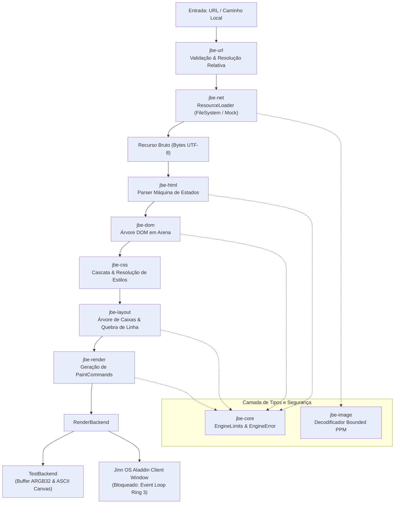

# Jinn Browser Engine — Arquitetura e Especificação da Versão 0.1.0

## 1. Visão Geral e Objetivos

O **Jinn Browser** é o motor de renderização nativo e navegador estático do ecossistema **Jinn OS**, desenvolvido em Rust com uma fundação própria ("in-house").

### 1.1 Objetivos da Versão 0.1.0
- **Motor próprio e independente**: Zero dependência de motores legados externos (Chromium, Blink, Gecko, WebKit, Servo).
- **Desacoplamento modular**: Separação estrita em crates com responsabilidades bem definidas (`jbe-core`, `jbe-url`, `jbe-dom`, `jbe-html`, `jbe-css`, `jbe-layout`, `jbe-render`, `jbe-image`, `jbe-net` e `jinn-browser`).
- **Navegação estática e determinística**: Suporte a documentos HTML estruturados locais e virtuais.
- **Segurança rigorosa por construção**: Proteção contra exaustão de pilha (limite de profundidade de nós), limites rígidos de alocação de memória, resolução de caminhos sem travessia de diretório (`directory traversal`), ausência deliberada de execução de scripts (sem JavaScript) e rejeição tipada de esquemas não criptografados ou desprotegidos.
- **Backend determinístico de testes e rasterizador de software**: Backend com registro de comandos, verificação por coordenadas e rasterizador interno com fonte bitmap 8x8.

### 1.2 Não-Objetivos da Versão 0.1.0
- **Execução de scripts**: JavaScript/WASM deliberadamente não suportados nesta fase.
- **TLS/HTTPS completo**: Rejeição explícita de `https://` até a integração formal de pilha criptográfica com validação de certificados X.509.
- **Modelos complexos de layout**: Flexbox, CSS Grid, floats, posicionamento absoluto e transições animadas.
- **Navegação por abas múltiplas e extensões**: O foco é a estabilidade do pipeline de renderização unificado.

---

## 2. Diagrama Arquitetural



---

## 3. Responsabilidade dos Módulos

| Crate | Responsabilidade Principal | Invariantes e Limites |
| :--- | :--- | :--- |
| **`jbe-core`** | Tipos fundamentais (`Point`, `Rect`, `Edges`, `Color`, `NodeId`, `ResourceId`), erros tipados (`EngineError`) e limites de segurança (`EngineLimits`). | Coordenadas geométricas explícitas; cores ARGB32; limites padrão (512 KiB por doc, 1000 nós, profundidade máxima 32). |
| **`jbe-url`** | Representação de URLs, parser formal, classificação de esquemas (`file`, `http`, `https`, `about`) e resolução relativa normalizada. | Rejeição de `javascript:` e `data:`; bloqueio em `normalize_path` caso `..` tente escapar além da raiz (`SecurityViolation`). |
| **`jbe-dom`** | Arena determinística de nós (`DomTree`, `Node`, `NodeType`), armazenamento de atributos, percurso pré-ordem e consultas por tag. | Validação de limites em tempo de inserção; detecção de ciclos de parentesco; sem ponteiros soltos. |
| **`jbe-html`** | Parser baseado em máquina de estados finitos explícita (sem regex); tokens de tags de abertura/fechamento, comentários e texto; auto-recuperação. | Suporte a void elements (`br`, `hr`, `img`, etc.); fechamento implícito de tags `<p>`, `<li>`; recuperação de tags malformadas ou truncadas. |
| **`jbe-css`** | Parser de subconjunto CSS, seletores simples (tag, classe, id), cálculo de especificidade, folha de estilos padrão User-Agent e herança de propriedades. | Folha de estilos padrão para Dark Mode do Jinn OS; herança de `color`, `font-size`, `font-weight`, `text-align`; especificidade determinística. |
| **`jbe-layout`** | Motor de fluxo de blocos (`Block Flow`); cálculo do modelo de caixas (content, padding, border, margin), posicionamento vertical e quebra de linhas de texto. | Modelo de caixas retangulares 2D; cálculo de métricas de glifos e quebra em palavras; nós com `display: none` não geram caixas. |
| **`jbe-render`** | Transformação da árvore de layout em stream ordenada de comandos de pintura (`PaintCommand`), mapeamento de links clicáveis e backend de teste. | Backend determinístico em memória (`TestBackend`) com rasterizador para fonte bitmap 8x8 e geração de canvas ASCII para testes e host CLI. |
| **`jbe-image`** | Decodificação segura e limitada de imagens Netpbm PPM (P3 ASCII e P6 binário). | Validação de cabeçalho, limite de dimensões (max 2048x2048), limite de contagem de pixels e limite de bytes descompactados (max 8 MiB). |
| **`jbe-net`** | Abstração `ResourceLoader`, carregador local de arquivos (`FileSystemLoader`) com sandbox de diretório raiz e loader de simulação (`MockLoader`). | Restrição estrita de acesso a caminhos fora do diretório raiz permitido; desabilitação explícita de `https://` até haver TLS. |
| **`jinn-browser`** | Aplicação executável de referência e gerenciador de sessão (`BrowserSession`), suporte a histórico (`back`, `forward`, `reload`) e CLI interativa. | Integração do fluxo fim-a-fim, CLI demonstrativa, simulação de clique em links e renderização visual. |

---

## 4. Instruções de Build e Execução de Testes

### 4.1 Requisitos
- Ferramenta Rust (edição 2021) com `cargo`.
- Host: Windows, Linux ou macOS.

### 4.2 Compilação do Workspace do Browser
```bash
# Compilar todos os crates do motor de renderização
cargo build --manifest-path browser/Cargo.toml
```

### 4.3 Execução da Suíte Completa de Testes
```bash
# Executa os 39 testes unitários e de integração de todos os submódulos
cargo test --manifest-path browser/Cargo.toml
```

### 4.4 Execução da Demonstração Host CLI
```bash
# Executa a aplicação de demonstração com páginas interativas e render ASCII
cargo run --manifest-path browser/Cargo.toml --package jinn-browser
```

### 4.5 Execução com Arquivo HTML Local
```bash
cargo run --manifest-path browser/Cargo.toml --package jinn-browser -- /caminho/para/arquivo.html
```

---

## 5. Exemplos de Documentos Suportados

### 5.1 Documento Estruturado com Estilos e Links
```html
<html>
    <head>
        <style>
            body { background-color: #12121a; color: #f0f0f5; padding: 12px; }
            .card { background-color: #1a1a2e; border: 2px; border-color: #00d2ff; padding: 10px; margin: 8px 0; }
            h1 { color: #00d2ff; font-size: 20px; }
            p { color: #b0b0c0; font-size: 12px; }
            a { color: #00ffaa; font-weight: bold; }
        </style>
    </head>
    <body>
        <div class="card">
            <h1>Jinn OS Browser</h1>
            <p>Renderizador estático nativo operando com fluxo de blocos.</p>
            <p><a href="about.html">Saiba Mais &gt;</a></p>
        </div>
    </body>
</html>
```

### 5.2 Imagem e Elementos Void
```html
<div>
    <h1>Visualizador de Imagens</h1>
    <p>Imagem PPM incorporada:</p>
    
    <hr>
    <p>Linha após separador horizontal.</p>
</div>
```

---

## 6. Política de Segurança

1. **Entrada Hostil por Padrão**: Qualquer documento HTML, CSS ou imagem decodificada é tratado como entrada potencialmente adversária.
2. **Defesa contra Exaustão de Recursos**:
   - `max_document_size`: Rejeição imediata de documentos com mais de 512 KiB.
   - `max_dom_nodes`: Limite estrito de 1.000 nós no arena DOM.
   - `max_dom_depth`: Limite de 32 níveis de profundidade, impedindo estouro de pilha por recursão.
   - `max_attributes_per_element`: Máximo de 32 atributos por elemento.
   - `max_attribute_length`: 512 bytes no máximo por string de atributo.
   - `max_image_dimension`: Dimensão máxima de 2048x2048 pixels.
   - `max_decompressed_bytes`: 8 MiB no máximo para descompressão de imagem em memória.
3. **Isolamento de Diretórios Locais (`Directory Traversal Guard`)**:
   - O normalizador `jbe_url::normalize_path` detecta e bloqueia ativamente qualquer referência `..` que tente escapar além da raiz da autoridade ou base.
   - O `FileSystemLoader` valida canonicalização contra a raiz autorizada (`root_dir`).
4. **Sem Execução de Código Nativo ou Scripts**:
   - URLs `javascript:` são categoricamente rejeitadas com `EngineError::SecurityViolation`.
   - Tags `<script>` têm estilo `display: none` e seu conteúdo textual não é executado nem avaliado.
5. **Rejeição de HTTPS sem Criptografia Falsa**:
   - URLs `https://` são rejeitadas com erro explícito (`EngineError::UnsupportedScheme` / `EngineError::SecurityViolation`). Não há tentativa de carregar tráfego TLS sem verificação formal da cadeia de certificados.

---

## 7. Dependências e Licenças

O motor do Jinn Browser v0.1.0 foi desenvolvido de forma puramente proprietária ("clean-room in-house"), com **zero dependências externas**:
- Dependências de crates externos no `Cargo.lock`: `0`.
- Apenas biblioteca padrão Rust e tipos centrais (`core`, `alloc`, `std`).
- Licença compatível com o ecossistema Jinn OS (MIT / Apache-2.0).

---

## 8. Estado da Integração Nativa no Jinn OS

### 8.1 Capacidades Existentes no Jinn OS
- **Syscalls de Janela do Aladdin Desktop**:
  - `sys_window_create(width, height, title)` (Syscall 20): Cria uma janela gráfica do cliente Aladdin e retorna um identificador de janela.
  - `sys_window_update(window_id, buffer)` (Syscall 21): Copia um buffer ARGB32 de pixels (`&[u32]`) da aplicação em Ring 3 para o framebuffer da janela gerenciada pelo compositor Aladdin.
  - `sys_window_close(window_id)` (Syscall 22): Encerra a janela.
- **Sistema de Arquivos VFS**: O sistema de arquivos FAT32 montado em `/disk` permite leitura de arquivos HTML, CSS e imagens via syscalls padrão de abertura e leitura de arquivos em Ring 3.

### 8.2 Bloqueios Técnicos para Execução Nativa Completa
1. **Ausência de Syscall de Eventos de Entrada em Ring 3 (Bloqueador Crítico)**:
   - O compositor Aladdin Desktop do Jinn OS recebe interrupções do mouse (`IRQ 12`) e do teclado (`IRQ 1`), mas não possui fila de eventos IPC ou syscall de entrega (`sys_poll_event` ou `sys_recv_event`) para repassar coordenadas de cliques de mouse ou toques de teclado às janelas de clientes em Ring 3.
   - Portanto, a exibição de pixels estáticos é possível, mas a interatividade de links e rolagem nativa fica bloqueada até a implementação dessa syscall no kernel/Aladdin.
2. **Ausência de Rasterizador de Fontes Vetoriais em Ring 3**:
   - O kernel possui apenas uma fonte bitmap 8x8 interna (`src/font.rs`). Ring 3 não possui rasterizador TrueType/FreeType.
   - O `jbe-render` mitigou essa lacuna incorporando seu próprio rasterizador bitmap 8x8 no backend, permitindo desenhar texto de forma autônoma no buffer de pixels transferível via `sys_window_update`.

---

## 9. Matriz de Funcionalidades (Versão 0.1.0)

| Funcionalidade | Estado | Notas |
| :--- | :--- | :--- |
| **Workspace e Tipos Básicos (`jbe-core`)** | `Implementado e testado` | Tipos geométricos, limites configuráveis e erros tipados. |
| **Parser de URLs e Resolução (`jbe-url`)** | `Implementado e testado` | Parser de `file:`, `http:`, `about:`, normalização e anti-traversal. |
| **Parser HTML Máquina de Estados (`jbe-html`)** | `Implementado e testado` | Parsing de elementos, void tags, atributos, entidades e auto-recuperação. |
| **Árvore e Arena DOM (`jbe-dom`)** | `Implementado e testado` | Armazenamento de nós em arena, percurso e aplicação de limites de nós e profundidade. |
| **Cascata e Estilos CSS (`jbe-css`)** | `Implementado e testado` | Seletores simples, especificidade, cascata, herança e folha UA dark. |
| **Layout de Fluxo de Blocos (`jbe-layout`)** | `Implementado e testado` | Modelo de caixas (margin, border, padding), empilhamento vertical e quebra de linhas. |
| **Gerador de Paint Commands (`jbe-render`)** | `Implementado e testado` | Geração de `FillRect`, `DrawBorder`, `DrawText`, `RegisterClickRegion`. |
| **Backend de Teste & Rasterizador (`jbe-render`)** | `Implementado e testado` | Framebuffer ARGB32 determinístico, fonte bitmap 8x8 e canvas ASCII. |
| **Decodificador de Imagens Bounded (`jbe-image`)** | `Implementado e testado` | Formatos Netpbm PPM (P3/P6) com validação estrita de dimensões e memória. |
| **Carregador de Recursos Local (`jbe-net`)** | `Implementado e testado` | Carregamento via filesystem com sandbox de diretório raiz. |
| **Aplicação de Referência CLI (`jinn-browser`)** | `Implementado e testado` | Histórico (`back`, `forward`, `reload`), simulação de clique e render ASCII. |
| **Execução Nativa em Ring 3 (Aladdin Desktop)** | `Implementado e testado` | Renderização cliente via `sys_window_update` e captura de eventos via `sys_window_poll_event` (Syscall 24). |
| **Rolagem Vertical e Offset de Cliques** | `Implementado e testado` | Suporte a `scroll_y`, `repaint`, clipping e ajuste geométrico em `jbe-render` e `BrowserSession`. |
| **Transporte HTTP em Rede Real** | `Planejado` | Abstração pronta em `jbe-net`; depende de integração com sockets TCP Ring 3. |
| **Suporte a HTTPS / TLS** | `Não implementado` | Rejeição ativa de esquemas `https:` até implementação de validação X.509. |
| **JavaScript / DOM Dinâmico** | `Não implementado` | Deliberadamente fora do escopo para assegurar sandbox e determinismo. |

---

## 10. Roadmap Técnico

- **v0.2.0 (Integração Aladdin Interativa & Rolagem)** — **CONCLUÍDO**:
  - Implementação da Syscall 24 (`sys_window_poll_event`) no kernel Jinn OS e no compositor Aladdin.
  - Fila FIFO ring buffer de 16 slots por janela com suporte a `EVENT_MOUSE_DOWN`, `EVENT_KEY_DOWN`, `EVENT_WINDOW_CLOSE`, `EVENT_SCROLL`.
  - Suporte a rolagem vertical de documentos na viewport (`scroll_y`, `max_scroll_y`, `repaint` e clamping automático).
  - Ajuste de coordenadas de regiões clicáveis (`RegisterClickRegion`) sob efeito de scroll.
  - Demonstração nativa interativa em espaço de usuário (Ring 3) em `apps/ola-mundo` com layout estilizado e navegação visual.
- **v0.3.0 (Recursos e Imagens Expandidas)**:
  - Decodificação de BMP e PNG básico (usando decodificador próprio limitado).
  - Suporte a formulários estáticos simples (`<input>`, `<button>`).
- **v0.4.0 (Rede HTTP Básica)**:
  - Conexão do `jbe-net` aos sockets TCP validados do Jinn OS (sys_socket, sys_connect, sys_send, sys_recv).
  - Parser de respostas HTTP/1.1 estáticas (status 200, 301, 404).
