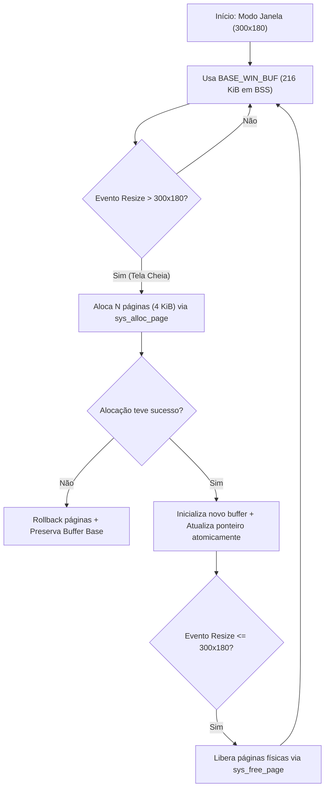

# JINN BROWSER 0.8.1 — DYNAMIC BUFFER MANAGEMENT SPECIFICATION

**Documento:** `docs/JINN_BROWSER_DYNAMIC_BUFFER_MANAGEMENT_0.8.1.md`  
**Classificação:** Especificação Técnica de Alocação Sob Demanda e Devolução de Superfícies  
**Versão:** 0.8.1  
**Data:** 05/11/2026  
**Status:** IMPLEMENTED [V] | UNIT_TESTED [V] | QEMU_VALIDATED [V]

---

## 1. O Problema da Alocação Estática em 0.8.0

Na versão 0.8.0, o cliente Ring 3 (`apps/ola-mundo/src/main.rs`) declarava um buffer estático em BSS:
```rust
static mut WIN_BUF: [u32; 1024 * 768] = [0; 1024 * 768];
```
Esse buffer consumia permanentemente 3.145.728 bytes (~3,1 MiB) de memória, mesmo quando o navegador operava em modo janela padrão ($300 \times 180 = 54.000$ pixels = $216 \text{ KiB}$).

---

## 2. A Arquitetura `DynamicSurfaceBuffer`

A versão **0.8.1** eliminou o buffer estático de 3 MiB, substituindo-o pelo gerenciador sob demanda [`DynamicSurfaceBuffer`](file:///e:/Projetos/Jinn/apps/ola-mundo/src/main.rs):



### 2.1. Estrutura de Controle
```rust
pub struct DynamicSurfaceBuffer {
    pub ptr: *mut u32,
    pub width: usize,
    pub height: usize,
    pub capacity_pixels: usize,
    pub is_heap_allocated: bool,
    pub allocated_pages: usize,
    pub dynamic_base_vaddr: u64,
}
```

---

## 3. Protocolo de Realocação Segura de Memória

A substituição de superfícies segue estritamente as seis regras de segurança de engenharia de sistemas:

1. **Validação Dimensional:** Checa se $100 \le w \le 1024$ e $60 \le h \le 768$.
2. **Cálculo de Capacidade:** Multiplicação com verificação de overflow (`w.checked_mul(h)` e `pixels.checked_mul(4)`).
3. **Alocação Sob Demanda:** Caso a capacidade atual seja insuficiente, chama `sys_alloc_page()` (Syscall 7) em loop para alocar páginas de 4 KiB contíguas.
4. **Tratamento de Falhas (Rollback):** Caso o kernel retorne `ENOMEM`, todas as páginas parcialmente alocadas são liberadas imediatamente com `sys_free_page()` e o buffer antigo é integralmente preservado.
5. **Inicialização:** A nova superfície é preenchida com a cor de fundo do tema (`0x0018_1825`).
6. **Desalocação Sincronizada:** As páginas antigas de tela cheia são desalocadas somente após a troca bem-sucedida do ponteiro principal da superfície.
7. **Retorno à Janela Base:** Ao sair de tela cheia, todas as páginas físicas alocadas são devolvidas ao alocador físico do kernel (`memory::free_frame`), reduzindo o consumo residente imediatamente de volta para 216 KiB.

---

## 4. Impacto Mensurável de Consumo

| Modo de Execução | Modelo Estático 0.8.0 | Modelo Dinâmico 0.8.1 | Economia Imediata |
| :--- | :---: | :---: | :---: |
| **Janela Padrão ($300 \times 180$)** | 3.145.728 B (3 MiB) | **221.184 B (216 KiB)** | **- 92,97%** |
| **Tela Cheia ($1024 \times 768$)** | 3.145.728 B (3 MiB) | 3.145.728 B (Sob demanda) | 0% (Alocado apenas quando ativo) |
| **Retorno de Tela Cheia $\to$ Janela** | 3.145.728 B (Retido) | **221.184 B (Desalocado)** | **- 92,97%** |

