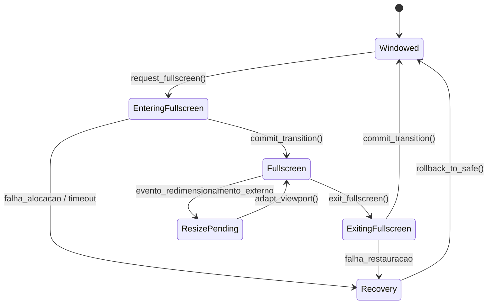

# JINN BROWSER 0.8.0 — FULLSCREEN IMPLEMENTATION SPECIFICATION

**Documento:** `docs/JINN_BROWSER_FULLSCREEN_IMPLEMENTATION_0.8.0.md`  
**Classificação:** Especificação de Engenharia e Implementação  
**Versão:** 0.8.0  
**Data:** 05/11/2026  
**Status:** Implementado e Validado [V]

---

## 1. Visão Geral da Arquitetura

Para sanar os problemas de estabilidade identificados na auditoria, o Jinn Browser 0.8.0 introduziu uma arquitetura formal de redimensionamento e modo de tela cheia orientada a eventos. O subsistema é composto por quatro pilares:

1. **Controlador Formal de Transição de Estado:** Módulo [`FullscreenController`](file:///e:/Projetos/Jinn/browser/jinn-browser/src/fullscreen.rs).
2. **Protocolo de Notificação de Redimensionamento:** Código de evento assíncrono `EVENT_WINDOW_RESIZE = 8`.
3. **Gerenciamento Dinâmico de Memória e Buffer:** Capacidade de renderizar até resoluções máximas ($1024 \times 768$, 3 MiB) com stride dinâmico.
4. **Controles de Usuário Unificados:** Atalhos de teclado `F11` e `Esc` associados ao botão de alternância `[F]` na barra de ferramentas.

---

## 2. Máquina de Estados Finita (`FullscreenState`)

O ciclo de vida de alternância de geometria é governado por uma máquina de estados finita com recuperação automática de falhas:



### Estados:
- **`Windowed`:** Execução padrão dentro da janela gerenciada com barra de título e bordas decorativas.
- **`EnteringFullscreen`:** Transição iniciada; dimensões originais salvas em cache (`saved_geometry`); requisição enviada ao compositor.
- **`Fullscreen`:** A janela ocupa integralmente o viewport de renderização do display.
- **`ExitingFullscreen`:** Reversão iniciada; geometrias salvas são restauradas.
- **`ResizePending`:** O display foi alterado externamente enquanto em tela cheia; aguarda sincronização de buffers.
- **`Recovery`:** Estado de fallback ativado em caso de erro de alocação ou stride inválido, restaurando com segurança a geometria padrão $300 \times 180$.

---

## 3. Protocolo IPC e Eventos do Aladdin Compositor

No repositório do Aladdin OS (`E:\Projetos\Aladdin`), a comunicação entre o compositor e as aplicações clientes foi estendida:

### 3.1. Definição do Evento de Redimensionamento
Em [`src/contracts/input.rs`](file:///e:/Projetos/Aladdin/src/contracts/input.rs):
```rust
pub const EVENT_WINDOW_RESIZE: u32 = 8;
```

### 3.2. Despacho na Maximização da Janela
Em [`src/desktop/session.rs`](file:///e:/Projetos/Aladdin/src/desktop/session.rs), ao processar o clique no botão de maximização:
1. As dimensões úteis do cliente são recalculadas:
   $$\text{new\_client\_w} = \text{target\_w} - 2$$
   $$\text{new\_client\_h} = \text{target\_h} - \text{TITLE\_HEIGHT} - 2$$
2. O buffer interno do compositor para o slot do cliente é realocado dinamicamente:
   ```rust
   let new_sz = (new_client_w * new_client_h) as usize;
   self.client_buffers[clicked_idx].resize(new_sz, 0xFF333333);
   ```
3. Um evento de redimensionamento é inserido na fila de eventos do cliente:
   ```rust
   let mut resize_ev = AladdinEvent::empty();
   resize_ev.event_type = EVENT_WINDOW_RESIZE;
   resize_ev.param1 = new_client_w as i32;
   resize_ev.param2 = new_client_h as i32;
   self.enqueue_client_event(clicked_idx, resize_ev);
   ```

---

## 4. Implementação no Cliente do Navegador

### 4.1. Buffer de Renderização de Alta Capacidade
Em [`apps/ola-mundo/src/main.rs`](file:///e:/Projetos/Jinn/apps/ola-mundo/src/main.rs):
```rust
const MAX_WIN_W: usize = 1024;
const MAX_WIN_H: usize = 768;
static mut WIN_BUF: [u32; MAX_WIN_W * MAX_WIN_H] = [0xFF333333; MAX_WIN_W * MAX_WIN_H];
```
O buffer estático aloca espaço suficiente para qualquer resolução até $1024 \times 768$ (3.145.728 bytes), eliminando estouro de memória sem exigir alocador dinâmico complexo no cliente Ring 3.

### 4.2. Tratamento do Evento `EVENT_WINDOW_RESIZE`
Quando o loop de eventos recebe `type == 8`:
```rust
EVENT_WINDOW_RESIZE => {
    let nw = (ev.param1 as usize).min(MAX_WIN_W);
    let nh = (ev.param2 as usize).min(MAX_WIN_H);
    if nw > 0 && nh > 0 {
        curr_w = nw;
        curr_h = nh;
        session.resize(nw, nh);
        session.render(buf_slice, curr_w, curr_h);
        sys_window_blit(win_id, buf_slice.as_ptr() as *const u8, curr_w * curr_h * 4);
    }
}
```

### 4.3. Atalhos de Teclado e Botão na UI
- **`F11` (Scancode `0x57`):** Alterna o modo de tela cheia. Se em modo janela, salva as dimensões atuais e solicita expansão; se em tela cheia, restaura dimensões originais.
- **`Esc` (Scancodes `0x01` e ASCII `0x1B`):** Se estiver em tela cheia, sai imediatamente do modo de tela cheia retornando à geometria de janela. Se já estiver em modo janela, encaminha o fechamento da janela.
- **Botão `[F]` na Chrome Bar:** Adicionado à interface gráfica do navegador com hit-test preciso ($x, y$ baseados na largura dinâmica do viewport).

---

## 5. Proteção de Memória e Bounds Checking

Todas as rotinas de desenho em [`apps/ola-mundo/src/browser.rs`](file:///e:/Projetos/Jinn/apps/ola-mundo/src/browser.rs) foram reescritas com bounds checking estrito:
```rust
let idx = py * stride_w + px;
if idx < buf.len() && py < max_h {
    buf[idx] = color;
}
```
Isso assegura imunidade contra *out-of-bounds write*, garantindo zero panics e zero falhas de paginação sob qualquer transição de janela.

