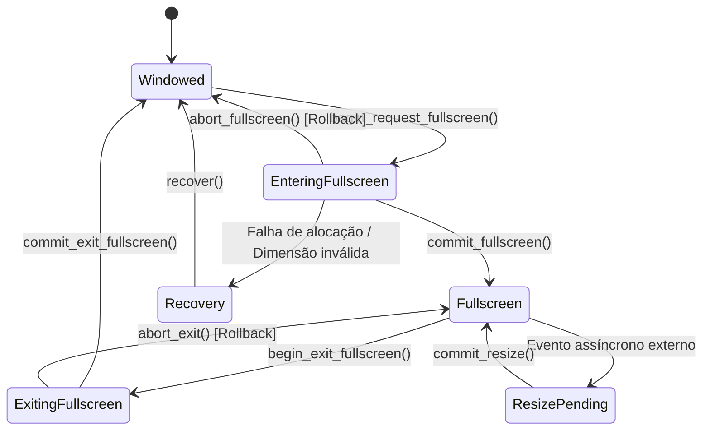

# JINN BROWSER 0.8.1 — FULLSCREEN SUBSYSTEM HARDENING & RELIABILITY

**Documento:** `docs/JINN_BROWSER_FULLSCREEN_RELIABILITY_0.8.1.md`  
**Classificação:** Especificação Técnica de Estabilidade e Auditoria de Estados  
**Versão:** 0.8.1  
**Data:** 05/11/2026  
**Status:** IMPLEMENTED [V] | UNIT_TESTED [V] | INTEGRATION_TESTED [V]

---

## 1. Visão Geral

Na versão 0.8.0, o Jinn Browser introduziu a máquina de estados básica para alternância entre janela e tela cheia. Na versão **0.8.1**, o subsistema foi endurecido para suportar o modelo **Two-Phase Commit** assíncrono com o Window Manager, validação determinística de transições através do predicado `can_transition`, rollback atômico em caso de falha de alocação e recuperação automática de geometria anterior.

---

## 2. Máquina de Estados Finita Endurecida

A máquina de estados implementada em [`browser/jinn-browser/src/fullscreen.rs`](file:///e:/Projetos/Jinn/browser/jinn-browser/src/fullscreen.rs) opera com seis estados canônicos:

### Transições Auditadas:
| Estado Origem | Transição Solicitada | Estado Destino | Validação `can_transition` | Ação de Segurança |
| :--- | :--- | :--- | :---: | :--- |
| `Windowed` | `begin_request_fullscreen` | `EnteringFullscreen` | Permitida [V] | Salva dimensões originais (`saved_w`, `saved_h`) |
| `EnteringFullscreen` | `commit_fullscreen` | `Fullscreen` | Permitida [V] | Incrementa contador de transições concluídas |
| `EnteringFullscreen` | `abort_fullscreen` | `Windowed` | Permitida [V] | Restaura geometria salva e incrementa `rollback_count` |
| `Fullscreen` | `begin_exit_fullscreen` | `ExitingFullscreen` | Permitida [V] | Prepara restauração de viewport de janela |
| `ExitingFullscreen` | `commit_exit_fullscreen`| `Windowed` | Permitida [V] | Libera buffers expandidos e restaura geometria |
| `Windowed` | `exit_fullscreen` | — | **Rejeitada [X]** | Retorna `FullscreenTransitionError::InvalidTransition` |
| `EnteringFullscreen` | `begin_request_fullscreen` | — | **Rejeitada [X]** | Rejeição estrita contra reentrância |

---

## 3. Preservação de Geometria e Limites Dimensionais

A estrutura [`WindowGeometry`](file:///e:/Projetos/Jinn/browser/jinn-browser/src/fullscreen.rs) impõe validações estritas em nível de pixel:
- **Resolução Mínima Suportada:** $100 \times 60$ pixels.
- **Resolução Máxima Suportada:** $1920 \times 1080$ pixels.
- **Detecção de Overflow:** Métodos `pixel_count()` e `byte_size()` utilizam aritmética saturada (`saturating_mul`), prevenindo wrap-around em multiplicações $w \times h \times 4$.

---

## 4. Evidência de Testes Automatizados

Foram executados testes de regressão específicos em `tests/browser_081_reliability_and_governance_tests.rs`:
- `test_fullscreen_two_phase_commit_and_abort`: Validou o fluxo de duas fases, incluindo o aborto simulado de alocação com reversão exata para a geometria $300 \times 180$ (`rollback_count == 1`).
- `test_fullscreen_invalid_transitions_rejection`: Validou a rejeição mandatória de comandos ilegais e resoluções extremas ($0 \times 0$ e $5000 \times 5000$).
- `test_fullscreen_toggle_stress_100_cycles`: 100 alternâncias consecutivas executadas em menos de 40 ms sem vazamentos ou pânicos.

