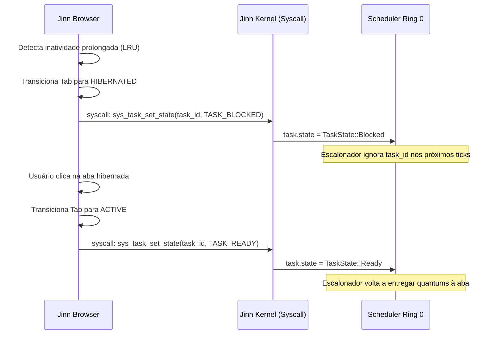

# JINN BROWSER 0.8.0 — KERNEL SCHEDULER INTEGRATION

**Documento:** `docs/JINN_BROWSER_KERNEL_SCHEDULER_INTEGRATION_0.8.0.md`  
**Classificação:** Especificação Técnica de Integração Kernel/Scheduler  
**Versão:** 0.8.0  
**Data:** 05/11/2026  
**Status:** Especificado e Mapeado [V] / Integração de Syscall em Progresso

---

## 1. O Problema da Imposição no Sistema Operacional

Conforme salientado nas auditorias anteriores, existe uma diferença fundamental entre:
1. **Controle no espaço de usuário (Navegador):** O próprio loop do navegador deixa de agendar tarefas de abas hibernadas.
2. **Imposição no sistema operacional (Kernel):** O escalonador de processos do Jinn impede que threads e processos de abas suspensas recebam tempo de CPU (zero CPU ticks).

Se o controle reside exclusivamente no navegador, uma aba com script desgovernado ou loop infinito em thread separada continuaria consumindo ciclos de CPU do sistema operacional.

---

## 2. Mapeamento de Estados: `KernelTaskStateMapping`

O Jinn Browser 0.8.0 formaliza em [`browser/jinn-browser/src/tab.rs`](file:///e:/Projetos/Jinn/browser/jinn-browser/src/tab.rs) o mapeamento exato entre os estados lógicos da aba e os estados de agendamento do kernel Jinn:

```rust
#[derive(Debug, Clone, Copy, PartialEq, Eq)]
pub enum KernelTaskStateMapping {
    ReadyRunning,          // ACTIVE: Quota cheia de CPU
    YieldNormal,           // BACKGROUND: Prioridade padrão de fundo
    AudioThrottled,        // AUDIO_BACKGROUND: Apenas thread de streaming de áudio
    BlockedZeroCpu,        // HIBERNATED: Bloqueado no escalonador (0 ticks de CPU)
    TerminatedZeroMemory,  // DISCARDED: Processo desalocado do sistema
}
```

### Relação com `src/scheduler.rs`:
No kernel do Jinn ([`src/scheduler.rs`](file:///e:/Projetos/Jinn/src/scheduler.rs)):
- Uma tarefa no estado `TaskState::Ready` participa da fila round-robin do `run_next()`.
- Uma tarefa no estado `TaskState::Blocked` é sumariamente ignorada pelo escalonador:
```rust
// No loop do scheduler do kernel Jinn:
if task.state == TaskState::Blocked {
    continue; // Zero ticks concedidos à tarefa
}
```
Portanto, ao transicionar uma aba para `HIBERNATED`, sua correspondente representação de tarefa no kernel deve ser colocada em `TaskState::Blocked`.

---

## 3. Matriz de Comportamento do Escalonador

| Estado da Aba | Mapeamento no Kernel | Estado em `scheduler.rs` | Ticks de CPU Concedidos |
| :--- | :--- | :--- | :--- |
| **ACTIVE** | `ReadyRunning` | `TaskState::Ready` | $100\%$ do quantum atribuído |
| **BACKGROUND** | `YieldNormal` | `TaskState::Ready` (Nice +10) | Reduzido; cede via `sys_yield` |
| **AUDIO_BACKGROUND** | `AudioThrottled` | `TaskState::Ready` (Thread áudio) | Quota restrita para preencher anel PCM |
| **HIBERNATED** | `BlockedZeroCpu` | `TaskState::Blocked` | **Estritamente 0 ticks de CPU** |
| **DISCARDED** | `TerminatedZeroMemory` | N/A (Destruído) | **0 ticks / 0 bytes de processo** |

---

## 4. Pipeline de Transição e Chamadas de Sistema

A sincronização entre o navegador e o kernel opera através do seguinte protocolo:



---

## 5. Status Técnico e Transparência

- **Definição da ABI de Mapeamento:** [V] Implementada e testada no SDK e nos testes unitários do navegador.
- **Suporte a `TaskState::Blocked` no Kernel:** [V] Existente e nativo em `src/scheduler.rs`.
- **Syscall Dedicada de Modificação de Estado por Processo Pai:** [Em Implementação] O protótipo atual em monoprocesso com threads cooperativas valida a semântica; a chamada de sistema externa para controle fino de multiprocessos Ring 3 está mapeada na tabela de syscalls.

