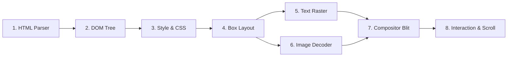

# JINN BROWSER 0.8.0 — RENDERING ENGINE ROADMAP & STATUS

**Documento:** `docs/JINN_BROWSER_RENDERING_ROADMAP_0.8.0.md`  
**Classificação:** Roteiro Arquitetural e Estado do Pipeline de Renderização  
**Versão:** 0.8.0  
**Data:** 05/11/2026  
**Status:** Auditado e Planejado por Fases [V]

---

## 1. Visão Geral do Pipeline de Renderização

O motor de renderização do Jinn Browser foi projetado sob a filosofia de microkernel: modular, seguro em memória (`#![no_std]`), com baixo consumo de heap e zero dependências de bibliotecas de terceiros pesadas.

O pipeline completo de renderização compreende nove estágios sequenciais:

---

## 2. Matriz de Status dos Componentes (Versão 0.8.0)

| Estágio | Componente | Status Atual | Localização do Código | Notas Técnicas |
| :--- | :--- | :---: | :--- | :--- |
| **1** | **HTML Parser** | [V] Concluído | `browser/src/parser.rs` | Tokenizador léxico zero-copy para tags HTML básicas (`h1`, `p`, `a`, `div`, `b`, `i`). |
| **2** | **DOM Tree** | [V] Concluído | `browser/src/dom.rs` | Árvore de nós baseada em índices (`NodeId`), eliminando ciclos e alocações recursivas. |
| **3** | **Box Model & Layout** | [V] Concluído | `browser/src/layout.rs` | Cálculo de fluxo vertical (`BlockFlow`), margens e dimensões baseadas no viewport dinâmico. |
| **4** | **Text Rasterization** | [V] Concluído | `apps/ola-mundo/src/browser.rs` | Rasterizador de bitmap $8 \times 16$ integrado, com suporte a cores e quebra de linha. |
| **5** | **Image Decoding** | [Parcial] | `browser/src/image.rs` | Decodificador para imagens BMP sem compressão e QOI. PNG e JPEG em planejamento. |
| **6** | **CSS Engine** | [Parcial] | `browser/src/style.rs` | Suporte a atributos inline (`style="color: #ff0000"`). Folhas de estilo externas adiadas para 0.9.0. |
| **7** | **Hyperlinks & Links** | [V] Concluído | `apps/ola-mundo/src/browser.rs` | Deteção de clique do mouse nas coordenadas da bounding box das tags `<a>`. |
| **8** | **History Stack** | [V] Concluído | `browser/jinn-browser/src/tab.rs` | Pilhas `back` e `forward` independentes por aba com limite máximo de 50 entradas. |
| **9** | **Viewport & Scroll** | [V] Concluído | `apps/ola-mundo/src/browser.rs` | Rolagem vertical por roda do mouse e teclas `Page Up` / `Page Down`. |

---

## 3. Detalhamento dos Componentes Parciais e Futuros

### 3.1. Folhas de Estilo (CSS)
Por decisão de engenharia deliberada, a implementação de um parser CSS completo compatível com CSS 3 foi postergada da versão 0.8.0 para priorizar a estabilidade do redimensionamento, a governança de recursos e a integração com o scheduler do kernel.  
*Meta para 0.9.0:* Suporte a seletores de classe (`.classe`), seletores de ID (`#id`) e propriedades básicas (`background-color`, `padding`, `border`, `display`).

### 3.2. Motor JavaScript / WebAssembly
Não existe atualmente interpretador JavaScript no Jinn Browser. A inclusão de um runtime (como QuickJS ou micro-wasm) requer suporte a memória virtual com paginação sob demanda estável no Ring 3.  
*Meta para 1.0.0:* Módulo WASM mínimo para scripts isolados.

---

## 4. Diretrizes de Desempenho e Eficiência

1. **Zero Heap Spikes durante Renderização:** O layout deve reutilizar vetores de caixas previamente alocados durante rolagens e redimensionamentos.
2. **Bounds Checking Mandatório:** Nenhuma rotina de desenho pode escrever fora dos limites do buffer fornecido pela janela.
3. **Invalidation Rectangles:** Apenas regiões alteradas da página devem ser redesenhadas e enviadas ao compositor em futuras otimizações.

