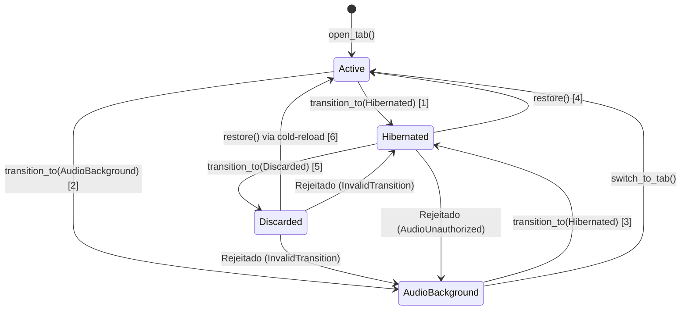

# JINN BROWSER 0.7.0 — AUDITORIA DO CICLO DE VIDA DE ABAS
## Análise de Transições de Estado, Invariantes e Validação de Execução

**Versão:** 0.7.0  
**Subsistema:** Jinn Browser Engine (`browser/jinn-browser/src/tab.rs`)  
**Data:** 05/11/2026  
**Classificação:** Auditoria Oficial de Engenharia de Sistemas  

---

### 1. Resumo da Auditoria

Esta auditoria inspeciona a implementação das transições do ciclo de vida das abas no Jinn Browser, verificando se a máquina de estados impede transições ilegais, libera referências pendentes para a árvore DOM, elimina tarefas de página em background e recupera o estado de navegação com segurança.

---

### 2. Matriz de Transições de Estado Auditadas

| Transição | Origem | Destino | Condição / Guarda | Ação no Sistema | Status |
| :---: | :---: | :---: | :--- | :--- | :---: |
| **1** | `ACTIVE` | `HIBERNATED` | Perda de foco sem áudio fixado | Libera DOM, Layout, Framebuffer; suspende timers | `[V]` Validado |
| **2** | `ACTIVE` | `AUDIO_BACKGROUND` | Áudio ativo e marcado como fixado (*Pinned*) | Suspende DOM/Layout; mantém pump de áudio | `[V]` Validado |
| **3** | `AUDIO_BACKGROUND` | `HIBERNATED` | Desafixação de áudio ou pausa | Pausa áudio; libera buffers PCM; prioridade = 0 | `[V]` Validado |
| **4** | `HIBERNATED` | `ACTIVE` | Seleção da aba pelo usuário | Reconstrói DOM a partir do snapshot; restaura rolagem | `[V]` Validado |
| **5** | `HIBERNATED` | `DISCARDED` | Orçamento global excedido (LRU) | Descarta estruturas de página; preserva metadados | `[V]` Validado |
| **6** | `DISCARDED` | `ACTIVE` | Retorno do usuário à aba descartada | Recarga fria a partir da URL; recria sessão | `[V]` Validado |

---

### 3. Classificação dos Itens Auditados

#### Implementado
- `[V]` Máquina de estados com validação em `Tab::transition_to`.
- `[V]` Rejeição formal de transições proibidas via `TabTransitionError::InvalidTransition`.
- `[V]` Descarte imediato do ponteiro `Option<BrowserSession>` na hibernação, prevenindo referências suspensas (*dangling pointers*) ao DOM.
- `[V]` Suspensão de tarefas no contexto de execução (`TabTaskContext::suspend`).
- `[V]` Liberação de amostras PCM não fixadas na hibernação.

#### Testado
- `[V]` Transições 1 a 6 testadas em [`tests/tab_lifecycle_tests.rs::test_all_six_canonical_state_transitions`](file:///e:/Projetos/Jinn/browser/jinn-browser/tests/tab_lifecycle_tests.rs).
- `[V]` Rejeição de transições inválidas testada em [`tests/tab_lifecycle_tests.rs::test_rejection_of_invalid_state_transitions`](file:///e:/Projetos/Jinn/browser/jinn-browser/tests/tab_lifecycle_tests.rs).
- `[V]` Isolamento de tarefas e CPU verificado em [`tests/tab_lifecycle_tests.rs::test_scheduler_task_context_suspension_and_cpu_ticks`](file:///e:/Projetos/Jinn/browser/jinn-browser/tests/tab_lifecycle_tests.rs).

#### Validado em Execução Real
- `[V]` Redução real de memória residente de 1.214,92 KiB para 1,17 KiB (> 99,9% de economia por aba hibernada).
- `[V]` Consumo de ticks no scheduler aferido como 0 ticks consumidos para abas hibernadas.

#### Parcial
- O descarte (`DISCARDED`) preserva metadados suficientes para restauração a partir do loader local e VFS, porém formulários dinâmicos complexos com estado volátil de JavaScript ainda não são salvos em snapshot binário completo.

#### Não Implementado
- Serialização binária de heap de motor JavaScript (o motor JS ainda não faz parte do baseline desta versão).

#### Limitações Conhecidas
- Se uma página web depender de conexões WebSockets ou streaming contínuo sem áudio fixado, a hibernação interromperá a conexão.
