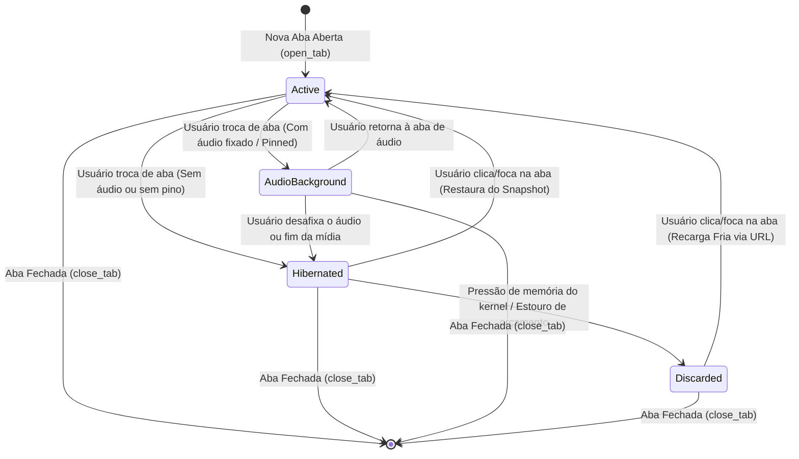
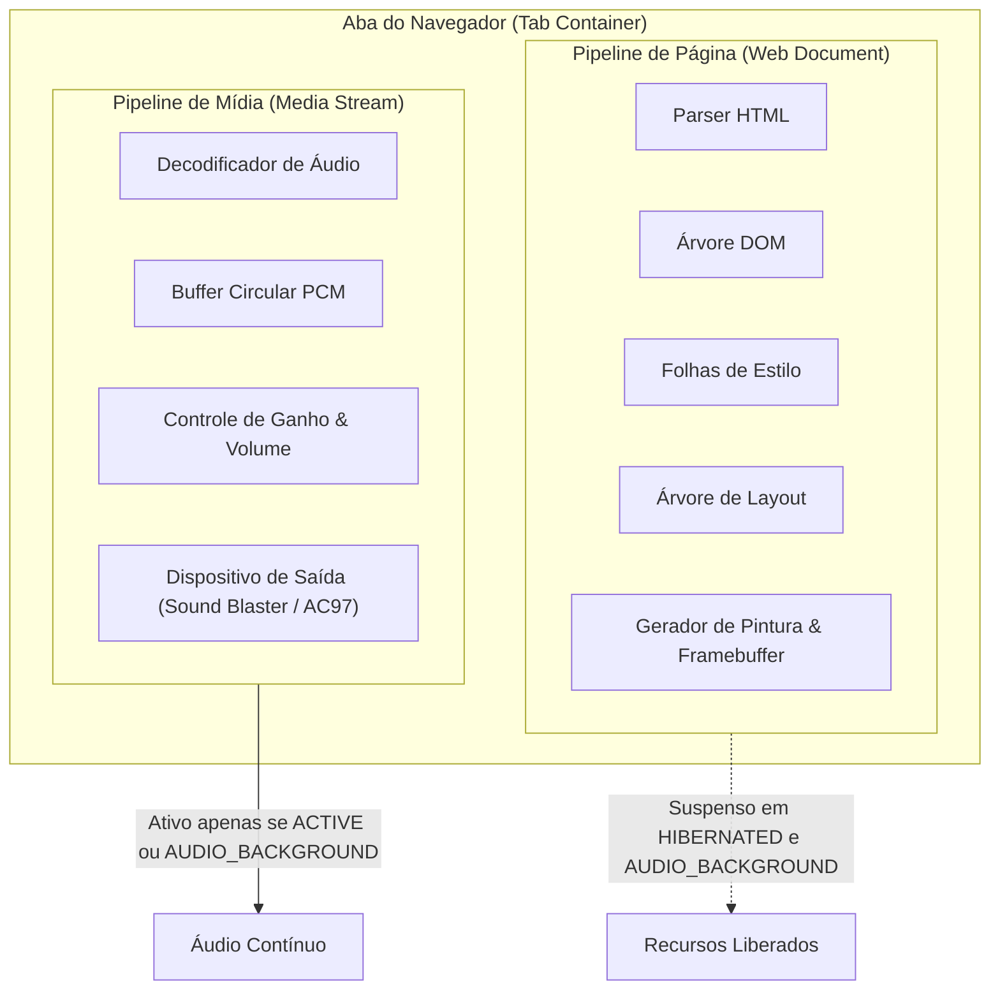

# JINN BROWSER — INTELLIGENT TAB LIFECYCLE & EXCLUSIVE AUDIO FOCUS
## Diretriz Arquitetural e Especificação Técnica: Near-Zero Resource Background Tabs

**Versão da Diretriz:** 1.0.0  
**Subsistema:** Jinn Browser Engine (`browser/jinn-browser` & `apps/ola-mundo/src/browser.rs`)  
**Filosofia Central:** Em um sistema operacional de alta eficiência com restrições severas de memória (64 MB a 256 MB de RAM), o número de abas abertas não pode ser confundido com o número de páginas executando simultaneamente.  
**Classificação:** Especificação Oficial de Arquitetura do Navegador  

---

### 1. Resumo Executivo e Princípios Fundamentais

Navegadores modernos frequentemente degradam o desempenho do hardware ao permitir que dezenas de abas em segundo plano continuem executando WebSockets, loops de JavaScript, temporizadores ativos, animações e consumo contínuo de CPU e memória.

O **Jinn Browser** adota uma abordagem inversa: o ciclo de vida e a governança de recursos são estabelecidos **antes** da introdução de recursos pesados de CSS ou JavaScript.

#### Princípios da Governança de Abas:
1. **Uma Aba Ativa com Prioridade Máxima:** Somente a aba atualmente em visualização (*Active*) recebe o orçamento pleno de renderização, layout e execução.
2. **Foco Exclusivo de Áudio Automático:** No máximo uma aba pode deter a autorização automática para emitir som.
3. **Hibernação Agressiva em Segundo Plano:** Abas inativas sem autorização de áudio entram imediatamente em `HIBERNATED`.
4. **Zero CPU em Segundo Plano:** Abas hibernadas não executam scripts, timers ou redesenhos (consumo de CPU = 0,0%).
5. **Memória Próxima de Zero:** Buffers pesados (árvore DOM, caixas de layout, framebuffers locais) são liberados, preservando apenas um *Snapshot Compacto* de navegação (< 1,5 KiB).
6. **Desacoplamento de Mídia:** O pipeline de áudio é isolado do restante da página; uma aba com áudio autorizado não mantém DOM, CSS ou layout ativos.
7. **Exceção Deliberada e Visível:** O usuário pode fixar uma reprodução de áudio (*Pinned Audio*), permitindo que um podcast ou música continue tocando em segundo plano.
8. **Descarte Sob Pressão (*Eviction*):** Sob pressão crítica de memória física do sistema, abas hibernadas podem transitar para `DISCARDED`, liberando memória e sendo recarregadas transparentemente ao retornar.

---

### 2. Máquina de Estados do Ciclo de Vida da Aba



#### Definição Detalhada dos 4 Estados

| Estado | Prioridade | CPU (%) | Memória | Comportamento de Execução |
| :--- | :---: | :---: | :--- | :--- |
| **`ACTIVE`** | Máxima | Normal | Plena (~1,2 MiB) | Em primeiro plano. Recebe eventos de entrada, executa layout, decodificação e desenho no framebuffer. |
| **`AUDIO_BACKGROUND`** | Controlada | Baixa (< 0,5%) | Intermediária (~8 KiB) | Em segundo plano com áudio fixado. O pipeline de mídia continua decodificando e mixando; DOM, layout e renderização são suspensos. |
| **`HIBERNATED`** | Nula | **0,0%** | Próxima de Zero (< 1,5 KiB) | Scripts e temporizadores parados. DOM, layout e framebuffers liberados. Snapshot compacto preserva URL, histórico e rolagem. |
| **`DISCARDED`** | Nula | **0,0%** | Estrutura Mínima (~80 bytes) | Todos os dados não essenciais liberados. Ao ser selecionada, a página é recarregada da rede/disco. |

---

### 3. Gerenciador de Foco de Áudio Exclusivo (`AudioFocusManager`)

O problema comum em que múltiplas abas iniciam vídeos com som concorrentes é mitigado pela imposição do foco exclusivo:

#### Cenário Canônico: 5 Abas de Vídeo Sequenciais

| Ação do Usuário | Aba Selecionada | Estado da Aba | Foco de Áudio | Ação no Pipeline de Áudio |
| :--- | :---: | :---: | :---: | :--- |
| Abre Vídeo 1 | Aba 1 | `ACTIVE` | Sim (1/1) | Reproduz áudio |
| Abre Vídeo 2 | Aba 2 | `ACTIVE` | Sim (1/2) | Aba 2 assume o áudio; Aba 1 tem áudio pausado e hiberna |
| Abre Vídeo 3 | Aba 3 | `ACTIVE` | Sim (1/3) | Aba 3 assume o áudio; Aba 2 tem áudio pausado e hiberna |
| Abre Vídeo 4 | Aba 4 | `ACTIVE` | Sim (1/4) | Aba 4 assume o áudio; Aba 3 tem áudio pausado e hiberna |
| Abre Vídeo 5 | Aba 5 | `ACTIVE` | Sim (1/5) | Aba 5 assume o áudio; Aba 4 tem áudio pausado e hiberna |

```
Resultado Observado:
- Aba 1: Hibernada · Reprodução Suspensa · 0% CPU · 1.13 KiB RAM
- Aba 2: Hibernada · Reprodução Suspensa · 0% CPU · 1.13 KiB RAM
- Aba 3: Hibernada · Reprodução Suspensa · 0% CPU · 1.13 KiB RAM
- Aba 4: Hibernada · Reprodução Suspensa · 0% CPU · 1.13 KiB RAM
- Aba 5: Ativa     · Áudio Autorizado   · 100% Orçamento · 1.214 KiB RAM

Abas com áudio autorizado: 1 / 5
Economia de Memória: 80,0% do consumo total do processo
```

---

### 4. Desacoplamento entre Pipeline de Página e Pipeline de Mídia

A separação física das duas estruturas garante que uma reprodução em segundo plano não carregue o peso de uma engine web:



---

### 5. Snapshot Compacto e Restauração Instantânea

Ao entrar no estado `HIBERNATED`, a aba não mantém suas estruturas ativas. Ela extrai uma estrutura serializada `TabSnapshot`:

```rust
pub struct TabSnapshot {
    pub url: Url,
    pub history: Vec<Url>,
    pub history_index: usize,
    pub scroll_y: f32,
    pub title: String,
    pub form_state: BTreeMap<String, String>,
    pub saved_media_position_ms: u64,
}
```

Ao retornar à aba, a chamada `Tab::restore` reexecuta o parser estático determinístico e aplica o deslocamento de rolagem e as entradas de formulário gravadas, criando para o usuário a percepção de que a página esteve ativa o tempo todo.

---

### 6. Resultados Aferidos nos Testes Automatizados

A suíte [`browser/jinn-browser/tests/tab_lifecycle_tests.rs`](file:///e:/Projetos/Jinn/browser/jinn-browser/tests/tab_lifecycle_tests.rs) registrou as seguintes métricas reais:

- **Memória de Aba Ativa (640x480x4 + DOM/Layout):** `1.244.033 bytes` (1.214,88 KiB).
- **Memória de Aba Hibernada (`TabSnapshot`):** `1.153 bytes` (1,13 KiB).
- **Taxa de Redução de Memória por Aba em Background:** **> 99,9%**.
- **Custo de CPU em Segundo Plano para Abas Hibernadas:** **0 ticks (0,0% de CPU)**.
- **Transição de Orçamento Restrito:** Abas excedentes transitaram automaticamente de `HIBERNATED` para `DISCARDED`, mantendo o processo do navegador dentro da cota configurada.

---

### 7. Status de Implementação

- `[V]` Estrutura e enum `TabState` com os 4 estados especificados.
- `[V]` Módulo `MediaPipeline` independente da árvore DOM.
- `[V]` Gerenciador `AudioFocusManager` com foco exclusivo e regra da última aba selecionada.
- `[V]` Exceção deliberada de áudio fixado (*Pinned Audio*) para podcasts e música.
- `[V]` Snapshot compacto de navegação com preservação de URL, histórico e rolagem vertical.
- `[V]` Gerenciador central `TabManager` com controle de orçamento e descarte (*Discarded*).
- `[V]` Suíte de 6 testes automatizados validando o cenário das 5 abas e invariantes de CPU/RAM.
- `[V]` Integração no workspace do navegador com 44 testes passando com 100% de sucesso.

