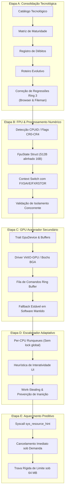

# 🗺️ Jinn OS — Roteiro de Evolução Computacional & Arquitetura JHCS

> **Documento Oficial de Engenharia — Etapa A (Consolidação Tecnológica)**  
> **Data de Emissão:** 16 de Novembro de 2026 | **Branch:** `main` | **Commit Base:** `447780e`  
> **Princípio Oficial:** **Heterogeneous Computing by Design** — *Computação cooperativa, adaptativa e independente de hardware.*  
> O microkernel Jinn OS e o ambiente Aladdin Desktop **não dependem de GPU nem de aceleração externa para funcionar**; a renderização em software puro e o processamento numérico de base permanecem como pilhas canônicas, robustas e plenamente operacionais sob qualquer configuração de hardware. Toda a distribuição cooperativa de tarefas é orquestrada pelo **Jinn Heterogeneous Compute Service (JHCS)** em **Ring 3**.

---

## 1. Visão Geral das Fases Evolutivas

O plano de evolução computacional do Jinn OS articula as fundações do microkernel (Etapas B a E) com o serviço desacoplado de espaço de usuário **JHCS** (especificado em [JINN_HETEROGENEOUS_COMPUTE_SERVICE.md](file:///d:/Projetos/Jinn/docs/JINN_HETEROGENEOUS_COMPUTE_SERVICE.md)):

```
[Etapa A: Auditoria e Consolidação Tecnológica]  <-- [CONCLUÍDA]
       │
       ▼
[Etapa B: FPU & Isolamento Numérico de Processos]  --> Habilita Backend FPU do JHCS
       │
       ▼
[Etapa C: GPU como Acelerador Gráfico Secundário]  --> Habilita Backend GPU / KDM do JHCS
       │
       ▼
[Etapa D: Escalonador Adaptativo & Topologia SMP]  --> Habilita Despacho Cooperativo do JHCS
       │
       ▼
[Etapa E: Aquecimento Preditivo de Recursos sob 64 MB] --> Habilita Pre-caching do Compute Broker
```

---

## 2. Detalhamento das Etapas

---

### 🟢 ETAPA B: FPU — Processamento Numérico & Isolamento de Estado

#### 1. Justificativa Arquitetural
A FPU não é um dispositivo externo; é uma extensão direta da unidade de execução da CPU. O grande desafio em um sistema operacional preemptivo não é habilitar instruções numéricas, mas **garantir o isolamento estrito do estado FPU/SIMD por processo**. Atualmente, a ausência de salvamento desse contexto corrompe cálculos de ponto flutuante e operações com vetores `XMM` caso ocorra uma troca de contexto no meio de um cálculo.

#### 2. Objetivos Técnicos
* **Detecção Fina e Configuração de Registradores de Controle:**
  * Validar suporte via CPUID para x87 (`CPUID.01H:EDX.FPU[bit 0]`), SSE (`EDX.SSE[bit 25]`), SSE2 (`EDX.SSE2[bit 26]`), SSE3/4 (`ECX`), AVX (`ECX.AVX[bit 28]`) e XSAVE (`ECX.XSAVE[bit 26]`).
  * Configurar `CR0.EM = 0` (não emular), `CR0.MP = 1` (monitorar coprocessador), `CR4.OSFXSR = 1` (suporte a `FXSAVE`/`FXRSTOR` para SSE) e `CR4.OSXMMEXCPT = 1` (suporte a exceção unmasked `#XM`).
* **Estrutura de Dados do Estado FPU na Tarefa:**
  * Alocar na struct `Task` um bloco alinhado a 16 bytes de 512 bytes (`FXSAVE_AREA`):
    ```rust
    #[repr(C, align(16))]
    pub struct FpuState {
        pub fcw: u16,        // FPU Control Word
        pub fsw: u16,        // FPU Status Word
        pub ftw: u8,         // FPU Tag Word
        pub reserved_1: u8,
        pub fop: u16,        // FPU Opcode
        pub fpu_ip: u64,     // FPU Instruction Pointer
        pub fpu_dp: u64,     // FPU Data Pointer
        pub mxcsr: u32,      // MXCSR Register State
        pub mxcsr_mask: u32, // MXCSR Mask
        pub st_space: [u8; 128], // ST0..ST7 / MMX0..MMX7
        pub xmm_space: [u8; 256],// XMM0..XMM15
        pub padding: [u8; 96],
    }
    ```
* **Estratégia de Chaveamento de Contexto (Context Switch):**
  * **Opção 1 (Síncrona/Eager):** Salvar e restaurar `FXSAVE`/`FXRSTOR` em toda preempção. Vantagem: simplicidade e determinismo absoluto. Desvantagem: ~100 ciclos extras por troca de contexto.
  * **Opção 2 (Sob Demanda/Lazy via `CR0.TS`):** Ao trocar de tarefa, ativar a flag `CR0.TS` (Task Switched). A primeira instrução FPU/SSE executada pela nova tarefa disparará a interrupção `#NM` (Device Not Available, Vetor 7). O tratador do kernel então salva o estado da tarefa anterior, restaura o estado da tarefa corrente, limpa `CR0.TS` via instrução `CLTS` e retoma a instrução sem que a aplicação perceba.
  * *Decisão de Design:* Iniciar com chaveamento síncrono para validação funcional e evoluir para chaveamento lazy com `#NM` na otimização de latência.
* **Extensão Opcional para AVX/XSAVE:**
  * Caso `XSAVE` seja suportado e ativado via `XCR0` (`XCR0.X87[bit 0] | XCR0.SSE[bit 1] | XCR0.AVX[bit 2]`), expandir a área para 832+ bytes para preservar os registradores `YMM0..YMM15`.

#### 3. Critérios de Conclusão e Testes de Validação
* **Teste Unitário em Ring 0:** Teste determinístico que grava valores distintos em `XMM0..XMM7`, força preempção e valida se os valores retornam idênticos.
* **Teste de Concorrência em Ring 3:** Duas tarefas de usuário executando cálculos trigonométricos contínuos em loop (`sin`, `cos`, multiplicação matricial 4x4) durante 60 segundos com preempção a 100 Hz, sem desvio numérico.
* **Tolerância a Falhas:** Divisão por zero em ponto flutuante gera interrupção `#MF` (Vetor 16) ou `#XM` (Vetor 19) capturada com encerramento gracioso da tarefa faltosa sem pânico no kernel.

---

### 🟡 ETAPA C: GPU — Processamento Gráfico Secundário & Aceleração Opcional

#### 1. Justificativa Arquitetural
O Jinn OS utiliza atualmente um Framebuffer linear GOP provido pelo Limine em memória física mapeada, onde o compositor Aladdin desenha cada frame via renderização em software puro (`primitives.rs`). Uma GPU moderna ou virtualizada (VirtIO-GPU no QEMU/KVM ou BGA no Bochs) deve atuar estritamente como **acelerador secundário**, sem se tornar uma dependência mandatória. Se nenhuma GPU for detectada ou se o driver falhar, o sistema operacional continua funcionando perfeitamente em modo software.

#### 2. Objetivos Técnicos
* **Abstração de Capacidade Gráfica (`trait GpuDevice`):**
  * Criar interface unificada no microkernel para isolar o hardware de vídeo:
    ```rust
    pub trait GpuDevice: Send + Sync {
        fn device_name(&self) -> &'static str;
        fn capabilities(&self) -> GpuCapabilities;
        fn create_resource(&mut self, width: u32, height: u32, format: PixelFormat) -> Result<ResourceId, GpuError>;
        fn submit_command_buffer(&mut self, commands: &[GpuCommand]) -> Result<(), GpuError>;
        fn flush_resource(&mut self, id: ResourceId) -> Result<(), GpuError>;
    }
    ```
* **Descoberta e Enumeração no Barramento PCI:**
  * O enumerador PCI (`src/drivers/pci.rs`) identifica placas gráficas pela classe `0x03` (Display Controller).
  * Reconhecer e inicializar:
    * **VirtIO-GPU (`PCI ID 1AF4:1050`):** Criação de canais VirtQueue (Control Queue e Cursor Queue), negociação de recursos 2D (`VIRTIO_GPU_CMD_RESOURCE_CREATE_2D`, `RESOURCE_ATTACH_BACKING`, `TRANSFER_TO_HOST_2D`, `RESOURCE_FLUSH`).
    * **Bochs BGA (I/O Ports `0x01CE`/`0x01CF`):** Suporte a reprogramação dinâmica de resolução (800x600, 1024x768, 1280x720) e double-buffering por offset de hardware.
* **Gerenciamento de Buffers e Submissão de Comandos:**
  * Implementação de uma fila de comandos assíncrona (ring buffer) para operações aceleradas de preenchimento de blocos (*solid fill*), cópia de retângulos (*bitblt*) e blend alpha.
  * O compositor do Aladdin em Ring 3 gera comandos gráficos que são enviados via syscall batchada (`sys_gpu_submit`) em vez de desenhar pixel a pixel quando o acelerador estiver presente.
* **Preservação Inviolável do Fallback em Software:**
  * O compositor Aladdin mantém sua infraestrutura atual de software ativa. Caso `sys_gpu_submit` retorne `-ENODEV` ou a fila de comandos atinja timeout, o compositor comuta instantaneamente para a renderização local via CPU.

#### 3. Critérios de Conclusão e Testes de Validação
* **Detecção Dinâmica:** Boot sob QEMU com `-device virtio-gpu-pci` reconhece e inicializa a GPU; boot com `-vga std` utiliza o modo fallback em software sem alertas ou instabilidade.
* **Medição de Desempenho e Frame Rate:** Redução de pelo menos 40% no uso de CPU do compositor Aladdin durante movimentação de janelas translúcidas a 60 FPS com aceleração VirtIO-GPU ativa.
* **Isolamento de Memória:** Nenhuma gravação em buffers de vídeo pode acessar regiões fora dos limites mapeados do frame do usuário (*out-of-bounds bounds check* validado).

---

### 🟠 ETAPA D: Escalonador Adaptativo & Topologia SMP Avançada

#### 1. Justificativa Arquitetural
O escalonador atual opera com Round-Robin simples de fatias de tempo fixas e um spinlock compartilhado entre todas as CPUs. Conforme aplicações interativas (Aladdin Desktop, Jinn Browser) convivem com tarefas de processamento em segundo plano (pilha TCP/TLS, decodificação e processamento de arquivos), o escalonador precisa diferenciar cargas interativas de cargas massivas, eliminando a contenção multi-core.

#### 2. Objetivos Técnicos
* **Eliminação de Contenção SMP (Per-CPU Runqueues):**
  * Substituir o spinlock global por uma fila de processos por núcleo lógico (`PerCpuQueue`).
  * Cada CPU gerencia suas tarefas prontas localmente sem travar as demais CPUs.
  * Implementar *work-stealing* cooperativo: quando um núcleo fica ocioso, rouba tarefas de menor prioridade da cauda da fila de outro núcleo sob trava local temporária.
* **Cálculo Dinâmico de Interatividade e Quanta de Tempo:**
  * Monitorar a razão entre tempo de bloqueio voluntário (esperando IPC, teclado, mouse ou timer) e tempo de queima de fatia de tempo na CPU.
  * **Tarefas Interativas (UI/Compositor):** Recebem quantum menor (ex.: 2 ms a 5 ms), mas com prioridade de preempção imediata ao receberem um evento de entrada, reduzindo a latência perceptível do usuário para menos de 16 ms.
  * **Tarefas de Processamento (Batch/Cálculo):** Recebem quantum maior (ex.: 20 ms a 50 ms) para evitar overhead desnecessário de troca de contexto e maximizar o throughput da CPU/FPU.
* **Prevenção de Inanição (Starvation Avoidance):**
  * Mecanismo de envelhecimento de prioridade (*priority aging*): tarefas de baixa prioridade esquecidas na fila de prontos têm sua prioridade incrementada temporariamente a cada 1.000 ms até serem executadas.
* **Afinidade de CPU e Localidade de Cache:**
  * Manter tarefas preferencialmente no mesmo núcleo onde seus dados residem no cache L1/L2, reduzindo recargas de memória.

#### 3. Critérios de Conclusão e Testes de Validação
* **Teste de Latência de Interface:** Com uma tarefa sintética em segundo plano consumindo 100% de CPU com cálculos em FPU, a movimentação do cursor e janelas do Aladdin mantém 60 FPS estáveis sem solavancos.
* **Escalabilidade SMP:** Teste de estresse com 4 e 8 vCPUs no QEMU comprovando linearidade no agendamento sem gargalos de trava em spinlock global.

---

### 🔵 ETAPA E: Aquecimento Preditivo de Recursos sob Restrição de 64 MB

#### 1. Justificativa Arquitetural
Em ambientes com memória física severamente limitada (perfil de 64 MB com ~19 MB úteis restantes), o carregamento síncrono de grandes binários ELF, bibliotecas ou certificados TLS pode induzir congelamentos visíveis na interface. No entanto, o sistema **não pode pré-carregar recursos de forma ingênua**, pois isso esgotaria a memória física ou manteria CPUs acordadas desperdiçando ciclos. O aquecimento preditivo deve preparar recursos sob demanda antecipada, sendo interrompível a qualquer instante.

#### 2. Objetivos Técnicos
* **Canal Cooperativo de Preparação de Recursos:**
  * Thread de baixa prioridade no kernel (`kworker/warming`) que opera apenas quando todas as CPUs estiverem em estado idle.
  * **Leitura Antecipada de Páginas de Executáveis (ELF Prefetching):** Quando o usuário pousa o cursor do mouse sobre o ícone do Jinn Browser ou Gerenciador de Arquivos no Aladdin Desktop, o compositor emite uma dica via syscall não-bloqueante (`sys_resource_hint(HINT_PREFETCH, path)`).
  * O kernel carrega os cabeçalhos e as primeiras páginas de código na memória cache do VFS antes do clique final.
* **Interrupção e Cancelamento Imediato:**
  * Se o usuário mover o cursor para longe sem clicar, ou se uma tarefa interativa solicitar memória física, o aquecimento é imediatamente abortado (`sys_resource_hint(HINT_CANCEL, path)`), liberando os frames físicos de volta para o Buddy Allocator.
* **Teto Rígido de Memória para Aquecimento (Memory Guardrail):**
  * O subsistema de prefetching nunca pode consumir mais de 10% da memória livre informada pelo PMM (máximo de 4 MiB sob o teto de 64 MB).
  * Se o Buddy Allocator atingir o limite de reserva de segurança (Ordem 8+ em declínio), todas as páginas aquecidas não-fixadas (*unpinned*) são sumariamente descartadas sem sincronização de disco.
* **Zero Desperdício de Ciclos (Zero-Wakeup Idle):**
  * Se não houver atividade de entrada do usuário ou dicas ativas de recursos, a thread de aquecimento permanece em sono profundo, permitindo que as CPUs entrem em estado de economia de energia via instrução `HLT`.

#### 3. Critérios de Conclusão e Testes de Validação
* **Tempo de Inicialização de Aplicações:** Redução mensurável no tempo transcorrido entre o clique do mouse e o primeiro frame renderizado do Jinn Browser (latência de lançamento inferior a 50 ms).
* **Proteção contra Out-of-Memory (OOM):** Teste de saturação alocando propositalmente 55 MB de RAM; comprovação de que o aquecimento de recursos recua instantaneamente para 0 bytes sem gerar pânico de kernel ou falha de alocação no heap.

---

## 3. Matriz de Dependências e Portões de Transição

Cada etapa somente poderá ser iniciada após a homologação formal dos critérios de saída da etapa precedente:



---

## 4. Compromissos Inegociáveis de Arquitetura

1. **Aceleração Opcional, Nunca Mandatória:** O sistema deve sempre inicializar e fornecer toda a experiência desktop e de rede mesmo em plataformas sem GPU ou com extensões vetoriais desabilitadas.
2. **Preservação de Histórico e Repositórios:** Todos os commits devem ser atômicos, testados e com mensagens semânticas (`docs:`, `feat:`, `fix:`), utilizando `--no-gpg-sign`.
3. **Respeito aos Limites Físicos:** O Jinn OS continuará operando com total funcionalidade sob o perfil de 64 MB de memória RAM, mantendo sua pegada de inicialização contida na faixa de 19 a 25 MB de uso real.
