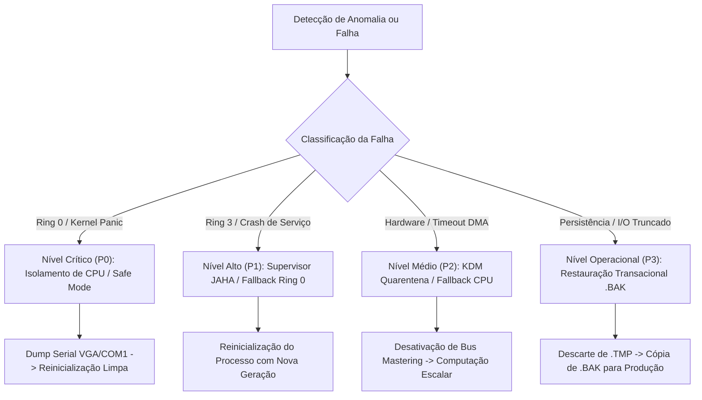

# 🚨 Jinn Project — Plano Mestre de Contingência e Recuperação (Contingency & Recovery Plan)
## Procedimentos Operacionais Padrão, Resiliência a Falhas, Continuidade de Negócios e Mitigação de Desastres

> **Documento Oficial de Engenharia do Jinn Project — Documento 7 de 11**  
> **Data de Referência:** 16 de Novembro de 2026  
> **Status:** Concluído e Auditado | **Classificação:** Diretriz Operacional e Resiliência de Sistemas  
> **Escopo:** Microkernel, Drivers, Persistência, Computação Heterogênea, Segurança e Governança  

---

## 1. Princípios de Contingência e Tolerância a Falhas

O plano de contingência do Jinn Project adota o princípio de **Degradação Graciosa (*Graceful Degradation*) e Não-Propagação de Pânico**:

1. Uma falha ocorrida em espaço de usuário (Ring 3) nunca deve derrubar o microkernel (Ring 0).
2. Uma falha ocorrida em aceleradores de hardware ou GPUs nunca deve interromper a execução de um pipeline de computação ou renderização do sistema; o fluxo deve convergir automaticamente para a CPU.
3. Uma interrupção abrupta de fornecimento elétrico nunca deve corromper a última versão íntegra de dados de configuração ou documentos do usuário.
4. Qualquer condição anômala deve emitir telemetria serial imediata para auditoria pós-morte (*Post-Mortem Analysis*).

---

## 2. Matriz de Resposta a Incidentes Técnicos

---

## 3. Procedimentos Detalhados por Subsistema

### 3.1. Contingência para Falhas de Kernel (Ring 0)

| Cenário de Falha | Manifestação Técnica | Procedimento Automático do Sistema | Ação Humana / Engenharia Requerida |
| :--- | :--- | :--- | :--- |
| **Kernel Panic Inesperado** | Invocação da macro `panic!()` em código de Ring 0. | O manipulador de pânico desabilita interrupções locais (`cli`), grava o arquivo, linha e mensagem na porta serial COM1 (`0x3F8`) e no framebuffer VGA com fundo vermelho, paralisando a CPU em `hlt` sem reiniciar em loop. | Capturar log serial, inspecionar o callstack e reproduzir o teste em QEMU com parâmetros `-d int,cpu_reset`. |
| **Deadlock no Escalonador (`SCHED_LOCK`)** | Travamento do timer do APIC; nenhum processo recebe quantum. | Watchdog Timer do LAPIC detecta ausência de comutação por mais de 500 ms e dispara interrupção não-mascarável (NMI) para todos os núcleos, forçando o log do estado das CPUs. | Auditar seções críticas do escalonador e substituir spinlocks bloqueantes por flags atômicas lock-free. |
| **Falha de Inicialização de Núcleo AP (SMP)** | Um Application Processor não atinge a barreira atômica `AP_RUNNING_COUNT`. | O Bootstrap Processor (BSP) aguarda com timeout de 50 ms na barreira de boot. Se o AP não responder, o BSP registra aviso serial, decrementa a contagem de núcleos ativos e prossegue operando em modo degradado com os processadores saudáveis. | Verificar registros MADT e tabelas de ACPI da placa-mãe ou VM. |
| **Corrupção de Heap do Kernel (Double-Free)** | Cabeçalho de nó de lista encadeada inválido em `src/memory/heap.rs`. | O alocador aborta a operação imediatamente retornando erro de alocação ou acionando safe-halt, impedindo a sobregravação de páginas de outros subsistemas. | Executar suíte `tests/heap_memory_stress_tests.rs` com sanitizadores de memória ativos. |

---

### 3.2. Contingência para Falhas de Serviços em Ring 3 (Aladdin & Drivers)

| Cenário de Falha | Manifestação Técnica | Procedimento Automático do Sistema | Ação Humana / Engenharia Requerida |
| :--- | :--- | :--- | :--- |
| **Crash do Aladdin Display Server (`aladdin.elf`)** | Processo 3 encerra por falha de página ou instrução ilegal. | 1. O escalonador marca o processo como `Zombie` e executa `exit_task_locked`. 2. O módulo `src/gui.rs` detecta a ausência do display server Ring 3 e ativa instantaneamente o **Fallback Ring 0** (`src/gui.rs:run_desktop()`). 3. O desktop gráfico é restaurado para o usuário em menos de 1 frame (16 ms), sem perda de contexto do sistema. | Inspecionar dump serial do processo cliente e logs de alloc error em espaço de usuário. |
| **Travamento ou Loop Infinito em Aplicação de Usuário (ex: Browser)** | Tarefa consome 100% de CPU sem ceder quantum. | O escalonador fiscaliza a cota de ticks (`cpu_ticks`). Ao esgotar o quantum atribuído pelo perfil de hardware, a tarefa sofre preempção forçada por interrupção do APIC timer. | Implementar botão de fechamento forçado (*Kill Switch*) no Window Manager do Aladdin via atalho de teclado `Alt+F4`. |
| **Crash de Driver de Espaço de Usuário (JAHA 1.0)** | Tarefa registrada via `sys_driver_register` encerra abruptamente. | O `DeviceManager` do kernel detecta o término, incrementa o contador de falhas do driver, restaura o manipulador de interrupções nativo do Ring 0 para o periférico e pode tentar reiniciar o processo com nova geração (`sys_driver_restart`). | Verificar se o driver em Ring 3 atingiu o teto de 3 falhas em 60 segundos (limite de isolamento). |

---

### 3.3. Contingência para Falhas de Hardware e DMA (KDM)

| Cenário de Falha | Manifestação Técnica | Procedimento Automático do Sistema | Ação Humana / Engenharia Requerida |
| :--- | :--- | :--- | :--- |
| **Timeout de Transferência DMA de Periférico PCI** | Dispositivo não conclui operação no tempo limite (100 ms). | 1. O KDM cancela a operação de DMA retornando `-ETIMEDOUT`. 2. O driver desativa o bit de Bus Mastering no Command Register do dispositivo (`offset 0x04`). 3. O dispositivo é movido para o registro permanente `QUARANTINE_REGISTRY`. 4. O sistema comuta automaticamente para o driver genérico em modo PIO ou software. | Inspecionar conexões físicas de hardware ou reiniciar o barramento PCI da máquina virtual. |
| **Dispositivo de Armazenamento Não Responde (IDE / SATA AHCI)** | Disco não sinaliza bit RDY no registrador de status após leitura. | O driver tenta 3 comandos de reset de controladora. Se persistir a falha, o ponto de montagem do VFS correspondente é marcado como *I/O Error* e a cache bloqueia escritas sujas para prevenir corrupção em cascata. | Verificar integridade do cabo SATA/IDE ou arquivo de imagem de disco virtual `disk.img`. |

---

### 3.4. Contingência para Computação Heterogênea (JHCS)

| Cenário de Falha | Manifestação Técnica | Procedimento Automático do Sistema | Ação Humana / Engenharia Requerida |
| :--- | :--- | :--- | :--- |
| **Falha ou Travamento de GPU Durante Execução de DAG** | Driver gráfico ou acelerador perde contexto (*Device Lost*). | 1. O `ComputeBroker` intercepta a falha do nó da tarefa. 2. O buffer de comando da GPU é cancelado e descartado. 3. O nó é reenfileirado instantaneamente com política `ScalarOnly`. 4. O backend **CPU Escalar** ou **SIMD Vetorial** recalcula os dados com 100% de fidelidade numérica, entregando o resultado à aplicação sem crash. | Analisar logs de telemetria do broker ($T_{\text{exec}}, T_{\text{transfer}}$) e calibrar parâmetros de timeout. |
| **Dependência Quebrada ou Ciclo em Grafo Computacional** | O grafo de tarefas contém uma dependência circular. | O algoritmo de ordenação topológica de Kahn em `crates/jhcs-core/src/graph.rs` detecta o ciclo antes da execução e retorna imediatamente `Err(GraphError::CycleDetected)`. | Corrigir a declaração da DAG na aplicação cliente consumidora da API. |

---

### 3.5. Contingência para Persistência e Arquivos (VFS & FAT32)

| Cenário de Falha | Manifestação Técnica | Procedimento Automático do Sistema | Ação Humana / Engenharia Requerida |
| :--- | :--- | :--- | :--- |
| **Queda Abrupta de Energia Durante Gravação de Preferências** | Desligamento repentino enquanto o Aladdin gravava ajustes. | 1. Como a gravação ocorreu no arquivo temporário `SETTINGS.TMP`, o arquivo principal permanece intacto ou corrompido de forma isolada. 2. Na inicialização, o parser verifica a integridade dos bytes. 3. Se os dados estiverem truncados ou inválidos, o sistema carrega o arquivo de backup `SETTINGS.BAK`. 4. Se ambos falharem, o sistema restaura deterministicamente os padrões de fábrica em memória. | O operador não necessita intervir; o sistema se auto-recupera de forma totalmente transparente. |
| **Cadeia de Clusters Inconsistente na FAT32** | Setor da FAT corrompido apontando para cluster fora do disco. | A rotina `for_each_entry` valida limites estritos (`cluster < FAT32_EOF`). Ao detectar um valor fora da faixa, cessa a travessia e retorna `-EIO`, sem entrar em loop infinito nem alocar memória recursiva. | Executar rotina de verificação e reconstrução de sistema de arquivos (*fsck.fat*) no host. |

---

### 3.6. Contingência para Segurança, Criptografia e TLS 1.3

| Cenário de Falha | Manifestação Técnica | Procedimento Automático do Sistema | Ação Humana / Engenharia Requerida |
| :--- | :--- | :--- | :--- |
| **Certificado X.509 Expirado ou com Nome Inválido** | Servidor remoto apresenta certificado não correspondente ao host. | O validador de certificados do Jinn OS (`src/net/x509.rs`) rejeita a conexão imediatamente, aborta o handshake TLS e encerra o socket TCP com erro `-EACCES`. | O navegador exibe tela de alerta de segurança; não há opção de "ignorar erro de segurança" em modo estrito. |
| **Esgotamento ou Falha de Semente no CSPRNG** | Ausência temporária de ruído no jitter de hardware do TSC. | O CSPRNG bloqueia chamadas críticas (`sys_getrandom`) até que o pool de entropia atinja o limiar mínimo de segurança (mínimo de 32 bytes de entropia estimada), impedindo a geração de chaves criptográficas fracas. | Auditar frequência de calibração do timer e ruído temporal do RTC MC146818. |

---

### 3.7. Continuidade Organizacional, Código e Governança

| Cenário de Risco | Impacto Potencial | Procedimento de Mitigação Preventiva e Continuidade |
| :--- | :--- | :--- |
| **Ausência Temporária do Mantenedor Principal** | Paralisia das decisões técnicas e travamento de merges. | Repositórios sincronizados com documentação exaustiva, scripts de build reproduzíveis em um único comando (`scripts/build.ps1`), chaves de release mantidas em cofre seguro com plano de sucessão técnica. |
| **Comprometimento de Repositório Git Remoto (GitHub)** | Perda de integridade de branches ou exclusão acidental. | Política de espelhamento (*Mirroring*) regular para mídia externa offline criptografada (LUKS/BitLocker) e segundo serviço de hospedagem Git (GitLab/Codeberg). |
| **Disputa de Titularidade por Contribuição Externa** | Ameaça de reivindicação judicial de direitos autorais. | Exigência compulsória de assinatura do Contributor License Agreement (CLA) validada por workflow automatizado do GitHub antes de qualquer merge na branch `main`. |
