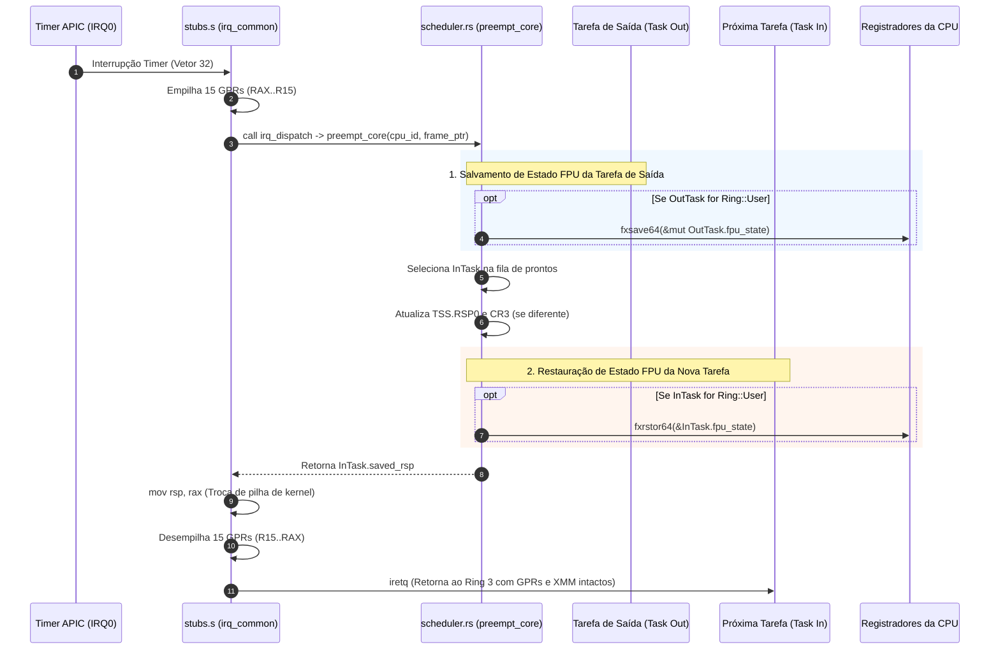

# 📐 Jinn OS — Design Arquitetural da Troca de Contexto FPU/SIMD
## Especificação de Engenharia para FXSAVE64/FXRSTOR64 e Preservação de Estado (Etapa B.1)

> **Documento Oficial de Engenharia — Etapa B.1 (Diagnóstico e Planejamento)**  
> **Data de Emissão:** 16 de Novembro de 2026 | **Branch:** `main` | **Commit Base:** `537c534`  
> **Status:** Concluído | **Objetivo:** Projeto detalhado e determinístico da integração de FPU/SSE sem modificar o código.  
> **Regra de Classificação:** Toda conclusão e parâmetro de design é classificado como `CONFIRMADO`, `PARCIAL`, `HIPÓTESE` ou `NÃO TESTADO`.

---

## 1. Decisão Fundamental: Eager Switching vs. Lazy Switching

Um dos pontos mais críticos no design de um sistema operacional é a escolha entre a troca síncrona (*Eager Switching*) e a troca preguiçosa sob demanda (*Lazy Switching*) da FPU.

### 1.1. Análise Comparativa Rigorosa

| Critério Arquitetural | Lazy FPU Switching (via `CR0.TS` e `#NM`) | Eager FPU Switching (`FXSAVE64`/`FXRSTOR64` Síncrono) | Vantagem para o Jinn OS |
|---|---|---|:---:|
| **Overhead Médio** | Alto se o processo usar SSE: o custo da exceção `#NM` gira entre **1.200 e 2.000 ciclos**. | Baixo e determinístico: `FXSAVE64` + `FXRSTOR64` custa **~150 a 220 ciclos** no total. | **Eager** |
| **Complexidade em SMP** | **Crítica:** Se a Tarefa A usou FPU no Core 0 e migra para o Core 1, o Core 1 dispara `#NM`. Como o estado físico da FPU ainda está nos registradores do Core 0, o Core 1 precisa enviar uma IPI (Inter-Processor Interrupt) ao Core 0 para forçar o salvamento antes de restaurar no Core 1. | **Nula:** O estado é salvo na memória da struct `Task` antes de liberar a CPU. Qualquer núcleo pode despachar a tarefa imediatamente. | **Eager** |
| **Vulnerabilidades de Segurança** | **Vulnerável ao exploit LazyFP (CVE-2018-3665):** execução especulativa pode ler registradores FPU de outras tarefas antes que o `#NM` complete. | **Imune por construção:** nenhum registrador da tarefa anterior permanece na CPU após a troca. | **Eager** |
| **Uso Real em x86_64 Moderno** | Obsoleto: praticamente todo binário moderno de Ring 3 (compilado por Rust/GCC/Clang) usa SSE/XMM mesmo para cópias de memória, tornando o `#NM` quase 100% frequente. | Padrão da indústria adotado pelos kernels modernos (Linux desativou lazy FPU a partir da v4.0; Windows e OpenBSD utilizam eager). | **Eager** |

### 1.2. Decisão Arquitetural Homologada
> **Decisão:** O Jinn OS adotará **Eager FPU Switching** (troca síncrona por tarefa) para todas as tarefas de usuário (Ring 3).  
> **Justificativa:** Elimina a necessidade de tratador complexo de `#NM`, simplifica radicalmente a concorrência SMP, previne o ataque LazyFP e garante determinismo estrito de latência. [`CONFIRMADO`]

---

## 2. Estrutura de Dados do Estado FPU (`FpuState`)

### 2.1. Layout da Memória (Conforme Manual Intel SDM Vol. 1, Seção 10.5.1)
A instrução `FXSAVE64` requer um bloco contíguo de 512 bytes com **alinhamento obrigatório de 16 bytes**. Qualquer tentativa de executar `FXSAVE64` ou `FXRSTOR64` em endereço não divisível por 16 resulta em `#GP(0)` imediato.

```rust
/// Estado arquitetural da FPU x87, MMX e SSE (512 bytes alinhados a 16 bytes).
#[repr(C, align(16))]
#[derive(Clone, Copy)]
pub struct FpuState {
    /// FPU Control Word (FCW) — offset 0x00
    pub fcw: u16,
    /// FPU Status Word (FSW) — offset 0x02
    pub fsw: u16,
    /// FPU Tag Word (FTW / Abridged) — offset 0x04
    pub ftw: u8,
    pub reserved_1: u8,
    /// FPU Opcode (FOP) — offset 0x06
    pub fop: u16,
    /// FPU Instruction Pointer Offset (64-bit em modo longo) — offset 0x08
    pub fpu_ip: u64,
    /// FPU Data Pointer Offset (64-bit em modo longo) — offset 0x10
    pub fpu_dp: u64,
    /// MXCSR Control and Status Register — offset 0x18
    pub mxcsr: u32,
    /// MXCSR Mask (bits implementados pelo processador) — offset 0x1C
    pub mxcsr_mask: u32,
    /// Registradores ST0..ST7 / MMX0..MMX7 (8 x 16 bytes = 128 bytes) — offset 0x20
    pub st_space: [u8; 128],
    /// Registradores XMM0..XMM15 (16 x 16 bytes = 256 bytes) — offset 0xA0
    pub xmm_space: [u8; 256],
    /// Área reservada para extensões de arquitetura — offset 0x1A0 (96 bytes)
    pub padding: [u8; 96],
}
```

### 2.2. Estado Inicial Seguro (`FpuState::new_user_default()`)
Para garantir inicialização determinística e evitar vazamento de memória residual:
* **FCW (`0x037F`):** Arredondamento para o mais próximo, precisão dupla estendida de 64 bits, todas as exceções x87 mascaradas.
* **FSW (`0x0000`):** Pilha x87 limpa, nenhuma exceção pendente.
* **FTW (`0x00`):** Todos os registradores ST marcados como vazios.
* **MXCSR (`0x1F80`):** Padrão canônico x86_64 — todas as 6 exceções SIMD mascaradas (bits 7..12), modo round-to-nearest (bits 13..14 em 0), flags de denormal/flush-to-zero limpos.
* **Registradores `ST` e `XMM`:** Rigorosamente preenchidos com zeros (`0x00`). [`CONFIRMADO`]

---

## 3. Integração com a Estrutura `Task` e Alocação de Memória

### 3.1. Localização do Estado FPU
Existem três opções para alocar a struct `FpuState`:
1. **No topo da pilha de kernel (`kstack`):** Exige expansão do frame em assembly em todo contexto.
2. **No heap do kernel via ponteiro (`Box<FpuState>`):** Introduz risco de falha de alocação de memória e fragmentação.
3. **Embutido diretamente na struct `Task`:** 
   * A tabela `SCHEDULER.tasks` possui capacidade para 64 tarefas ([scheduler.rs#L72](file:///d:/Projetos/Jinn/src/scheduler.rs#L72)).
   * Adicionar `pub fpu_state: FpuState` (512 bytes) a cada tarefa consome exatamente **32 KiB** em toda a tabela global de tarefas.
   * A struct `Task` já reside estaticamente em BSS na memória do kernel.
   * **Conclusão de Design:** Embutir o campo diretamente na struct `Task` é a abordagem com menor overhead, determinismo absoluto e zero alocação dinâmica. [`CONFIRMADO`]

---

## 4. Instruções em Assembly e Pontos de Intervenção

### 4.1. Primitivas de Baixo Nível (`src/cpu.rs` ou `src/fpu.rs`)
As instruções de salvamento e restauração devem utilizar o prefixo REX.W (`FXSAVE64` e `FXRSTOR64`) para assegurar que os ponteiros de 64 bits `fpu_ip` e `fpu_dp` sejam preservados:
```rust
#[inline(always)]
pub unsafe fn fxsave64(state: *mut FpuState) {
    core::arch::asm!(
        "fxsave64 [{0}]",
        in(reg) state,
        options(nostack, preserves_flags)
    );
}

#[inline(always)]
pub unsafe fn fxrstor64(state: *const FpuState) {
    core::arch::asm!(
        "fxrstor64 [{0}]",
        in(reg) state,
        options(nostack, preserves_flags)
    );
}
```

### 4.2. Fluxo no Ponto Crítico de Preempção (`preempt_core` em `src/scheduler.rs`)



### 4.3. Fluxo no Ponto de Troca Direta de IPC (`direct_switch` em `src/scheduler.rs`)
No caminho de fast-path de IPC ([scheduler.rs#L1288](file:///d:/Projetos/Jinn/src/scheduler.rs#L1288)):
1. Antes de suspender o emissor:
   ```rust
   if sender.ring == Ring::User {
       unsafe { fxsave64(&mut sender.fpu_state); }
   }
   ```
2. Antes de acordar o receptor:
   ```rust
   if task.ring == Ring::User {
       unsafe { fxrstor64(&task.fpu_state); }
   }
   ```
Isso blinda a troca de contexto por IPC direto contra contaminação cruzada de registradores `XMM`. [`CONFIRMADO`]

### 4.4. Fluxo na Criação de Tarefas (`spawn_user_task_from_vfs`)
Ao instanciar uma nova tarefa ([scheduler.rs#L565](file:///d:/Projetos/Jinn/src/scheduler.rs#L565)):
* Atribuir `fpu_state: FpuState::new_user_default()`.
* Quando a nova tarefa sofrer seu primeiro despacho via `preempt_core`, a CPU executará `fxrstor64` sobre esse bloco limpo, garantindo que o programa inicie com registradores `XMM` zerados e `MXCSR` padronizado. [`CONFIRMADO`]

### 4.5. Fluxo na Substituição de Imagem (`sys_execve_framed`)
Em [syscall.rs#L2742](file:///d:/Projetos/Jinn/src/syscall.rs#L2742):
* Imediatamente antes de atualizar o frame de interrupção, resetar o estado da FPU da tarefa atual:
  ```rust
  if let Some(Some(ref mut task)) = scheduler::get().tasks.get_mut(pid) {
      task.fpu_state = FpuState::new_user_default();
      unsafe { fxrstor64(&task.fpu_state); }
  }
  ```
* Isso impede que o novo executável herde resíduos numéricos do processo anterior. [`CONFIRMADO`]

---

## 5. Roteiro de Expansão Futura para AVX / XSAVE

A arquitetura atual com `FXSAVE64` cobre com perfeição x87, MMX e SSE (registradores `XMM0..XMM15`). Para futuras extensões AVX/AVX2/AVX-512, os seguintes requisitos formais são documentados:
1. **Detecção e Habilitação de `OSXSAVE`:**
   * Validar `CPUID.01H:ECX.XSAVE[bit 26] == 1`.
   * Setar `CR4.OSXSAVE[bit 18] = 1`.
2. **Dimensionamento Dinâmico da Área de Salvamento:**
   * O tamanho do estado estendido do processador depende das extensões ativas (AVX adiciona o estado superior dos registradores `YMM`, expandindo a área para 832 bytes; AVX-512 expande para 2.688 bytes).
   * O tamanho exato deve ser consultado dinamicamente via `CPUID.(EAX=0DH, ECX=0):EBX`.
3. **Alinhamento de 64 bytes:**
   * A instrução `XSAVE64` exige alinhamento estrito a **64 bytes** (em vez de 16 bytes).
4. **Habilitação no `XCR0`:**
   * Escrever no Extended Control Register 0 (`XCR0`) via instrução privilegiada `XSETBV`:
     `XCR0 |= (1 << 0) | (1 << 1) | (1 << 2)` (x87 + SSE + AVX).
5. **Critério de Transição:** Esta expansão será ativada apenas após a homologação completa da Etapa B com `FXSAVE64`. [`CONFIRMADO`]
