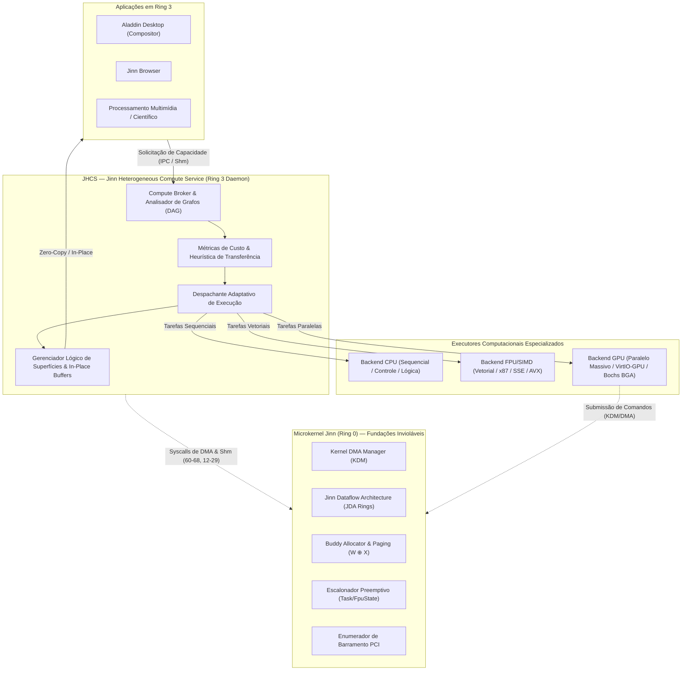
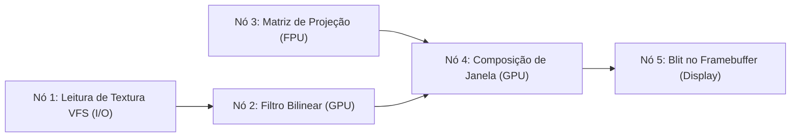

# ⚡ Jinn Heterogeneous Compute Service (JHCS)
## Especificação Arquitetural Oficial & Princípio de Design

> **Documento Oficial de Engenharia do Jinn OS & Aladdin Desktop**  
> **Status:** Arquitetura Aprovada & Especificada | **Camada:** Ring 3 (Espaço de Usuário)  
> **Classificação:** Serviço Cooperativo Não-Essencial ao Kernel | **Autorização:** Roadmap Oficial  

---

## 1. O Princípio Oficial

# **Heterogeneous Computing by Design**
### *Computação cooperativa, adaptativa e independente de hardware.*

> O **Jinn OS** não presume que todo processamento computacional deva recair exclusivamente sobre a CPU. O sistema reconhece ativamente as capacidades do hardware subjacente, analisa as características de cada tarefa e distribui as cargas de trabalho entre unidades computacionais especializadas e complementares.
>
> **CPU, FPU/SIMD e GPU atuam como recursos cooperativos**, orquestrados por uma camada de gerenciamento desacoplada executada integralmente em **Ring 3**.
>
> A ausência, falha ou reinicialização de qualquer acelerador secundário **jamais comprometerá a integridade, o boot ou a continuidade operacional** do sistema operacional. O Jinn adapta sua capacidade computacional ao hardware disponível, sem exigir que o hardware se adapte às limitações do sistema.

---

## 2. Visão Geral da Arquitetura JHCS

O **Jinn Heterogeneous Compute Service (JHCS)** é um serviço desacoplado de espaço de usuário (Ring 3) que atua como um corretor computacional inteligente (*Compute Broker*). Ele recebe intenções de computação de aplicações clientes (Aladdin Desktop, Jinn Browser, ferramentas analíticas, decodificadores de mídia) e decide de forma determinística e mensurada onde e como executar cada operação.



---

## 3. As Cinco Estratégias de Desafogamento da CPU

Transferir cegamente trabalho da CPU para a GPU pode piorar o desempenho geral se o custo de empacotamento, envio e sincronização superar o tempo de execução do cálculo na própria CPU. O JHCS fundamenta suas decisões em cinco estratégias formais:

### A. Descarregar Apenas Operações Paralelizáveis
A GPU só recebe grandes lotes homogêneos de dados com alto grau de paralelismo de dados (SIMD/SIMT). Operações de controle, árvores de decisão ou pequenos blocos escalares permanecem na CPU.

| Categoria da Operação | Características do Dado | Executor Preferencial | Justificativa Arquitetural |
|---|---|:---:|---|
| **Composição de Telas / Janelas** | Imagens 32 bpp, alpha blending massivo | **GPU** | Alto paralelismo por pixel, cálculo homogêneo. |
| **Escala e Filtros de Imagem** | Matrizes de convolução 2D, resize bilinear | **GPU** | Acesso coalescido à memória de texturas/superfícies. |
| **Álgebra Linear & Matrizes 4x4** | Vetores $N \ge 64$, transformações 3D | **FPU/SIMD ou GPU** | SIMD local elimina latência de transferência de barramento. |
| **Parsing DOM / HTML / CSS** | Árvores heterogêneas, strings, ponteiros | **CPU** | Tarefas sequenciais com desvios imprevisíveis. |
| **Criptografia Simétrica (ChaCha20)**| Vetorização por bloco de 64 bytes | **FPU/SIMD** | Registradores `XMM` processam 16 bytes/ciclo sem overhead de DMA. |
| **Decisões de Controle do Desktop** | Foco de janela, cliques, eventos | **CPU** | Baixíssima latência requerida ($< 1$ ms), sem ganho paralelo. |

### B. Processar Dados Onde Já Estão (In-Place & Zero-Copy)
O maior gargalo computacional em dispositivos com memória discreta ou restrita é a cópia redundante entre RAM de aplicação, RAM de DMA e VRAM de vídeo.
1. O JHCS aloca superfícies de memória compartilhada utilizando os pools do **JDA / KDM** (`sys_jda_shm_alloc` / `sys_dma_buffer_alloc`).
2. A aplicação escreve ou renderiza diretamente na superfície compartilhada.
3. Se a GPU suportar acesso direto via barramento PCI (Unified Memory ou BARs com Bus Mastering), a GPU opera sobre o mesmo frame físico alinhado.
4. Somente os metadados de status e conclusão trafegam pelos anéis de sincronização.

### C. Encadeamento de Operações em Grafo (Pipelines sem Round-Trip)
Em vez de emitir múltiplas submissões intercaladas por leitura da CPU, o JHCS constrói cadeias de execução sequencial na unidade aceleradora:
$$\text{Buffer Original} \xrightarrow{\text{Redimensionar}} \text{Temp 1} \xrightarrow{\text{Ajuste Brilho/Contraste}} \text{Temp 2} \xrightarrow{\text{Alpha Blend}} \text{Superfície Final}$$
A CPU prepara a descrição da cadeia uma única vez; a GPU executa todas as fases sucessivamente, eliminando interrupções intermediárias e trocas de contexto.

### D. Seleção Dinâmica do Executor por Métricas Determinísticas
O Compute Broker calcula dinamicamente o custo estimado de execução antes de despachar cada lote:
$$T_{\text{GPU}} = T_{\text{preparação}} + T_{\text{transferência\_DMA}} + T_{\text{execução\_GPU}} + T_{\text{sincronização}}$$
$$T_{\text{CPU}} = T_{\text{execução\_SIMD\_local}}$$
* Se $T_{\text{GPU}} < T_{\text{CPU}}$, o lote é encaminhado ao backend de GPU.
* Caso contrário, a tarefa é executada instantaneamente na CPU/FPU local, evitando a penalidade de barramento para cargas pequenas.

### E. Concorrência Total: CPU e GPU Simultaneamente Ativas
O objetivo do JHCS não é fazer a CPU bloquear esperando a GPU concluir seu trabalho. Enquanto o acelerador gráfico processa operações de renderização ou cálculos de filtro em segundo plano:
* A CPU continua respondendo aos eventos interativos de teclado e mouse do usuário a 60 FPS.
* A CPU prepara a próxima fatia de dados ou decodifica pacotes de rede da conexão TLS 1.3.
* A sincronização ocorre por eventos assíncronos no estilo `io_uring` providos pelo anel JDA.

---

## 4. Modos Operacionais do JHCS

O JHCS opera em três configurações estritas de acordo com a detecção de hardware:

```
┌────────────────────────────────────────────────────────────────────────┐
│ MODO BÁSICO (Sempre Disponível — Fallback Canônico)                   │
│ • Sem GPU detectada ou com acelerador inoperante.                       │
│ • A CPU e a FPU/SIMD assumem todas as operações.                       │
│ • Aladdin Desktop utiliza renderização por software puro.               │
└──────────────────────────────────┬─────────────────────────────────────┘
                                   │
                                   ▼
┌────────────────────────────────────────────────────────────────────────┐
│ MODO COOPERATIVO (GPU Secundária Presente)                              │
│ • VirtIO-GPU ou Bochs BGA identificada no barramento PCI.              │
│ • Superfícies de composição e blitting massivo descarregados na GPU.   │
│ • CPU e FPU concentram-se na lógica, layouts e operações numéricas.    │
└──────────────────────────────────┬─────────────────────────────────────┘
                                   │
                                   ▼
┌────────────────────────────────────────────────────────────────────────┐
│ MODO HETEROGÊNEO AVANÇADO (CPU + FPU/AVX + GPU + DAG)                 │
│ • Todas as unidades computacionais operam coordenadas por grafo.       │
│ • Despacho adaptativo baseado no histórico de latência do profiler.     │
│ • Aquecimento preditivo de recursos sob cota máxima de 4 MiB.          │
└────────────────────────────────────────────────────────────────────────┘
```

---

## 5. Arquitetura do Compute Broker & Execução por Grafo (DAG)

O núcleo do JHCS é o **Compute Broker**, que expõe às aplicações uma API agnóstica de hardware.

### 5.1. Contrato Declarativo da Tarefa (`ComputeTaskDecl`)
A aplicação cliente submete uma descrição de alto nível sem precisar conhecer os registradores da placa de vídeo:
```rust
pub struct ComputeTaskDecl {
    pub task_id: u32,
    pub operation_type: ComputeOpType,
    pub input_buffer_handle: u32,
    pub output_buffer_handle: u32,
    pub element_count: usize,
    pub element_size_bytes: usize,
    pub parallelism_hint: ParallelismClass,
    pub dependencies_mask: u64,
    pub fallback_allowed: bool,
}
```

### 5.2. Grafo Acíclico Dirigido (DAG)
As tarefas compõem um grafo onde nós filhos só se tornam elegíveis para despacho quando a máscara de bits de dependências dos nós pais for totalmente satisfeita:


---

## 6. Fronteiras Rígidas entre Ring 0 (Microkernel) e Ring 3 (JHCS)

Para preservar o isolamento, a segurança de memória e a estabilidade do Jinn, as responsabilidades são estritamente delimitadas:

| Camada / Responsabilidade | Entidade Executora | Mecanismo de Isolamento |
|---|:---:|---|
| **Política de distribuição de tarefas** | JHCS (Ring 3) | Lógica de usuário, substituível sem reiniciar o kernel. |
| **Heurística de custos e métricas de execução** | JHCS (Ring 3) | Tabelas em memória do daemon, sem impacto em tempo de interrupção. |
| **Montagem e resolução de grafos (DAG)** | JHCS (Ring 3) | Resolução de dependências em espaço de usuário. |
| **Alocação de frames físicos e paginação** | Kernel (Ring 0) | Buddy Allocator, KDM e flags de proteção $W \oplus X$. |
| **Isolamento de DMA e quarentena de buffers** | Kernel (Ring 0) | Tokens opacos, contadores de geração e mediador KDM. |
| **Preservação de registradores FPU/SIMD** | Kernel (Ring 0) | Salvamento síncrono/lazy de `FpuState` no context switch da tarefa. |
| **Acesso a portas I/O e BARs MMIO privilegiados** | Kernel (Ring 0) | Drivers isolados no kernel com mediação segura por syscall. |
| **Recuperação de falhas e travamentos de GPU** | Kernel + JHCS | Reset do acelerador sem pânico de kernel; fallback automático para software. |

---

## 7. Roteiro de Implementação em 8 Fases

O desenvolvimento do JHCS segue a sequência ordenada abaixo, garantindo validação progressiva sem dependências circulares:

| Fase | Denominação | Escopo Técnico Principal | Critério de Sucesso |
|:---:|---|---|---|
| **Fase 1** | **Compute Broker Core** | Protocolo IPC Ring 3 e API declarativa de submissão de tarefas agnóstica de hardware. | Aplicação cliente envia tarefa e recebe resultado processado sem conhecer o executor. |
| **Fase 2** | **CPU/FPU Backend** | Integração com as extensões numéricas validadas da CPU (x87/SSE/AVX) e `FpuState`. | Processamento numérico e vetorial concorrente sem corrupção de registradores `XMM`. |
| **Fase 3** | **GPU Discovery** | Enumeração de periféricos PCI classe `0x03` e identificação de VirtIO-GPU (`1AF4:1050`) e Bochs BGA. | Logs do JHCS listam os aceleradores disponíveis com seus limites de resolução e canais. |
| **Fase 4** | **GPU Backend** | Canal de submissão de comandos gráficos 2D (fill, blit, blend) via driver mediado pelo KDM. | Primeira janela do Aladdin renderizada com preenchimento acelerado por hardware. |
| **Fase 5** | **Compute Graph (DAG)** | Encadeamento de múltiplos nós de processamento com resolução de dependências por bitmask. | Pipeline completo de redimensionamento e composição executado em comando único. |
| **Fase 6** | **Adaptive Dispatch** | Heurística baseada em métricas de latência para chaveamento automático entre GPU e CPU/FPU. | Operações pequenas executam na CPU; grandes lotes migram automaticamente para GPU. |
| **Fase 7** | **Resource Warming** | Preparação preditiva de buffers e superfícies gráficas sob limite rígido de 4 MiB. | Latência de abertura de janelas reduzida para $< 50$ ms sem ultrapassar o teto de 64 MB. |
| **Fase 8** | **Scheduler Integration** | Coordenação fina entre prioridades do escalonador Ring 0 e tarefas assíncronas do JHCS. | 60 FPS garantidos na interface mesmo sob carga computacional máxima em background. |
