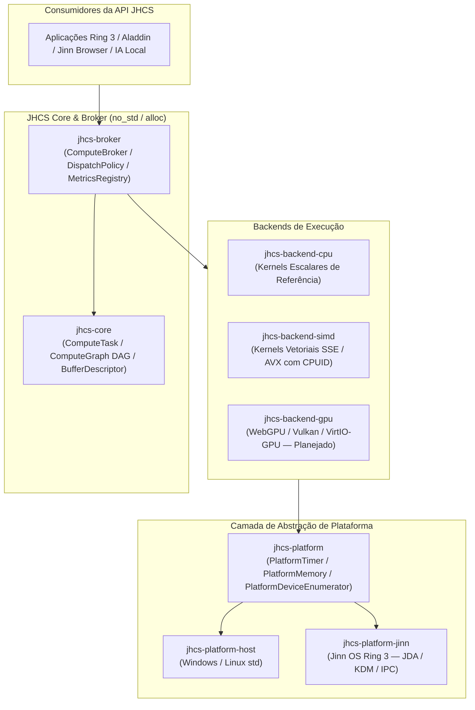

# 🏛️ Jinn Project — Arquitetura Mestre Consolidada (Master Architecture)
## Microkernel Jinn OS, Ambiente Gráfico Aladdin, Infraestrutura JDA/KDM e Middleware JHCS

> **Documento Oficial de Engenharia do Jinn Project — Documento 2 de 11**  
> **Data de Referência:** 16 de Novembro de 2026  
> **Status:** Concluído e Auditado | **Classificação:** Arquitetura do Sistema Real vs. Planejado  
> **Baseline de Referência:** Commit `2726806` (Jinn `main`), `61d93ff` (JHCS `master`)  

---

## 1. Visão Geral e Princípios Fundamentais

O ecossistema **Jinn Project** é estruturado sobre o princípio do **Microkernel Modular e Seguro em Rust**, com separação estrita de privilégios entre Ring 0 e Ring 3, acompanhado pelo princípio **Heterogeneous Computing by Design** para computação cooperativa e independente de hardware.

### 1.1. Axiomas Arquiteturais Invioláveis

1. **Microkernel Mínimo e Preemptivo (Ring 0):** O kernel é responsável exclusivamente pela gerência de espaço de memória virtual/física, escalonamento preemptivo de threads, comutação de contexto atômica, comunicação interprocesso (IPC) de baixa latência e mediação segura de acesso ao hardware.
2. **Serviços de Sistema em Espaço de Usuário (Ring 3):** Servidores gráficos (Aladdin Display Server), drivers de entrada complexos, clientes de rede e corretores de computação (JHCS) devem operar em Ring 3, sem privilégios de I/O direto (`IOPL=0`) e protegidos por barreiras de memória.
3. **Isolamento de DMA por Hardware e Software:** Nenhum dispositivo periférico ou processo de usuário possui autorização para programar ponteiros físicos de memória sem passar pelas garantias de validação temporal do Kernel DMA Manager (KDM) ou IOMMU.
4. **Fallback Universal em Software:** Qualquer funcionalidade acelerada por hardware (FPU, SIMD, GPU, drivers Ring 3) deve possuir um equivalente estritamente funcional em software puro no microkernel, garantindo que o sistema nunca falhe por ausência de aceleração especializada.
5. **Teto de Recursos Doméstico (Meta de 256 MB de RAM):** A arquitetura inteira é dimensionada para operar confortavelmente sob o perfil `Legacy` com 256 MB de memória RAM física total (com validações de estresse executadas sob 64 MB).

---

## 2. Diagrama de Camadas da Arquitetura Real

A estrutura em camadas atualmente compilada e funcional no ecossistema é representada abaixo:

```mermaid
flowchart TD
    subgraph Ring3["Espaço de Usuário (Ring 3 — Isolamento Total)"]
        subgraph Apps["Aplicações Clientes"]
            Browser["Jinn Browser 0.6.0\n(HTML5 / Mini-CSS / Storage)"]
            FileManager["Aladdin File Manager\n(FAT32 / Ext2 / QuickLook)"]
            TermApp["Terminal Gráfico\n(Shell Interativo)"]
            SysMon["Monitor do Sistema\n(Telemetria em Tempo Real)"]
            SettingsApp["Ajustes do Desktop\n(Persistência .BAK)"]
        end

        subgraph CoreServices["Serviços de Infraestrutura Ring 3"]
            AladdinServer["Aladdin Display Server\n(Compositor / WM / Damage Tracking)"]
            JHCSBroker["JHCS Compute Broker\n(DAG Engine / Adaptive Dispatch)"]
            UserDrivers["User-Space Drivers\n(PS/2 Input Daemon — JAHA 1.0)"]
        end
    end

    subgraph Boundary["Fronteira Arquitetural (Syscalls 0..79 & Interrupções)"]
        SyscallGate["SYSCALL / SYSRET / INT 0x80\nValidação EFAULT + $W \oplus X$"]
        IPCGate["IPC Síncrono Fast-Path\n(direct_switch)"]
        ShmGate["Memória Compartilhada Zero-Copy\n(SHARED_BUFFER_POOL)"]
    end

    subgraph Ring0["Microkernel Jinn OS (Ring 0 — Kernel Space)"]
        subgraph Foundations["Fundações do Sistema Operacional"]
            Sched["Escalonador Preemptivo SMP\n(Eager FXSAVE64 / FXRSTOR64)"]
            Paging["Paginação x86_64 4 Níveis\n(PML4 Isolado / Buddy Allocator)"]
            KDM["Kernel DMA Manager\n(Tokens / Pools / Bounce Buffers)"]
            JDA["Jinn Dataflow Architecture\n(io_uring SQE/CQE / DataflowNode)"]
            VFS["Virtual File System\n(FAT32 RW / Ext2 RO / BlockCache)"]
            NetStack["Pilha de Rede & Criptografia\n(TCP/IP / JinnWall / TLS 1.3 / CSPRNG)"]
        end

        subgraph ResilientFallback["Camada de Fallback Resiliente"]
            KernelGUI["Compositor Gráfico de Fallback\n(src/gui.rs — Limine Framebuffer)"]
            KernelDrivers["Drivers Nativos de Bloco & NIC\n(IDE, AHCI, e1000, VirtIO)"]
        end
    end

    subgraph Hardware["Hardware Físico / Máquina Virtual (x86_64)"]
        CPU["CPU x86_64 SMP (APIC / TSC / FPU / SSE / AVX)"]
        RAM["Memória Física (Meta: 256 MB / Mínimo Testado: 64 MB)"]
        Storage["Discos (IDE / SATA AHCI / VirtIO-Blk)"]
        NIC["Controladoras de Rede (Intel e1000 / AMD PCnet / VirtIO-Net)"]
        Video["Framebuffer GOP / Bochs BGA / VirtIO-GPU"]
    end

    Apps --> CoreServices
    CoreServices --> Boundary
    Apps --> Boundary
    Boundary --> Foundations
    Foundations --> ResilientFallback
    Foundations --> Hardware
    ResilientFallback --> Hardware
```



---

## 3. Arquitetura Real vs. Arquitetura Planejada

A auditoria identificou divergências importantes entre a especificação teórica constante em alguns documentos antigos de planejamento e a implementação real presente no código-fonte:

| Subsistema | Arquitetura Planejada (Documentada) | Arquitetura Real (Implementada no Código) | Análise de Divergência |
| :--- | :--- | :--- | :--- |
| **Ambiente Gráfico Aladdin** | Servidor gráfico exclusivamente em Ring 3 desacoplado via soquetes IPC UNIX-like. | Servidor Ring 3 (`apps/aladdin-server`) conectado via Syscalls gráficas dedicadas (72..79) com fallback automático para Ring 0 (`src/gui.rs`). | A existência do fallback em Ring 0 aumenta a resiliência em caso de falha do binário no disco, mas mantém resquícios de lógica de UI no kernel. |
| **Persistência de Arquivos** | Sistema transacional ACID completo no VFS com suporte total a Ext2 (leitura/escrita) e journaling. | Driver FAT32 completo (leitura/escrita); Driver Ext2 somente-leitura; persistência transacional implementada no nível de aplicação via arquivos `.BAK` e `sys_rename`. | A atomicidade é garantida pela renomeação do VFS, e não por um log de transações ou journaling do sistema de arquivos subjacente. |
| **Computação Heterogênea (JHCS)** | Subsistema integrado ao kernel com drivers de GPU dedicados em Ring 0 gerenciando pipelines WebGPU/Vulkan. | Biblioteca multiplataforma independente em Ring 3 (`jhcs-rs`) com backends CPU Escalar e SIMD Vetorial; despacho adaptativo e DAG implementados em espaço de usuário. | Decisão superior: preserva o microkernel, reduz a superfície de ataque em Ring 0 e permite portabilidade host (Windows/Linux). |
| **Isolamento de DMA** | Isolamento por hardware via IOMMU (Intel VT-d e AMD-Vi) programado diretamente pelo kernel. | Isolamento mediado por software no KDM através de tokens criptográficos, contadores de geração e *Bounce Buffers* na memória do kernel. | Compatível com computadores legados e ambientes virtualizados que não expõem IOMMU de hardware (QEMU sem q35/VT-d). |
| **Pilha de Rede e TLS** | Servidor de rede em Ring 3 desacoplado por IPC com pilha microkernel pura. | Pilha TCP/IP, sockets unificados, firewall JinnWall e TLS 1.3 implementados nativamente dentro do Ring 0. | Justificado pelo teto de recursos: diminui o overhead de context switches em transmissões massivas de pacotes em hardware de baixa potência. |

---

## 4. O Microkernel Jinn OS (Ring 0)

### 4.1. Camada de Inicialização e Plataforma

* **Bootloader:** O sistema delega o carregamento para o Limine Bootloader (`src/limine.rs`), que estabelece o mapa de memória física, transiciona a CPU para o modo longo de 64 bits (`CR0.PG = 1`, `EFER.LME = 1`) e entrega um framebuffer linear com alinhamento contíguo.
* **Segmentação e Isolamento:** A GDT (`src/gdt.rs`) estabelece seletores fixos de código e dados para Ring 0 e Ring 3. O Task State Segment (TSS) é configurado com uma pilha de interrupção dedicada (`RSP0`) de 64 KiB por CPU, atualizada deterministicamente a cada comutação de tarefa para impedir estouro de pilha durante falhas aninhadas.
* **Interrupções e Exceções:** A IDT (`src/interrupts/idt.rs`) define manipuladores para as 256 interrupções de arquitetura. O salvamento de contexto ocorre em assembly puro (`src/interrupts/stubs.s`), empilhando todos os registradores de uso geral antes de invocar a lógica em Rust.

### 4.2. Escalonador Multicore (SMP) e Isolamento FPU/SIMD

* **Topologia e Barreira de APs:** O módulo `src/smp.rs` enumera as CPUs lógicas via MADT e dispara a sequência de inicialização canônica (INIT-SIPI-SIPI). Os Application Processors (APs) aguardam em uma barreira de contagem atômica antes de iniciar o loop de escalonamento.
* **Política de Escalonamento:** O escalonador (`src/scheduler.rs`) implementa uma fila com prioridades (`Priority::Idle` a `Realtime`) e controle de cotas de tempo de CPU por processo (`cpu_ticks`).
* **Preservação Eager de FPU/SIMD:**
  * O estado arquitetural da FPU/SSE é mantido na estrutura `FpuState` (512 bytes, alinhamento estrito a 16 bytes).
  * Em toda preempção do Timer (`preempt_core`) e comutação rápida de IPC (`direct_switch`), caso a tarefa saintes execute em Ring 3, seus registradores são preservados via `fxsave64(&mut task.fpu_state)`.
  * Antes do retorno à tarefa entrante em Ring 3, seus registradores são restaurados via `fxrstor64(&task.fpu_state)`.
  * **Sanitização de MXCSR:** O registrador `MXCSR` é sanitizado com a máscara `0x0000_FFFF` (bits 16..31 estritamente reservados) para prevenir *General Protection Fault* (`#GP(0)`) no kernel.
  * **Exceções Nativas (`CR0.NE = 1`):** Erros numéricos disparam o vetor nativo 16 (`#MF`), eliminando o travamento do hardware da CPU por exceções x87 pendentes.

### 4.3. Gerenciamento de Memória (Buddy Allocator e Paginação)

* **Buddy Allocator:** `src/memory/buddy.rs` gerencia frames físicos de 4 KiB agrupados em potências de 2 até a ordem 10 (4 MiB). As alocações e liberações possuem complexidade $O(1)$ a $O(\log N)$, com fusão instantânea de blocos adjacentes para conter a fragmentação externa.
* **Espaço de Endereçamento Virtual:** Cada processo possui um PML4 isolado. As entradas da metade superior (`0xFFFF_8000_0000_0000` em diante) são compartilhadas estaticamente com o kernel, enquanto a metade inferior (`< 0x0000_8000_0000_0000`) contém código, pilha e heap privados do processo.
* **Segurança $W \oplus X$:** Nenhuma página utilizável em espaço de usuário possui simultaneamente as permissões `WRITABLE` e `NO_EXECUTE = false`. O segmento de código do ELF é mapeado com `USER_RX` e os segmentos de dados/pilha com `USER_RW + NX`.

---

## 5. Fundações de Suporte: KDM e JDA

### 5.1. Kernel DMA Manager (KDM)

O KDM (`src/dma/`) atua como a autoridade central de mediação entre periféricos de barramento (PCI/VirtIO) e a memória física do microkernel:

1. **Alocação de Pools Contíguos:** Os buffers de DMA são alocados a partir de pools de páginas contíguas alinhadas a 4 KiB ou 2 MiB, garantindo compatibilidade com barramentos físicos de 32 e 64 bits.
2. **Tokens Temporais:** O acesso a um buffer de DMA exige a apresentação de um `DmaToken` contendo um identificador de 64 bits associado a um contador de geração. Tentativas de acesso pós-liberação (*use-after-free*) são rejeitadas pelo registro central.
3. **Bounce Buffers:** Caso um dispositivo de hardware ou driver em Ring 3 precise ler ou gravar dados na memória de outro processo, a transferência ocorre obrigatoriamente através de um *bounce buffer* residente na memória intermediária do kernel, eliminando acesso físico direto por hardware não confiável.
4. **Quarentena Permanente:** Se um periférico PCI falhar em concluir uma transferência no tempo limite (*timeout*) ou ignorar comandos de reset, o KDM move o dispositivo para a lista `QUARANTINE_REGISTRY`, desativando seu bit de Bus Mastering e bloqueando futuras transferências.

### 5.2. Jinn Dataflow Architecture (JDA)

A JDA (`src/jda/`) provê infraestrutura nativa para fluxos de processamento assíncronos e troca de dados Zero-Copy:

1. **Anéis de Submissão e Conclusão (`JdaSqe` e `JdaCqe`):** Baseados no padrão `io_uring`, permitem que processos em Ring 3 submetam lotes de até 32 requisições de I/O e computação em um buffer circular mapeado em memória compartilhada, sem incorrer no custo de uma chamada de sistema por item.
2. **Grafos de Dependência (`DataflowNode`):** O grafo de execução suporta nós de computação e barreiras de sincronização. A resolução de dependências utiliza operações atômicas sobre máscaras de bits de 64 bits (`dependencies_mask` e `resolved_deps_mask`), permitindo que nós prontos sejam despachados imediatamente para os núcleos ociosos.
3. **Pool de Memória Compartilhada Zero-Copy:** Mapeia blocos físicos do kernel em dois ou mais espaços de endereçamento com semântica de leitor/escritor, eliminando cópias redundantes entre serviços do desktop e clientes de janelas.

---

## 6. O Ambiente Gráfico Aladdin Desktop (Ring 3)

### 6.1. Desacoplamento Arquitetural Ring 3 vs. Ring 0

O Aladdin é desenhado em torno de uma suíte de interfaces abstratas (*Traits*) em `Aladdin/src/contracts/`:
* `FramebufferHost`: Leitura e escrita de backbuffer e dimensões de vídeo.
* `InputHost`: Leitura desacoplada de eventos de teclado e mouse.
* `ProcessHost`: Consulta de processos vivos e lançamento de novas aplicações.
* `StorageHost`: Obtenção de estatísticas de volumes montados e partições.
* `SystemHost`: Obtenção de relógio em tempo real (RTC) e métricas de desempenho.

Essa separação permite que o Aladdin seja compilado em dois binários:
1. **Servidor Gráfico Ring 3 (`apps/aladdin-server`):** Executa no espaço de usuário do processo 3, utilizando as Syscalls 72..79 para apresentar quadros no monitor e recolher eventos de entrada.
2. **Servidor de Fallback Integrado (`src/gui.rs`):** Executa diretamente no contexto do kernel, garantindo que o sistema continue utilizável caso o arquivo `/disk/aladdin.elf` esteja ausente ou corrompido.

### 6.2. Motor de Renderização 2D e Damage Tracking

O compositor gráfico opera a 60 FPS com renderização por software puro:
* **Double Buffering:** As operações gráficas ocorrem em um backbuffer de 1024×768 pixels a 32 bpp (~3,14 MiB). O quadro final é transferido para a memória de vídeo linear através da Syscall `sys_graphics_present`.
* **Damage Tracking:** As estruturas `DirtyRect` e `ClipRect` calculam a união das regiões alteradas (cursor, animações, janelas ativas). Quando apenas o cursor se desloca, o compositor atualiza exclusivamente a caixa delimitadora do ponteiro (< 5 µs), eliminando transferências completas de tela.
* **Gerenciador de Janelas (WindowManager):** Mantém a ordem Z de sobreposição, processa eventos de arrasto, redimensionamento, foco e renderiza barras de título com cantos arredondados e botões de controle.

---

## 7. O Jinn Heterogeneous Compute Service (JHCS)

### 7.1. Arquitetura do JHCS Middleware (`jhcs-rs`)

O JHCS foi formalizado como um projeto multiplataforma independente, desacoplado do microkernel e dividido em 7 crates modulares:



### 7.2. Despacho Adaptativo de Tarefas

O `ComputeBroker` do JHCS não assume que aceleradores especializados (GPUs) superam a CPU em todas as tarefas. O algoritmo de despacho decide o executor ideal com base na equação de custo computacional:

$$\Delta T = (T_{\text{prep}} + T_{\text{transfer}} + T_{\text{exec}} + T_{\text{sync}})_{\text{Acelerador}} - (T_{\text{exec}})_{\text{CPU Escalar/SIMD}}$$

Se $\Delta T > 0$, o custo de transferência e sincronização de dados supera o ganho de paralelismo bruto da GPU, e a tarefa é despachada imediatamente para o backend vetorial SIMD local ou escalar da CPU.

---

## 8. Interface de Chamadas de Sistema (Syscalls 0 a 79)

A fronteira entre espaço de usuário e kernel é mediada por 85 manipuladores de syscall registrados em `src/syscall.rs`, organizados nas seguintes categorias funcionais:

| Intervalo | Categoria | Principais Syscalls | Responsabilidade |
| :--- | :--- | :--- | :--- |
| **00 .. 11** | **Processos & IPC Básico** | `exit`, `write`, `read`, `yield`, `getpid`, `ipc_send`, `ipc_recv`, `alloc_page`, `free_page`, `spawn`, `waitpid`, `sleep` | Controle básico do ciclo de vida da tarefa, alocação de frames e mensageria IPC síncrona. |
| **12 .. 14** | **JDA Básico** | `jda_shm_alloc`, `jda_shm_release`, `jda_submit` | Criação e submissão básica de tarefas em memória compartilhada. |
| **15 .. 19** | **Arquivos POSIX** | `open`, `close`, `stat`, `fstat`, `lseek` | Manipulação de arquivos abertos e consulta de metadados no VFS. |
| **20 .. 22** | **Janelas Gráficas** | `window_create`, `window_update`, `window_close` | Criação e atualização de superfícies gráficas de clientes. |
| **23 .. 25** | **Sincronização & Cotas**| `sync`, `window_poll_event`, `res_stat` | Descarregamento de cache de disco, polling de eventos e telemetria de cotas do processo. |
| **26 .. 29** | **JDA Avançado** | `jda_shm_share`, `jda_ring_submit`, `jda_ring_poll`, `jda_shm_get_vaddr` | Operações de alta densidade no padrão `io_uring` e compartilhamento Zero-Copy. |
| **30 .. 36** | **Rede & Sockets** | `socket`, `connect`, `bind`, `listen`, `accept`, `send`, `recv` | Pilha BSD Sockets nativa mapeada sobre descritores unificados de processo. |
| **37** | **Segurança JinnWall** | `jinnwall_ctrl` | Configuração de perfis do firewall e inspeção de conexões ativas. |
| **38 .. 39** | **Execução de Binários** | `execve`, `spawn_process` | Substituição em-lugar e criação de novos processos independentes a partir de executáveis ELF. |
| **40** | **Resolução DNS** | `dns_resolve` | Resolução nativa de nomes RFC 1035 para endereços IPv4. |
| **41 .. 44** | **Volumes & Montagem** | `statvfs`, `disk_info`, `mount`, `unmount` | Estatísticas de sistemas de arquivos e gerenciamento de pontos de montagem do VFS. |
| **45 .. 49** | **Catálogo de Dispositivos**| `device_info`, `device_count`, `partition_info`, `volume_info`, `volume_count` | Consulta ao catálogo unificado de dispositivos e partições descobertas. |
| **50 .. 52** | **Manipulação de VFS** | `unlink`, `mkdir`, `rename` | Exclusão, criação de pastas e renomeação atômica de arquivos. |
| **53** | **Estado de Tarefas** | `task_set_state` | Modificação de estados e prioridades de processos. |
| **54 .. 59** | **Drivers em Ring 3** | `driver_register`, `driver_event_poll`, `driver_send_input`, `driver_unregister`, `driver_restart`, `driver_telemetry` | Framework JAHA 1.0 para execução de drivers de hardware isolados em espaço de usuário. |
| **60 .. 68** | **Kernel DMA Manager** | `dma_pool_create`, `dma_pool_destroy`, `dma_buffer_alloc`, `dma_buffer_release`, `dma_buffer_map`, `dma_buffer_unmap`, `dma_transfer_prepare`, `dma_transfer_complete`, `dma_device_reset_status` | Gestão de transferências diretas de memória, alocação de buffers contíguos e quarentena de periféricos. |
| **69 .. 71** | **Cripto, Tempo & VFS** | `getrandom`, `clock_gettime`, `creat` | Entropia segura via CSPRNG, data/hora UNIX do RTC e criação de arquivos. |
| **72 .. 79** | **Serviço Gráfico Ring 3**| `graphics_register`, `graphics_get_fb_info`, `graphics_present`, `graphics_poll_input`, `graphics_unregister`, `graphics_read_client_surface`, `graphics_dispatch_client_event`, `graphics_list_client_windows` | Interface de privilégio concedida ao processo do servidor gráfico Aladdin (`GRAPHICS_SERVER_PID`). |
| **83..108** | **Compatibilidade POSIX**| `mkdir`, `creat`, `getuid`, `getgid`, `geteuid`, `getegid` | Mapeamento canônico de chamadas POSIX para compatibilidade de executáveis. |

---

## 9. Garantias de Memória e Operação Sob Baixa Capacidade

### 9.1. Orçamento de Memória no Perfil Legacy (Meta: 256 MB / Validação: 64 MB)

A alocação de recursos físicos de memória é estritamente orçada para garantir que o sistema nunca atinja exaustão (*OOM Panic*):

```
+-----------------------------------------------------------------------+
|  Memória RAM Física Total (Perfil Legacy): 256 MiB (65.536 frames)     |
+------------------------------------+----------------------------------+
|  Região                            | Orçamento Máximo Alocado         |
+------------------------------------+----------------------------------+
|  Reservado Hardware / BIOS / GOP   | ~16 MiB                          |
|  Código e Estruturas do Kernel     | ~12 MiB                          |
|  Heap Dinâmico do Microkernel      | ~8 MiB                           |
|  Pool de Buffers KDM & DMA         | ~8 MiB                           |
|  BlockCache LRU do VFS             | ~4 MiB                           |
|  Aladdin Display Server (Backbuf)  | ~14 MiB (.bss isolado em Ring 3) |
|  Jinn Browser & Motor Web          | ~16 MiB                          |
|  Pool de Memória Compartilhada JDA | ~8 MiB                           |
|  Memória Livre para Aplicações     | ~170 MiB                         |
+------------------------------------+----------------------------------+
```

### 9.2. Execução Sob Estresse em 64 MB de RAM

Durante a auditoria e os testes em máquina virtual com 64 MB de RAM física (`-m 64M`), o consumo real medido foi:
* **Uso Real do Microkernel:** ~4.5 MB (1.111 frames físicos de 11.474 utilizáveis).
* **Uso do Servidor Aladdin Ring 3:** ~3.14 MiB para o backbuffer primário.
* **Memória Disponível Remanescente:** Mais de 40 MB totalmente livres.
* **Comportamento em Carga:** O escalonador manteve a taxa de comutação sem perda de interrupções a 100 Hz, confirmando que a meta de 256 MB em hardware físico possui ampla margem de segurança técnica.
