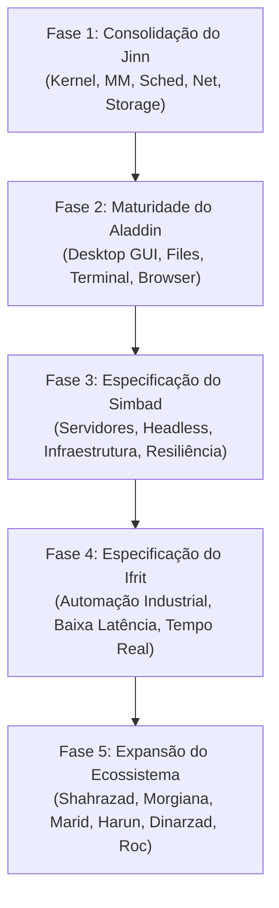

# JINN PROJECT
## Relatório de Consolidação Estratégica, Identidade e Arquitetura Multissistema

**Documento:** Diretrizes oficiais de identidade e organização do ecossistema  
**Projeto:** Jinn Project  
**Data:** Novembro de 2026  
**Natureza:** Diretriz estratégica, arquitetural e de planejamento de produtos

---

# 1. Apresentação

O Jinn Project tem como objetivo desenvolver uma plataforma computacional própria, fundamentada em um kernel modular, adaptável e de alto desempenho, capaz de sustentar diferentes sistemas operacionais especializados.

A proposta não consiste em desenvolver um único sistema operacional para todos os segmentos do mercado. Pretende-se construir uma infraestrutura tecnológica comum, sobre a qual possam existir diferentes sistemas operacionais, cada um com identidade, interface, aplicações, serviços e políticas de funcionamento adequados ao seu público e finalidade.

A nomenclatura do projeto é inspirada no universo narrativo das *Mil e Uma Noites*. Essa inspiração não deve ser compreendida apenas como uma escolha estética ou comercial: ela representa a própria concepção do projeto.

Assim como a figura do Jinn é associada à capacidade de assumir diferentes manifestações, o kernel deverá constituir uma base tecnológica comum, capaz de sustentar diferentes ambientes computacionais.

O princípio fundamental é:

**Jinn é o núcleo. Os sistemas operacionais são suas manifestações especializadas.**

---

# 2. Jinn — O kernel central

## 2.1. Identidade

Jinn é o componente central de todo o ecossistema. Não deve ser classificado como um sistema operacional exclusivamente doméstico, corporativo, industrial ou voltado a servidores.

É o kernel responsável por fornecer as capacidades fundamentais necessárias à execução dos diferentes sistemas operacionais do projeto.

Seu desenvolvimento deverá priorizar:

- Alto desempenho.
- Modularidade.
- Segurança.
- Adaptabilidade.
- Escalabilidade.
- Eficiência no gerenciamento de recursos.
- Independência entre componentes.
- Capacidade de evolução contínua.
- Compatibilidade com diferentes classes de hardware.

## 2.2. Princípio do potencial máximo

Um dos princípios fundamentais do Jinn é que suas capacidades técnicas não deverão ser artificialmente limitadas pela finalidade comercial ou pelo público-alvo dos sistemas derivados.

O kernel deverá disponibilizar todo o potencial arquitetural que sua implementação e o hardware suportarem.

Isso significa que não deverá existir, por exemplo, um kernel doméstico artificialmente inferior ao kernel utilizado em servidores, nem uma versão industrial com funcionalidades fundamentais removidas apenas para diferenciar produtos.

A especialização deverá acontecer principalmente por meio de:

- Políticas de execução.
- Serviços do sistema.
- Módulos.
- Configurações.
- Interfaces.
- Gerenciamento de recursos.
- Aplicações especializadas.

É importante distinguir capacidade de privilégio: disponibilizar o potencial máximo do kernel não significa conceder acesso irrestrito a todos os processos. Segurança, isolamento, controle de permissões e proteção de memória deverão permanecer obrigatórios.

## 2.3. Arquitetura fundamental

A organização arquitetural deverá preservar a visão modular já estabelecida para o Jinn:

**Camada L0 — Núcleo fundamental**
- Scheduler preemptivo e SMP.
- IPC de alto rendimento.
- Gerenciamento de memória física e paginação PML4.
- Segurança, anéis de proteção (Ring 0 / Ring 3) e isolamento.
- Mecanismos fundamentais de interrupção e execução.

**Camada L1 — Supervisão e serviços essenciais**
- Process Supervisor e Resource Limits.
- Unified Device Manager (L1).
- Network Manager e Firewall Stateful (JinnWall).
- Filesystem Manager e VFS unificado.
- Cache Manager LRU de blocos.
- Volume Manager e detecção de partições (MBR/GPT).
- Serviços de gerenciamento e previsão de recursos.

**Camada L2 — Componentes especializados**
- Drivers de GPU e Framebuffer.
- Drivers de Armazenamento (IDE/ATA, AHCI SATA, NVMe PCIe, VirtIO-Block).
- Drivers de Rede (VirtIO-Net, Intel e1000).
- Barramento PCI e subsistemas I/O.
- Áudio e USB (expansões futuras).

**Camada L3 — Aplicações e ambientes**
- Interfaces gráficas de usuário (Desktop Environments).
- Aplicações Ring 3 (ex: Jinn Browser, suítes de produtividade).
- Serviços e daemons especializados.
- Ambientes de execução e runtimes.
- Ferramentas de administração e monitoramento.

A arquitetura deverá permitir que os produtos utilizem os componentes necessários sem duplicar desnecessariamente funcionalidades fundamentais.

---

# 3. Aladdin — Sistema operacional desktop

## 3.1. Identidade

Aladdin será o sistema operacional desktop do Jinn Project, destinado prioritariamente ao usuário doméstico.

Sua finalidade é oferecer uma experiência computacional completa, moderna, acessível, visualmente consistente e eficiente.

Enquanto Jinn representa a infraestrutura tecnológica, Aladdin representa a experiência cotidiana do usuário.

## 3.2. Público-alvo

- Usuários domésticos.
- Estudantes.
- Profissionais.
- Pequenos escritórios.
- Usuários interessados em produtividade e multimídia.
- Pessoas que desejam uma alternativa aos sistemas operacionais comerciais tradicionais.

## 3.3. Diretrizes de desenvolvimento

Aladdin deverá priorizar:

- Interface gráfica intuitiva.
- Inicialização rápida.
- Baixo consumo de recursos.
- Gerenciamento de janelas com aceleração por Dirty Rects.
- Gerenciador de arquivos integrado com VFS (FAT32, Ext2, devfs).
- Terminal interativo Ring 0 / Ring 3.
- Configurações centralizadas.
- Navegador integrado (Jinn Browser com motor JBE).
- Gerenciamento de processos e telemetria de sistema.
- Gerenciamento de armazenamento e perfis (JSA).
- Suporte a dispositivos e periféricos (PS/2, PCI, VirtIO).
- Aplicações de produtividade.
- Segurança e atualizações.

## 3.4. Identidade visual

A interface deverá preservar a proposta minimalista e elegante, combinando referências visuais de sistemas modernos, sem reproduzir diretamente suas interfaces.

O objetivo é desenvolver uma identidade própria, com:

- Consistência visual.
- Hierarquia clara.
- Animações eficientes.
- Transparências utilizadas com moderação.
- Efeitos adaptáveis à capacidade do hardware (Capability Modes: Basic, Balanced, Advanced).
- Excelente legibilidade.
- Experiência responsiva.

A interface deverá ser concebida como um ambiente de trabalho completo, e não apenas como uma demonstração gráfica do kernel.

## 3.5. Papel estratégico

Aladdin será o principal produto de demonstração do potencial do Jinn para o mercado doméstico.

Sua evolução deverá servir também como campo de validação para os serviços de sistema, gerenciamento de dispositivos, interface gráfica, armazenamento, rede e aplicações.

---

# 4. Simbad — Sistema operacional para servidores e infraestrutura

## 4.1. Identidade

Simbad será uma manifestação especializada do kernel Jinn destinada a ambientes de infraestrutura, servidores e serviços profissionais.

Sua concepção deverá priorizar estabilidade, previsibilidade, segurança, desempenho e capacidade de operação contínua.

## 4.2. Público-alvo

- Empresas.
- Provedores de infraestrutura.
- Administradores de sistemas.
- Centros de processamento de dados.
- Ambientes de virtualização.
- Serviços de rede.
- Infraestruturas de armazenamento.

## 4.3. Diretrizes de desenvolvimento

Simbad deverá considerar:

- Operação headless (modo servidor puro, sem sobrecarga de GPU).
- Administração remota (SSH / console seguro).
- Gerenciamento avançado de processos e cotas de CPU/Memória.
- Serviços de rede de alto rendimento (IoRing / JDA Dataflow, TCP RFC 793).
- Gerenciamento avançado de armazenamento (AHCI, NVMe, RAID lógico, cache write-back seguro).
- Monitoramento de recursos e telemetria contínua.
- Logs estruturados e auditoria de segurança.
- Isolamento de serviços (namespaces, IPC isolado).
- Políticas de segurança e filtragem com JinnWall.
- Virtualização, quando suportada pelo hardware.
- Recuperação e continuidade operacional (zero downtime failover).
- Gerenciamento de múltiplos serviços simultâneos.

## 4.4. Diferenciação em relação ao Aladdin

Simbad não deverá ser simplesmente uma versão do Aladdin sem interface gráfica.

Deverá possuir uma organização própria, orientada à administração de infraestrutura, priorizando serviços, monitoramento, segurança e operação remota.

A interface gráfica poderá existir como componente opcional de gestão local, mas não deverá ser requisito para o funcionamento do produto.

---

# 5. Ifrit — Computação industrial e processamento especializado

## 5.1. Identidade

Ifrit será a manifestação especializada do Jinn voltada à computação industrial, automação, controle de equipamentos e processamento especializado.

Sua concepção deverá considerar ambientes nos quais confiabilidade, previsibilidade, disponibilidade e integração com equipamentos físicos são fundamentais.

Ifrit deverá representar a capacidade do Jinn de operar além dos computadores convencionais, alcançando equipamentos industriais e sistemas computacionais especializados.

## 5.2. Público-alvo

- Indústrias e chão de fábrica.
- Empresas de automação e robótica.
- Fabricantes de equipamentos médicos e industriais.
- Sistemas de controle industrial (SCADA / PLC / DCS).
- Equipamentos embarcados e edge computing.
- Máquinas especializadas.
- Sistemas de monitoramento e aquisição de dados (DAQ).
- Infraestrutura de automação crítica.

## 5.3. Diretrizes de desenvolvimento

A implementação deverá considerar:

- Baixa latência e preempção ultra-rápida.
- Previsibilidade estrita de execução.
- Comunicação com barramentos industriais (CAN, Modbus, Serial RS-485, Ethernet Industrial).
- Gerenciamento determinístico de sensores e atuadores.
- Processamento contínuo com isolamento de falhas.
- Tolerância a falhas de hardware com redundância.
- Monitoramento operacional e watchdogs de hardware/software.
- Gerenciamento de energia adaptativo.
- Isolamento estrito de componentes críticos em anéis protegidos.
- Segurança de comunicação criptográfica e integridade de dados.
- Suporte a diferentes arquiteturas de hardware (x86_64, ARM, RISC-V).

## 5.4. Sistemas de tempo real

Uma linha importante de investigação para Ifrit será o suporte a sistemas de tempo real.

É necessário avaliar a possibilidade de implementar políticas de escalonamento determinísticas (EDF, Rate Monotonic), prioridades fixas com herança de prioridade para evitar inversão de prioridade, mecanismos de interrupção previsíveis e controle estrito de jitter.

Entretanto, o suporte a tempo real deverá ser demonstrado por métricas e testes específicos. Não deverá ser anunciado como garantia de tempo real rígido (*hard real-time*) sem validação formal da arquitetura e do hardware.

## 5.5. Aplicações possíveis

- Controle de linhas de produção automatizadas.
- Robótica e controle de movimento.
- Equipamentos de monitoramento de usinas e telemetria crítica.
- Sistemas de aquisição de dados de alta frequência.
- Controladores lógicos programáveis (PLCs) de última geração.
- Máquinas CNC e processamento de manufatura aditiva.
- Equipamentos científicos e de instrumentação laboratorial.
- Sistemas embarcados industriais e automotivos.

---

# 6. Organização da família de sistemas operacionais

A estrutura principal do ecossistema é definida por quatro pilares essenciais:

| Nome | Classificação | Finalidade | Público Primário |
|---|---|---|---|
| **Jinn** | **Kernel Central** | Base tecnológica comum e infraestrutura universal | Todos os sistemas do ecossistema |
| **Aladdin** | **Sistema Operacional** | Desktop gráfico doméstico e estações pessoais | Usuários domésticos, estudantes, criadores |
| **Simbad** | **Sistema Operacional** | Servidores, data centers e infraestrutura de rede | Empresas, sysadmins, data centers |
| **Ifrit** | **Sistema Operacional** | Indústria, automação e processamento especializado | Indústrias, robótica, equipamentos embarcados |

Esses quatro nomes constituem o núcleo prioritário da identidade de produtos do Jinn Project.

A implementação deverá ocorrer de maneira progressiva, preservando a maturidade do kernel e evitando a criação prematura de múltiplos produtos incompletos.

---

# 7. Expansão futura — Nomes reservados

Os nomes abaixo integram a proposta de expansão do ecossistema. Não representam produtos aprovados para implementação imediata, mas estabelecem a direção oficial de nomenclatura conceitual:

## 7.1. Shahrazad — Educação e pesquisa
Sistema operacional voltado a universidades, instituições de ensino, laboratórios e ambientes científicos.
- Laboratórios computacionais e simulações didáticas.
- Pesquisa científica colaborativa.
- Ferramentas acadêmicas e bibliotecas abertas.

## 7.2. Morgiana — Automação comercial e pontos de venda
Sistema operacional para ambientes comerciais, varejo e serviços.
- Terminais de ponto de venda (POS).
- Sistemas de checkout e frente de caixa.
- Integração com periféricos comerciais (impressoras térmicas, leitores de código de barras, PIN pads).
- Operação simplificada, segura e à prova de travamento por operadores.

## 7.3. Marid — Nuvem e virtualização
Sistema especializado em infraestrutura de nuvem, hipervisores e ambientes virtualizados de alta densidade.
- Orquestração leve de contêineres e micro-VMs.
- Hipervisor nativo integrado ao microkernel Jinn.
- Infraestrutura distribuída e balanceamento dinâmico.

## 7.4. Harun — Administração e ambientes corporativos
Sistema voltado a grandes organizações, governança e ambientes administrativos corporativos.
- Políticas centralizadas de conformidade e auditoria.
- Gerenciamento de identidades, credenciais e diretórios.
- Estações de trabalho empresariais seguras e monitoradas.

## 7.5. Dinarzad — Comunicação e colaboração
Plataforma especializada em telecomunicações, mensagens corporativas e colaboração em tempo real.
- Servidores de mensagens instantâneas e VoIP seguros.
- Ambientes de colaboração distribuída com criptografia de ponta a ponta.

## 7.6. Roc — Computação de alto desempenho (HPC)
Sistema destinado a supercomputação, clusters científicos e processamento massivo paralelo.
- Cargas computacionais intensivas e renderização.
- Agendamento de tarefas distribuídas via JDA Engine.
- Comunicação de ultra-baixa latência (RDMA / InfiniBand / PCIe Gen 5).

---

# 8. Princípios de desenvolvimento compartilhados

Todos os sistemas operacionais derivados deverão respeitar rigorosamente os seguintes princípios:

**8.1. Kernel compartilhado**  
Evitar forks independentes do kernel. As melhorias fundamentais no agendador, gerenciamento de memória, drivers e IPC deverão beneficiar toda a família de produtos.

**8.2. Especialização modular**  
Cada produto deverá utilizar módulos, serviços, interfaces e políticas adequados à sua finalidade, sem código inútil ou sobrecarga desnecessária.

**8.3. Segurança transversal**  
Segurança, isolamento de privilégios (Ring 0 / Ring 3), proteção de memória PML4, validação de buffers (`EFAULT`), filtros stateful (JinnWall) e cotas de recursos são obrigatórios em todos os produtos.

**8.4. Desempenho mensurável**  
Todas as decisões arquiteturais deverão ser suportadas por benchmarks reprodutíveis: latência de preempção, vazão de I/O em disco, largura de banda de rede, tempo de inicialização e consumo de memória.

**8.5. Compatibilidade e interoperabilidade**  
A arquitetura deverá manter uma ABI de syscalls estável e contratos unificados de IPC e VFS que facilitem a portabilidade de aplicações entre as manifestações da plataforma.

**8.6. Independência de produto**  
A evolução de Aladdin, Simbad e Ifrit deverá ocorrer em ciclos próprios, sem que a atualização ou instabilidade temporária de um ambiente afete os demais.

**8.7. Reutilização tecnológica**  
Serviços comuns (pilha de rede, gerenciador de blocos, cache LRU, driver manager) deverão ser implementados com máxima robustez e reutilizados transversalmente.

---

# 9. Diretrizes de implementação e organização

1. **Jinn:** Repositório e núcleo tecnológico soberano (`Jinn_Project`).
2. **Aladdin:** Ambiente desktop independente construído sobre Jinn (`Aladdin`).
3. **Simbad:** Especificação arquitetural formal prévia antes de iniciar codificação de serviços headless.
4. **Ifrit:** Especificação dos requisitos industriais e de tempo real com testes de latência mensuráveis.
5. **Catálogo de Serviços:** Mapeamento explícito de serviços compartilhados vs. componentes específicos de cada manifesto.
6. **Zero Duplicação:** Reaproveitamento estrito de drivers L1/L2 e subsistemas L0.
7. **Contratos Estáveis:** Comunicação baseada em interfaces bem documentadas (traits Rust, syscall ABI, IPC).
8. **Perfis de Execução Não Restritivos:** As políticas de execução (JSA, JinnWall, Capability Modes) adaptam o sistema ao caso de uso sem capar o kernel de forma artificial.
9. **Testes Contínuos:** Baterias de testes automatizados garantindo compatibilidade multiplataforma.
10. **Dual Licensing:** Preservação estrita da licença dual (Apache 2.0 / MIT) e filosofia `#![no_std]` com zero dependências externas arbitrárias.

---

# 10. Estratégia de evolução por fases

---

# 11. Conclusão

O Jinn Project estabelece uma visão de engenharia e produto única:

> **Jinn é o núcleo. Os sistemas operacionais são suas manifestações especializadas.**

Com essa diretriz, garantimos um núcleo de altíssimo desempenho, seguro e unificado, capaz de impulsionar desde computadores pessoais de uso doméstico até centros de dados de alta densidade e controladores industriais críticos.
