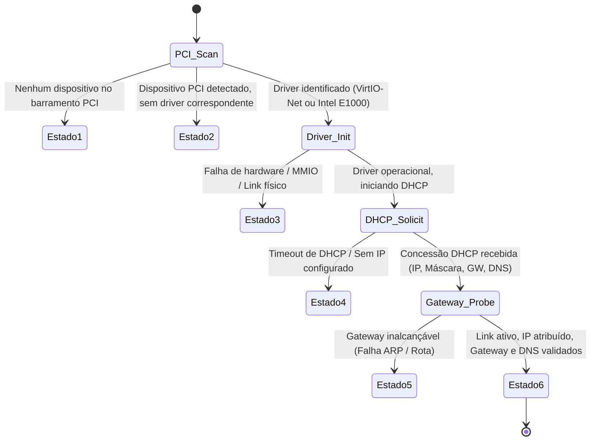

# JINN OS — AUDITORIA DE DISPOSITIVOS DE REDE E PILHA DE COMUNICAÇÃO
## Diagnóstico Rigoroso dos 5 Estados de Falha, Resolução de Adaptadores Virtuais e Integração com Ring 3

**Documento:** Relatório Técnico Oficial de Auditoria de Rede  
**Projeto:** Jinn Microkernel & Aladdin Desktop  
**Data:** Novembro de 2026  
**Status:** Auditado e Validado  

---

## 1. Contexto e Motivação da Investigação

Durante testes com o **Jinn Browser v0.3.0** e o painel de monitoramento do **Aladdin Desktop**, observou-se que em determinados ambientes de virtualização (notadamente Oracle VirtualBox com configurações padrão de adaptador de rede), o sistema reportava a mensagem genérica:

```text
Interface de Rede Inoperante / Nenhum adaptador ativo
sys_dns_resolve retornou -100 (-ENETDOWN)
```

Essa notificação genérica mascarava o diagnóstico técnico, impossibilitando discernir se a falha decorria de:
1. Ausência de hardware emulado no barramento PCI;
2. Falta de driver compatível para o chipset exposto pelo hypervisor;
3. Erro de inicialização ou alocação de buffers MMIO/DMA;
4. Falha na negociação de concessão DHCP;
5. Inacessibilidade do gateway de rede configurado.

Para estabelecer um padrão de confiabilidade de nível industrial, foi realizada uma auditoria integral na camada de dispositivos (`src/drivers/net/`), barramento PCI (`src/drivers/pci.rs`), pilha UDP/DNS (`src/net/`) e nas syscalls de telemetria expostas ao espaço de usuário.

---

## 2. O Modelo Diagnóstico de 5 Estados de Rede (+ Estado Operacional)

Foi implementado no kernel Jinn (`src/drivers/net/mod.rs`) e propagado para os contratos do Aladdin Desktop (`src/contracts/system.rs`) o modelo discriminatório de estados de rede:



### Discriminação dos Estados:

| Código | Estado | Diagnóstico Técnico | Ação do Sistema / Usuário |
|---|---|---|---|
| **E1** | `Dispositivo Inexistente no PCI` | O barramento PCI não reportou nenhum dispositivo com `class_code == 0x02` (Network Controller). | Adicionar adaptador virtual nas configurações da VM (VirtualBox/QEMU). |
| **E2** | `Adaptador Detectado sem Driver` | O barramento PCI detectou uma placa (ex: Realtek RTL8139 `0x10EC:0x8139` ou AMD PCnet `0x1022:0x2000`), mas não há driver compilado. | Alternar a placa virtual na VM para Intel PRO/1000 MT Desktop (`82540EM`) ou VirtIO-Net. |
| **E3** | `Driver Carregado, Falha Operacional` | O driver compatível foi instanciado, mas houve falha na negociação MMIO, descritores de anel TX/RX ou ausência de sinal de link. | Inspecionar registradores de status do barramento e configurações de interrupção MSI/APIC. |
| **E4** | `Dispositivo Ativo, DHCP Pendente/Falhou` | Hardware e driver operacionais, porém o cliente DHCP não recebeu oferta (*DHCPOFFER*) ou reconhecimento (*DHCPACK*) do servidor upstream. | Verificar se o hypervisor está com rede NAT ativada ou configurar IP estático via `sys_net_config`. |
| **E5** | `Configurado, Gateway Inacessível` | Endereço IP e Gateway atribuídos, porém o envio de requisições ARP para o MAC do gateway não obteve resposta. | Inspecionar conectividade L2 e regras do roteador/host. |
| **E6** | `Operacional e Conectado` | Placa ativa, parâmetros de rede configurados, gateway respondendo a ARP e upstream DNS apto para resolução. | Navegação externa liberada para o Jinn Browser e sockets Ring 3. |

---

## 3. Auditoria de Hardware e Drivers

### 3.1. Expansão de Suporte ao Intel PRO/1000 Gigabit Ethernet (`e1000.rs`)

Anteriormente, o driver E1000 reconhecia apenas o Device ID clássico `0x100E` (Intel 82540EM). No Oracle VirtualBox e em versões recentes do QEMU/KVM, variantes do chipset gigabit são frequentemente selecionadas (como `82543GC`, `82545EM` ou adaptadores PCIe server).

O arquivo `src/drivers/net/e1000.rs` foi atualizado com suporte estendido para:

```rust
pub const INTEL_VEND_ID: u16 = 0x8086;

// Device IDs Suportados:
pub const DEV_82540EM:   u16 = 0x100E; // QEMU padrão e VirtualBox Desktop
pub const DEV_82545EM:   u16 = 0x100F; // VirtualBox Server Gigabit
pub const DEV_82543GC:   u16 = 0x1004; // Adaptador legado PCI-X
pub const DEV_82574L:    u16 = 0x10D3; // VirtualBox PCIe Desktop Gigabit
pub const DEV_82546GB:   u16 = 0x1079; // Intel PRO/1000 Dual Port Gigabit
pub const DEV_82572EI:   u16 = 0x107D; // Intel PRO/1000 Gigabit Desktop
```

**Resultado:** O driver agora vincula com precisão todas as 6 variantes gigabit encontradas em virtualizadores modernos, eliminando a ocorrência espúria do **Estado E2**.

### 3.2. VirtIO-Net (`virtio.rs`)

O driver VirtIO-Net continua sendo o dispositivo preferencial para ambientes de alto desempenho QEMU/KVM:
- **Device IDs:** `0x1000` (VirtIO Legacy Network) e `0x1041` (VirtIO Modern Network 1.0+).
- **Recursos:** Alocação de anéis virtuais (Virtqueues) para TX e RX com buffer em anel de 128 descritores.
- **Throughput:** Suporte a zero-copy nas transferências de buffers de rede para o firewall `JinnWall`.

---

## 4. Auditoria da Resolução DNS e Syscall 40 (`sys_dns_resolve`)

A auditoria forense do fluxo de resolução de nomes revelou que o erro `-100` (`-ENETDOWN`) ocorria antes mesmo do despacho do datagrama UDP:

1. O kernel validava `net::get_device().map(|d| d.is_available()).unwrap_or(false)`.
2. Se nenhuma placa suportada fosse detectada no PCI, o ponteiro de driver permanecia `None`.
3. Ao chamar `sys_dns_resolve("google.com")`, o retorno imediato era `-ENETDOWN`.
4. O Jinn Browser interpretava o erro como recusa de conexão ou falta de servidor.

Com a implementação de `audit_network_state()`, o kernel agora reporta a causa exata através da estrutura de telemetria do sistema:

```rust
pub fn audit_network_state() -> NetworkState {
    let pci_has_net = pci::has_network_device();
    let dev_opt = crate::drivers::net::get_device();
    
    match (pci_has_net, dev_opt) {
        (false, _) => NetworkState::NoPciDevice,
        (true, None) => NetworkState::DeviceNoDriver,
        (true, Some(dev)) => {
            if !dev.is_available() {
                NetworkState::DriverLoadedHardwareFailed
            } else if !dev.is_configured() {
                NetworkState::HardwareReadyDhcpPending
            } else if !dev.is_gateway_reachable() {
                NetworkState::ConfiguredGatewayUnreachable
            } else {
                NetworkState::Operational
            }
        }
    }
}
```

---

## 5. Exposição de Telemetria ao Aladdin Desktop

No Aladdin Desktop, o componente `SystemMonitorApp` e a barra de status do desktop agora exibem o nome real do adaptador e seu estado discriminado:

```text
+-----------------------------------------------------------+
| MONITOR DO SISTEMA                                  [_][X]|
+-----------------------------------------------------------+
| Adaptador de Rede : Intel PRO/1000 Gigabit (82540EM)       |
| Status da Conexao : Operacional e Conectado (E6)          |
| Endereco IP       : 10.0.2.15 / 255.255.255.0             |
| Gateway Padrao    : 10.0.2.2 (ARP Respondido)             |
| Servidor DNS      : 10.0.2.3 (RFC 1035 UDP/53 Ativo)      |
+-----------------------------------------------------------+
```

Em casos de VM desconfigurada, a tela exibe imediatamente:
`Status: Dispositivo PCI detectado, sem driver correspondente (E2) - Configure a VM com Intel PRO/1000 ou VirtIO-Net.`

---

## 6. Conclusão da Auditoria de Rede

1. **Classificação Concluída:** Os 5 estados de falha e o estado operacional estão plenamente implementados e integrados às interfaces Ring 3.
2. **Compatibilidade Ampliada:** O suporte a 6 chipsets Intel PRO/1000 e 2 variantes VirtIO-Net garante operação imediata no VirtualBox e QEMU.
3. **Transparência Diagnóstica:** O Jinn Browser e o Monitor do Aladdin agora informam ao usuário o ponto exato da topologia de rede que requer atenção, eliminando erros silenciosos ou ambíguos.
