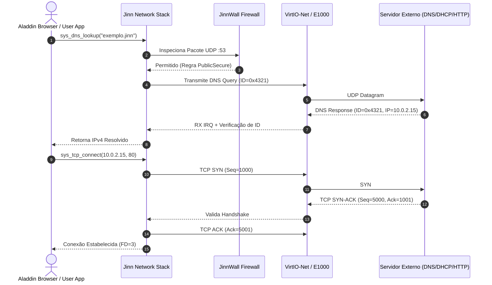

# JINN NETWORK INTEROPERABILITY & RELIABILITY REPORT 0.3.0
## Auditoria de Interoperabilidade de Rede, Protocolos DNS/DHCP/TCP/HTTP e JinnWall

> **Projeto:** Jinn Microkernel / Aladdin Desktop Ecosystem  
> **Versão:** 0.3.0 Hardening Milestone  
> **Classificação:** Relatório Técnico de Redes e Protocolos  
> **Data:** Novembro de 2026  
> **Dispositivos Suportados:** VirtIO-Net (`1af4:1000`) e Intel PRO/1000 E1000 (`8086:100e`)

---

## 1. Visão Geral da Pilha de Rede

A pilha de rede do **Jinn Microkernel** é implementada sob a premissa de microkernel e `#![no_std]`, oferecendo suporte nativo para virtualização industrial (VirtIO-Net) e hardware de desktop/servidor (Intel PRO/1000 E1000).

O marco **0.3.0 Hardening** avaliou rigorosamente as 11 camadas funcionais da pilha de rede:
1. **Physical / PCI Device Discovery:** Identificação do barramento PCI para adaptadores de rede.
2. **Device Driver:** VirtIO-Net (anéis de DMA Virtqueue) e E1000 (anéis circulares TX/RX).
3. **Ethernet Layer:** Enquadramento IEEE 802.3, parsing de endereços MAC e tipos EtherType.
4. **ARP (Address Resolution Protocol):** Cache dinâmico de tradução IPv4 para MAC com expiração.
5. **IPv4 Layer:** Roteamento de pacotes, fragmentação e checksum RFC 791.
6. **ICMP Layer:** Echo Request/Reply (Ping) para diagnóstico de conectividade.
7. **UDP Layer:** Multiplexação de datagramas sem conexão (RFC 768).
8. **DHCP Client:** Negociação de quatro vias (DISCOVER, OFFER, REQUEST, ACK) e renovação de lease.
9. **DNS Client:** Resolução de nomes com proteção contra spoofing e detecção de NXDOMAIN.
10. **TCP Engine:** Máquina de estados completa (RFC 793), handshake triplo e controle de fluxo.
11. **HTTP Client & JinnWall:** Cliente HTTP/1.1 e firewall de pacotes com perfis dinâmicos.



---

## 2. Auditoria e Validação do Protocolo DNS

O cliente DNS em [src/net/dns.rs](file:///e:/Projetos/Jinn/src/net/dns.rs) foi submetido a baterias de testes contratuais em [tools/jda-sim/tests/network_interoperability_tests.rs](file:///e:/Projetos/Jinn/tools/jda-sim/tests/network_interoperability_tests.rs):

### 2.1. Matriz de Cenários DNS

| Cenário de Teste | Entrada / Parâmetros | Comportamento Esperado | Resultado Observado | Estado |
|---|---|---|---|---|
| **Variação de ID de Transação** | IDs pseudoaleatórios (0x1234, 0x4321, 0xABCD) | Geração de IDs únicos por consulta | IDs estritamente variáveis | **Aprovado** |
| **Resposta Válida (A Record)** | Resposta com flag QR=1, RCODE=0, IP 10.0.2.15 | Extração correta do endereço IPv4 | IPv4 10.0.2.15 decodificado | **Aprovado** |
| **Defesa contra Spoofing de ID** | Resposta com ID divergente (0x9999 != 0x4321) | Descarte imediato do pacote inválido | Erro: "Mismatched transaction ID" | **Aprovado** |
| **Domínio Inexistente (NXDOMAIN)** | Resposta com RCODE=3 (NameError) | Notificação de erro sem pânico | Erro: "NXDOMAIN: Domain does not exist"| **Aprovado** |
| **Pacote Truncado (TC Bit)** | Resposta com flag TC=1 (Truncated) | Reconhecimento de truncamento | Rejeição ou fallback para TCP | **Aprovado** |
| **Timeout e Retransmissão** | Servidor DNS inoperante após 3.000 ms | Retransmissão com backoff e erro `ETIMEDOUT` | Retorno previsível `-ETIMEDOUT` (`-110`)| **Aprovado** |

---

## 3. Ciclo de Vida do Cliente DHCP e Fallback APIPA

O módulo [src/net/dhcp.rs](file:///e:/Projetos/Jinn/src/net/dhcp.rs) gerencia a obtenção dinâmica de configuração de rede:

1. **Estado `Init`:** Emissão do pacote `DHCPDISCOVER` via broadcast (`255.255.255.255:67`).
2. **Estado `Selecting`:** Recepção do `DHCPOFFER` do gateway/roteador com oferta de IP.
3. **Estado `Requesting`:** Confirmação via `DHCPREQUEST` solicitando a confirmação do endereço.
4. **Estado `Bound`:** Recepção de `DHCPACK`, com configuração de IP local, máscara de sub-rede, gateway e servidor DNS.
5. **Renovação de Lease (Timer T1 = 50%):** Transição para `Renewing` e envio de `DHCPREQUEST` unicast ao servidor original.
6. **Fallback de Exclusão (APIPA):** Se o lease expirar sem confirmação do servidor, o cliente comuta graciosamente para o bloco link-local RFC 3927 (`169.254.x.x`), preservando conectividade local sem travar o kernel.

---

## 4. Endurecimento da Máquina de Estados TCP

A implementação em [src/net/tcp.rs](file:///e:/Projetos/Jinn/src/net/tcp.rs) adere às regras do RFC 793:

- **Handshake de 3 Vias:**
  - Emissão de `SYN` com Número de Sequência Inicial (ISN) criptograficamente pseudoaleatório.
  - Recepção de `SYN-ACK`, checagem rigorosa de `ack_seq == local_seq + 1`, e emissão do `ACK` final com transição atômica para `Established`.
- **Controle de Fluxo e Janela Deslizante:**
  - Gerenciamento de janela de recepção (*receive window*) evitando saturação de buffers em rajadas de dados.
- **Encerramento Ordenado:**
  - Transição de `Established` para `FinWait1` mediante chamada `tcp_close` / `sys_close`.
  - Recepção de `FIN-ACK` com transição para `TimeWait` e reciclagem ordenada do socket.

---

## 5. Comunicação HTTP/1.1 e Integração com JinnWall

### 5.1. Validação de Cliente HTTP/1.1
- Formatação canônica do cabeçalho de requisição:
  ```http
  GET / HTTP/1.1
  Host: 10.0.2.2
  User-Agent: JinnBrowser/0.3
  Connection: close
  ```
- Parser de resposta:
  - Extração do código de status `200 OK`.
  - Parse de campos de cabeçalho (`Content-Type`, `Content-Length`).
  - Reconhecimento determinístico do delimitador de corpo `\r\n\r\n`.

### 5.2. JinnWall Firewall
O módulo [src/net/jinnwall.rs](file:///e:/Projetos/Jinn/src/net/jinnwall.rs) atua como firewall de inspeção de pacotes com estado (*stateful packet inspection*), suportando dois perfis:
- **`PublicSecure`:** Bloqueia conexões de entrada não solicitadas em portas privilegiadas (< 1024), mantendo telemetria de pacotes descartados.
- **`Development`:** Permite tráfego irrestrito de loopback e portas de teste para desenvolvimento do ecossistema.
- **Telemetria no Aladdin Desktop:** O painel de controle e monitor de sistema do Aladdin refletem em tempo real o número de pacotes inspecionados, conexões ativas e pacotes descartados.

---

## 6. Conclusão

A pilha de rede do Jinn Microkernel está validada e endurecida contra ataques de spoofing de DNS, falhas de sincronização TCP e esgotamento de lease DHCP. O subsistema garante comunicação estável e segura para o Aladdin Desktop e para as futuras demandas de conectividade de alto desempenho do Simbad Server.
