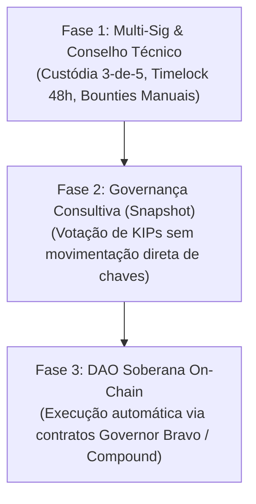

# Jinn Open Economy — Governança e Gestão da Tesouraria

**Documento:** Diretrizes Oficiais de Governança, Custódia e Gestão Econômica  
**Projeto:** Jinn Project  
**Ativo:** $JINN (Jinn Network Token)  
**Versão:** 1.0.0  
**Data:** Novembro de 2026  
**Status:** Política de Governança Institucional e Técnica  

---

## 1. Princípios Fundamentais de Governança

A governança do **Jinn Project** é fundamentada no princípio da **descentralização progressiva e transparência institucional**:

1. **Separação Tecnológica:** O desenvolvimento do kernel Jinn e seus padrões de engenharia permanecem soberanos. Decisões técnicas sobre segurança do microkernel jamais serão subjugadas a votações financeiras especulativas.
2. **Ausência de DAO Fictícia:** O projeto rejeita a rotulagem prematura de "DAO 100% descentralizada" enquanto houver dependência de signatários centrais. A governança assume explicitamente seu estágio atual (Fase 1: Fundação & Multi-Sig) e define um caminho auditável até a descentralização plena.
3. **Imutabilidade do Teto de Emissão:** O suprimento de 1.000.000.000 $JINN é matematicamente fixo e o contrato não possui função de mint arbitrário.

---

## 2. Alocação e Cronograma Oficial de Vesting

O suprimento total de 1.000.000.000 $JINN está dividido estritamente conforme a matriz:

| Destinação | % | Quantidade ($JINN) | Condição de Bloqueio (Vesting) | Custodiante Inicial |
|---|---:|---:|---|---|
| **Fundo Comunitário & PoUC** | 35% | 350.000.000 | 5% no TGE; 48 meses de liberação proporcional a marcos de desenvolvimento | `JinnRewardDistributor.sol` |
| **Tesouraria do Ecossistema** | 25% | 250.000.000 | 12 meses de carência (*cliff*); 36 meses de liberação linear contínua | `JinnVesting.sol` (Multi-Sig Safe) |
| **Mantenedores Centrais & Core Dev** | 15% | 150.000.000 | 12 meses de carência (*cliff*); 36 meses de liberação linear mensal | `JinnVesting.sol` (Individual) |
| **Provisão de Liquidez DEX/CEX** | 15% | 150.000.000 | 100% no TGE; LP Tokens bloqueados em cofre público por 24 meses | Liquidity Lock (PancakeSwap/Uniswap) |
| **Adoção Inicial & Airdrop** | 10% | 100.000.000 | 20% no TGE; 6 meses lineares para desenvolvedores, testadores da ISO e assinantes do CLA | Distribuição Auditada |

---

## 3. Arquitetura da Tesouraria e Custódia Multi-Sig

Para garantir que nenhum indivíduo tenha controle unilateral sobre fundos da tesouraria ou parâmetros contratuais, a custódia inicial adota o padrão **Gnosis Safe Multi-Sig** na BNB Smart Chain:

### 3.1. Parâmetros da Carteira da Tesouraria
- **Quórum Mínimo:** **3 de 5 assinaturas** necessárias para qualquer movimentação.
- **Composição dos Signatários:**
  1. *Signatário 1:* Arquiteto-Chefe do Kernel Jinn.
  2. *Signatário 2:* Líder de Desenvolvimento do Aladdin Desktop.
  3. *Signatário 3:* Engenheiro de Infraestrutura & Rede (Simbad).
  4. *Signatário 4:* Representante Técnico da Comunidade Open Source.
  5. *Signatário 5:* Auditor de Segurança Independente.
- **Timelock Obrigatório:** Todas as transações da tesouraria acima de 50.000 $JINN ou alterações de parâmetros passam por um contrato de *Timelock* com carência mínima de **48 horas** entre o anúncio on-chain e a execução, permitindo que a comunidade audite a intenção.

### 3.2. Regras de Gastos da Tesouraria
1. Subsídios a contribuidores somente são liberados mediante PR aprovado no repositório oficial e cumprimento do CLA.
2. Contratos de auditoria externa de segurança e custos operacionais de infraestrutura RPC têm prioridade de desembolso.
3. É estritamente vedado aos signatários utilizar fundos da tesouraria para especulação financeira, empréstimos não colateralizados ou benefícios pessoais.

---

## 4. Política de Conflitos de Interesse

1. **Declaração Prévia:** Qualquer mantenedor ou membro do conselho multi-sig que possua vínculo pessoal, comercial ou societário com um beneficiário de proposta de grant deve abster-se da votação e registrar o conflito publicamente.
2. **Quórum Especial:** Propostas que envolvam entidades ligadas a mantenedores exigem aprovação unânime dos signatários desimpedidos.
3. **Auditoria Trimestral:** A fundação publicará a cada trimestre um relatório contábil detalhando:
   - Saldo de tokens na tesouraria e no cofre de vesting.
   - Entradas de taxas de serviços do ecossistema.
   - Lista completa de transações com hashes no BSCScan.

---

## 5. Roteiro de Descentralização Progressiva

1. **Fase 1 (Atual — Fundação & Multi-Sig):** Foco na integridade do código e entrega dos marcos do roadmap. Governança técnica concentrada nos mantenedores ativos.
2. **Fase 2 (Intermediária — Sinalização Comunitária):** Introdução de votações no Snapshot para propostas de melhoria (KIPs) e seleção de prioridades de drivers, servindo como mandato consultivo para os signatários.
3. **Fase 3 (Madura — DAO Descentralizada):** Quando o Aladdin Desktop e o Simbad OS atingirem maturidade de produção e liquidez sustentável, o controle dos cofres passará para um governador inteligente na blockchain.
