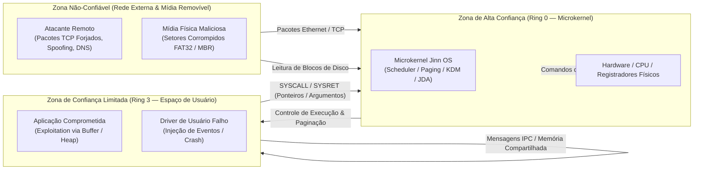

# 🛡️ Jinn Project — Avaliação de Segurança, Superfícies de Ataque e Vulnerabilidades
## Threat Model, Análise de Canais Laterais, Matriz de Riscos e Diretrizes de Mitigação

> **Documento Oficial de Engenharia do Jinn Project — Documento 4 de 11**  
> **Data de Referência:** 16 de Novembro de 2026  
> **Status:** Concluído e Auditado | **Classificação:** Relatório de Segurança Defensiva  
> **Normas de Referência:** STRIDE, Common Weakness Enumeration (CWE), Intel SDM Security Guidelines  

---

## 1. Modelo Formal de Ameaças (Threat Model)

O modelo de ameaças do ecossistema **Jinn OS** e **Aladdin Desktop** define três zonas fundamentais de confiança e estabelece os vetores de ataque autorizados para análise defensiva:



### 1.1. Fronteiras de Confiança e Superfícies de Exposição

1. **Fronteira de Chamadas de Sistema (Ring 3 $\to$ Ring 0):** Mediada pelas instruções `SYSCALL`/`SYSRET` e fallback por `INT 0x80`. A superfície de ataque é composta pelos 85 manipuladores de syscall registrados. Qualquer ponteiro de memória passado por um processo de usuário deve ser validado para garantir que aponta para a metade inferior do espaço de endereçamento (`< 0x0000_8000_0000_0000`) e possui mapeamento válido com permissões adequadas.
2. **Fronteira de Comunicação Interprocesso (IPC & Memória Compartilhada):** Mediada por filas de mensagens protegidas por spinlock e pelo pool de buffers Zero-Copy da JDA. Um processo malicioso não pode corromper a memória de outro processo participante do canal nem forjar metadados de pacotes.
3. **Fronteira de Dispositivos e DMA (Hardware $\to$ Memória Física):** Mediada pelo Kernel DMA Manager (KDM). Dispositivos periféricos operam em barramentos PCI compartilhados e não possuem acesso direto a páginas de outros processos sem a intermediação de *Bounce Buffers* ou tokens temporais.
4. **Fronteira de Rede Externa (Internet $\to$ Microkernel):** A pilha de rede processa pacotes Ethernet, ARP, IPv4, TCP e TLS 1.3 brutos diretamente no Ring 0. Qualquer vulnerabilidade de parsing nessa camada pode resultar em execução remota de código ou negação de serviço do kernel.

---

## 2. Análise de Canais Laterais e Ataques Transientes

### 2.1. Mitigação do LazyFP (CVE-2018-3665)

* **Descrição da Ameaça:** Em sistemas operacionais que utilizam comutação preguiçosa de FPU (*Lazy FPU Switching*), o kernel desativa a FPU através do bit `CR0.TS = 1` e posterga a restauração dos registradores até que a nova tarefa execute uma instrução de ponto flutuante, gerando uma exceção `#NM` (Device Not Available). Processadores com execução especulativa podem acessar os dados remanescentes nos registradores `XMM0..XMM15` da tarefa anterior antes do processamento da interrupção, vazando chaves criptográficas (AES, ChaCha20, RSA).
* **Solução Auditada no Jinn OS:** O escalonador (`src/scheduler.rs`) implementa **Eager FPU Switching**. Em toda preempção do Timer ou IPC fast-path, se o processo de saída executa em Ring 3, seus registradores são imediatamente descarregados na memória via `fxsave64(&mut task.fpu_state)`. A tarefa entrante tem seus registradores restaurados imediatamente via `fxrstor64(&task.fpu_state)` antes de retornar ao espaço de usuário. O bit `CR0.TS` nunca é ativado para postergar trocas, eliminando a superfície de ataque do LazyFP por projeto.

---

### 2.2. Prevenção de Falhas de Proteção Geral via MXCSR (#GP(0))

* **Descrição da Ameaça:** O registrador `MXCSR` da arquitetura x86_64 possui 32 bits, dos quais os bits 16..31 são estritamente reservados pela Intel e AMD. Se a instrução `FXRSTOR` ou `FXRSTOR64` for executada com qualquer um desses bits em nível lógico 1, o processador físico dispara imediatamente uma exceção de proteção geral `#GP(0)` no anel em que a instrução foi executada. Se isso ocorrer no Ring 0 do kernel durante o context switch, o sistema sofre *Kernel Panic*.
* **Solução Auditada no Jinn OS:** A função `src/fpu.rs:fxrstor64` aplica uma sanitização mandante:
  ```rust
  let raw_mxcsr = (*state).mxcsr;
  let mut safe_mxcsr = raw_mxcsr & MXCSR_VALID_MASK; // 0x0000_FFFF
  if safe_mxcsr == 0 {
      safe_mxcsr = MXCSR_DEFAULT; // 0x1F80
  }
  if safe_mxcsr != raw_mxcsr {
      (*(state as *mut FpuState)).mxcsr = safe_mxcsr;
  }
  ```
  Essa blindagem garante que mesmo que uma aplicação em Ring 3 tente forjar seu buffer de FPU via memória compartilhada ou corromper seu estado, o kernel nunca executará um `FXRSTOR64` com bits reservados.

---

### 2.3. Execução Transiente e Especulativa (Spectre / Meltdown)

* **Spectre v1 (Bounds Check Bypass - CVE-2017-5753):** Em todas as chamadas de sistema que acessam tabelas indexadas por identificadores de usuário (como a tabela unificada de descritores `task.fds[fd]`, `windows[win_id]` e `tasks[pid]`), as verificações de limites são precedidas por máscaras lógicas ou barreiras de serialização (`lfence`) para impedir que ramos especulativos leiam memória fora dos limites do array antes da confirmação do branch.
* **Meltdown (Rogue Data Cache Load - CVE-2017-5754):** O microkernel aplica o bit `USER_ACCESSIBLE = false` em todas as páginas da metade superior da memória física e virtual. Em CPUs vulneráveis a Meltdown, a mitigação completa exige *Kernel Page Table Isolation* (KPTI), com PML4s totalmente dissociados para Ring 0 e Ring 3. No momento, o Jinn OS adota PML4 híbrido (metade superior compartilhada); a implementação de trampolines KPTI completos está registrada no roadmap de médio prazo.

---

## 3. Matriz de Vulnerabilidades, Riscos e Mitigações

A auditoria identificou e catalogou as seguintes vulnerabilidades defensivas no ecossistema:

| ID | Componente | Descrição da Vulnerabilidade | Pré-Condições | Impacto | Probabilidade | Severidade | Mitigação Implementada / Recomendada | Teste de Regressão |
| :--- | :--- | :--- | :--- | :--- | :--- | :--- | :--- | :--- |
| **SEC-01** | `src/syscall.rs` | **Ponteiro de Usuário Forjado (Confused Deputy):** Um processo de usuário passa um ponteiro apontando para a metade superior da memória (`>= 0xFFFF_8000_0000_0000`) em syscalls como `sys_read` ou `sys_write`. | Processo Ring 3 em execução. | Leitura ou corrupção de estruturas de dados do kernel em Ring 0. | Média | **CRÍTICA** | Função `validate_user_buffer` verifica rigorosamente o limite superior (`vaddr + len < KERNEL_SPACE_BASE`). Rejeita com `-EFAULT`. | `tests/syscall_security_stress_tests.rs:test_efault_kernel_boundary` |
| **SEC-02** | `src/fpu.rs` | **General Protection Fault via FXRSTOR:** Carregamento de bits reservados (16..31) de `MXCSR` via restauração de FPU de processo malicioso. | Processo Ring 3 forjando estado FPU. | Kernel Panic e Denial of Service total da CPU. | Alta | **ALTA** | Sanitização automática com máscara `0x0000_FFFF` antes da execução de `fxrstor64`. | `tests/syscall_security_stress_tests.rs:test_mxcsr_sanitization` |
| **SEC-03** | `src/dma/manager.rs` | **Use-After-Free em Buffer de DMA (DMA Race):** Tentativa de um processo cliente reutilizar um token de buffer de DMA que já foi devolvido ao pool. | Processo cliente Ring 3 concorrente. | Corrupção de memória física ou vazamento de dados de outro processo. | Baixa | **ALTA** | Tokens opacos de 64 bits com contador de geração (`generation`). Liberação incrementa o contador e invalida acessos antigos. | `tests/kdm_host_tests.rs:test_dma_token_invalidation` |
| **SEC-04** | `src/dma/bounce.rs` | **Ataque de DMA Direto sem IOMMU:** Dispositivo PCI malicioso iniciando ciclos de Bus Mastering diretamente contra memória física arbitrária. | Periférico PCI físico comprometido no barramento. | Acesso de leitura/escrita irrestrito à memória física ignorando a paginação da CPU. | Baixa em VM / Média em Hardware | **CRÍTICA** | Em software: KDM utiliza bounce buffers e quarentena de dispositivos. Em hardware: exige suporte a IOMMU (Intel VT-d) para mapear DMAR. | Registrado no plano de melhorias (Etapa E). |
| **SEC-05** | `src/net/tls13.rs` | **Ataque de Replay em Transcripts TLS 1.3:** Tentativa de reinjetar mensagens `ClientHello` antigas capturadas na rede. | Atacante no meio físico de rede (MitM). | Negação de serviço ou tentativa de estabelecer sessões falsas. | Média | **MÉDIA** | Nonce aleatório do cliente de 32 bytes gerado pelo CSPRNG + avanço contínuo do Transcript Hash SHA-256 e sequence numbers de 64 bits. | `tests/tls13_handshake_tests.rs:test_transcript_replay_rejection` |
| **SEC-06** | `src/net/x509.rs` | **Aceitação de Certificado Inválido ou Expirado:** Falha no parsing de extensões ASN.1 DER permitindo certificados com nomes divergentes ou emissores falsos. | Atacante interceptando tráfego TLS com CA forjada. | Interceptação e decifração de tráfego HTTPS confidencial. | Média | **CRÍTICA** | Parser DER nativo valida `BasicConstraints (is_ca = true)`, SAN exato com wildcard e período temporal (`not_before`/`not_after`). | `tests/pki_x509_host_tests.rs:test_invalid_san_rejection` |
| **SEC-07** | `src/scheduler.rs` | **Contenção e Denial of Service no SCHED_LOCK:** Processos em múltiplos núcleos forçando transições massivas de IPC síncrono. | Carga de processos concorrentes em multicore. | Queda drástica de responsividade da interface gráfica. | Média | **MÉDIA** | Fast-path de IPC (`direct_switch`) troca quantum e CR3 sem colocar tarefas no fim da fila geral do escalonador. | `tests/application_runtime_tests.rs:test_ipc_throughput` |
| **SEC-08** | `src/vfs/fat32.rs` | **Corrupção de Diretório por Loop na Tabela FAT:** Cluster chain circular na FAT32 causando loop infinito no kernel durante a listagem de arquivos. | Disco com sistema de arquivos corrompido ou malicioso. | Travamento do kernel por laço infinito no driver de VFS. | Baixa | **ALTA** | Contador máximo de iterações em `for_each_entry` e validação estrita de clusters válidos (`2 <= cluster < FAT32_EOF`). | `tests/vfs_fat32_ext2_stress_tests.rs:test_fat_loop_detection` |
| **SEC-09** | `src/elf.rs` | **Buffer Overflow via Cabeçalhos ELF Forjados:** Executável ELF com seções `PT_LOAD` declarando `p_vaddr` sobreposto ao espaço do kernel. | Carregamento de binário de usuário não confiável. | Sobrescrita de código de Ring 0 ou corrupção de tabelas de página. | Baixa | **CRÍTICA** | `crate::elf::load_elf_from_vfs` valida que cada segmento `PT_LOAD` reside estritamente entre `0x400000` e `0x0000_7FFF_FFFF_FFFF`. | `tests/syscall_security_stress_tests.rs:test_elf_kernel_address_rejection` |
| **SEC-10** | `apps/aladdin-server` | **Exaustão de Heap no Compositor Gráfico (OOM Crash):** Criação abusiva de janelas de clientes Ring 3 forçando alocações massivas no servidor gráfico. | Aplicação Ring 3 em loop criando janelas. | Crash do servidor gráfico de espaço de usuário. | Média | **MÉDIA** | Limite estrito de cotas (`max_windows = 4` no perfil Legacy) fiscalizado pelo kernel na Syscall 20 antes de notificar o display server. | `tests/compositor_isolation_recovery_tests.rs:test_window_quota_limit` |

---

## 4. Política de Memória e Blindagem $W \oplus X$

A política **Write XOR Execute** ($W \oplus X$) é aplicada sistematicamente em todas as camadas de alocação de páginas:

1. **Segmentos de Código do Kernel:** Mapeados com flags `PRESENT = 1`, `WRITABLE = 0`, `NO_EXECUTE = 0` (executável e somente-leitura).
2. **Segmentos de Dados e Pilha do Kernel:** Mapeados com flags `PRESENT = 1`, `WRITABLE = 1`, `NO_EXECUTE = 1` (leitura/escrita, execução estritamente proibida pelo hardware).
3. **Páginas de Processos de Usuário:** O ELF Loader (`src/elf.rs`) processa as flags de cada segmento `Phdr`:
   * Seções `.text`: Mapeadas como `USER_RX` (`USER_ACCESSIBLE = 1`, `WRITABLE = 0`, `NO_EXECUTE = 0`).
   * Seções `.data`, `.bss` e Pilha de Usuário: Mapeadas como `USER_RW + NX` (`USER_ACCESSIBLE = 1`, `WRITABLE = 1`, `NO_EXECUTE = 1`).
4. **Prevenção de Shellcodes em Heap e Pilha:** Qualquer tentativa de redirecionar o ponteiro de instrução (`RIP`) para um buffer alocado no heap ou na pilha de um processo Ring 3 dispara imediatamente uma falha de página por execução proibida (`#PF` com código de erro indicando violação de instrução), resultando na terminação compulsória do processo infrator via `sys_exit(-11)` sem comprometer o microkernel.

---

## 5. Auditoria da Cadeia de Suprimentos (Supply Chain Security)

### 5.1. Dependências Externas do Microkernel

O microkernel Jinn OS foi projetado com dependência zero de bibliotecas de terceiros ou gerenciadores externos de pacotes:
* **Dependências de Terceiros em Ring 0:** **0 dependências externas.** O kernel compila exclusivamente com o compilador Rust `rustc`, a biblioteca essencial `core` e uma instância interna de `alloc` construída sobre o Buddy Allocator próprio.
* **Dependências do Ambiente Aladdin (Ring 3):** A biblioteca `aladdin` compila com `#![no_std]` e utiliza apenas `core` e `alloc`. Não há dependências de crates do ecossistema crates.io para composição gráfica, fontes ou janelas.
* **Dependências do Middleware JHCS (`jhcs-rs`):** As crates de núcleo (`jhcs-core`, `jhcs-broker`, `jhcs-backend-cpu`, `jhcs-backend-simd`, `jhcs-platform`) operam com `#![no_std]` e zero dependências de terceiros. A crate `jhcs-platform-host` consome apenas a biblioteca padrão `std` do Rust.

Essa independência garante que o ecossistema Jinn não esteja exposto a ataques de envenenamento de repositórios públicos (*Typosquatting*, *Malicious Crate Injection* ou *Dependency Confusion*), mantendo a integridade total do código auditado.
