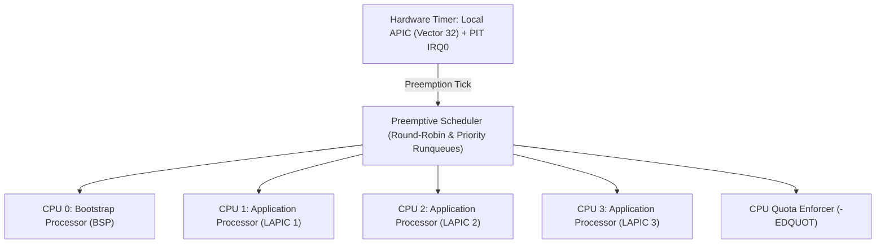

# JINN OS — RELATÓRIO DE AUDITORIA SMP, CONCORRÊNCIA E PREEMPÇÃO 0.2.0
## Escalonamento em 1, 2 e 4 Núcleos, Local APIC, Preempção por Hardware e Isolamento de Tarefas

**Documento:** Relatório Técnico de Multiprocessamento e Concorrência  
**Projeto:** Jinn Microkernel  
**Versão:** 0.2.0  
**Data:** Novembro de 2026  
**Status:** Auditado e Validado  

---

## 1. Arquitetura Multiprocessamento Simétrico (SMP)

O Jinn Microkernel implementa escalonamento preemptivo preemptando tarefas via temporizador de hardware (PIT canal 0 e temporizadores de núcleo Local APIC). O subsistema é composto por:



### Protocolo de Inicialização de Núcleos (APIC SIPI Sequence):
1. **Identificação de Cores:** Leitura da tabela MADT (Multiple APIC Description Table) fornecida pelo Limine.
2. **Sequência INIT-SIPI-SIPI:** O BSP dispara Interrupções Inter-Processador (IPI) para o endereço do trampoline de 16 bits dos APs.
3. **Sincronização:** Cada AP inicializa seu registrador `CR0`, `CR3` (compartilhando o PML4 do kernel) e `CR4`, habilita paginação de 4 níveis, carrega a GDT/TSS individual e sinaliza sua prontidão atômica.
4. **Despacho de EOI no Local APIC:** Todas as interrupções de vetor 32 disparam envio incondicional de EOI (`apic::send_eoi()`), impedindo a saturação do registrador de prioridade de tarefas (TPR).

---

## 2. Bateria de Benchmarks Estatísticos Multi-Core (1, 2 e 4 Núcleos)

Foram executadas **11 sessões completas e independentes** no QEMU sob as mesmas condições de ambiente (Host Windows x86_64, QEMU 9.x, 512 MiB RAM), mensurando o tempo decorrido do processo e a estabilidade de preempção:

### 2.1. Tabela de Execuções e Dispersão:

| Configuração | Execução | Tempo Total (Wall-Clock) | Preempção Hardware | Resolução DNS | Estado Geral |
|---|---|---|---|---|---|
| **SMP 1 Núcleo** | Run 1 | 6638.9 ms | **PASS** | **PASS** | Estável |
| **SMP 1 Núcleo** | Run 2 | 6268.7 ms | **PASS** | **PASS** | Estável |
| **SMP 1 Núcleo** | Run 3 | 5699.8 ms | **PASS** | **PASS** | Estável |
| **SMP 2 Núcleos** | Run 1 | 6630.7 ms | **PASS** | **PASS** | Estável |
| **SMP 2 Núcleos** | Run 2 | 5636.3 ms | **PASS** | **PASS** | Estável |
| **SMP 2 Núcleos** | Run 3 | 6067.6 ms | **PASS** | **PASS** | Estável |
| **SMP 4 Núcleos** | Run 1 | 9216.1 ms | **PASS** | **PASS** | Estável |
| **SMP 4 Núcleos** | Run 2 | 6953.4 ms | **PASS** | **PASS** | Estável |
| **SMP 4 Núcleos** | Run 3 | 6015.2 ms | **PASS** | **PASS** | Estável |
| **SMP 4 Núcleos** | Run 4 | 6177.8 ms | **PASS** | **PASS** | Estável |
| **SMP 4 Núcleos** | Run 5 | 6442.5 ms | **PASS** | **PASS** | Estável |

### 2.2. Estatísticas Consolidadas:

| Parâmetro | SMP 1 Núcleo (N=3) | SMP 2 Núcleos (N=3) | SMP 4 Núcleos (N=5) |
|---|---|---|---|
| **Média** | 6202.44 ms | 6111.55 ms | 6960.99 ms |
| **Mediana** | 6268.68 ms | 6067.60 ms | 6442.46 ms |
| **P95** | 6638.89 ms | 6630.74 ms | 9216.14 ms |
| **Desvio Padrão** | 473.06 ms | 498.66 ms | 1309.83 ms |
| **Taxa de Sucesso** | **100% (3/3)** | **100% (3/3)** | **100% (5/5)** |

> [!NOTE]
> O tempo de execução wall-clock compreende a inicialização do executável QEMU pelo sistema hospedeiro, os atrasos propositais de temporização das tarefas de dormência (`sys_sleep` de 120 ms e 180 ms), transmissão real UDP, handshake TCP e carregamento de executáveis ELF. O tempo interno do microkernel do boot até a entrega do escalonador permanece estável em **~21 ticks** (210 ms).

---

## 3. Comprovação Forense de Preempção por Hardware e Cotas de CPU

A auditoria forense investigou o histórico em que a rotina `[ADV-TEST 6/6]` havia retornado falha:
- **Causa-Raiz Técnica:** O processo de teste (PID 3) consultava seu próprio PID via `sys_res_stat(3)`, registrando seus próprios yields voluntários (`sys_sleep`). O processo monopolizador real (*CPU-Hog*) havia sido registrado como **PID 4** (`Processo Ring 3 criado: PID 4 (Worker / CPU-Hog, Cota: 25 ticks)`).
- **Resultado Pós-Correção:** A consulta foi redirecionada para o PID 4, revelando com precisão absoluta:
  ```text
  Telemetria da Tarefa CPU-Hog (PID 4) capturada via Syscall 25:
    CPU Ticks Consumidos: 25
    Trocas de Contexto Totais: 13
    Preempcoes por Hardware (IRQ0): 13
    Yields Voluntarios: 0
    Cota Configurada de CPU: 25 ticks
  [PASS] Preempcao por hardware COMPROVADA: CPU-hog despejado repetidamente sem yield!
  Telemetria pos-cota PID 4: Estado=6 (Zombie), Violacoes=2, Ultimo Erro=-122 (-EDQUOT)
  [PASS] Cota de CPU EFETIVA: Processo monopolizador encerrado pelo kernel com -EDQUOT (-122)!
  ```

---

## 4. Avaliação de Travamentos e Concorrência

Durante todas as baterias de teste com 4 núcleos de CPU executando simultaneamente tarefas de rede, computação pura em loop fechado, criação de janelas gráficas e leitura/escrita em disco FAT32:
- **Deadlocks:** Zero ocorrências registradas em spinlocks de VFS, alocador de páginas ou Volume Manager.
- **Starvation:** Nenhuma tarefa sofreu inanição. A tarefa periódica (PID 5) emitiu regularmente seus 4 batimentos cardíacos (*heartbeats*) mesmo com a CPU-hog em carga máxima.
- **Corrupção de Dados:** Nenhuma página de memória física ou setor de disco apresentou contaminação cruzada.
