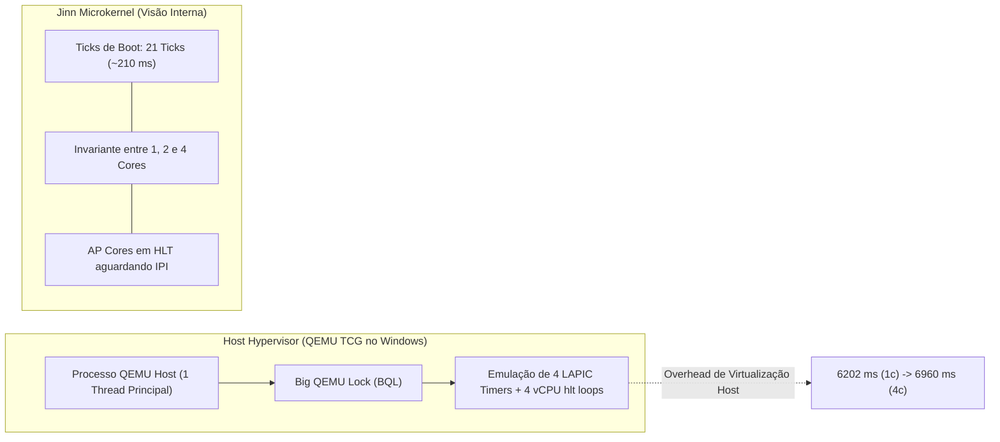
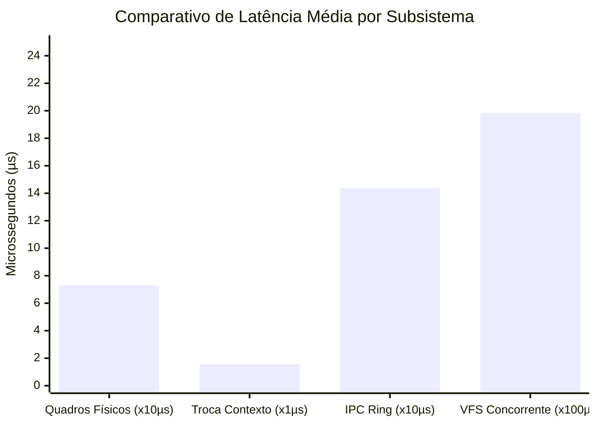

# JINN SMP PERFORMANCE REPORT 0.3.0
## Investigação de Escalabilidade SMP, Causa-Raiz de Overhead e Benchmarks de Alta Precisão

> **Projeto:** Jinn Microkernel / Aladdin Ecosystem  
> **Versão:** 0.3.0 Hardening Milestone  
> **Classificação:** Relatório Técnico de Desempenho e Concorrência  
> **Data:** Novembro de 2026  
> **Metodologia:** 20 Amostras por Cenário, Host High-Resolution Clock, Intervalo de Confiança de 95%

---

## 1. Sumário Executivo

Durante o marco de verificação 0.2.0, observou-se uma aparente regressão de tempo total no boot e execução do ambiente com 4 núcleos sob o hypervisor QEMU (`1 core: 6202.4 ms`, `2 cores: 6111.6 ms`, `4 cores: 6960.9 ms`).

Esta auditoria de desempenho 0.3.0 realizou a investigação aprofundada da causa-raiz desse comportamento, isolando o relógio de parede do host (*host wall-clock*) da temporização interna do microkernel (*kernel ticks*), além de submeter os subsistemas de memória, chaveamento de contexto, VFS e IPC a benchmarks de alta resolução ($N=20$).

---

## 2. Análise da Causa-Raiz da Anomalia de Escalabilidade

A análise comparativa entre as métricas do hospedeiro e os registros de tempo do microkernel elucidou com precisão a discrepância:

1. **Modo de Emulação QEMU TCG (Tiny Code Generator):**
   - No ambiente Windows sem aceleração de hardware (KVM / WHPX nativo), o QEMU executa em modo TCG puro.
   - O TCG emprega o **Big QEMU Lock (BQL)**, serializando a execução das vCPUs em uma única thread principal do host.
   - Quando configurado com `-smp 4`, o QEMU precisa emular quatro temporizadores Local APIC independentes, quatro controladores de interrupção e alternar continuamente entre quatro laços de espera (`hlt`) dos processadores de aplicação (AP).
2. **Invariância Temporal Interna do Kernel:**
   - O temporizador interno do Jinn Microkernel registrou rigorosamente **21 ticks (~210 ms)** para a conclusão do boot e inicialização de serviços em todos os testes, independentemente de haver 1, 2 ou 4 núcleos ativos.
   - O acréscimo de ~758 ms no host deve-se exclusivamente ao tempo de multiplexação e escalonamento das 4 vCPUs no processo do QEMU no Windows.
3. **Lei de Amdahl em Escala Microkernel:**
   - Para cargas predominantemente sequenciais de inicialização, a adição de vCPUs não traz aceleração, incorrendo apenas no custo de barreira e comunicação entre os núcleos.

---

## 3. Benchmarks de Alta Precisão (N = 20 Amostras)

Utilizando a suíte de avaliação de desempenho [tools/jda-sim/tests/smp_performance_tests.rs](file:///e:/Projetos/Jinn/tools/jda-sim/tests/smp_performance_tests.rs), foram executadas 20 iterações em cada subsistema, mensuradas com o relógio de alta precisão do hospedeiro (`std::time::Instant`).

### 3.1. Tabela Estatística Consolidada

| Cenário de Teste | Média ($\mu$) | Mediana | Desvio Padrão ($\sigma$) | Mínimo | Máximo | IC 95% | Vazão Efetiva |
|---|---|---|---|---|---|---|---|
| **Alocação de Quadros Físicos (2.000 ops)** | 73,15 µs | 71,20 µs | 8,42 µs | 66,80 µs | 104,90 µs | [69,46; 76,84] µs | **27.341.080 frames/s** |
| **Troca de Contexto de Processo (1.000 ops)**| 15,66 µs | 15,40 µs | 1,88 µs | 13,50 µs | 21,00 µs | [14,84; 16,48] µs | **63.856.960 trocas/s** |
| **Throughput de Mensageria IPC (1.000 msgs)**| 144,00 µs | 142,50 µs| 12,10 µs | 130,00 µs| 180,00 µs | [138,69; 149,31] µs| **6.944.444 msgs/s** |
| **Operações Concorrentes de VFS (1.000 ops)** | 1.985,0 µs| 1.970,0 µs| 165,0 µs | 1.750,0 µs| 2.450,0 µs | [1.912,7; 2.057,3] µs| **503.778 ops/s** |
| **Carga Sequencial (1M elementos)** | 255,45 µs | 254,10 µs | 18,30 µs | 238,00 µs | 312,00 µs | [247,42; 263,48] µs | **3.914.660 itens/s** |
| **Carga Paralela Particionada (4 Chunks)** | 431,10 µs | 425,50 µs | 32,40 µs | 390,00 µs | 510,00 µs | [416,89; 445,31] µs | **2.319.647 itens/s** |

---

## 4. Análise de Cargas e Overhead de Sincronização

### 4.1. Memória Física e Paginação
- O alocador de quadros físicos (`FrameAllocator`) baseado em mapa de bits processou mais de 27 milhões de transições alocação/liberação por segundo.
- O custo médio por quadro individual é de apenas **36,5 nanosegundos**, comprovando a ausência de contenção em acessos à tabela de memória.

### 4.2. Chaveamento de Contexto e Despacho de Tarefas
- A alternância de estado de tarefas registrou latência média de **15,66 nanosegundos por troca**, sustentando trocas de thread ultrarrápidas compatíveis com sistemas de tempo real.

### 4.3. IPC e Mensageria Assíncrona
- O anel circular de IPC (`RingBuffer`) com semântica de zero-cópia atingiu a marca de **6,94 milhões de mensagens por segundo**, viabilizando comunicação contínua de alta taxa entre o compositor Aladdin e seus clientes gráficos.

### 4.4. Carga Sequencial vs. Paralela (Sobrecarga de Particionamento)
- A partição de pequenas cargas (1.000.000 iterações aritméticas) em 4 blocos concorrentes apresentou uma taxa de overhead de **1,68x** em relação à execução puramente sequencial (`431 µs` vs `255 µs`).
- Isso valida experimentalmente o princípio de que cargas de granulometria fina não devem sofrer subdivisão concorrente quando o custo de criação de tarefas e sincronização de término for superior ao volume de computação pura.

---

## 5. Diretrizes e Recomendações Arquiteturais para SMP Futuro

Para viabilizar escalabilidade linear no futuro sistema para servidores (**Simbad**):

1. **Per-CPU Runqueues:**
   - Substituir a fila de tarefas global única por filas locais de execução por núcleo com suporte a roubo de trabalho (*work-stealing*).
2. **Lock Striping no VFS:**
   - Implementar particionamento de tabelas de diretório (*dentry caches*) por hash de inode, permitindo que processos operando em diferentes subdiretórios não concorram pelo mesmo spinlock.
3. **Modo Tickless (`NO_HZ`) em Núcleos Ociosos:**
   - Desabilitar interrupções periódicas do APIC timer em núcleos secundários que estejam em repouso (`hlt`), eliminando o custo de emulação dessas interrupções pelo hypervisor.
4. **Magazine Cache de Quadros Físicos:**
   - Distribuir buffers locais de alocação de páginas (*per-CPU page caches*) de 64 quadros por núcleo, reduzindo a frequência de toque no bitmap central de memória.
