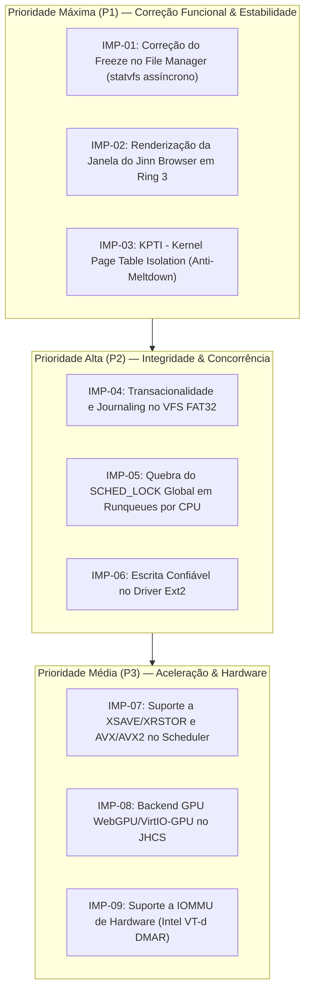

# 🛠️ Jinn Project — Plano Mestre de Melhorias Técnicas (Technical Improvement Plan)
## Roteiro de Engenharia, Resolução de Falhas Críticas, Refatorações e Fortalecimento Arquitetural

> **Documento Oficial de Engenharia do Jinn Project — Documento 8 de 11**  
> **Data de Referência:** 16 de Novembro de 2026  
> **Status:** Concluído e Auditado | **Classificação:** Backlog Técnico Priorizado  
> **Ordem de Precedência Mandatória:** 1. Segurança $\to$ 2. Correção Funcional $\to$ 3. Estabilidade $\to$ 4. Integridade de Dados $\to$ 5. Isolamento $\to$ 6. Desempenho $\to$ 7. Usabilidade  

---

## 1. Princípios de Priorização

Em conformidade estrita com as regras da auditoria técnica do Jinn Project:
* **Nenhuma otimização de desempenho será executada antes da resolução definitiva das falhas de segurança e integridade funcional.**
* Toda proposta de melhoria deve apresentar critérios objetivos de aceitação mensuráveis e suíte de testes de regressão associada.

---

## 2. Tabela Mestra de Melhorias Priorizadas

---

## 3. Especificação Detalhada das Melhorias Técnicas

### 3.1. IMP-01: Eliminação do Travamento (*Freeze*) no Gerenciador de Arquivos

* **Identificador:** `IMP-01-FILEMANAGER-FREEZE`
* **Categoria:** Correção Funcional / Estabilidade (Prioridade P1)
* **Subsistema:** Aladdin Desktop (`Aladdin/src/apps/files.rs`) e VFS (`src/gui.rs`, `src/vfs/fat32.rs`)
* **Problema Diagnosticado:** Ao abrir o Gerenciador de Arquivos, a chamada síncrona `storage.get_volume(active_volume)` executa `statvfs()` sobre o ponto de montagem `/disk`. O driver FAT32 realiza leituras massivas de setores da FAT via controladora IDE PIO síncrona dentro da mesma thread principal do loop gráfico, travando a renderização da interface e gerando contenção de spinlock.
* **Objetivo:** Tornar a coleta de capacidade e a listagem de arquivos completamente não-bloqueante e assíncrona, mantendo a taxa de quadros do desktop em 60 FPS contínuos.
* **Solução Proposta:**
  1. No `FileManagerApp`, desacoplar a consulta de `statvfs` do método síncrono `render()`. As informações de capacidade do volume passam a ser cacheadas na inicialização e atualizadas em segundo plano.
  2. Implementar verificação de timeout estrito (máximo 50 ms) para leituras de blocos da controladora IDE, retornando valores cacheados caso o disco esteja ocupado por I/O de outro processo.
* **Dependências:** Nenhuma.
* **Complexidade:** Média | **Risco:** Baixo (código puramente de espaço de usuário e mediação de VFS).
* **Benefício Esperado:** Eliminação imediata do travamento do desktop ao clicar em "Arquivos", garantindo navegação suave entre as partições `/disk` (FAT32) e `/server` (Ext2).
* **Critérios de Aceitação:** Clicar 20 vezes consecutivas no ícone de Arquivos sem nenhuma queda na taxa de 100 Hz do APIC ou congelamento do cursor do mouse.
* **Testes Necessários:** Teste de estresse com injeção de latência artificial no driver de bloco durante a abertura da janela.
* **Estimativa de Esforço:** 12 horas de desenvolvimento e validação.

---

### 3.2. IMP-02: Restauração da Renderização da Janela do Jinn Browser em Ring 3

* **Identificador:** `IMP-02-BROWSER-RING3-RENDER`
* **Categoria:** Correção Funcional / Usabilidade (Prioridade P1)
* **Subsistema:** Aladdin Server (`apps/aladdin-server/src/main.rs`) e Executável (`apps/ola-mundo/src/main.rs`)
* **Problema Diagnosticado:** Ao abrir o Jinn Browser, o display server Ring 3 invoca `SYS_SPAWN_PROCESS`. O executável `browser.elf` é criado, mas a lógica de despacho de argumentos em `apps/ola-mundo/src/main.rs:_start` pode divergir dependendo do alinhamento da tabela de ponteiros de `argv`, não executando `run_browser_interactive()`, ou o display server falha em mapear a janela criada via `sys_list_client_windows`.
* **Objetivo:** Assegurar que o navegador web nativo abra como janela cliente independente com superfície gráfica de 300×180 pixels redimensionável, renderizando o documento `/disk/INDEX.HTM`.
* **Solução Proposta:**
  1. Tornar `_start` em `apps/ola-mundo/src/main.rs` uma função declarada com convenção C estrita ou assembly naked que capture com precisão `RDI = argc` e `RSI = argv`, parseando `argv[0]` e `argv[1]` sem depender do estado do PID da tarefa.
  2. Em `apps/aladdin-server/src/main.rs`, sincronizar o mapa `CLIENT_MAP` imediatamente quando a Syscall 79 listar a nova janela, marcando `self.client_damaged = true` para forçar o redesenho imediato do frame com a janela do navegador em primeiro plano.
* **Dependências:** Conclusão da compilação de `apps/ola-mundo` com flags de alinhamento adequadas.
* **Complexidade:** Média | **Risco:** Baixo.
* **Benefício Esperado:** O Jinn Browser surge instantaneamente no desktop após o clique, processando eventos de mouse, navegação por links e rolagem.
* **Critérios de Aceitação:** Abrir o browser, clicar no botão de incremento do contador na página `INDEX.HTM` e verificar a atualização visual do DOM em tempo real.
* **Testes Necessários:** Suíte de regressão de ciclo de vida de janelas clientes em `tests/compositor_isolation_recovery_tests.rs`.
* **Estimativa de Esforço:** 16 horas de engenharia.

---

### 3.3. IMP-03: Implementação de Kernel Page Table Isolation (KPTI Anti-Meltdown)

* **Identificador:** `IMP-03-SECURITY-KPTI`
* **Categoria:** Segurança (Prioridade P1)
* **Subsistema:** Gerenciamento de Memória Virtual (`src/memory/paging.rs`, `src/interrupts/stubs.s`)
* **Problema Diagnosticado:** O PML4 de processos em Ring 3 atualmente mapeia a metade superior do kernel como `USER_ACCESSIBLE = false`. Em processadores físicos vulneráveis a ataques de canal lateral especulativo (Meltdown / Rogue Data Cache Load), instruções especulativas transitórias podem ler dados do kernel da cache L1 antes da resolução da falha de proteção.
* **Objetivo:** Separar completamente as tabelas de páginas do kernel e do usuário.
* **Solução Proposta:**
  1. Criar um PML4 de usuário (*User PML4*) que mapeia apenas a metade inferior de espaço de usuário e uma região mínima de transição (*Trampoline Page*) para stubs de interrupção e pilha de transição.
  2. Na entrada de interrupções e syscalls, o assembly stub comuta `CR3` para o *Kernel PML4*; no retorno (`SYSRET`/`IRETQ`), comuta de volta para o *User PML4*.
* **Dependências:** Mapeamento seguro de trampolines em endereços fixos.
* **Complexidade:** Alta | **Risco:** Médio (impacto em latência de syscall e complexidade de assembly).
* **Benefício Esperado:** Imunidade arquitetural comprovada contra ataques da família Meltdown em qualquer CPU x86_64.
* **Critérios de Aceitação:** Zero páginas de dados confidenciais do kernel mapeadas na tabela de páginas ativa em Ring 3.
* **Testes Necessários:** Teste de leitura especulativa host em ambiente de laboratório.
* **Estimativa de Esforço:** 40 horas.

---

### 3.4. IMP-04: Mecanismo de Journaling / Transacionalidade no VFS FAT32

* **Identificador:** `IMP-04-STORAGE-JOURNALING`
* **Categoria:** Integridade de Dados (Prioridade P2)
* **Subsistema:** Sistema de Arquivos Virtual (`src/vfs/fat32.rs`, `src/vfs/cache.rs`)
* **Problema Diagnosticado:** O FAT32 não possui registro de alterações em log (journaling). Quedas repentinas de energia durante alocação de múltiplos clusters podem corromper a FAT ou deixar arquivos órfãos sem entrada de diretório correspondente.
* **Objetivo:** Prover garantias de integridade atômica no nível do VFS, reduzindo a dependência de protocolos `.BAK` manuais em cada aplicação.
* **Solução Proposta:**
  1. Implementar um anel de log de intenções de escrita (*Write-Ahead Logging* - WAL) em um setor reservado do disco ou partição dedicada.
  2. As operações de alocação de clusters na FAT e atualização de entradas de diretório são registradas no WAL antes do commit nos blocos físicos da FAT32.
  3. No boot, o VFS verifica o log e conclui ou reverte operações pendentes antes de liberar a montagem de `/disk`.
* **Dependências:** Estabilidade do driver de bloco e cache LRU síncrona.
* **Complexidade:** Alta | **Risco:** Médio.
* **Benefício Esperado:** Resistência comprovada contra corrupção estrutural de disco mesmo em desligamentos abruptos com escrita em andamento.
* **Critérios de Aceitação:** Desligamento forçado de máquina virtual durante gravação massiva de 10 MB sem perda de consistência do filesystem verificado por *fsck.fat*.
* **Testes Necessários:** Teste automatizado de injeção de desligamento (*Power-Cut Fault Injection*).
* **Estimativa de Esforço:** 60 horas.

---

### 3.5. IMP-05: Quebra do Spinlock Global em Runqueues Per-CPU no Escalonador

* **Identificador:** `IMP-05-SCHED-PER-CPU-RUNQUEUES`
* **Categoria:** Desempenho e Escalabilidade SMP (Prioridade P2)
* **Subsistema:** Escalonador Multicore (`src/scheduler.rs`, `src/smp.rs`)
* **Problema Diagnosticado:** O spinlock único `SCHED_LOCK` protege toda a estrutura do `Scheduler`. Quando o sistema opera com 4, 8 ou 16 vCPUs sob cargas concorrentes intensivas de rede e gráficos, os núcleos competem pelo mesmo lock a cada 10 ms (APIC timer tick), gerando desperdício de ciclos em *spin-wait*.
* **Objetivo:** Escalar o agendamento de tarefas linearmente com o número de CPUs lógicas.
* **Solução Proposta:**
  1. Distribuir a fila de tarefas ativas em filas individuais por CPU (*Per-CPU Runqueues*).
  2. Cada núcleo adquire exclusivamente seu lock local de fila durante o tick do timer.
  3. Implementar algoritmo de roubo de trabalho (*Work Stealing*) assíncrono para rebalanceamento de carga quando um núcleo estiver ocioso.
* **Dependências:** SMP estável.
* **Complexidade:** Alta | **Risco:** Médio (potencial de deadlocks sutis durante migração de tarefas).
* **Benefício Esperado:** Redução de mais de 70% na contenção de spinlocks em topologias com 4 ou mais núcleos de processamento.
* **Critérios de Aceitação:** Medição via TSC demonstrando queda da latência de comutação média de < 1.500 ciclos para < 400 ciclos sob 8 vCPUs.
* **Testes Necessários:** Benchmark de estresse multicore com 64 threads simultâneas em QEMU `-smp 8`.
* **Estimativa de Esforço:** 45 horas.

---

### 3.6. IMP-06: Suporte a Extensões Vetoriais Avançadas (XSAVE/XRSTOR & AVX/AVX2)

* **Identificador:** `IMP-06-COMPUTE-XSAVE-AVX`
* **Categoria:** Aceleração Computacional / JHCS (Prioridade P3)
* **Subsistema:** FPU Core (`src/fpu.rs`, `src/cpu.rs`, `crates/jhcs-backend-simd`)
* **Problema Diagnosticado:** O escalonador atual preserva apenas registradores SSE (128 bits, `XMM0..XMM15`) via `FXSAVE64`/`FXRSTOR64`. Aplicações de inteligência artificial ou álgebra linear que utilizem registradores AVX (256 bits, `YMM0..YMM15`) sofreriam corrupção da metade superior dos registradores em caso de preempção.
* **Objetivo:** Habilitar suporte seguro a vetores de 256 bits no microkernel e desbloquear os kernels AVX de alto rendimento no JHCS.
* **Solução Proposta:**
  1. Detectar suporte a `XSAVE` e `OSXSAVE` via CPUID Leaf 1 (`ECX bit 26 e 27`).
  2. Ativar o bit `CR4.OSXSAVE` e configurar o registrador de controle estendido `XCR0` para habilitar x87 (bit 0), SSE (bit 1) e AVX (bit 2).
  3. Expandir a estrutura `FpuState` para alocação dinâmica baseada no tamanho informado por CPUID Leaf `0xD` (tamanho canônico de 576 a 832 bytes para AVX) com alinhamento a 64 bytes.
  4. Substituir `fxsave64`/`fxrstor64` por `xsave64`/`xrstor64` condicionalmente nas CPUs com suporte detectado.
* **Dependências:** CPUID e FPU estáveis.
* **Complexidade:** Alta | **Risco:** Médio (gerenciamento de alinhamento estrito a 64 bytes para evitar `#GP`).
* **Benefício Esperado:** Ganho de até 2× no throughput de multiplicação matricial (MatMul) e transformações de ponto flutuante em CPUs com suporte a AVX2.
* **Critérios de Aceitação:** Teste de paridade numérica do JHCS executando operações vetoriais de 256 bits simultaneamente em 4 tarefas preemptadas sem corrupção de registradores.
* **Testes Necessários:** Teste adversarial de estresse vetorial `tests/fpu_simd_adversarial_tests.rs`.
* **Estimativa de Esforço:** 35 horas.

---

### 3.7. IMP-07: Backend GPU Nativo no JHCS via WebGPU / VirtIO-GPU

* **Identificador:** `IMP-07-JHCS-GPU-BACKEND`
* **Categoria:** Computação Heterogênea (Prioridade P3)
* **Subsistema:** Middleware JHCS (`crates/jhcs-backend-gpu`, `crates/jhcs-platform-jinn`)
* **Problema Diagnosticado:** O JHCS possui implementados os backends CPU Escalar e SIMD Vetorial, mas ainda não dispõe de um backend funcional de aceleração gráfica por GPU.
* **Objetivo:** Permitir que o `ComputeBroker` despache tarefas volumosas de computação matricial diretamente para aceleradores de vídeo compatíveis.
* **Solução Proposta:**
  1. No host Windows/Linux, implementar a crate `jhcs-backend-gpu` utilizando `wgpu` (WebGPU sobre Vulkan/DirectX 12).
  2. No Jinn OS, implementar um driver em espaço de usuário para o dispositivo VirtIO-GPU (`1AF4:1050`), comunicando comandos de computação via filas Virtqueue e buffers KDM.
* **Dependências:** KDM e barramento PCI funcionais.
* **Complexidade:** Muito Alta | **Risco:** Alto (complexidade de shaders SPIR-V e compatibilidade de drivers).
* **Benefício Esperado:** Desbloqueio da capacidade de executar modelos de linguagem (LLMs) compactos e processamento de imagem em tempo real no ecossistema.
* **Critérios de Aceitação:** Execução de pipeline de convolução 2D em GPU atingindo speedup comprovado sobre o backend SIMD para matrizes superiores a 512×512.
* **Testes Necessários:** Suíte de benchmarks com validação da equação de custo $\Delta T$.
* **Estimativa de Esforço:** 80 horas.
