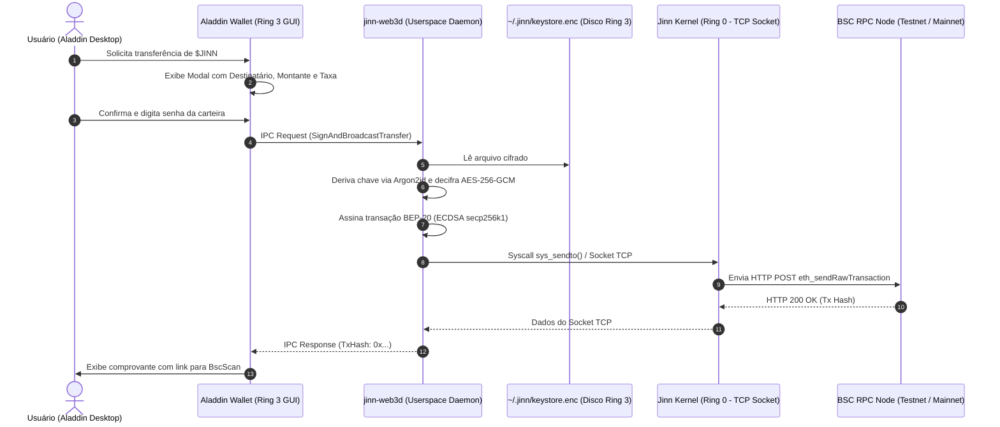

# Aladdin Desktop Web3 & Wallet Architecture

**Documento:** Especificação Técnica de Integração da Carteira e Serviços Web3  
**Subsistema:** Aladdin Desktop (Ring 3) / `jinn-web3d`  
**Padrão de Rede:** BNB Smart Chain (BSC / EVM)  
**Versão:** 1.0.0  
**Status:** Especificação Aprovada para Implementação  

---

## 1. Visão Geral

A integração de ativos criptográficos no **Jinn OS** é estruturada sobre o princípio do **isolamento estrito de privilégios**. 

Enquanto o microkernel Jinn (Ring 0) fornece transporte de dados confiável através da sua pilha de rede nativa (`src/net/tcp.rs`, `socket.rs` e firewall `jinnwall.rs`), todas as operações criptográficas sensíveis (gestão de sementes BIP-39, chaves privadas secp256k1, assinatura de transações e decodificação JSON-RPC) residem exclusivamente no **espaço do usuário (Ring 3)**.

A experiência do usuário é provida pelo **Aladdin Wallet**, uma aplicação nativa integrada ao ambiente desktop Aladdin, seguindo os *Design Tokens* oficiais do sistema (`COLOR_BG_DESKTOP`, `COLOR_ACCENT_PRIMARY`, dirty rects).

---

## 2. Diagrama de Comunicação e Camadas



---

## 3. Formato do Keystore Seguro no Userspace

O arquivo de carteira é armazenado em `/home/user/.jinn/wallet.json` com permissão estrita `0600` (leitura e gravação exclusiva do usuário).

### 3.1. Estrutura do Arquivo Criptografado (JSON Schema)

```json
{
  "version": 1,
  "id": "e6f8b1a2-3c4d-4e5f-a6b7-c8d9e0f1a2b3",
  "address": "0x71C...aB3",
  "crypto": {
    "cipher": "aes-256-gcm",
    "ciphertext": "d4e5f6...a1b2c3",
    "cipherparams": {
      "iv": "1a2b3c4d5e6f7a8b9c0d1e2f"
    },
    "kdf": "argon2id",
    "kdfparams": {
      "m": 65536,
      "t": 3,
      "p": 4,
      "salt": "f0e1d2c3b4a59687"
    },
    "mac": "8a7b6c5d4e3f2a1b0c9d8e7f6a5b4c3d"
  },
  "network": {
    "defaultChainId": 97,
    "rpcEndpoint": "https://data-seed-prebsc-1-s1.binance.org:8545/"
  }
}
```

---

## 4. O Daemon Userspace: `jinn-web3d`

O `jinn-web3d` é um processo servidor leve executado em Ring 3 que atua como ponte de abstração entre as chamadas de interface e a rede blockchain.

### 4.1. Responsabilidades:
1. **Gerenciamento de Conexão RPC:** Mantém conexões TCP ativas com os endpoints da BSC (Chapel Testnet ou Mainnet).
2. **Codificação/Decodificação ABI:** Converte chamadas de métodos como `balanceOf(address)` e `transfer(address,uint256)` em chamadas hexadecimais compatíveis com a EVM.
3. **Assinatura Local:** Executa a matemática elíptica secp256k1 em memória volátil de userspace, limpando buffers sensíveis (*zeroize*) imediatamente após a geração do hash assinado.
4. **Interface IPC:** Expõe um canal de comunicação IPC baseado em mensagens tipadas para o Aladdin Wallet e a App Store.

---

## 5. Interface Gráfica do Aladdin Wallet (L3)

Projetada com base no **Aladdin Design System** ([`docs/ALADDIN_DESKTOP_SPEC.md`](ALADDIN_DESKTOP_SPEC.md)):

```
┌─────────────────────────────────────────────────────────────┐
│ ✦ Aladdin Wallet — Jinn OS Network                  [—][□][X]│
├─────────────────────────────────────────────────────────────┤
│  Rede Ativa: ● BSC Testnet (Chapel)   Chain ID: 97          │
│                                                             │
│  ┌───────────────────────────────────────────────────────┐  │
│  │ Saldo Disponível                                      │  │
│  │ 12,450.00 $JINN                                       │  │
│  │ ≈ 0.85 BNB (Taxas de Rede)                            │  │
│  └───────────────────────────────────────────────────────┘  │
│                                                             │
│  Endereço Público:                                          │
│  [ 0x8a92...3F2b ]  [ Copiar ]  [ Ver no BscScan ]          │
│                                                             │
│  Ações Rápidas:                                             │
│  [ Enviar $JINN ]   [ Receber ]   [ Resgatar Bounties PoUC ]│
│                                                             │
│  Atividades Recentes:                                       │
│  ✓ +500 $JINN — Kernel Driver PR #42 (PoUC Epoch 1)         │
│  ✓ -25 $JINN — Licença: Jinn Code Studio v1.0               │
│  ✓ +100 $JINN — Simbad Node Relay Staking Reward            │
└─────────────────────────────────────────────────────────────┘
```

---

## 6. Primitivas de Protocolo IPC entre Aladdin UI e `jinn-web3d`

As mensagens trocadas via IPC de alta velocidade utilizam o subsistema `ipc.rs` do Jinn OS:

```rust
#[repr(u32)]
pub enum Web3IpcOpcode {
    GetStatus = 1,
    GetBalance = 2,
    EstimateGas = 3,
    SignAndSend = 4,
    ClaimReward = 5,
}

#[repr(C)]
pub struct Web3BalanceQuery {
    pub account: [u8; 20], // Endereço 160-bit BSC
    pub token_address: [u8; 20],
}

#[repr(C)]
pub struct Web3BalanceResponse {
    pub balance_wei: [u8; 32], // Inteiro 256-bit Big-Endian
    pub nonce: u64,
    pub status_code: u32,
}
```

---

## 7. Próximos Passos de Integração

1. Homologar os contratos inteligentes na rede pública de testes (BSC Testnet).
2. Prototipar a biblioteca em userspace `jinn_web3` para compilação estática em Ring 3.
3. Integrar o widget de carteira no painel superior do Aladdin Desktop.
