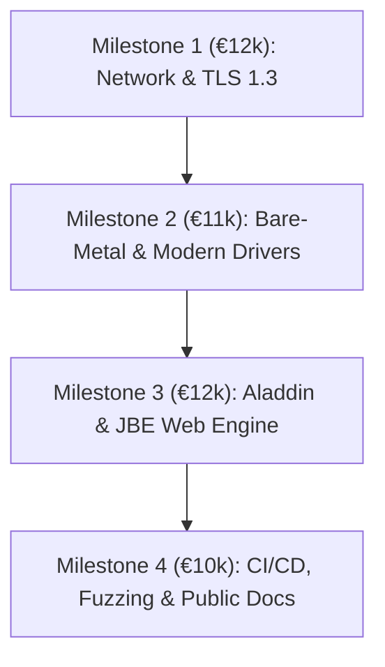

# NLnet Foundation / NGI Zero Grant Application Proposal

**Project Title:** Jinn OS & Aladdin Desktop: A Memory-Safe, High-Efficiency Rust Microkernel and Desktop Ecosystem for Digital Sovereignty and E-Waste Reduction  
**Target Program:** NGI Zero Core / NGI Zero Entrust (Next Generation Internet)  
**Applicant:** Geovane Feitosa (Lead Architect & Core Developer)  
**Repository:** https://github.com/geovane-feitosa/jinn *(Adjust to canonical repository URL)*  
**Primary License:** Open Source (`GPL-2.0-only` for community / public domain compatibility)  
**Requested Funding:** €45,000 EUR  
**Duration:** 6–8 Months (Milestone-based delivery)  

---

## 1. General Project Information

### 1.1 Project Abstract (Elevator Pitch — max 120 words)
Modern computing is trapped in an operating system and browser duopoly dominated by monolithic C/C++ codebases that suffer from systemic memory vulnerabilities and bloated memory footprints, forcing artificial hardware obsolescence. **Jinn OS** is a modern, preemptive, memory-safe microkernel written entirely in Rust (`#![no_std]`, bare-metal x86_64) paired with the **Aladdin Desktop Environment** and native browser engine. By enforcing strict CPU privilege isolation (Ring 0 limited to scheduling and memory paging; drivers, file systems, and network stacks residing in Ring 3) and operating stably within a **64 MiB to 256 MiB RAM envelope**, Jinn delivers sovereign, privacy-preserving, and memory-safe personal computing to billions of legacy and edge devices otherwise destined for landfills.

---

## 2. General Description of the Project

### 2.1 Problem Statement & Status Quo
The foundational software layer of the internet—the operating system and browser—faces three critical crises:

1. **Systemic Memory Safety Vulnerabilities:** Over 70% of high-severity CVEs in traditional kernels (Linux, Windows) originate from memory safety bugs (buffer overflows, use-after-free, double frees) inherent to C/C++. Monolithic kernels run hundreds of complex third-party hardware drivers directly in Ring 0, where a single driver flaw compromises the entire machine.
2. **Hyper-Bloated Resource Footprints and E-Waste:** Contemporary operating systems (Windows 11, mainstream Linux desktop distributions) and browser engines (Chromium, WebKit) require gigabytes of RAM and multi-core CPUs merely to render an idle desktop. This planned and structural obsolescence discards millions of functional computing devices annually, exacerbating electronic waste and disenfranchising lower-income communities and schools globally.
3. **Monopolistic Web Monoculture:** The web browsing engine market has coalesced around a Blink/WebKit monoculture. Independent, privacy-respecting, lightweight engines that can operate securely without multi-gigabyte runtimes or complex multi-process telemetry are virtually non-existent.

### 2.2 Proposed Solution
Jinn OS addresses these foundational failures by reimagining personal and edge computing from bare metal:

* **True Microkernel Architecture:** Jinn's Ring 0 kernel is strictly minimal (~6,000 lines of verified Rust). It only manages preemptive round-robin thread scheduling, 4-level x86_64 paging (PML4), and synchronous lock-free Inter-Process Communication (IPC).
* **Complete Ring 3 Driver Isolation:** All device drivers (PS/2, IDE/ATA, PCI, Realtek/Intel NICs), Virtual File Systems (FAT32, Ext2), and network stacks run as unprivileged userspace processes. If a driver crashes or receives malicious malformed input, it fails in user space without triggering a kernel panic and can be hot-restarted by the system supervisor.
* **JDA (Jinn Directed Acyclic Graph) / IoRing Engine:** An asynchronous, zero-copy I/O subsystem inspired by `io_uring` that pipelines storage and network dataflows with lock-free submission and completion rings, eliminating syscall overhead.
* **Aladdin Desktop & Browser Engine (JBE):** A native, non-bloated desktop compositor and HTTP/TLS 1.3 browser engine designed to run without floating-point unit (FPU) dependencies and operate with full interactive GUI fidelity inside **64 MiB of physical RAM** (verified on QEMU `-m 64M` with only 44.3 MiB usable RAM).

---

## 3. Comparison with the State of the Art

| Feature / Metric | Linux Desktop (Ubuntu/Debian) | Redox OS | seL4 | **Jinn OS & Aladdin** |
| :--- | :--- | :--- | :--- | :--- |
| **Language & Safety** | Monolithic C (Memory Unsafe) | Microkernel Rust | Microkernel C (Formally Verified) | **Microkernel Rust (`#![no_std]`)** |
| **Driver Isolation** | Ring 0 (Fatal on crash) | Ring 3 (Scheme-based) | Ring 3 (Capabilities) | **Ring 3 (Strict Syscall/IPC Sandbox)** |
| **Minimum RAM for GUI** | 2,048 MiB – 4,096 MiB | 512 MiB – 1,024 MiB | N/A (Embedded focus) | **64 MiB – 256 MiB (Validated)** |
| **Asynchronous I/O** | `io_uring` (Kernel C) | Standard syscalls | Custom IPC | **JDA Lock-Free DAG / Ring Queues** |
| **Native TLS 1.3 Stack** | OpenSSL/GnuTLS (Large C) | Rustls / Ported POSIX | Third-party / C | **Native Userspace RFC 8446 Stack** |
| **E-Waste & Edge Focus** | Low (Deprecates legacy) | Moderate | Industrial / Aerospace | **Primary Architectural Invariant** |

* **Contrast with Redox OS:** While Redox has demonstrated the viability of Rust microkernels, it targets modern hardware profiles with standard POSIX abstractions. Jinn is specifically engineered for deterministic memory ceilings, running its compositor, VFS, and networking stack within micro-allocator bounds (< 64 MiB).
* **Contrast with seL4:** seL4 provides mathematical formal verification for its C microkernel but imposes an exceptionally steep capability-programming barrier, lacks a native lightweight desktop/browser stack, and is rarely deployed as a sovereign personal workstation OS.

---

## 4. Technical Feasibility & Current Implementation Status

Jinn OS is not a theoretical proposal; it has an existing, functioning codebase with audited engineering milestones:

1. **Bootloader & Memory Management:** Boots via the modern Limine Boot Protocol v2 (higher-half x86_64). Features a validated Buddy Allocator, kernel heap, and PML4 page frame management.
2. **Userspace Cryptographic Stack:** Independently audited implementation of **TLS 1.3 Key Schedule (RFC 8446 / RFC 5869)**, HKDF-Extract/Expand, ChaCha20-Poly1305, SHA-256, and X.509 ASN.1 DER parser running in Ring 3.
3. **64 MiB Hardened Desktop Milestone:** Aladdin Desktop compositor (`aladdin.elf`) and window manager verified running stably on QEMU under strict `-m 64M` constraints with zero page leaks, deterministic memory accounting, and zero memory quota violations (`EDQUOT`).
4. **Hardware Driver Subsystems:** Userspace PS/2 mouse and keyboard drivers, ATA/IDE block device driver, and FAT32/Ext2 VFS mounting engines.

---

## 5. Work Plan: Milestones, Deliverables & Budget Breakdown

Total Budget Requested: **€45,000 EUR**  
Execution Timeline: **8 Months**

### Milestone 1: Userspace Network Stack Hardening & VirtIO-Net Driver (€12,000)
* **Objective:** Expand the existing Ring 3 network stack into a resilient, production-ready subsystem.
* **Deliverables:**
  1. Implementation of a native VirtIO-Net PCI driver running in Ring 3 for accelerated virtualization and cloud edge environments.
  2. Integration of the audited RFC 8446 TLS 1.3 handshake with full bi-directional record encryption over native TCP/IP sockets.
  3. Memory-bounded socket buffer manager guaranteeing zero heap exhaustion under high-throughput adversarial traffic.
  4. Test suite with automated PCAP regression capture validating TCP flow control and packet retransmission.
* **Acceptance Criteria:** Successful automated fetching of static HTTPS web assets via TLS 1.3 in QEMU with full network capture logs published.

### Milestone 2: Bare-Metal UEFI Bootloader & Modern Block Storage (€11,000)
* **Objective:** Transition Jinn from virtualized environments (QEMU/Bochs) to booting seamlessly on physical x86_64 PC hardware.
* **Deliverables:**
  1. Implementation of native 64-bit UEFI boot sequence using Limine UEFI-CD and bare-metal handoff without legacy BIOS dependencies.
  2. Native AHCI (SATA) and introductory NVMe block driver implementation in userspace Ring 3.
  3. APIC / IO-APIC interrupt controller initialization, replacing legacy 8259 PIC for multi-core scalability.
  4. Hardware compatibility test matrix covering standard second-life laptops (ThinkPad T4xx/X2xx series, Intel Atom/Celeron edge boards).
* **Acceptance Criteria:** Bootable hybrid ISO tested and verified on at least three distinct physical bare-metal hardware platforms with logged kernel diagnostics.

### Milestone 3: Aladdin Desktop & Jinn Browser Engine (JBE) Stabilization (€12,000)
* **Objective:** Deliver a practical, everyday user experience for low-resource environments.
* **Deliverables:**
  1. Stabilization of the Aladdin Window Manager (multi-window focus, keyboard navigation, clipboard IPC service).
  2. Hardening of JBE (Jinn Browser Engine): compliant HTTP/1.1 client, incremental HTML/CSS tokenizer, and linear frame text/image renderer running in userspace.
  3. Implementation of a persistent user configuration and file manager applet operating over FAT32/Ext2 partitions.
  4. End-to-end memory stress validation maintaining < 128 MiB RAM utilization with Aladdin Desktop, Terminal, and Browser running simultaneously.
* **Acceptance Criteria:** Demonstration of Jinn OS booting on a 128 MiB system, opening the Aladdin file manager, and browsing an informational web page via HTTPS.

### Milestone 4: Continuous Integration, Fuzzing & Public Community Documentation (€10,000)
* **Objective:** Guarantee long-term software supply chain integrity, third-party auditability, and ease of adoption.
* **Deliverables:**
  1. Automated GitHub Actions CI/CD pipeline compiling the `#![no_std]` Rust microkernel, building ISO artifacts, and executing headless QEMU integration tests on every commit.
  2. Syzkaller/AFL-based syscall fuzzing harness targeting the Jinn Syscall ABI (Syscalls 0..52) and IPC endpoints.
  3. Comprehensive English technical documentation: Architecture Reference, Driver SDK Guide, Syscall Specification, and Step-by-Step Self-Hosting Installation Manual.
  4. Publicly accessible live binary ISO images for community testing and academic evaluation.
* **Acceptance Criteria:** 100% automated CI test pass rate, fuzzing report proving zero kernel panics across 100,000 synthetic syscall mutations, and complete documentation published online.

---

## 6. Relevance to Digital Sovereignty, Sustainability & Society

* **Combating Planned Obsolescence:** Millions of computers discarded due to arbitrary OS requirements (e.g., Windows 11 TPM and CPU generation gates) can run Jinn OS smoothly, extending computer lifespans by 10+ years and significantly curbing global electronic waste.
* **Digital Inclusion in Developing Nations:** In regions where modern hardware is economically inaccessible, a secure, memory-safe OS capable of browsing documentation and executing software on legacy machines bridges the digital divide.
* **Sovereign Infrastructure:** Public entities, academic laboratories, and privacy-conscious users gain a verifiable, microkernel alternative free from telemetry, proprietary blob dependencies in Ring 0, and Big Tech lock-in.

