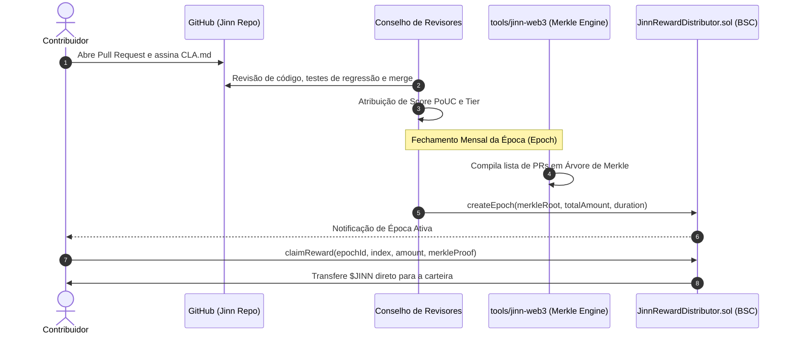

# Proof of Useful Contribution (PoUC) — Especificação Técnica de Recompensas

**Documento:** Especificação do Mecanismo de Reconhecimento e Recompensa por Contribuição  
**Projeto:** Jinn Project  
**Subsistema:** Jinn Ecosystem Bounties & `JinnRewardDistributor.sol`  
**Versão:** 1.0.0  
**Data:** Novembro de 2026  
**Status:** Especificação Aprovada para Implementação  

---

## 1. Visão Geral e Filosofia

O mecanismo de **Proof of Useful Contribution (PoUC)** foi desenhado para incentivar e recompensar desenvolvedores, pesquisadores de sistemas operacionais, designers e pesquisadores de segurança que geram valor técnico concreto para o ecossistema Jinn.

### Princípios Norteadores:
1. **Qualidade sobre Volume:** É terminantemente proibido recompensar métricas superficiais como número de commits, quantidade de linhas de código modificadas ou volume de pull requests. Um patch de 10 linhas que resolve uma vulnerabilidade crítica de escalonador ou implementa suporte a dirty rects é infinitamente mais valioso que um PR de 5.000 linhas de código gerado automaticamente.
2. **Humano no Circuito (Human-in-the-Loop):** Todas as avaliações no estágio inicial passam por revisão técnica rigorosa de mantenedores credenciados. Apenas marcos aprovados entram na folha de pagamento on-chain.
3. **Auditabilidade Criptográfica:** Cada ciclo de recompensa é compilado em uma árvore de Merkle transparente, onde qualquer contribuinte pode validar publicamente seu índice, carteira, montante e hash de contribuição.
4. **Vínculo com o CLA:** O pagamento de recompensas só é autorizado após assinatura digital do Acordo de Licença de Contribuidor (`CLA.md`), garantindo segurança jurídica ao código aberto.

---

## 2. Categorias Elegíveis de Contribuição

| Categoria | Camada | Exemplos de Contribuição |
|---|---|---|
| **Núcleo do Kernel (L0)** | Ring 0 | Algoritmos de escalonamento preemptivo SMP, alocadores físicos de páginas, mitigação de vulnerabilidades de hardware, otimizações de preempção. |
| **Drivers de Hardware (L2)** | Ring 0 / Ring 3 | Controladores de disco NVMe / AHCI SATA, adaptadores de rede Intel e1000 / VirtIO-Net, subsistemas de áudio e barramento PCI. |
| **Ambiente Desktop Aladdin (L3)**| Ring 3 | Gerenciador de janelas, renderizadores 2D acelerados, suíte de aplicativos essenciais, navegador Jinn Browser. |
| **Segurança e Auditoria** | Transversal | Descoberta responsável de vulnerabilidades, auditorias de estouro de pilha/buffer, relatórios de análise estática e fuzzing. |
| **Infraestrutura e Redes** | L1 / L2 | Pilha TCP/IP RFC 793, regras stateful do JinnWall, clientes de DNS e protocolos de sincronismo. |
| **Qualidade e Documentação** | Transversal | Especificações formais de ABI, manuais de desenvolvimento, traduções técnicas e suítes completas de testes automatizados. |

---

## 3. Matriz de Avaliação Multidimensional (Score PoUC)

Cada contribuição submetida recebe uma pontuação calculada por 7 dimensões ponderadas:

$$\text{Score PoUC} = \sum_{i=1}^{7} (W_i \times D_i)$$

| Dimensão | Peso ($W_i$) | Critério de Avaliação (1 a 10) |
|---|---|---|
| **1. Utilidade ($D_1$)** | 0.25 | Resolve um gargalo real ou atende a uma prioridade explícita do `ROADMAP.md`? |
| **2. Complexidade ($D_2$)** | 0.20 | Envolve algoritmos concorrentes complexos, `#![no_std]`, assembly x86_64 ou depuração de hardware? |
| **3. Qualidade do Código ($D_3$)** | 0.15 | Código limpo, idiomático em Rust, documentado, testado e sem vazamentos de memória? |
| **4. Impacto no Sistema ($D_4$)** | 0.15 | Aumenta o throughput de I/O, reduz latência de preempção ou expande hardware suportado? |
| **5. Manutenibilidade ($D_5$)** | 0.10 | É modular, fácil de manter e não introduz dependências desnecessárias? |
| **6. Rigor de Segurança ($D_6$)** | 0.10 | É à prova de estouro de memória, checa ponteiros de syscalls (`EFAULT`) e respeita anéis de privilégio? |
| **7. Revisão Técnica ($D_7$)** | 0.05 | Resposta construtiva aos apontamentos dos revisores e cobertura de testes de regressão? |

---

## 4. Tiers de Recompensa em $JINN

Com base no **Score PoUC Final** e na criticidade do componente, a contribuição é enquadrada em um nível de recompensa da época:

| Nível (Tier) | Score Mínimo | Teto Indicativo por PR | Escopo Típico |
|---|---|---|---|
| **Tier 1 — Micro / Doc** | 5.0 | Até 500 $JINN | Correções pontuais de bugs, documentação, testes unitários. |
| **Tier 2 — Standard** | 6.5 | Até 2.500 $JINN | Ferramentas de userspace, componentes de UI do Aladdin, utilitários de shell. |
| **Tier 3 — Avançado** | 8.0 | Até 10.000 $JINN | Módulos de rede TCP/IP, drivers VirtIO, renderização 2D acelerada. |
| **Tier 4 — Estratégico** | 9.0 | Até 35.000 $JINN | Novos drivers de hardware (NVMe/AHCI), subsistemas de memória virtual, SMP. |
| **Tier 5 — Crítico / Bounty** | 9.8 | Até 100.000 $JINN | Auditoria e resolução de falhas críticas de segurança no Ring 0. |

---

## 5. Fluxo Operacional: Do Pull Request ao Resgate On-Chain

---

## 6. Prevenção de Fraudes e Regras Anti-Abuso

1. **Vedação a Código Gerado em Massa:** Contribuições detectadas como spam ou geradas sem revisão humana competente serão sumariamente rejeitadas.
2. **Reversão por Regressão:** Se um componente aprovado introduzir instabilidade grave no kernel descoberta em até 30 dias após o merge, a concessão poderá ser suspensa ou submetida a correção obrigatória.
3. **Registro Público Imutável:** Cada época contém um arquivo manifesto (`docs/pouc/epoch_<N>.json`) com o hash do commit, o ID do PR e o endereço público da carteira correspondente.
