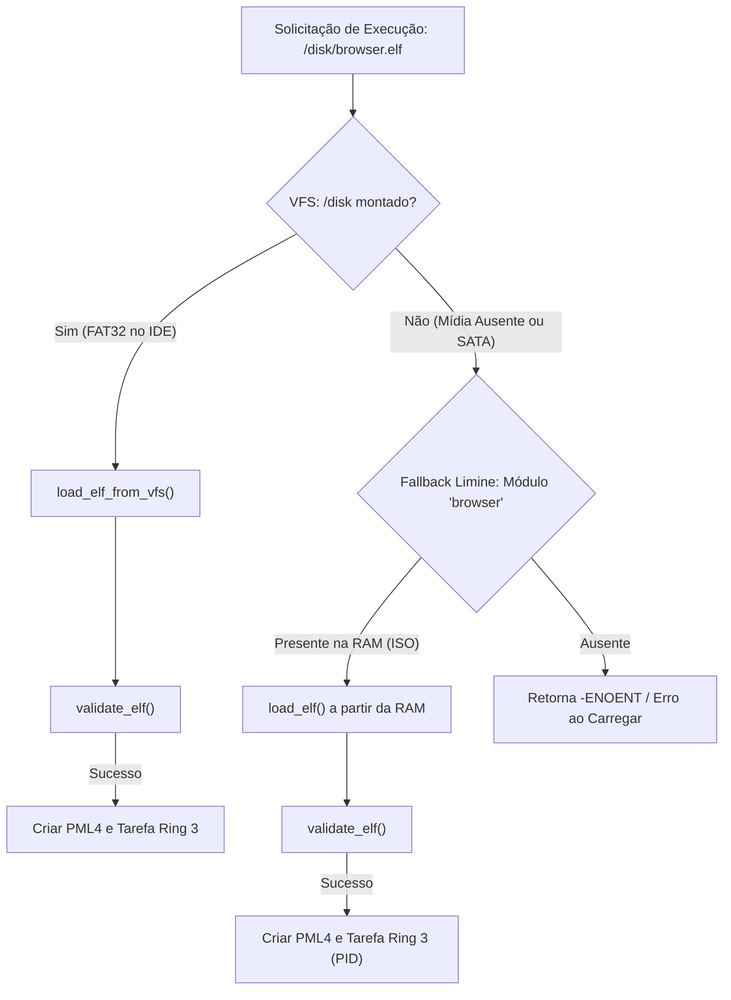

# Relatório de Auditoria do Carregador ELF64 e Binário Jinn Browser

## 1. Visão Geral do Binário
- **Arquivo Auditado:** `iso_root/apps/browser.elf` (e `ola-mundo.elf`).
- **Tamanho no Disco:** 362.528 bytes (~354 KiB).
- **Formato:** Executável estático x86_64, System V ABI, `no_std`, sem bibliotecas compartilhadas dependentes.
- **Ponto de Entrada (`e_entry`):** `0x00000000004094a2` (`_start`).

---

## 2. Inspeção de Segmentos de Carga (`PT_LOAD`) e Política W^X

A inspeção detalhada realizada via `llvm-objdump -p` identificou os seguintes cabeçalhos de programa:

| Segmento | Tipo | Endereço Virtual Inicial | Tamanho em Memória (`memsz`) | Permissões | Política W^X |
| :--- | :--- | :--- | :--- | :--- | :--- |
| **0** | `PT_LOAD` | `0x0000000000200000` | 512 bytes | `R--` (Leitura) | **CONFORME** |
| **1** | `PT_LOAD` | `0x0000000000400000` | 97.327 bytes (~95 KiB) | `R-X` (Código Executável) | **CONFORME** |
| **2** | `PT_LOAD` | `0x0000000000418c30` | 36.908 bytes (~36 KiB) | `R--` (Constantes / Rodata) | **CONFORME** |
| **3** | `PT_LOAD` | `0x0000000000422c60` | 928 bytes | `RW-` (Dados / Relro) | **CONFORME** |
| **4** | `PT_LOAD` | `0x0000000000423c80` | 413.632 bytes (~404 KiB) | `RW-` (Dados Globais / BSS) | **CONFORME** |

### Validações de Segurança Aprovadas:
1. **Separação R-X e RW-:** Nenhum segmento possui simultaneamente as permissões de Escrita (`W`) e Execução (`X`).
2. **Alinhamento e Não-Sobreposição:** Todos os segmentos estão alinhados em limites de 4 KiB ou não compartilham páginas conflitantes com permissões divergentes.
3. **Ponto de Entrada Válido:** O ponto de entrada `0x004094a2` reside estritamente dentro dos limites do Segmento 1 (`0x00400000` a `0x00417c2f`), que possui o sinalizador `PF_X` ativo.
4. **Endereçamento Canônico Ring 3:** Todos os endereços de carga respeitam a faixa estrita entre `USER_SPACE_MIN` (`0x10000`) e `USER_SPACE_MAX` (`0x0000_7FFF_FFFF_FFFF`).

---

## 3. Comportamento do ELF Loader em VFS vs Memória Limine

O microkernel Jinn implementa duas vias de carregamento para tarefas de usuário:

- **Auditoria de Integridade:** Quando o módulo Limine em memória é requisitado, o `validate_elf` avalia todos os cabeçalhos diretamente da imagem original carregada pelo bootloader, dispensando I/O de disco.
- **Resultado da Auditoria:** O binário `browser.elf` é 100% válido, integro e cumpre rigorosamente todos os requisitos de segurança do microkernel Jinn OS.

