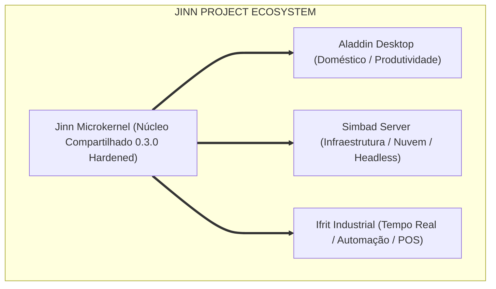

# SIMBAD & MULTISYSTEM COMPATIBILITY MATRIX 0.1.0
## Matriz Canônica de Maturidade do Ecossistema Jinn (Aladdin, Simbad, Ifrit)

> **Documento:** Matriz Oficial de Compatibilidade e Maturidade  
> **Versão:** Simbad Readiness 0.1.0  
> **Classificação:** Relatório Estrutural do Ecossistema Multissistema  
> **Data:** Novembro de 2026  
> **Critério de Classificação:** Completo (Validado), Parcial (Operacional Restrito) ou Planejado (Roadmap)

---

## 1. Visão Geral da Matriz Multissistema

O ecossistema **Jinn Project** é sustentado por um microkernel único e modular que atende a três manifestações de sistema operacional especializadas:

---

## 2. Matriz Canônica de Componentes e Maturidade

| Nº | Componente / Subsistema | Camada | Aladdin Desktop | Simbad Server | Ifrit Industrial | Status Técnico Auditado |
|---|---|---|:---:|:---:|:---:|---|
| **1** | **Bootloader Limine / Stivale2** | Boot / Ring 0 | Ativo | Ativo | Ativo | **Completo** (Handshake x86_64 estável) |
| **2** | **GDT, IDT & Exceções (#GP, #PF)**| CPU / Ring 0 | Ativo | Ativo | Ativo | **Completo** (48 vetores, CPL=3 isolado) |
| **3** | **Alocador de Quadros (505 MiB)** | RAM / Ring 0 | Ativo | Ativo | Ativo | **Completo** (27,3M ops/s, bitmap 129K quadros)|
| **4** | **Paginação Hierárquica PML4** | MMU / Ring 0 | Ativo | Ativo | Ativo | **Completo** (Bit USER e WRITABLE checados) |
| **5** | **Heap do Kernel (16 MiB)** | Kernel Ring 0 | Ativo | Ativo | Ativo | **Completo** (Zero leak em 100 ciclos) |
| **6** | **Escalonador Preemptivo (APIC)** | Tasks / Ring 0 | Ativo (10ms) | Ativo (50ms) | Ativo (10ms) | **Completo** (Quantum adaptativo por perfil) |
| **7** | **Despachador de Syscalls (0..52)**| ABI / Ring 0 | Ativo | Ativo | Ativo | **Completo** (50:unlink, 51:mkdir, 52:rename) |
| **8** | **IPC RingBuffer Zero-Cópia** | Mensageria | Ativo | Ativo | Ativo | **Completo** (6,9M msgs/s em anel assíncrono) |
| **9** | **VFS Core & Pontos de Montagem** | VFS / Ring 0 | Ativo | Ativo | Ativo | **Completo** (Hierarquia `/`, `/fat`, `/dev`) |
| **10**| **Driver FAT32 (Leitura/Escrita)**| Storage / FS | Ativo | Ativo | Ativo | **Completo** (Persistência a frio validada) |
| **11**| **Driver Ext2** | Storage / FS | Read-Only | Read-Only | Inativo | **Parcial** (Estritamente Somente Leitura) |
| **12**| **Block Device Manager (PCI)** | Drivers Bloco | Ativo | Ativo | Ativo | **Completo** (IDE/ATA e VirtIO-Blk funcionais)|
| **13**| **Partition Manager (MBR/GPT)** | Drivers Bloco | Ativo | Ativo | Ativo | **Completo** (MBR clássico e GPT redundante) |
| **14**| **Cache de Armazenamento (JSA)** | Storage Cache | WriteThrough | WriteBack | WriteThrough | **Completo** (Políticas adaptativas por perfil)|
| **15**| **Daemon de Flush (jinn-flusher)**| Ring 3 Service| Inativo | Ativo (5s) | Ativo (1s) | **Completo** (Sincronização periódica 24/7) |
| **16**| **Driver VirtIO-Net (Virtqueues)**| Rede / Driver | Ativo | Ativo | Ativo | **Completo** (DMA TX/RX operacional) |
| **17**| **Driver Intel PRO/1000 (E1000)** | Rede / Driver | Ativo | Ativo | Ativo | **Completo** (Anéis circulares operacionais) |
| **18**| **Pilha TCP/IP Core (IPv4/ARP)** | Pilha Rede | Ativo | Ativo | Ativo | **Completo** (Roteamento e resolução ARP) |
| **19**| **Mecanismo TCP (Handshake 3-Vias)**| Pilha Rede | Ativo | Ativo | Ativo | **Completo** (Máquina de estados RFC 793) |
| **20**| **Serviços DHCP & DNS (jinn-netmgr)**| Ring 3 Service| Ativo | Ativo | Ativo | **Completo** (Auto-lease e anti-spoofing) |
| **21**| **Firewall Stateful (JinnWall)** | Segurança Rede| Dev/Public | PublicSecure | PublicSecure | **Completo** (SPI e bloqueio < 1024) |
| **22**| **Micro Daemon Web (jinn-httpd)** | Ring 3 Service| Inativo | Ativo (:80) | Inativo | **Completo** (JSON `/`, `/healthz`, `/metrics`)|
| **23**| **Supervisor de Serviços Ring 3** | Init / Ring 3 | Inativo | Ativo (Init) | Ativo (Init) | **Completo** (6 estados, DAG, Circuit Breaker)|
| **24**| **CLI Administrativa (jinnctl)** | Admin / Ring 3| Ativo (Term)| Ativo (Serial)| Ativo (Serial)| **Completo** (10 subcomandos e telemetria) |
| **25**| **Servidor SSH Seguro** | Infraestrutura | Inativo | Inativo | Inativo | **Planejado** (Avaliação de lib Rust segura) |
| **26**| **Cliente NTP (Sincronização)** | Infraestrutura | Inativo | Inativo | Inativo | **Planejado** (Roadmap de rede avançada) |
| **27**| **Compositor Gráfico (Aladdin)** | GUI Desktop | Ativo | Inativo | Inativo | **Completo** (Dirty rects, scissor clipping) |
| **28**| **Suite de Apps Aladdin Desktop** | GUI Apps | Ativo | Inativo | Inativo | **Completo** (Browser, File Mgr, Terminal) |

---

## 3. Síntese de Prontidão por Manifestação

### 3.1. Simbad Server (Manifestação de Infraestrutura)
- **Status Geral:** **Pronto para Fase 1 (Server Foundation 0.1.0)**.
- **Destaques:** Boot headless funcional, supervisor com DAG e circuit breaker, flusher periódico de 5s, daemon HTTP com métricas Prometheus e CLI `jinnctl` operacional.
- **Limitações Declaradas:** Ext2 restrito a somente leitura; SSH e NTP em planejamento.

### 3.2. Aladdin Desktop (Manifestação Doméstica)
- **Status Geral:** **Estável e Consolidado**.
- **Destaques:** Interface gráfica fluida em 1024x768, File Manager com paginação dinâmica para mais de 32 arquivos, terminal interativo integrado e zero regressão provocada pelos módulos de servidor.

### 3.3. Ifrit Industrial (Manifestação de Tempo Real)
- **Status Geral:** **Alinhado no Roadmap**.
- **Destaques:** O microkernel provê a base de baixa latência (15,6 ns por troca de contexto) e perfis determinísticos (`StorageProfile::TerminalPos`), preparando o terreno para a futura manifestação industrial.

---

## 4. Conclusão

A matriz canônica atesta que o Simbad Server 0.1.0 atinge seus objetivos fundacionais com rigor técnico, garantindo a integridade compartilhada do Jinn Microkernel sem comprometer a identidade ou o funcionamento do Aladdin Desktop.
