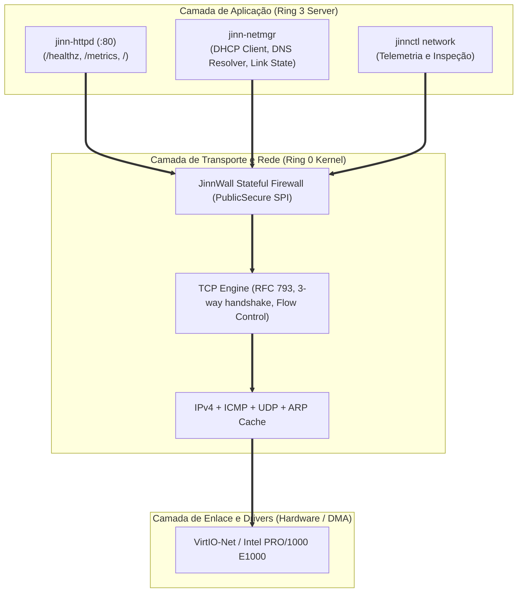

# SIMBAD NETWORK FOUNDATION SPECIFICATION 0.1.0
## Infraestrutura de Rede, Daemons de Serviço, HTTP/1.1 e JinnWall SPI

> **Documento:** Especificação de Serviços e Protocolos de Rede  
> **Sistema:** Simbad Server 0.1.0  
> **Classificação:** Arquitetura de Comunicação e Serviços de Rede  
> **Data:** Novembro de 2026  
> **Dispositivos Suportados:** VirtIO-Net (`1af4:1000`) e Intel PRO/1000 E1000 (`8086:100e`)

---

## 1. Visão Geral da Infraestrutura de Rede

O **Simbad Server** fundamenta sua conectividade na pilha de rede de 11 camadas validada no marco Jinn 0.3.0. Para operar como servidor de infraestrutura, o Simbad introduz serviços de aplicação, monitoramento de conexões ativas e proteção de borda.



---

## 2. Daemons de Rede Ativos no Simbad 0.1.0

### 2.1. Daemon Gerenciador de Rede (`jinn-netmgr`)
- **Papel:** Configuração dinâmica de interface via protocolo DHCP e resolução de nomes DNS.
- **Ciclo de Vida DHCP:**
  - Emite `DHCPDISCOVER` na inicialização do sistema.
  - Recebe `DHCPOFFER`, responde com `DHCPREQUEST` e comuta para `Bound` após `DHCPACK`.
  - Timer de renovação automática em $T_1 = 50\%$ do tempo de concessão (*lease time*).
  - Em caso de timeout prolongado ou ausência de servidor DHCP, comuta ordenadamente para o endereço link-local RFC 3927 (`169.254.1.1/16`).
- **Resolvedor DNS (RFC 1035):**
  - Geração de IDs de transação pseudoaleatórios de 16 bits para cada consulta UDP na porta 53.
  - Rejeição estrita de respostas com ID divergente (imunidade a *cache poisoning* / *spoofing*).
  - Reconhecimento determinístico do código de erro `NXDOMAIN` (RCODE 3).

### 2.2. Micro Daemon Web & Métricas (`jinn-httpd`)
- **Porta Padrão:** TCP 80.
- **Endpoints Nativos:**
  1. `GET /`: Responde `200 OK` com payload JSON contendo identificação do microkernel, manifestação e status:
     ```json
     {"system":"Jinn Microkernel","manifestation":"Simbad Server 0.1.0","status":"online"}
     ```
  2. `GET /healthz`: Responde `200 OK` com `healthy\n`, servindo como sonda de vivacidade (*liveness probe*) para balanceadores de carga e orquestradores de contêineres.
  3. `GET /metrics`: Responde `200 OK` com métricas estruturadas no padrão Prometheus:
     ```text
     # HELP jinn_uptime_seconds Total system uptime in seconds
     jinn_uptime_seconds 42
     # HELP jinn_services_running Total running services in supervisor
     jinn_services_running 4
     # HELP jinn_services_failed Total failed services in supervisor
     jinn_services_failed 0
     ```
  4. Métodos não suportados (`POST`, `PUT`, `DELETE`): Retornam `405 Method Not Allowed`.
  5. Rotas não existentes: Retornam `404 Not Found`.

---

## 3. Segurança de Borda com JinnWall SPI

O firewall integrado opera no modo **`PublicSecure`** por padrão no perfil Simbad:
- **Inspeção com Estado (Stateful Packet Inspection):**
  - Rastreia conexões TCP ativas através de sua tabela de tuplas (`IP_origem`, `Porta_origem`, `IP_destino`, `Porta_destino`).
  - Permite tráfego de retorno legítimo de conexões de saída iniciadas pelos serviços do servidor.
- **Bloqueio de Portas Privilegiadas:**
  - Pacotes de entrada não solicitados destinados a portas inferiores a 1024 (com exceção explícita da porta HTTP :80 configurada) são imediatamente descartados (*dropped*).
- **Contabilização e Telemetria:**
  - Total de pacotes inspecionados, conexões ativas e pacotes descartados são disponibilizados para a CLI `jinnctl network`.

---

## 4. Declaração Transparente de Recursos Futuros (SSH e NTP)

Em conformidade com a diretriz de transparência radical do Jinn Project:
- **SSH Server (Secure Shell):** Classificado estritamente como **PLANEJADO**. Nenhuma biblioteca de criptografia assimétrica caseira será desenvolvida. Avaliaremos a portabilidade de implementações consolidadas em Rust (como `russh` ou primitivas baseadas em `ring`) em marcos futuros.
- **NTP Client (Network Time Protocol):** Classificado estritamente como **PLANEJADO**. A sincronização de relógio de rede será integrada após a consolidação dos serviços de tempo do kernel.

---

## 5. Conclusão

A fundação de rede do **Simbad Server 0.1.0** provê conectividade de rede estável, observabilidade via HTTP e métricas padrão da indústria, respaldada pelo firewall JinnWall em perfil seguro.
