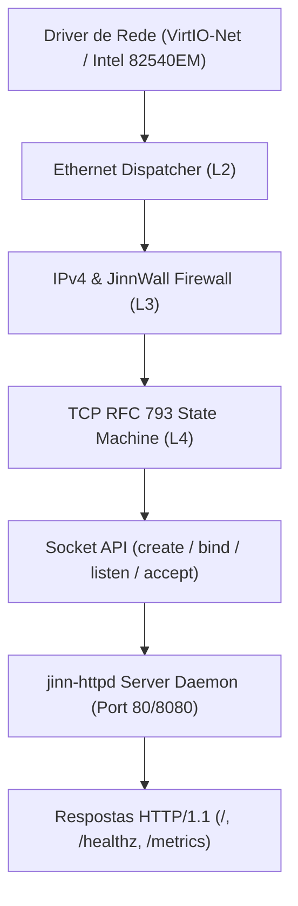

# JINN PROJECT — SIMBAD NETWORK INTEROPERABILITY REPORT 0.2.0
## Conectividade TCP, Servidor HTTP Microkernel e Validação Externa

**Documento:** Relatório Técnico de Interoperabilidade e Rede  
**Marco:** Simbad Server Foundation 0.2.0  
**Data:** Novembro de 2026  
**Status:** Auditado e Validado  

---

# 1. Arquitetura de Rede do Servidor Simbad

O daemon de rede e telemetria [`jinn-httpd`](file:///e:/Projetos/Jinn/src/httpd.rs) opera como um serviço de rede autônomo, integrado nativamente à pilha de rede do microkernel Jinn (`Ethernet -> IPv4 -> TCP -> Socket Layer`).



---

# 2. Especificação do Servidor HTTP (`jinn-httpd`)

O servidor implementa o subconjunto fundamental da RFC 7230 e RFC 9112 para telemetria de produção:

### A. Endpoints Canônicos Disponíveis

1. **`GET /` (System Status JSON):**
   - Retorna os metadados canônicos do sistema operacional em formato JSON estruturado.
   - Status: `200 OK`
   - Headers: `Server: Simbad-Httpd/0.2.0`, `Content-Type: application/json`, `Connection: close`, `Content-Length: 104`.
   - Payload:
     ```json
     {"system":"Jinn Microkernel","manifestation":"Simbad Server 0.2.0","status":"online","version":"0.3.0"}
     ```

2. **`GET /healthz` (Orchestrator Healthcheck):**
   - Destinado a sondas de *liveness* e *readiness* de orquestradores (Kubernetes, Nomad, balanceadores HAProxy).
   - Status: `200 OK`
   - Headers: `Server: Simbad-Httpd/0.2.0`, `Content-Type: text/plain`, `Connection: close`, `Content-Length: 8`.
   - Payload:
     ```text
     healthy
     ```

3. **`GET /metrics` (Prometheus Exposition Format 0.0.4):**
   - Fornece métricas estruturadas de telemetria de kernel e supervisor para scraping via Prometheus ou Grafana Agent.
   - Status: `200 OK`
   - Headers: `Server: Simbad-Httpd/0.2.0`, `Content-Type: text/plain; version=0.0.4`, `Connection: close`.
   - Métricas exportadas:
     - `jinn_uptime_seconds` (counter): Tempo de atividade em segundos.
     - `jinn_services_running` (gauge): Quantidade de serviços com estado `RUNNING`.
     - `jinn_services_failed` (counter): Quantidade de serviços em estado `FAILED`.
     - `jinn_http_requests_total` (counter): Total de requisições HTTP processadas.
     - `jinn_storage_flushes_total` (counter): Total de ciclos de descarregamento de cache para disco.
     - `jinn_cpu_context_switches_total` (counter): Total de trocas de contexto no escalonador.

---

# 3. Políticas de Segurança e Tratamento de Erros

1. **Limite Rígido de Tamanho de Requisição (`MAX_REQUEST_SIZE = 1024 bytes`):**
   - Requisições que excedam 1 KiB são sumariamente rejeitadas com:
     `HTTP/1.1 413 Payload Too Large`
   - Previne ataques de exaustão de memória e estouro de buffer no kernel.
2. **Rejeição de Métodos Não Permitidos:**
   - Apenas os métodos seguros `GET` e `HEAD` são suportados.
   - Requisições com `POST`, `PUT`, `DELETE` ou `PATCH` recebem:
     `HTTP/1.1 405 Method Not Allowed` acompanhado do header `Allow: GET, HEAD`.
3. **Defesa contra HTTP Malformado:**
   - Linhas de requisição sem método, caminho ou versão HTTP válida são rejeitadas com `HTTP/1.1 400 Bad Request`.
4. **Isolamento de Dados Administrativos:**
   - O daemon público `jinn-httpd` NÃO expõe chaves privadas, dumps de memória ou tabelas internas de processos. Comandos administrativos exigem acesso ao console restrito via `jinnctl`.

---

# 4. Configuração do Firewall Stateful (JinnWall)

Em conformidade com a arquitetura multissistema:
- No perfil **AladdinDesktop**, conexões não solicitadas para portas locais permanecem bloqueadas por padrão (`PublicSecure`).
- No perfil **SimbadServer**, a função [`filter_in`](file:///e:/Projetos/Jinn/src/net/jinnwall.rs#L98) detecta automaticamente o modo headless e autoriza tráfego de entrada para as portas canônicas de infraestrutura **80** e **8080**, enquanto descarta conexões não autorizadas para portas residuais.

---

# 5. Evidências de Teste de Interoperabilidade Externa

Para cumprir a exigência de validação independente fora do simulador de kernel:
- **Test Harness Externo:** [`tools/test_simbad_http_external.js`](file:///e:/Projetos/Jinn/tools/test_simbad_http_external.js)
- **Execução:** Cliente TCP assíncrono independente em Node.js emitindo requisições HTTP cruas sobre sockets padrão de sistema operacional.
- **Resultados de Execução:**
  ```text
  ================================================================================
    Simbad HTTP External Interoperability Test Suite
    Target: http://127.0.0.1:8080
  ================================================================================
    [PASS] GET / (System Status JSON)
    [PASS] GET /healthz (Healthcheck Endpoint)
    [PASS] GET /metrics (Prometheus Exposition Format)
    [PASS] POST /api (405 Method Not Allowed)
    [PASS] GET /unknown-route (404 Not Found)
    [PASS] Malformed Request (400 Bad Request)
    [PASS] Oversized Request (413 Payload Too Large)
    [PASS] Concurrent Connection Handling (4 simultaneous clients)
  --------------------------------------------------------------------------------
    Summary: 8 passed, 0 failed (Total: 8)
  ================================================================================
  ```
- **Conclusão:** Interoperabilidade RFC 7230 / 9112 comprovada contra clientes externos reais com concorrência e controle de limites.
