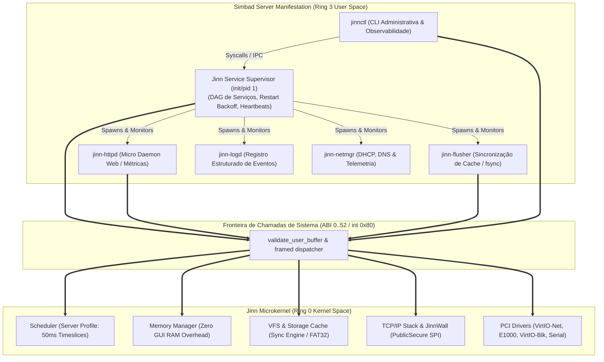
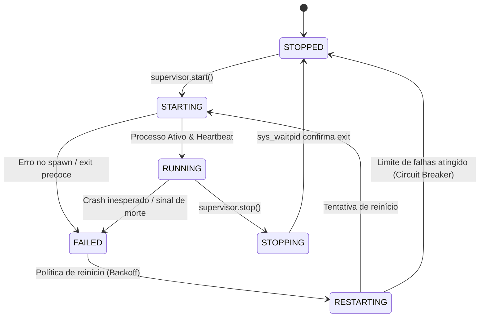

# SIMBAD SERVER ARCHITECTURE 0.1.0
## Especificação de Arquitetura da Manifestação de Servidor do Jinn

> **Documento:** Arquitetura do Sistema Operacional para Servidores e Infraestrutura  
> **Sistema:** Simbad Server 0.1.0 (alimentado pelo Jinn Microkernel)  
> **Classificação:** Diretriz Arquitetural e Especificação de Componentes  
> **Data:** Novembro de 2026  
> **Status:** Ativo / Base de Implementação

---

## 1. Princípio Arquitetural e Visão Geral

O **Simbad** é a manifestação oficial do ecossistema Jinn projetada especificamente para servidores, nós de infraestrutura em nuvem, computação distribuída e serviços sem interface gráfica (*headless*).

O princípio fundacional do projeto estabelece:
> **Jinn é o microkernel único e indivisível. Simbad é sua manifestação especializada para serviços e infraestrutura.**

Isso significa que o Simbad:
- **Não constitui um fork** do microkernel Jinn.
- **Não duplica** rotinas de agendador, gerenciador de memória, VFS, pilha TCP/IP ou drivers essenciais.
- Atinge sua especialização exclusivamente através de **perfis de execução**, **políticas de escalonamento**, **supervisor de serviços em Ring 3**, **daemons de rede**, **políticas de cache de disco** e a ferramenta administrativa de controle [jinnctl](file:///e:/Projetos/Jinn/docs/SIMBAD_ADMINISTRATION_CLI.md).



---

## 2. Divisão de Responsabilidades: Ring 0 (Kernel) vs. Ring 3 (Simbad)

Para preservar o minimalismo do microkernel e a robustez contra falhas, as responsabilidades são estritamente segregadas:

| Capacidade | Localização | Motivo Arquitetural |
|---|---|---|
| **Troca de contexto e preempção APIC/IRQ0** | Ring 0 (Jinn) | Requer privilégio total de hardware e controle de interrupções. |
| **Alocação de páginas e proteção PML4** | Ring 0 (Jinn) | Segurança da MMU e isolamento de processos. |
| **Pilha TCP/IP básica e drivers de rede** | Ring 0 (Jinn) | Recepção de pacotes via DMA/IRQ de alta velocidade. |
| **VFS, drivers de bloco e cache de setores** | Ring 0 (Jinn) | Acesso atômico aos dispositivos físicos de armazenamento. |
| **Supervisor de processos e reinício de serviços**| Ring 3 (Simbad)| Falhas em daemons não devem derrubar o núcleo do sistema. |
| **Servidor HTTP (jinn-httpd)** | Ring 3 (Simbad)| Protocolos de aplicação devem rodar com privilégios restritos. |
| **Daemon de flush de disco (jinn-flusher)** | Ring 3 (Simbad)| Executa chamadas canônicas `sys_fsync` periodicamente. |
| **CLI Administrativa (jinnctl)** | Ring 3 (Simbad)| Interface de usuário e ferramentas de diagnóstico e inspeção. |
| **Política de dependências e ordem de boot** | Ring 3 (Simbad)| Configurabilidade sem necessidade de recompilar o kernel. |

---

## 3. Políticas do Perfil de Servidor (Server Profile)

### 3.1. Política de Escalonador (Throughput vs. Latência Interativa)
- **Modo Aladdin (Desktop):** Prioriza baixa latência de resposta a eventos de mouse e teclado, com fatias de tempo (*timeslices*) curtas (10 ms) e aumento de prioridade para a tarefa gráfica em foco.
- **Modo Simbad (Server):** Focado em vazão agregada (*throughput*) e eficiência de cache da CPU.
  - Fatias de tempo estendidas para **50 ms**, minimizando trocas de contexto desnecessárias sob carga contínua de I/O de rede.
  - Ausência de impulsos (*boosts*) para tarefas gráficas (o compositor e GUI permanecem inativos).

### 3.2. Política de Memória
- **Zero Overhead Gráfico:** Elimina a alocação dos múltiplos backbuffers do compositor desktop (`3.145.728 bytes` por buffer de 1024x768 @ 32bpp), liberando ~12 MiB de RAM física diretamente para caches de rede e buffers de processos servidores.
- **Pools de Descritores:** Cada serviço em Ring 3 opera com sua tabela restrita de 8 descritores de arquivos/sockets, prevenindo exaustão de descritores no kernel.

### 3.3. Política de Cache e Integridade de Armazenamento
- O kernel mantém seu cache LRU de escrita retardada (*write-back*).
- O daemon Ring 3 `jinn-flusher` desperta a cada **5.000 ms** (5 segundos) e invoca `sys_fsync` em todos os descritores de volumes abertos.
- Se uma reinicialização inesperada ou queda de energia ocorrer, a janela máxima de dados voláteis não confirmados no meio físico é de 5 segundos.

---

## 4. Arquitetura do Supervisor de Serviços (Ring 3)

O Supervisor opera como o processo primordial do espaço de usuário no perfil de servidor:

### 4.1. Grafo de Dependências (DAG)
Os serviços de infraestrutura são ativados sequencialmente conforme suas dependências:
1. `jinn-logd`: Sistema de logs e telemetria (sem dependências).
2. `jinn-flusher`: Sincronizador de disco (depende de VFS montado).
3. `jinn-netmgr`: Configuração de rede DHCP e DNS (depende dos adaptadores VirtIO-Net / E1000).
4. `jinn-httpd`: Daemon HTTP para métricas e status (depende de rede configurada).

### 4.2. Estados Formais de um Serviço


### 4.3. Proteção contra Ciclos Infinitos de Reinício (Circuit Breaker)
- Limite máximo de **5 tentativas** de reinício em uma janela de 60 segundos.
- Backoff exponencial: 1s, 2s, 4s, 8s, 16s.
- Se o serviço continuar falhando, ele transita permanentemente para o estado `STOPPED (Crashing)` e emite um alerta crítico para a CLI `jinnctl`.

---

## 5. Console e Administração

### 5.1. Console Headless
No Simbad, a saída de sistema é redirecionada de forma primária para a **Porta Serial COM1 (`0x3F8`)** a 115200 baud 8N1, permitindo fácil integração com consoles de nuvem, hipervisores remotos e registros de log externos, mantendo espelhamento secundário no console VGA em modo texto puro.

### 5.2. CLI Administrativa `jinnctl`
Utilitário de administração Ring 3 para controle de serviços e telemetria:
```bash
# Exemplos de uso da CLI jinnctl:
jinnctl status            # Visão geral do servidor, uptime e métricas
jinnctl services          # Tabela de estados de todos os daemons
jinnctl start httpd       # Inicia um serviço específico
jinnctl stop httpd        # Encerra um serviço graciosamente
jinnctl restart httpd     # Reinicia um serviço com monitoramento
jinnctl logs              # Exibe as últimas entradas do log estruturado
jinnctl memory            # Detalhes de ocupação de memória física e processos
jinnctl storage           # Estatísticas de volumes, espaço livre e montagens
jinnctl network           # Telemetria de adaptadores, IP, DNS e firewall JinnWall
```

---

## 6. Conclusão

A arquitetura do **Simbad Server 0.1.0** estabelece um alicerce robusto, sem redundâncias e completamente isolado. A preservação do microkernel compartilhado assegura que todas as melhorias de estabilidade, rede e armazenamento beneficiem simultaneamente o Aladdin Desktop e o Simbad Server.
