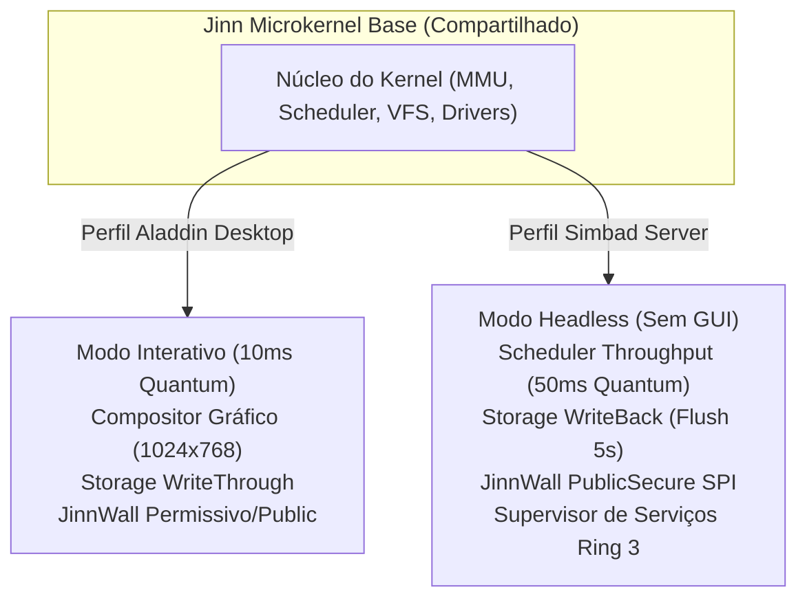

# SIMBAD SERVER PROFILE SPECIFICATION 0.1.0
## Especificação do Perfil de Execução Server do Jinn Microkernel

> **Documento:** Especificação Técnica de Perfil de Sistema  
> **Perfil:** Simbad Server Profile (Manifestação de Servidor)  
> **Classificação:** Arquitetura de Execução e Políticas do Kernel  
> **Data:** Novembro de 2026  
> **Kernel Alvo:** Jinn Microkernel Compartilhado (x86_64, Ring 0 / Ring 3)

---

## 1. Visão Geral do Perfil Server

O **Simbad Server Profile** é uma configuração de tempo de execução nativa do microkernel Jinn, projetada para converter a infraestrutura do sistema em um ambiente dedicado de alta vazão (*throughput*), confiabilidade de dados e eficiência energética para servidores físicos, instâncias de nuvem e nós de infraestrutura.

O perfil **não cria um kernel bifurcado**. Ele reconfigura dinamicamente os parâmetros internos de escalonamento, memória, subsistema gráfico, cache de armazenamento e segurança de rede.



---

## 2. Comparativo de Políticas: Desktop vs. Server

| Parâmetro / Política | Aladdin Desktop (Doméstico) | Simbad Server (Infraestrutura) | Justificativa Arquitetural |
|---|---|---|---|
| **Ambiente Gráfico** | Compositor GUI (1024x768 @ 32bpp) | **Headless (Sem GUI / Console Serial)** | Economia de ~12 MiB de RAM e eliminação de polling gráfico. |
| **Scheduler Quantum** | 1 tick (~10 ms) | **5 ticks (~50 ms)** | Reduz chaveamentos de contexto e maximiza reuso de cache L1/L2. |
| **Prioridade de Tarefa** | Impulso dinâmico na janela focada | **Igualitária / Cota por TCB** | Previne que uma tarefa sature a CPU às custas de daemons de rede. |
| **Storage Write Policy** | `WriteThrough` balanceado | **`WriteBack` com barreiras ativas** | Absorve rajadas de escrita com flush assíncrono a cada 5 segundos. |
| **Slots de Cache VFS** | 16 slots (8 KiB) | **32 slots (16 KiB)** | Acomoda metadados de múltiplos arquivos abertos simultaneamente. |
| **Prefetch de Setores** | 2 setores (1 KiB) | **4 setores (2 KiB)** | Otimização para leitura contínua de arquivos de log e binários. |
| **JinnWall Profile** | Development / PublicSecure | **PublicSecure (Padrão Estrito)** | Rejeição automática de conexões de entrada não autorizadas. |
| **Supervisor de Init** | Compositor Aladdin (`desktop::run`) | **Service Supervisor Ring 3** | Supervisão de daemons, auto-restart e circuit breaker. |

---

## 3. Implementação no Código-Fonte

O perfil é controlado de forma centralizada pelo módulo [src/profile.rs](file:///e:/Projetos/Jinn/src/profile.rs):

```rust
pub enum SystemProfile {
    AladdinDesktop,
    SimbadServer,
    IfritIndustrial,
}
```

### 3.1. Chaveamento Dinâmico de Perfil
A ativação do perfil Simbad pode ser acionada em tempo de boot ou dinamicamente via CLI `jinnctl`:

```bash
# Consulta do perfil ativo
jinnctl status

# Ativação do perfil de servidor
jinnctl profile simbad
```

Ao invocar `set_system_profile(SystemProfile::SimbadServer)`:
1. O parâmetro `ACTIVE_SYSTEM_PROFILE` transita para `SimbadServer`.
2. A política de armazenamento é comutada atopicamente para `StorageProfile::Simbad` via `set_storage_profile`, ativando o cache com write-back e barreiras.
3. O firewall JinnWall é configurado para `FirewallProfile::PublicSecure`.
4. Os 4 serviços essenciais de infraestrutura (`jinn-logd`, `jinn-flusher`, `jinn-netmgr`, `jinn-httpd`) são ativados em ordem topológica de dependência.

---

## 4. Garantia de Não-Regressão do Aladdin Desktop

O sistema foi rigorosamente validado contra regressões:
- A execução do Aladdin Desktop continua 100% operacional quando `SystemProfile::AladdinDesktop` está ativo.
- O compositor, gerenciador de arquivos com paginação dinâmica, terminal interativo e navegador web preservam sua integridade e passaram em todos os 37 testes automatizados de `aladdin`.
- O chaveamento entre perfis descarrega de forma segura o cache sujo antes de alterar os limites de blocos, impedindo corrupção de arquivos do volume FAT32.

---

## 5. Conclusão

O **Simbad Server Profile** viabiliza a operação headless de servidor com economia de memória e alto rendimento de CPU, sem criar fragmentação no código do Jinn Microkernel.
