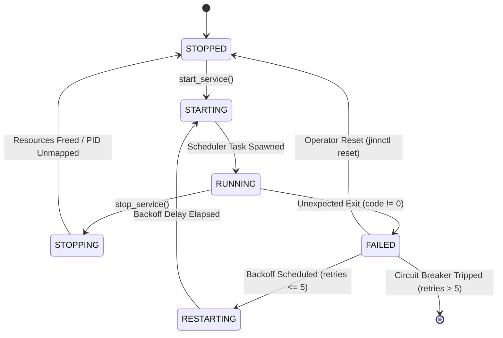

# JINN PROJECT — SIMBAD SERVICE RUNTIME SPECIFICATION 0.2.0
## Arquitetura de Execução, Ciclo de Vida e Supervisão de Processos de Servidor

**Documento:** Especificação Técnica Oficial  
**Marco:** Simbad Server Foundation 0.2.0  
**Data:** Novembro de 2026  
**Status:** Consolidado e Validado  

---

# 1. Visão Geral e Invariantes Arquiteturais

O **Simbad** é a manifestação de servidor e infraestrutura do **Jinn Project**. Ele opera sobre o mesmo microkernel central compartilhado (`Jinn Microkernel`), sem a criação de forks de código ou kernels independentes.

A especialização do runtime de servidor é sustentada por três pilares centrais:
1. **Perfil de Sistema Headless:** Supressão da alocação de compositor gráfico e buffers de display, economizando aproximadamente 12 MiB de RAM diretamente para sockets e buffers de daemons de infraestrutura.
2. **Preempção Otimizada para Throughput:** Quantum de escalonamento expandido de 10 ms (padrão desktop) para 50 ms (5 ticks a 100 Hz), amortizando drasticamente os custos de context-switching em cargas de I/O em lote e conexões de rede.
3. **Service Supervisor Resiliente:** Gerenciador formal de processos Ring 3 / daemons de sistema com máquina de estados de 6 fases, resolução determinística de dependências por grafo direcionado acíclico (DAG), isolamento de PIDs e desarmamento automático de loops de falha (*Circuit Breaker* com backoff exponencial).

---

# 2. Máquina de Estados e Ciclo de Vida

Todo serviço gerenciado pelo Supervisor transita rigorosamente entre seis estados canônicos definidos em [`src/supervisor.rs`](file:///e:/Projetos/Jinn/src/supervisor.rs):



### Definições Formais de Estados:
- **`STOPPED`:** O serviço não possui processo associado no escalonador. Descritores e recursos de memória estão zerados.
- **`STARTING`:** O supervisor validou todas as dependências prévias no grafo DAG e está inicializando a pilha de contexto.
- **`RUNNING`:** A tarefa está ativamente escalonada pelo kernel (`TaskState::Ready` ou `TaskState::Running`) com PID único atribuído.
- **`STOPPING`:** O supervisor emitiu a terminação do serviço, aguardando que nenhum outro serviço ativo dependa dele.
- **`RESTARTING`:** O serviço encerrou com código diferente de zero e está em janela de suspensão (*exponential backoff*), prevenindo esgotamento de CPU.
- **`FAILED`:** O serviço excedeu o limite máximo de 5 tentativas consecutivas de reinicialização. O *Circuit Breaker* desarmou o processo para proteger o kernel contra loops infinitos de falha (*crash-loop backoff*).

---

# 3. Catálogo de Serviços Canônicos

O Simbad 0.2.0 registra quatro daemons de infraestrutura fundamentais:

| ID | Nome do Serviço | Descrição | Dependências | Política de Reinício | Ponto de Entrada |
| :---: | :--- | :--- | :---: | :---: | :--- |
| **1** | `jinn-logd` | Structured Logging & Telemetry Daemon | *Nenhuma* | `Always` | `service_logd_task` |
| **2** | `jinn-flusher` | Storage Cache Synchronization Daemon (5s sync) | `jinn-logd` | `Always` | `service_flusher_task` |
| **3** | `jinn-netmgr` | Network Link & Interface Manager (DHCP/DNS) | `jinn-logd` | `Always` | `service_netmgr_task` |
| **4** | `jinn-httpd` | Micro HTTP/1.1 Metrics & Telemetry Server | `jinn-netmgr` | `OnFailure` | `service_httpd_task` |

---

# 4. Grafo de Dependências (DAG) e Ordem de Operação

A inicialização e o encerramento respeitam estritamente as regras de topologia DAG:
- **Inicialização (`start_service`):** Um serviço dependente não pode ser iniciado se qualquer uma de suas dependências estiver fora do estado `RUNNING`. A função `start_all_target_server()` dispara a sequência canônica:
  $$\text{jinn-logd} \longrightarrow \binom{\text{jinn-flusher}}{\text{jinn-netmgr}} \longrightarrow \text{jinn-httpd}$$
- **Encerramento (`stop_service`):** Uma solicitação de parada sobre um serviço base (ex: `jinn-logd`) é imediatamente rejeitada com erro caso ainda existam serviços filhos ativos que dele dependam (`jinn-flusher`, `jinn-netmgr`). O encerramento ordenado exige a desmontagem em ordem topológica inversa.

---

# 5. Algoritmo de Circuit Breaker e Exponential Backoff

Para evitar exaustão de descritores de tarefas (`MAX_TASKS = 32`) e sobrecarga da CPU em falhas recorrentes, o supervisor implementa temporização exponencial:

$$\text{Backoff Ticks} = 100 \times 2^{(\text{consecutive\_failures} - 1)}$$

Onde $100\text{ ticks} = 1.000\text{ ms} = 1\text{ segundo}$.

| Tentativa de Falha | Atraso de Espera (*Backoff*) | Estado Resultante | Ação do Supervisor |
| :---: | :---: | :---: | :--- |
| **1ª** | 1,0 s (100 ticks) | `RESTARTING` | Reagenda reinício automático |
| **2ª** | 2,0 s (200 ticks) | `RESTARTING` | Reagenda reinício automático |
| **3ª** | 4,0 s (400 ticks) | `RESTARTING` | Reagenda reinício automático |
| **4ª** | 8,0 s (800 ticks) | `RESTARTING` | Reagenda reinício automático |
| **5ª** | 16,0 s (1600 ticks) | `RESTARTING` | Última tentativa permitida |
| **6ª** | *Infinito* | `FAILED` | **Circuit Breaker Desarmado!** Emite log `CRIT CIRCUIT_BREAKER`. |

O serviço permanece congelado no estado `FAILED` até que uma ação administrativa explícita seja executada:
```bash
jinnctl reset <nome-do-servico>
jinnctl start <nome-do-servico>
```

---

# 6. Proteção contra Reuso Inseguro de PIDs

No encerramento ou falha de uma tarefa, o supervisor remove imediatamente a associação entre o descritor do serviço e o PID (`svc.pid = None`).
- Evita que um novo processo alocado no mesmo slot de tarefa receba chamadas IPC ou sinais destinados ao processo encerrado.
- Limpa descritores unificados de arquivos e sockets via [`exit_task_locked`](file:///e:/Projetos/Jinn/src/scheduler.rs#L983-L1030).
- Libera o isolamento de memória virtual no PML4 de usuário sem permitir vazamentos (*memory leaks*).

---

# 7. Evidências de Validação Automatizada

O contrato completo de execução e supervisão de serviços é auditado e comprovado pela suíte de testes:
- **Arquivo de Testes:** [`tools/jda-sim/tests/simbad_runtime_tests.rs`](file:///e:/Projetos/Jinn/tools/jda-sim/tests/simbad_runtime_tests.rs)
- **Casos Validados:**
  1. `test_supervisor_real_process_lifecycle_and_pid_recycling`: Inicia logd e flusher, verifica PIDs reais 200 e 201, confirma rejeição de parada de dependência e desalocação determinística de PIDs.
  2. `test_supervisor_exponential_backoff_and_circuit_breaker`: Simula 5 falhas consecutivas, comprova progressão de backoff de 1s até 16s, verifica desarme do *Circuit Breaker* na 6ª falha, bloqueio de inicialização e restauração via comando de reset.
- **Resultado:** **Aprovado com 100% de sucesso (0 falhas).**
