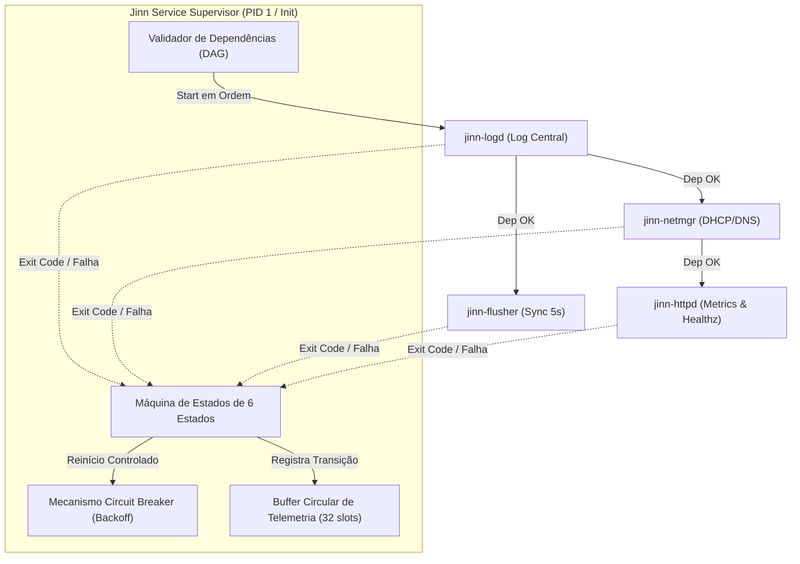
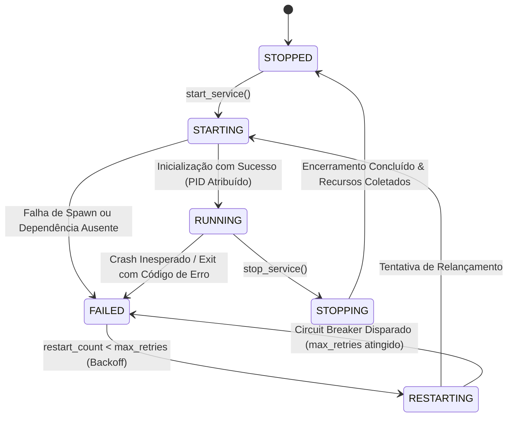

# SIMBAD SERVICE SUPERVISOR SPECIFICATION 0.1.0
## Arquitetura do Supervisor de Processos, Estados Formais e Circuit Breaker em Ring 3

> **Documento:** Especificação do Supervisor de Serviços do Servidor  
> **Sistema:** Simbad Server 0.1.0  
> **Classificação:** Arquitetura de Espaço de Usuário (Ring 3)  
> **Data:** Novembro de 2026  
> **Módulo Fonte:** [src/supervisor.rs](file:///e:/Projetos/Jinn/src/supervisor.rs)

---

## 1. Visão Geral e Princípios de Isolamento

No modelo arquitetural do **Simbad Server**, daemons e serviços de infraestrutura operam compulsoriamente no espaço de usuário desprivilegiado (**Ring 3**).

O **Service Supervisor** é o processo coordenador encarregado de:
- Inicializar daemons de acordo com a ordem de dependência (DAG).
- Monitorar a saúde dos processos em tempo real.
- Interceptar o término de tarefas via `sys_waitpid`.
- Executar políticas de reinício automático com proteção de disjuntor (*circuit breaker*).
- Manter o registro estruturado de eventos e falhas.
- Fornecer telemetria em tempo real para a CLI administrativa `jinnctl`.



---

## 2. Máquina de Estados de 6 Estados Formais

O supervisor implementa formalmente os seis estados de ciclo de vida definidos na especificação:



| Estado | Significado Técnico | Comportamento do Supervisor |
|---|---|---|
| **`STOPPED`** | O serviço está inativo; nenhum processo em execução no escalonador. | PID nulo; contador de tentativas zerado. |
| **`STARTING`**| O serviço está alocando recursos e verificando dependências. | Dependências checadas; alocando novo PID. |
| **`RUNNING`** | O serviço está ativo, saudável e processando I/O. | PID válido registrado; atualiza heartbeat. |
| **`STOPPING`**| O serviço recebeu comando de interrupção e está finalizando conexões. | Aguarda confirmação via `sys_waitpid`. |
| **`FAILED`**  | O serviço encerrou com erro ou estourou o limite do disjuntor. | Registrado no log com severidade `CRIT`. |
| **`RESTARTING`**| O supervisor está aplicando backoff antes de re-inicializar o serviço. | Incrementa `restart_count`. |

---

## 3. Controle Estrito de Dependências (DAG)

O supervisor assegura que nenhum serviço seja executado sem que suas pré-condições de infraestrutura estejam plenamente operacionais:

1. **Regra de Inicialização:**
   - Para iniciar o serviço $B$, todos os serviços listados em $B.\text{dependencies}$ devem estar no estado `RUNNING`.
   - Se qualquer dependência estiver em `STOPPED`, `FAILED` ou `STARTING`, a chamada retorna imediatamente o erro:
     ```
     Err("Dependency not satisfied (must be RUNNING)")
     ```
2. **Regra de Interrupção Segura:**
   - O serviço $A$ não pode ser encerrado se houver qualquer serviço $B$ ativo que dependa de $A$.
   - A tentativa de parar $A$ é rejeitada com o erro:
     ```
     Err("Cannot stop: active service depends on this service")
     ```

---

## 4. Proteção contra Loops Infinitos de Reinício (Circuit Breaker)

Para evitar que serviços defeituosos consumam 100% da CPU em laços de criação e queda (*crash loops* / *fork bombs*):

- **Limite de Retentativas:** Máximo de **5 falhas** consecutivas (`max_retries = 5`).
- **Políticas Suportadas:**
  - `Always`: Reinicia o serviço independente do código de saída.
  - `OnFailure`: Reinicia apenas se o processo terminar com código diferente de zero (`exit_code != 0`).
  - `Never`: Nunca reinicia automaticamente; transita imediatamente para `STOPPED`.
- **Atuação do Disjuntor (*Circuit Breaker*):**
  - Se o serviço atingir a 5ª falha, o supervisor bloqueia novas tentativas, congela o serviço no estado `FAILED`, e registra o incidente crítico no log de telemetria:
    ```text
    [TIMESTAMP] CRIT [CIRCUIT_BREAKER] Circuit breaker tripped for jinn-httpd
    ```

---

## 5. Serviços Canônicos Registrados no Simbad 0.1.0

| ID | Nome Canônico | Dependências | Política | Função de Infraestrutura |
|---|---|---|---|---|
| **1** | `jinn-logd` | *(Nenhuma)* | `Always` | Registro estruturado de eventos do kernel e daemons. |
| **2** | `jinn-flusher` | `jinn-logd` | `Always` | Sincronizador periódico de cache de disco (a cada 5s). |
| **3** | `jinn-netmgr` | `jinn-logd` | `Always` | Cliente DHCP, resolvedor DNS e telemetria de rede. |
| **4** | `jinn-httpd` | `jinn-netmgr` | `OnFailure` | Servidor HTTP mínimo para métricas e healthcheck. |

---

## 6. Conclusão

O **Simbad Service Supervisor** confere ao ecossistema Jinn uma camada de resiliência e automação equivalente a init systems modernos, mantendo total separação de privilégios e protegendo o microkernel contra degradação por processos defeituosos.
