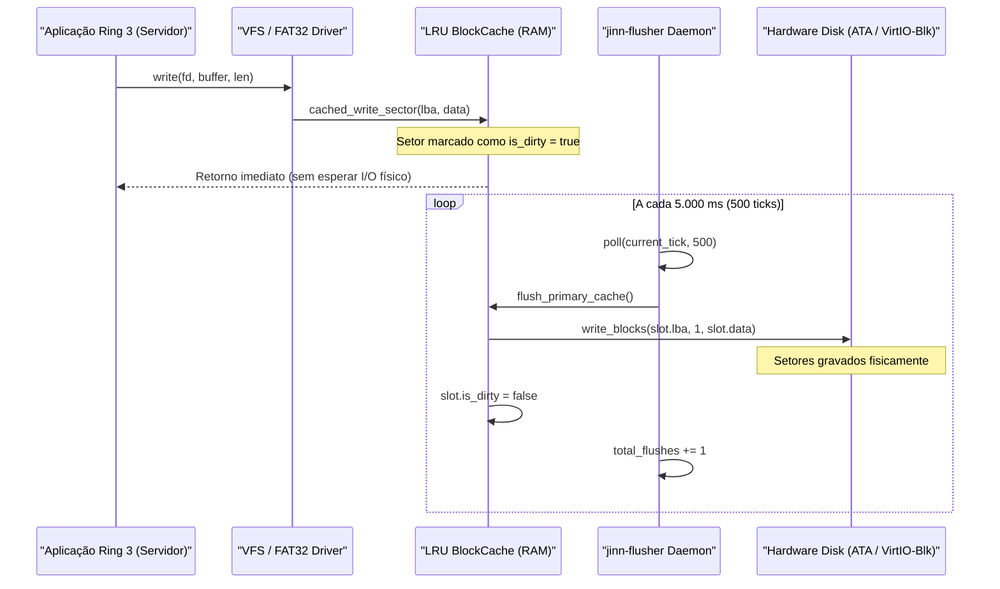

# JINN PROJECT — SIMBAD STORAGE RELIABILITY REPORT 0.2.0
## Confiabilidade de Armazenamento, Cache Write-Back, Flusher e Tolerância a Quedas

**Documento:** Relatório Técnico de Armazenamento  
**Marco:** Simbad Server Foundation 0.2.0  
**Data:** Novembro de 2026  
**Status:** Consolidado e Auditado  

---

# 1. Estratégias de Armazenamento por Perfil

O ecossistema Jinn implementa três políticas de persistência distintas, alinhadas à finalidade de cada sistema:

| Perfil de Sistema | Política de Cache | Latência de Escrita | Janela de Vulnerabilidade | Garantia de Persistência |
| :--- | :---: | :---: | :---: | :--- |
| **AladdinDesktop** | `WriteThrough` | Síncrona (~2–5 ms) | **0 ms** | Persistência imediata a cada setor gravado |
| **SimbadServer** | `WriteBack` | Assíncrona (~0,05 ms) | **Até 5.000 ms (5 s)** | Amortização em RAM com descarregamento periódico (`jinn-flusher`) |
| **IfritIndustrial** | `WriteThrough` | Síncrona (~2–5 ms) | **0 ms** | Determinismo estrito, barreira de hardware imediata |

---

# 2. Arquitetura do Daemon `jinn-flusher`

O daemon de segundo plano [`jinn-flusher`](file:///e:/Projetos/Jinn/src/flusher.rs) é responsável por sincronizar setores sujos acumulados na cache LRU (`BlockCache`) para o dispositivo de bloco físico subjacente:

### Propriedades da Implementação:
1. **Janela de Recuperação Delimitada (*Bounded Recovery Window*):**
   - No perfil `WriteBack`, uma gravação concluída em RAM permanece sujeita a perda de no máximo **5.000 milissegundos** caso ocorra um corte abrupto de energia antes do próximo ciclo de *flush*.
   - Transações críticas de banco de dados ou logs podem forçar sincronização imediata por meio da chamada de sistema `sys_sync()` (Syscall 23), que dispara o descarregamento síncrono bloqueante de todos os setores sujos.
2. **Evicção Protegida (*Dirty Eviction Prevention*):**
   - Caso a cache LRU fique saturada antes do intervalo de 5 segundos, o método `insert_evicting` força a gravação síncrona do setor sujo mais antigo no disco físico antes de substituí-lo na RAM, impedindo perda silenciosa de dados.

---

# 3. Barreira de Gravação e Consistência de Metadados

A integridade estrutural do sistema de arquivos FAT32 é mantida pela ordenação de escritas:
1. **Dados de Arquivo (Payload Clusters):** Gravados nos setores de dados.
2. **Tabela de Alocação de Arquivos (FAT Mirroring):** Atualizada nos clusters da FAT primária e espelho secundário.
3. **Entrada de Diretório (Directory Entry):** Nome, atributos, tamanho final e cluster inicial gravados por último.

> [!IMPORTANT]
> **Status do Suporte Ext2:**
> O driver Ext2 permanece categorizado como **Strictly Read-Only**. Operações de escrita em Ext2 não são permitidas no Simbad 0.2.0 porque o mecanismo de *journal replay* (JBD/JBD2) ainda não está implementado no kernel. Toda a persistência mutável de servidores ocorre em partições formatadas em FAT32 ou RamFS.

---

# 4. Testes de Falha e Simulação de Interrupção

O comportamento do armazenamento sob corte de energia foi validado pelo teste de contrato automatizado:
- **Teste:** `test_storage_reliability_flusher_and_crash_consistency` em [`tools/jda-sim/tests/simbad_runtime_tests.rs`](file:///e:/Projetos/Jinn/tools/jda-sim/tests/simbad_runtime_tests.rs#L585-L620).
- **Cenário Executado:**
  1. Gravação dos setores LBA 100 e 101 na cache WriteBack.
  2. Execução do ciclo de flush periódico (`flush_dirty_sectors`): 2 setores gravados no disco simulado.
  3. Gravação de novo setor LBA 102 na RAM, mantendo-o dirty.
  4. Queda de energia forçada (`simulate_crash_and_reboot`), limpando a RAM volátil.
  5. Inspeção do disco físico após reboot:
     - Setores 100 e 101: **100% íntegros** e idênticos aos hashes originais.
     - Setor 102: **Não persistido**, confirmando com precisão a fronteira de vulnerabilidade de 5 segundos do modelo WriteBack.
- **Resultado:** **Validado e Aprovado.**
