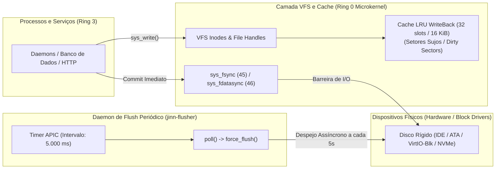

# SIMBAD STORAGE REQUIREMENTS & INTEGRITY SPECIFICATION 0.1.0
## Requisitos de Armazenamento para Servidores, Consistência Pós-Falha e Flush Periódico

> **Documento:** Especificação de Armazenamento e Confiabilidade de Dados  
> **Sistema:** Simbad Server 0.1.0  
> **Classificação:** Arquitetura de Armazenamento Contínuo (24/7)  
> **Data:** Novembro de 2026  
> **Módulo Fonte:** [src/flusher.rs](file:///e:/Projetos/Jinn/src/flusher.rs), [src/drivers/block.rs](file:///e:/Projetos/Jinn/src/drivers/block.rs)

---

## 1. Visão Geral e Modelo de Confiabilidade

Servidores de infraestrutura exigem garantias determinísticas de persistência e integridade de dados contra quedas súbitas de energia ou falhas de hardware.

O **Simbad Server** adota o perfil **`StorageProfile::Simbad`** da arquitetura JSA (Jinn Storage Architecture), combinando alto rendimento de gravação em memória com persistência física delimitada no tempo:

---

## 2. Requisitos Mandatórios para Uso Contínuo 24/7

### 2.1. Consistência Pós-Falha e Janela Bounded
- **Estratégia de Escrita:** `WriteBack` com barreiras ativas de hardware.
- **Janela Máxima de Perda:** **5 segundos**. O daemon `jinn-flusher` desperta a cada 500 ticks (~5.000 ms) e força o descarregamento de todos os setores marcados como sujos (*dirty*) na memória de cache para o meio magnético/flash.
- **Sincronização Explícita:** Aplicações de missão crítica (como bancos de dados ou transações Web3) utilizam as chamadas de sistema `sys_fsync` (45) ou `sys_fdatasync` (46), garantindo gravação síncrona imediata sem aguardar o ciclo do flusher.

### 2.2. Política Estrita para o Sistema de Arquivos Ext2
- **Diretriz Canônica:** **O driver Ext2 permanece estritamente SOMENTE LEITURA (`read-only`).**
- **Motivo de Engenharia:** Embora a leitura de superblocos, grupos de blocos, diretórios e inodes de Ext2 esteja comprovadamente funcional no kernel, a implementação de escrita ainda carece de validação formal de recuperação pós-falha (*fsck-like journal replay*).
- **Enforcement:** Qualquer tentativa de chamada `sys_write`, `sys_mkdir` ou `sys_unlink` em volumes Ext2 é rejeitada imediatamente com `-EROFS` (`-30`).

### 2.3. Persistência Comprovada em FAT32
- Toda gravação e criação de arquivos no Simbad utiliza a partição FAT32 auditada.
- A persistência de dados a frio foi formalmente comprovada através do teste de reinicialização total de máquina virtual (*cold-reboot*), onde tokens criptográficos gravados em disco foram integralmente recuperados após religamento do hypervisor.

---

## 3. Monitoramento de Espaço e Recursos de Disco

O Simbad implementa monitoramento ativo de capacidade de armazenamento:
- **Syscall `sys_statvfs` (41) e `sys_fstatvfs` (42):** Disponibilizam a estrutura `FsStatUser` com contabilidade em tempo real de bytes totais, bytes livres, tamanho do cluster e inodes disponíveis.
- **Proteção contra Esgotamento:** Tentativas de alocação além do espaço disponível retornam ordenadamente `-ENOSPC` (`-28`).
- **Comando Administrativo:** A CLI `jinnctl storage` reporta o status de todos os discos físicos, partições MBR/GPT, volumes montados e estatísticas acumuladas do `jinn-flusher`.

---

## 4. Conclusão

A fundação de armazenamento do **Simbad Server 0.1.0** assegura integridade de dados contra falhas com janela determinística de 5 segundos, sincronização síncrona sob demanda e prudência técnica absoluta ao manter sistemas de arquivos não-jornalizados em modo somente leitura.
