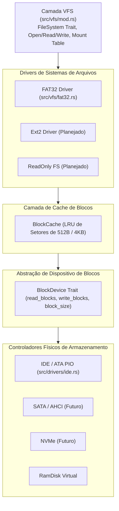

# Jinn Storage Architecture & Avaliação Comparativa de Sistemas de Arquivos v0.1

## 1. Fundamentos e Separação de Responsabilidades

Uma arquitetura de armazenamento robusta e modular em um microkernel exige distinção estrita entre camadas conceituais:

1. **Alocador de Páginas Físicas da RAM (PMM)**: Gerencia frames de 4 KiB da memória volátil (`src/memory/mod.rs`).
2. **Alocador do Heap do Kernel**: Aloca blocos dinâmicos na memória RAM para estruturas internas do kernel (`src/memory/heap.rs`).
3. **Dispositivo de Blocos (Block Device)**: Abstração de I/O em setores brutos de 512 ou 4096 bytes (`src/drivers/block.rs`).
4. **Cache de Blocos (Block Cache)**: Buffer volátil na RAM para reter setores lidos frequentemente e amortizar operações de I/O em disco.
5. **Sistema de Arquivos (Filesystem)**: Lógica estrutural que organiza clusters, nós de índice (*inodes*), diretórios, árvores B+ e metadados.
6. **Sistema Virtual de Arquivos (VFS)**: Camada unificadora de pontos de montagem, descritores de arquivos e tabelas de permissões (`src/vfs/mod.rs`).

---

## 2. Comparativo Técnico de Sistemas de Arquivos

Avaliamos os sistemas de arquivos sob a perspectiva das necessidades de um sistema operacional doméstico (Aladdin Desktop), mantido com foco em previsibilidade e baixo overhead.

| Critério | FAT32 | exFAT | Ext2 | Ext4 | NTFS | Btrfs | Imagens Read-Only (SquashFS/erofs) |
|:---|:---|:---|:---|:---|:---|:---|:---|
| **Complexidade de Código** | Baixa (~500–1.000 linhas) | Média (~1.500–2.500 linhas) | Média-Baixa (~1.500 linhas) | Muito Alta (>10.000 linhas) | Extrema (>30.000 linhas) | Extrema (>50.000 linhas) | Baixa-Média (~1.200 linhas) |
| **Compatibilidade / Interoperabilidade** | Universal (BIOS, UEFI, Windows, Linux, Mac) | Excelente em pendrives e cartões SD | Excelente em Linux / Unix | Excelente em Linux | Nativo do Windows | Específico Linux | Universal em sistemas embarcados e LiveCDs |
| **Requisitos de Memória RAM** | Mínimos (< 64 KiB para estruturas ativas) | Baixos (< 128 KiB) | Baixos (~128 KiB) | Médios-Altos (Journal + Extent Tree) | Altos (MFT caching amplo) | Muito Altos (Árvores B+ e CoW) | Mínimos (leitura contínua compactada) |
| **Limite de Tamanho de Arquivo** | 4 GiB (Gargalo crítico) | 16 EiB | 2 TiB | 16 TiB | 16 TiB | 16 EiB | Limitado pelo volume |
| **Resiliência a Quedas de Energia** | Nula (Sem journaling; risco de corrupção da FAT) | Baixa (Sem journaling tradicional) | Nula (Requer `e2fsck`) | Muito Alta (Journaling com write barrier) | Alta (Journaling USN/LogFile) | Máxima (Copy-on-Write transacional) | Imune (Mídia estritamente somente leitura) |
| **Metadados e Permissões** | Básicos (Somente leitura, Oculto, Sistema) | Básicos | Posix completo (UID, GID, permissões rwx) | Posix completo + ACLs + xattr | ACLs ricas, DACL, SACL, SID | Posix + Subvolumes + Snapshots | Posix estático comprimido |
| **Patentes e Restrições Legais** | Patentes expiradas na quase totalidade | Patentes ativas da Microsoft (requer cautela) | Livre e aberto | Livre e aberto | Especificação proprietária fechada | Livre e aberto (GPL) | Livre e aberto |
| **Adequação ao Aladdin Doméstico** | Primordial para boot e pendrives de troca | Excelente para mídias externas > 4GB | Boa para discos internos de teste | Excelente para partição nativa do sistema | Crítica para leitura de discos Windows pré-instalados | Prematura para o estágio atual | Excelente para imagens de recuperação e Live ISO |
| **Custo de Manutenção (Equipe Pequena)** | Muito Baixo | Baixo-Médio | Baixo | Alto | Inviável para escrita completa a curto prazo | Inviável | Baixo |

### Conclusões da Análise:
1. **FAT32**: Deve continuar sendo o formato de referência imediato para boot, compatibilidade com Limine e teste em QEMU (`disk.img`), dado que já possui suporte a leitura funcional no Jinn OS.
2. **Ext2**: É o melhor candidato para o primeiro sistema de arquivos Posix com suporte a **escrita segura** no Jinn OS, pois sua estrutura de blocos diretos/indiretos é matematicamente elegante e não impõe o custo de gerenciar um diário (*journal*) na fase inicial.
3. **NTFS**: Deve ser abordado estritamente como **somente-leitura (Read-Only)** em uma fase intermediária, permitindo que o usuário do Aladdin acesse arquivos de partições Windows sem o altíssimo risco de corromper o volume NTFS.
4. **Imagens Read-Only (estilo SquashFS/EROFS)**: Ideais para distribuir a imagem base do sistema operacional Aladdin, garantindo inicialização rápida, integridade criptográfica e imunidade a falhas de escrita.

---

## 3. Arquitetura em Camadas do Jinn Storage



### 3.1. Abstração de Dispositivo de Blocos (`BlockDevice`)
Desacopla os drivers de hardware dos sistemas de arquivos:
```rust
pub trait BlockDevice: Send + Sync {
    fn name(&self) -> &'static str;
    fn block_size(&self) -> usize;
    fn total_blocks(&self) -> u64;
    fn read_blocks(&self, start_block: u64, count: usize, buf: &mut [u8]) -> Result<(), &'static str>;
    fn write_blocks(&self, start_block: u64, count: usize, buf: &[u8]) -> Result<(), &'static str>;
    fn flush(&self) -> Result<(), &'static str>;
}
```

---

## 4. Roteiro e Critérios de Segurança para Escrita em Disco

Operações de escrita destrutiva em mídias de armazenamento físicas representam o maior risco de corrupção de dados em desenvolvimento de sistemas operacionais.

**Diretrizes de Segurança Rígidas:**
1. **Ambiente Isolado**: Testes de escrita devem ocorrer exclusivamente em imagens virtuais (`disk.img`) ou RamDisks, nunca em dispositivos físicos de partição do hospedeiro.
2. **Escrita Atômica de Setor IDE**: A implementação de `write_sector` no driver IDE deve verificar rigorosamente os sinais `STATUS_BSY` e `STATUS_DRQ`, com atrasos padronizados de 400ns e timeouts explícitos.
3. **Flushing Obrigatório**: O driver deve emitir comandos de sincronização (`FLUSH CACHE - 0xE7` no padrão ATA) antes de confirmar a gravação de blocos de metadados críticos.
