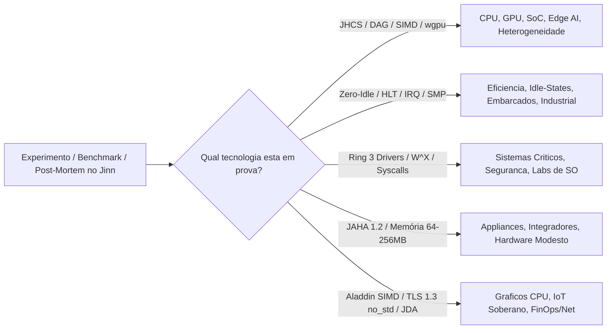
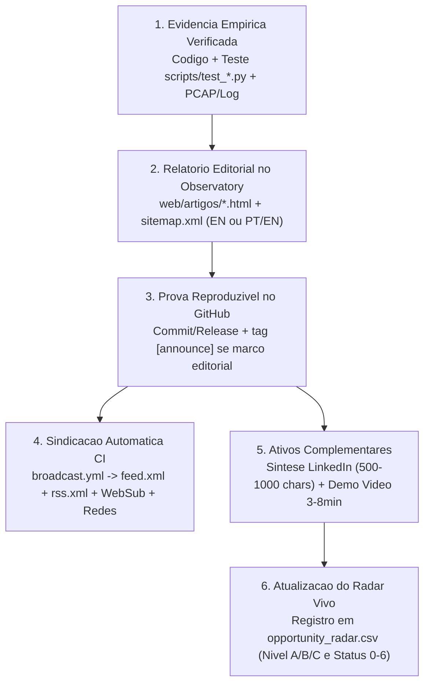

# Jinn Global Initiative — Estratégia de Visibilidade, Prospecção Tecnológica, Parcerias e Financiamento

> **Programa Permanente:** **Jinn Open Engineering Outreach**  
> **Lema:** *Research. Engineering. Outreach. Collaboration.*  
> **Escopo:** Ecossistema Jinn OS (`#![no_std]`), Aladdin Desktop, JHCS (`jhcs-rs`), JAHA 1.2, Simbad Server & Pilha Soberana de Rede  
> **Data de Referência:** 26 de Novembro de 2026  
> **Regime Jurídico Base:** Duplo Licenciamento (`GPL-2.0-only` e minuta comercial `Jinn-Commercial-1.0`, conforme [`LICENSE`](../../LICENSE); `jhcs-rs` sob `MIT OR Apache-2.0`)  
> **Status:** Documento-Mãe Canônico (Sistema Operacional de Crescimento Externo)

---

## 1. Mandato, Tese e Princípio de Legitimidade

### 1.1. A Mudança de Posicionamento
Não posicionamos o Jinn como *"mais um sistema operacional tentando competir com Linux ou Windows"*. Esse enquadramento fecha portas antes da primeira conversa técnica porque o custo de adoção de um sistema operacional inteiro é proibitivo para empresas e equipes estabelecidas.

Posicionamos o projeto como uma **arquitetura experimental verificável para computação isolada, determinística e heterogênea**, na qual:
- O **Jinn OS (`x86_64`, `#![no_std]`)** é o ambiente integrado de prova viva (*end-to-end testbed*);
- Os **subsistemas modulares** (**JHCS**, **Zero-Idle & SMP Scheduling**, **JAHA 1.2 Memory Accounting**, **Aladdin Shared Rings / Compositor SIMD Zero-GPU**, **Simbad Server / JDA**, **Pilha TLS 1.3 / DNS 3 camadas / HotRouteTable `#![no_std]`**) são os **ativos transferíveis** de pesquisa, engenharia, piloto industrial e potencial licenciamento.

### 1.2. Princípio do **Jinn Open Engineering Outreach**
> **"Não abordamos uma organização simplesmente porque ela é grande. Abordamos porque existe uma relação técnica, científica ou operacional legítima entre aquilo que estamos investigando e os interesses, problemas ou competências daquela organização."**

Cada desenvolvimento, experimento, benchmark, auditoria ou *post-mortem* do Jinn passa a ser planejado com uma dimensão externa, buscando — simultaneamente ou de forma seletiva — **quatro objetivos**:
1. **Visibilidade:** tornar a descoberta técnica e sua metodologia acessíveis;
2. **Reconhecimento:** construir reputação técnica consistente ao longo do tempo (múltiplas entregas sólidas, não ruído isolado);
3. **Interlocução:** abrir diálogo técnico qualificado com engenheiros, pesquisadores e operadores do domínio;
4. **Oportunidade:** identificar colaboradores, acesso a hardware físico, cargas de trabalho reais, projetos-piloto, bolsas/grants ou licenciamento.

### 1.3. Cláusula Inegociável de Rigor Empírico
Para preservar credibilidade diante de engenheiros seniores de hardware, sistemas operacionais e pesquisa:
1. **QEMU $\neq$ Silício Real para Energia:** Em QEMU (TCG/KVM), métricas de `HLT`, `idle_cycles` e `0.00% CPU ociosa` nos APs comprovam **eficiência operacional do modelo orientado a eventos** (ausência de *busy-waiting* e timers espúrios em segundo plano). Afirmações sobre **economia energética real (watts/joules, C-states, DVFS)** só podem ser feitas após medição direta em **hardware físico** com metodologia declarada (RAPL, wattímetro/telemetria de placa).
2. **Sem Afirmações Genéricas de Superioridade:** Comparações de memória ou latência (como as referenciadas em [`docs/benchmarks/JINN_PERFORMANCE_BASELINE.md`](../benchmarks/JINN_PERFORMANCE_BASELINE.md)) exigem declaração explícita de *workload*, perfil de hardware, configuração, versão e escopo da medição.
3. **Limitações Explícitas:** Todo relatório publicado no Observatory e no GitHub deve incluir uma seção de **Limitações Conhecidas e Próximos Passos**.

---

## 2. Mapeamento Tecnologia $\to$ Radar de Interlocutores

Em vez de manter uma lista fixa de "gigantes" e tentar encaixar todo o projeto nela, **a tecnologia investigada determina quem entra no radar**:

| Pilar Tecnológico do Jinn | Artefatos & Evidências Reais no Ecossistema | Questões Técnicas Abertas (Gatilho de Diálogo) | Ecossistema Alvo |
| :--- | :--- | :--- | :--- |
| **1. JHCS & Computação Heterogênea** | Workspace [`jhcs-rs`](../../../jhcs-rs/README.md) (`jhcs-core`, `jhcs-broker`, `jhcs-backend-simd`, `jhcs-backend-wgpu`, `jhcs-platform-jinn`); issues [`01_NEON_ARM64_SIMD.md`](../strategic-issues/01_NEON_ARM64_SIMD.md) e [`02_ZERO_ALLOC_COMPUTE_GRAPH.md`](../strategic-issues/02_ZERO_ALLOC_COMPUTE_GRAPH.md) | Política de seleção de executor baseada em tamanho do *workload*, custo de transferência, latência e fallback determinístico CPU/SIMD/GPU; implementação ARM NEON (`aarch64`) | Fabricantes de CPU/GPU/SoC (AMD, Intel, NVIDIA, Arm, Qualcomm), engenharia de edge AI, grupos de compiladores e computação paralela |
| **2. Zero-Idle, SMP & Hardware Interrupts** | `src/scheduler.rs`, `src/smp.rs`, `src/interrupts/pic.rs`; artigos [`auditoria-zero-idle-smp-percpu-irq-apic-gating.html`](../../web/artigos/auditoria-zero-idle-smp-percpu-irq-apic-gating.html), [`post-mortem-pic-eoi-zero-gpu.html`](../../web/artigos/post-mortem-pic-eoi-zero-gpu.html) | Equilíbrio entre escalonamento orientado a eventos, gating de timer APIC, wakeups por IRQ e transição para estados de baixo consumo sob restrição de latência | Arquiteturas x86/ARM, ecossistema Linux/Linaro/Red Hat, automação industrial e sistemas embarcados (Siemens, Bosch), pesquisa em eficiência energética |
| **3. Isolamento, W^X & Drivers em Ring 3** | `src/memory/paging.rs`, `src/syscall.rs`, `src/supervisor.rs`; [`JINN_DRIVER_ISOLATION_ARCHITECTURE.md`](../architecture/JINN_DRIVER_ISOLATION_ARCHITECTURE.md), [`SYSCALL_ABI_RESOURCE_CONTRACT.md`](../SYSCALL_ABI_RESOURCE_CONTRACT.md) | Contenção de falhas de driver sem *kernel panic*, validação estrita de fronteira `SYSCALL`, recuperação supervisionada e isolamento futuro via KPTI e IOMMU (`VT-d`/`AMD-Vi`) | Empresas de segurança de sistemas, fornecedores de dispositivos críticos/industriais, laboratórios universitários de SO e verificação |
| **4. Densidade de Memória & JAHA 1.2** | [`JINN_MEMORY_BUDGET.md`](../benchmarks/JINN_MEMORY_BUDGET.md), [`JAHA_12_SPECIFICATION.md`](../JAHA_12_SPECIFICATION.md), [`scripts/test_jaha_12_integrity.py`](../../scripts/test_jaha_12_integrity.py) (invariante $\Delta = 0\text{ B}$) | Contabilidade física contínua *no-overcommit*, operação desktop/navegador sob 64–256 MB de RAM, *backpressure* em 7 níveis | Edge computing, *appliances* industriais, hardware legado/baixo custo, inclusão digital e laboratórios com equipamentos restritos |
| **5. Pilha Soberana `#![no_std]` (Rede + GUI Zero-GPU)** | `apps/ola-mundo/src/` (`tls.rs`, `browser.rs`), `src/net/` (`tls13.rs`, `dns.rs`, `hot_routes.rs`), compositor `Aladdin`; post-mortem TLS 1.3 (`508ebd5` / `1b93f0c`) | Criptografia TLS 1.3 AEAD sem dependências C, resolução DNS 3 camadas com expiração *lazy*, fast-path L2/L3 `HotRouteTable`, composição SIMD pura em CPU | Comunidade Rust (`#![no_std]`), segurança de protocolos, integradores de gateways/appliances embarcados, hardware sem GPU |

---

## 3. Os Quatro Círculos de Interlocução

Dependendo apenas de corporações globais de trilhões de dólares (Círculo 1), o ciclo de resposta é lento e opaco. O Jinn opera simultaneamente em **quatro círculos complementares**:

| Círculo | Perfil das Organizações | Alcance Geográfico | Objetivo Primário no Jinn | O que Traz ao Projeto que uma Big Tech Raramente Traz Cedo |
| :--- | :--- | :--- | :--- | :--- |
| **Círculo 1 — Empresas Pioneiras** | Fabricantes de hardware, semicondutores, cloud, infraestrutura e sistemas (Intel, AMD, Arm, NVIDIA, Qualcomm, Red Hat, Siemens, Bosch, Linaro) | Internacional | Visibilidade, reconhecimento técnico, aderência a ecossistemas, programas open source, parcerias futuras | Escala global, ecossistema de hardware de ponta, referência arquitetural |
| **Círculo 2 — Empresas Operacionais** | Empresas de automação industrial, integradores de sistemas, fabricantes nacionais de equipamentos/appliances, consultorias de TI e startups deep-tech (ex.: polos de MG, SP, SC, PR, RS) | Regional e Nacional | Problemas reais de campo, acesso a placas/equipamentos físicos parados ou legados, testes em ambiente operacional, pilotos | **Agilidade, acesso direto a decisores, problemas sem solução comercial economicamente viável e evidência empírica de uso real** |
| **Círculo 3 — Academia e Pesquisa** | Universidades, departamentos de Ciência da Computação / Engenharia da Computação, grupos de SO, arquitetura, segurança e embarcados | Nacional e Internacional | Validação científica, bancadas físicas, alunos de IC/mestrado, publicações conjuntas, revisão crítica de metodologia | Bancadas instrumentadas (incluindo medição física de energia), rigor científico e formação de colaboradores |
| **Círculo 4 — Instituições e Sociedade** | Órgãos públicos, laboratórios públicos, institutos federais, escolas técnicas e programas de eficiência/inclusão tecnológica | Nacional e Regional | Demandas reais de modernização com hardware restrito, transparência e impacto social mensurável | Casos de uso públicos e reaproveitamento responsável de parque computacional (*sujeito à Cláusula de Governança Ética, Legal e Segura*) |

> **Princípio de Alavancagem Círculo 2 $\to$ Círculo 1:** Uma empresa operacional de 20 pessoas ou um laboratório universitário pode viabilizar o primeiro experimento em hardware real ou piloto que produz os dados necessários para dialogar de igual para igual com uma corporação global.

---

## 4. Política Anti-Spam de Marcações (*Jinn Outreach Matrix*)

Nenhuma organização deve perceber o Jinn como um projeto que faz *mention-spam*. Cada referência ou marcação pública exige **justificativa técnica concreta**.

### 4.1. Matriz de Decisão por Tipo de Publicação

| Tipo de Publicação | Marcar Empresas? | Estratégia Canônica |
| :--- | :---: | :--- |
| **Benchmark diretamente relacionado** | **Sim** (seletivo) | Apenas organizações cujos produtos, ISAs ou domínios de hardware sejam diretamente avaliados |
| **Descoberta de problema técnico** | **Sim** (cuidadoso) | Comunidades/organizações do domínio do problema, sem afirmar que seus produtos sofrem daquela falha específica |
| **Auditoria de arquitetura** | **Se pertinente** | Apenas grupos ou projetos capazes de contribuir com crítica técnica relevante |
| **Release genérica** | **Normalmente não** | Divulgação comunitária via Observatory, GitHub, RSS, Discord/Telegram/Mastodon/TWiR |
| **Correção de bug** | **Depende** | Só se a correção revelar lição relevante para arquitetura, compilador, criptografia ou segurança (ex.: carry de Poly1305 em fluxos TLS 1.3 >35 KiB) |
| **Nova tecnologia / Subsistema** | **Sim** (máx. 2–3) | Somente ecossistemas ligados diretamente ao componente apresentado |
| **Post-mortem** | **Sim, se relevante** | Enfoque estrito em aprendizado empírico, captura PCAP e metodologia de diagnóstico |
| **Proposta de colaboração** | **Sim** (direto) | Abordagem individualizada, respeitosa e com escopo técnico delimitado |
| **Resultado comercial / Piloto** | **Com cautela** | Proibida exposição de clientes, contratos, hardware proprietário ou dados sem autorização formal |

### 4.2. Regra dos Três Níveis

1. **Nível A — Marcação Direta (Alta Regras):**
   - Só ocorre quando há **relação direta com a tecnologia testada** E a publicação entrega **valor técnico verificável** (dados, PCAP/reprodução, *issue* específica ou pergunta aberta legítima).
   - Limite estrito: **no máximo 2 a 3 organizações** por postagem pública (ex.: LinkedIn). Nunca repetir menções genéricas em sequência para a mesma empresa.
2. **Nível B — Referência Contextual:**
   - A organização, especificação ou arquitetura é citada **dentro do corpo técnico do artigo** como contexto factual (ex.: NIC Intel `e1000` 82540EM, especificação VT-d/AMD-Vi, RFC 8446, `wgpu`), **sem marcação social** e sem jamais insinuar endosso.
3. **Nível C — Radar Silencioso:**
   - Nenhuma menção pública nem marcação social. O ativo e suas métricas são apenas indexados no [`JINN_GLOBAL_OPPORTUNITY_RADAR.md`](JINN_GLOBAL_OPPORTUNITY_RADAR.md) como referência de credibilidade para uma eventual abordagem individual futura.

---

## 5. Arquitetura de Canais e Fluxo **"1 Experimento $\to$ 5 Ativos"**

### 5.1. Papel Único de Cada Plataforma

| Plataforma | Função Estratégica Exclusiva | Infraestrutura Já Existente no Repositório |
| :--- | :--- | :--- |
| **Jinn Engineering Observatory (`jinn-os.dev.br`)** | Base permanente de conhecimento: relatórios completos, metodologia, gráficos, capturas e histórico técnico (EN/PT) | [`web/index.html`](../../web/index.html), [`web/artigos/`](../../web/artigos/index.html), [`.github/workflows/deploy-pages.yml`](../../.github/workflows/deploy-pages.yml) |
| **GitHub (`GeovaneEstanislau/Jinn_Project` & `jhcs-rs`)** | Prova técnica e participação: código-fonte, scripts reproduzíveis QEMU, testes automatizados, CI, releases e *good first issues* | [`.github/workflows/ci.yml`](../../.github/workflows/ci.yml), `scripts/test_*.py`, `docs/strategic-issues/` |
| **Google News & Motores de Busca** | Descoberta e indexação orgânica via artigos editoriais originais com autor, data, estrutura semântica (`NewsArticle`), RSS e pings WebSub *(nota: inclusão no Google News depende de critérios editoriais da plataforma, não é garantida)* | [`web/sitemap.xml`](../../web/sitemap.xml), [`web/feed.xml`](../../web/feed.xml), [`web/rss.xml`](../../web/rss.xml), WebSub hub ping |
| **LinkedIn** | Interlocução corporativa e institucional: síntese executiva de engenharia (500–1.000 caracteres), visual/métrica, pergunta técnica aberta e marcação Nível A criteriosa | A operar manualmente a partir dos templates em [`OUTREACH_TEMPLATES_EN_PT.md`](OUTREACH_TEMPLATES_EN_PT.md) |
| **YouTube** | Demonstração visual verificável (3–8 min): problema $\to$ experimento em execução/QEMU/hardware $\to$ resultado $\to$ limitações | Rotes de captura deriváveis de QEMU/screendumps e `test_*.py` |
| **Mastodon, Bluesky, Discord, Telegram, HN, Reddit, TWiR** | Distribuição entre desenvolvedores de sistemas, Rust `#![no_std]`, OSDev e pesquisa | [`scripts/syndicate_broadcast.py`](../../scripts/syndicate_broadcast.py) e [`.github/workflows/broadcast.yml`](../../.github/workflows/broadcast.yml) (acionado por `[announce]` / release / tag `v*`) |

### 5.2. Fluxo Operacional de Publicação (*Pipeline* Padrão)

**Regra de Ouro:** Um único experimento real gera os 5 ativos acima **sem fabricar cinco notícias artificiais**.

---

## 6. Protocolo de Prospecção Individual e Critérios de Colaboração

### 6.1. Estrutura da Abordagem Direta
Nunca iniciar contato pedindo dinheiro ou investimento genérico. Toda abordagem direta existe por uma **razão técnica específica**:
- Pedir perspectiva de engenharia sobre um trade-off medido;
- Submeter um experimento reproduzível relacionado à área daquela equipe/laboratório;
- Propor um teste em hardware físico ou *workload* real de interesse mútuo.

Os modelos prontos em **Inglês (Círculos 1 e 3 internacionais)** e **Português (Círculos 2, 3 e 4 regionais/nacionais)** estão formalizados em [`OUTREACH_TEMPLATES_EN_PT.md`](OUTREACH_TEMPLATES_EN_PT.md).

### 6.2. Critérios de Avaliação e Aceitação de Colaborações / Pilotos
Toda parceria externa (acadêmica, industrial, pública ou comercial) é avaliada em cinco filtros objetivos:

| Critério | Pergunta de Controle | Regra de Decisão |
| :--- | :--- | :--- |
| **1. Alinhamento Técnico Real** | O desafio envolve isolamento Ring 3, baixo consumo de RAM (64–256 MB), execução heterogênea (`jhcs-rs`), eventos *Zero-Idle* ou rede/storage `#![no_std]`? | Recusar escopos que desviem o Jinn para consultoria genérica sem relação com a arquitetura |
| **2. Mensurabilidade & Evidência** | Existe métrica reproduzível de sucesso (latência, *discrepancy = 0*, throughput, memória residente, estabilidade contínua)? | Exigir critérios objetivos antes de iniciar piloto |
| **3. Propriedade Intelectual & Licença** | Contribuições ao código principal exigem assinatura do CLA (`CLA.md`) e conformidade SPDX (`GPL-2.0-only OR Jinn-Commercial-1.0`)? | Validar via `.github/workflows/cla-check.yml` e `spdx-license-check.yml`; relicenciamento comercial só via minuta `Jinn-Commercial-1.0` com direitos validados |
| **4. Viabilidade de Hardware & Escopo** | O parceiro fornece *workload* real, placa/equipamento de teste, bolsa de pesquisa ou escopo delimitado em fases curtas (4–12 semanas)? | Priorizar pilotos curtos com entregas verificáveis sobre promessas abertas de longo prazo |
| **5. Ética, Legalidade & Confidencialidade** | Especialmente no Círculo 4 (setor público) e Círculo 2 (indústria): há transparência, legalidade, segurança defensiva e respeito a dados confidenciais? | Proibir exposição pública não autorizada de infraestrutura, contratos ou dados de parceiros |

---

## 7. Metas de 12 Meses e Horizonte de 24 Meses

As metas abaixo alinham a iniciativa externa diretamente com o cronograma técnico de [`docs/JINN_36_MONTH_ROADMAP.md`](../JINN_36_MONTH_ROADMAP.md) (Meses 1 a 24: Nov/2026 – Nov/2028), tratando métricas de crescimento como **alvos operacionais acompanháveis** (e não promessas garantidas):

### 7.1. Metas Trimestrais — Ano 1 (Nov/2026 – Nov/2027)

| Trimestre | Alinhamento Técnico (Roadmap) | Entregas de Alcance & Ecossistema (Outreach) | Marcos Mensuráveis Alvo |
| :--- | :--- | :--- | :--- |
| **Q1 (M1–M3)** | Consolidação Ring 3 (`Aladdin`, `Jinn Browser`), isolamento de memória (rumo a KPTI), estabilidade 64–256 MB | Ativação do Radar Vivo; publicação bilíngue (EN/PT) das bancadas do Observatory; envio de sínteses técnicas semanais/quinzenais no LinkedIn e comunidades Rust/OSDev | • Radar inicial estruturado nos 4 círculos • 6+ artigos editoriais indexáveis com scripts de reprodução • Primeiros 3 vídeos de demonstração técnica (3–8 min) |
| **Q2 (M4–M6)** | Desacoplamento completo do Aladdin SDK e transição do escalonador *per-CPU* (`src/scheduler.rs`) | Publicação de experimentos comparativos de Ring 3 IPC / `AladdinSharedRings` e *Zero-Idle*; prospecção ativa no **Círculo 3 (Universidades)** e **Círculo 2 (Automação/Integradores regionais)** | • 15+ organizações investigadas no estágio `>= 1` no Radar • Primeiros 5+ contatos individuais qualificados (estágio `3`) • Ao menos 1 bancada ou parceria de teste com grupo acadêmico ou empresa operacional |
| **Q3 (M7–M9)** | `Work Stealing` SMP e habilitação `XSAVE`/`XRSTOR` + AVX/AVX2 no kernel para o `jhcs-platform-jinn` | Série técnica JHCS (*workload-aware selection*: CPU vs SIMD vs GPU); publicação de issues acessíveis (`ARM NEON`, `Zero-Alloc Compute Graph`) no GitHub | • 25+ publicações técnicas acumuladas no Observatory/GitHub • Primeiras contribuições ou revisões técnicas externas (issues/PRs/feedback registrado) • 1° experimento reproduzível de `jhcs-rs` sobre Jinn OS documentado |
| **Q4 (M10–M12)** | Meta **Beta** (`JINN_36_MONTH_ROADMAP.md`): TLS 1.3 validado contra múltiplos servidores + JHCS SIMD no Jinn | Pacotes de apresentação técnica por componente (`JHCS`, `Simbad/JAHA`, `Aladdin Ring 3`) para potenciais parceiros de piloto, hardware ou fomento/grants | • 30+ publicações técnicas originais acumuladas no ano 1 • Ao menos 1–2 pilotos técnicos em hardware real ou cooperação acadêmica em curso (estágio `5`) • Revisão anual do Radar e pipeline de grants/patrocínios mapeada |

### 7.2. Estado-Alvo em 24 Meses (Novembro de 2028)
Em convergência com as Etapas E/F (M13–M24: IOMMU `VT-d`/`AMD-Vi`, backend GPU `jhcs-backend-gpu` e perfil headless **Simbad**), consolidar um portfólio verificável composto por:
- **Acervo editorial contínuo** (meta orientadora de **50+ publicações técnicas originais** ao longo dos dois anos, sem sacrificar profundidade por volume);
- **Benchmarks reproduzíveis e relatórios de auditoria** executando tanto em emulação controlada (QEMU/KVM) quanto em **hardware físico real** (com medições reais de memória, latência e consumo);
- **Base ativa nos 4 Círculos** (pesquisadores que avaliam a arquitetura, colaboradores externos em módulos desacoplados, empresas que testaram ou dialogaram tecnicamente sobre componentes);
- **Ativos transferíveis e trilha econômica comprovável:** componentes independentes (`jhcs-rs`, `Aladdin SDK / Shared Rings`, perfil headless `Simbad / JDA`) validados por ao menos um projeto-piloto real, bolsa/grant ou licenciamento piloto (`Jinn-Commercial-1.0`).
